# tekes-worker::provider_turn

[Package atlas](index.md) · [Source](../../src/provider_turn.rs)

## Declarations

Visibility is the declaration spelling; trait members and reexports require their enclosing interface. `cfg` is not evaluated.

| Symbol | Kind | Visibility | Test / cfg |
|---|---|---|---|
| [tekes-worker::provider_turn::set_provider_test_redirect](../../src/provider_turn.rs#L11) | function_item | `pub(crate)` | test; #[cfg(test)] |
| [tekes-worker::provider_turn::ProviderControlInput](../../src/provider_turn.rs#L15) | trait_item | `private` |  |
| [tekes-worker::provider_turn::ProviderControlInput::drain_provider_deliveries](../../src/provider_turn.rs#L16) | function_signature_item | `private` |  |
| [tekes-worker::provider_turn::ProviderControlInput::next_while_draining_deliveries](../../src/provider_turn.rs#L25) | function_signature_item | `private` |  |
| [tekes-worker::provider_turn::IteratorControlInput](../../src/provider_turn.rs#L36) | struct_item | `private` | test; #[cfg(test)] |
| [tekes-worker::provider_turn::Item](../../src/provider_turn.rs#L40) | type_item | `private` | test; #[cfg(test)] |
| [tekes-worker::provider_turn::IteratorControlInput::next](../../src/provider_turn.rs#L42) | function_item | `private` | test; #[cfg(test)] |
| [tekes-worker::provider_turn::IteratorControlInput::drain_provider_deliveries](../../src/provider_turn.rs#L49) | function_item | `private` | test; #[cfg(test)] |
| [tekes-worker::provider_turn::IteratorControlInput::next_while_draining_deliveries](../../src/provider_turn.rs#L60) | function_item | `private` | test; #[cfg(test)] |
| [tekes-worker::provider_turn::ControlLines::drain_provider_deliveries](../../src/provider_turn.rs#L74) | function_item | `private` |  |
| [tekes-worker::provider_turn::ControlLines::next_while_draining_deliveries](../../src/provider_turn.rs#L85) | function_item | `private` |  |
| [tekes-worker::provider_turn::ProviderOutcome](../../src/provider_turn.rs#L107) | struct_item | `pub(crate)` |  |
| [tekes-worker::provider_turn::ProviderContext](../../src/provider_turn.rs#L118) | struct_item | `pub(crate)` |  |
| [tekes-worker::provider_turn::run_provider_turn](../../src/provider_turn.rs#L126) | function_item | `pub(crate)` | test; #[cfg(test)] |
| [tekes-worker::provider_turn::run_provider_turn_with_controls](../../src/provider_turn.rs#L149) | function_item | `pub(crate)` |  |
| [tekes-worker::provider_turn::run_provider_turn_with_input](../../src/provider_turn.rs#L172) | function_item | `private` |  |
| [tekes-worker::provider_turn::ProviderLoopBudget](../../src/provider_turn.rs#L232) | struct_item | `private` |  |
| [tekes-worker::provider_turn::ProviderRunContext](../../src/provider_turn.rs#L241) | struct_item | `pub(crate)` |  |
| [tekes-worker::provider_turn::run_provider_turn_inner](../../src/provider_turn.rs#L247) | function_item | `private` |  |
| [tekes-worker::provider_turn::forward_provider_frame](../../src/provider_turn.rs#L1279) | function_item | `private` |  |
| [tekes-worker::provider_turn::EagerDispatch](../../src/provider_turn.rs#L1333) | struct_item | `pub(crate)` |  |
| [tekes-worker::provider_turn::EagerDispatch::contains](../../src/provider_turn.rs#L1343) | function_item | `pub(crate)` |  |
| [tekes-worker::provider_turn::local_provider_call_id](../../src/provider_turn.rs#L1351) | function_item | `pub(crate)` |  |
| [tekes-worker::provider_turn::repair_provider_call_arguments](../../src/provider_turn.rs#L1419) | function_item | `pub(crate)` |  |
| [tekes-worker::provider_turn::localize_provider_frame](../../src/provider_turn.rs#L1438) | function_item | `pub(crate)` |  |
| [tekes-worker::provider_turn::EagerReadyCall](../../src/provider_turn.rs#L1459) | struct_item | `pub(crate)` |  |
| [tekes-worker::provider_turn::eager_dispatch_ready_call](../../src/provider_turn.rs#L1475) | function_item | `pub(crate)` |  |
| [tekes-worker::provider_turn::append_provider_tool_call](../../src/provider_turn.rs#L1557) | function_item | `pub(crate)` | test; #[cfg(test)] |
| [tekes-worker::provider_turn::append_provider_tool_call_with_wire_id](../../src/provider_turn.rs#L1568) | function_item | `pub(crate)` |  |
| [tekes-worker::provider_turn::settle_provider_unavailable](../../src/provider_turn.rs#L1602) | function_item | `private` |  |
| [tekes-worker::provider_turn::SelectedProviderFailure](../../src/provider_turn.rs#L1628) | enum_item | `pub(crate)` |  |
| [tekes-worker::provider_turn::SelectedProviderFailure::detail](../../src/provider_turn.rs#L1637) | function_item | `private` |  |
| [tekes-worker::provider_turn::selected_provider](../../src/provider_turn.rs#L1648) | function_item | `pub(crate)` |  |
| [tekes-worker::provider_turn::current_turn_inputs](../../src/provider_turn.rs#L1680) | function_item | `pub(crate)` |  |
| [tekes-worker::provider_turn::repair_dialect_tests::repairs_quoted_null_exclusive_for_deepseek_chat_and_anthropic](../../src/provider_turn.rs#L1711) | function_item | `private` | test; #[cfg(test)] |

## Imports / reexports

| Local name | Source path | Visibility |
|---|---|---|
| `*` | `super::*` | `private` |
| `*` | `super::*` | `private` |
| `json` | `serde_json::json` | `private` |

## Module declarations

| Module | Visibility | Attributes |
|---|---|---|
| `tekes-worker::provider_turn::repair_dialect_tests` | `private` | #[cfg(test)] |

## Function call graphs

Edges below are syntactically resolved calls only, including private functions. Graphs partition callers into groups of 20; they are not execution order. All unresolved sites are listed below and in the JSON inventory.

```mermaid
flowchart TD
  n0["engine::context::plan_context_compaction"]
  n1["engine::context::plan_tool_result_trim"]
  n2["engine::dispatcher::side_effectful"]
  n3["provider::dialect::resolve_profile"]
  n4["provider::dialect::epoch_profile"]
  n5["provider::request::prepare_with_native_deferred_tools"]
  n6["session-controls::read_goal"]
  n7["store::asset::AssetStore::new"]
  n8["tools::schema_registry::fixed_schema"]
  n9["tekes-worker::provider_turn::forward_provider_frame"]
  n10["tekes-worker::provider_turn::EagerDispatch::contains"]
  n11["tekes-worker::provider_turn::local_provider_call_id"]
  n12["tekes-worker::provider_turn::repair_provider_call_arguments"]
  n13["tekes-worker::provider_turn::localize_provider_frame"]
  n14["tekes-worker::provider_turn::eager_dispatch_ready_call"]
  n15["tekes-worker::provider_turn::run_provider_turn_with_controls"]
  n16["tekes-worker::provider_turn::append_provider_tool_call_with_wire_id"]
  n17["tekes-worker::provider_turn::settle_provider_unavailable"]
  n18["tekes-worker::provider_turn::SelectedProviderFailure::detail"]
  n19["tekes-worker::provider_turn::selected_provider"]
  n20["tekes-worker::provider_turn::current_turn_inputs"]
  n21["tekes-worker::provider_turn::run_provider_turn_with_input"]
  n22["tekes-worker::provider_turn::run_provider_turn_inner"]
  n23["tekes-worker::provider_turn::ControlLines::drain_provider_deliveries"]
  n24["tekes-worker::provider_turn::ControlLines::next_while_draining_deliveries"]
  n12 --> n8
  n13 --> n11
  n14 --> n16
  n15 --> n21
  n16 --> n2
  n21 --> n22
  n22 --> n0
  n22 --> n1
  n22 --> n3
  n22 --> n4
  n22 --> n5
  n22 --> n6
  n22 --> n7
  n22 --> n9
  n22 --> n12
  n22 --> n13
  n22 --> n14
  n22 --> n17
  n22 --> n19
  n22 --> n20
  n22 --> n22
```

Functions 1–16: 21 direct edges

## Call sites

Includes test functions (marked in declarations). Receiver-type-required sites need type analysis/manual tracing. Calls in closures are attributed to their enclosing function; their occurrence here does not mean the closure executes immediately.

| Caller | Callee expression | Source lines | Target / classification |
|---|---|---|---|
| `set_provider_test_redirect` | `PROVIDER_TEST_REDIRECT.with` | [12](../../src/provider_turn.rs#L12) | receiver-type-required |
| `set_provider_test_redirect` | `slot.borrow_mut` | [12](../../src/provider_turn.rs#L12) | receiver-type-required |
| `next` | `self.0.next` | [43](../../src/provider_turn.rs#L43) | receiver-type-required |
| `drain_provider_deliveries` | `drain_parked_deliveries` | [57](../../src/provider_turn.rs#L57) | external-constructor-callback-or-unresolved |
| `next_while_draining_deliveries` | `drain_parked_deliveries` | [68](../../src/provider_turn.rs#L68) | external-constructor-callback-or-unresolved |
| `next_while_draining_deliveries` | `Ok` | [69](../../src/provider_turn.rs#L69) | external-constructor-callback-or-unresolved |
| `next_while_draining_deliveries` | `self.0.next` | [69](../../src/provider_turn.rs#L69) | receiver-type-required |
| `drain_provider_deliveries` | `drain_ready_deliveries` | [82](../../src/provider_turn.rs#L82) | external-constructor-callback-or-unresolved |
| `next_while_draining_deliveries` | `drain_parked_deliveries` | [94](../../src/provider_turn.rs#L94) | external-constructor-callback-or-unresolved |
| `next_while_draining_deliveries` | `cancellation.take_deferred` | [95](../../src/provider_turn.rs#L95) | receiver-type-required |
| `next_while_draining_deliveries` | `Ok` | [96](../../src/provider_turn.rs#L96), [99](../../src/provider_turn.rs#L99), [101](../../src/provider_turn.rs#L101) | external-constructor-callback-or-unresolved |
| `next_while_draining_deliveries` | `Some` | [96](../../src/provider_turn.rs#L96), [99](../../src/provider_turn.rs#L99) | external-constructor-callback-or-unresolved |
| `next_while_draining_deliveries` | `self.receiver.recv_timeout` | [98](../../src/provider_turn.rs#L98) | receiver-type-required |
| `next_while_draining_deliveries` | `Duration::from_millis` | [98](../../src/provider_turn.rs#L98) | external-constructor-callback-or-unresolved |
| `run_provider_turn` | `IteratorControlInput` | [136](../../src/provider_turn.rs#L136) | external-constructor-callback-or-unresolved |
| `run_provider_turn` | `run_provider_turn_with_input` | [137](../../src/provider_turn.rs#L137) | [tekes-worker::provider_turn::run_provider_turn_with_input](../../src/provider_turn.rs#L172) |
| `run_provider_turn_with_controls` | `lines.cancellation.clone` | [158](../../src/provider_turn.rs#L158) | receiver-type-required |
| `run_provider_turn_with_controls` | `run_provider_turn_with_input` | [159](../../src/provider_turn.rs#L159) | [tekes-worker::provider_turn::run_provider_turn_with_input](../../src/provider_turn.rs#L172) |
| `run_provider_turn_with_input` | `ledger.sync_prefix` | [183](../../src/provider_turn.rs#L183) | receiver-type-required |
| `run_provider_turn_with_input` | `ledger.projection().and_then` | [184](../../src/provider_turn.rs#L184) | receiver-type-required |
| `run_provider_turn_with_input` | `ledger.projection` | [184](../../src/provider_turn.rs#L184), [185](../../src/provider_turn.rs#L185) | receiver-type-required |
| `run_provider_turn_with_input` | `ledger.projection().is_some_and` | [185](../../src/provider_turn.rs#L185) | receiver-type-required |
| `run_provider_turn_with_input` | `hooks.before_turn` | [187](../../src/provider_turn.rs#L187) | receiver-type-required |
| `run_provider_turn_with_input` | `profile.clone` | [190](../../src/provider_turn.rs#L190) | receiver-type-required |
| `run_provider_turn_with_input` | `validation_runtime::activate_validator_profile` | [191](../../src/provider_turn.rs#L191) | external-constructor-callback-or-unresolved |
| `run_provider_turn_with_input` | `profile         .config         .execution         .policy         .max_wall_seconds         .map` | [193](../../src/provider_turn.rs#L193) | receiver-type-required |
| `run_provider_turn_with_input` | `Instant::now` | [198](../../src/provider_turn.rs#L198) | external-constructor-callback-or-unresolved |
| `run_provider_turn_with_input` | `Duration::from_secs` | [198](../../src/provider_turn.rs#L198) | external-constructor-callback-or-unresolved |
| `run_provider_turn_with_input` | `run_provider_turn_inner` | [199](../../src/provider_turn.rs#L199) | [tekes-worker::provider_turn::run_provider_turn_inner](../../src/provider_turn.rs#L247) |
| `run_provider_turn_with_input` | `Ok` | [219](../../src/provider_turn.rs#L219), [223](../../src/provider_turn.rs#L223), [225](../../src/provider_turn.rs#L225) | external-constructor-callback-or-unresolved |
| `run_provider_turn_with_input` | `is_protocol_failure` | [220](../../src/provider_turn.rs#L220) | external-constructor-callback-or-unresolved |
| `run_provider_turn_with_input` | `error.as_ref` | [220](../../src/provider_turn.rs#L220), [224](../../src/provider_turn.rs#L224) | receiver-type-required |
| `run_provider_turn_with_input` | `Err` | [220](../../src/provider_turn.rs#L220), [226](../../src/provider_turn.rs#L226) | external-constructor-callback-or-unresolved |
| `run_provider_turn_with_input` | `cancellation.stop_requested` | [223](../../src/provider_turn.rs#L223) | receiver-type-required |
| `run_provider_turn_with_input` | `settle_internal_worker_failure` | [224](../../src/provider_turn.rs#L224) | external-constructor-callback-or-unresolved |
| `run_provider_turn_inner` | `ledger         .projection()         .and_then(&#124;projection&#124; projection.latest_turn)         .ok_or` | [261](../../src/provider_turn.rs#L261) | receiver-type-required |
| `run_provider_turn_inner` | `ledger         .projection()         .and_then` | [261](../../src/provider_turn.rs#L261) | receiver-type-required |
| `run_provider_turn_inner` | `ledger         .projection` | [261](../../src/provider_turn.rs#L261), [278](../../src/provider_turn.rs#L278) | receiver-type-required |
| `run_provider_turn_inner` | `budget         .wall_deadline         .is_some_and` | [265](../../src/provider_turn.rs#L265) | receiver-type-required |
| `run_provider_turn_inner` | `Instant::now` | [267](../../src/provider_turn.rs#L267), [831](../../src/provider_turn.rs#L831) | external-constructor-callback-or-unresolved |
| `run_provider_turn_inner` | `append_settle` | [269](../../src/provider_turn.rs#L269), [1070](../../src/provider_turn.rs#L1070), [1081](../../src/provider_turn.rs#L1081), [1238](../../src/provider_turn.rs#L1238) | external-constructor-callback-or-unresolved |
| `run_provider_turn_inner` | `options.event_timestamp` | [271](../../src/provider_turn.rs#L271), [413](../../src/provider_turn.rs#L413), [953](../../src/provider_turn.rs#L953), [1072](../../src/provider_turn.rs#L1072), [1083](../../src/provider_turn.rs#L1083), [1240](../../src/provider_turn.rs#L1240) | receiver-type-required |
| `run_provider_turn_inner` | `Some` | [274](../../src/provider_turn.rs#L274), [377](../../src/provider_turn.rs#L377), [461](../../src/provider_turn.rs#L461), [589](../../src/provider_turn.rs#L589), [623](../../src/provider_turn.rs#L623), [877](../../src/provider_turn.rs#L877), [928](../../src/provider_turn.rs#L928), [1075](../../src/provider_turn.rs#L1075), [1086](../../src/provider_turn.rs#L1086) | external-constructor-callback-or-unresolved |
| `run_provider_turn_inner` | `Ok` | [276](../../src/provider_turn.rs#L276), [282](../../src/provider_turn.rs#L282), [286](../../src/provider_turn.rs#L286), [289](../../src/provider_turn.rs#L289), [295](../../src/provider_turn.rs#L295), [309](../../src/provider_turn.rs#L309), [541](../../src/provider_turn.rs#L541), [571](../../src/provider_turn.rs#L571), [592](../../src/provider_turn.rs#L592), [600](../../src/provider_turn.rs#L600), [609](../../src/provider_turn.rs#L609), [789](../../src/provider_turn.rs#L789), [937](../../src/provider_turn.rs#L937), [1039](../../src/provider_turn.rs#L1039), [1077](../../src/provider_turn.rs#L1077), [1088](../../src/provider_turn.rs#L1088), [1104](../../src/provider_turn.rs#L1104), [1155](../../src/provider_turn.rs#L1155), [1197](../../src/provider_turn.rs#L1197), [1200](../../src/provider_turn.rs#L1200), [1221](../../src/provider_turn.rs#L1221), [1245](../../src/provider_turn.rs#L1245), [1248](../../src/provider_turn.rs#L1248), [1256](../../src/provider_turn.rs#L1256) | external-constructor-callback-or-unresolved |
| `run_provider_turn_inner` | `ledger         .projection()         .is_some_and` | [278](../../src/provider_turn.rs#L278) | receiver-type-required |
| `run_provider_turn_inner` | `recover_provider_attempt_for_ordinary` | [284](../../src/provider_turn.rs#L284) | external-constructor-callback-or-unresolved |
| `run_provider_turn_inner` | `validation_runtime::advance` | [288](../../src/provider_turn.rs#L288), [1220](../../src/provider_turn.rs#L1220) | external-constructor-callback-or-unresolved |
| `run_provider_turn_inner` | `selected_provider` | [291](../../src/provider_turn.rs#L291) | [tekes-worker::provider_turn::selected_provider](../../src/provider_turn.rs#L1648) |
| `run_provider_turn_inner` | `settle_provider_unavailable` | [294](../../src/provider_turn.rs#L294), [308](../../src/provider_turn.rs#L308), [540](../../src/provider_turn.rs#L540), [570](../../src/provider_turn.rs#L570), [591](../../src/provider_turn.rs#L591), [595](../../src/provider_turn.rs#L595), [604](../../src/provider_turn.rs#L604), [1251](../../src/provider_turn.rs#L1251) | [tekes-worker::provider_turn::settle_provider_unavailable](../../src/provider_turn.rs#L1602) |
| `run_provider_turn_inner` | `reason.detail` | [294](../../src/provider_turn.rs#L294) | receiver-type-required |
| `run_provider_turn_inner` | `BuiltinManifest::compiled` | [298](../../src/provider_turn.rs#L298) | external-constructor-callback-or-unresolved |
| `run_provider_turn_inner` | `manifest.validate` | [299](../../src/provider_turn.rs#L299) | receiver-type-required |
| `run_provider_turn_inner` | `ledger         .path()         .parent()         .ok_or("worker ledger has no thread folder")?         .to_path_buf` | [300](../../src/provider_turn.rs#L300) | receiver-type-required |
| `run_provider_turn_inner` | `ledger         .path()         .parent()         .ok_or` | [300](../../src/provider_turn.rs#L300) | receiver-type-required |
| `run_provider_turn_inner` | `ledger         .path()         .parent` | [300](../../src/provider_turn.rs#L300) | receiver-type-required |
| `run_provider_turn_inner` | `ledger         .path` | [300](../../src/provider_turn.rs#L300) | receiver-type-required |
| `run_provider_turn_inner` | `provider::resolve_profile` | [305](../../src/provider_turn.rs#L305) | [provider::dialect::resolve_profile](../../../provider/src/dialect.rs#L714) |
| `run_provider_turn_inner` | `resolved_profile.native_deferred_tools` | [316](../../src/provider_turn.rs#L316) | receiver-type-required |
| `run_provider_turn_inner` | `assemble_tool_backends` | [319](../../src/provider_turn.rs#L319) | external-constructor-callback-or-unresolved |
| `run_provider_turn_inner` | `execution_access_for_profile` | [324](../../src/provider_turn.rs#L324) | external-constructor-callback-or-unresolved |
| `run_provider_turn_inner` | `session_permission_policy` | [326](../../src/provider_turn.rs#L326) | external-constructor-callback-or-unresolved |
| `run_provider_turn_inner` | `credential.as_ref` | [329](../../src/provider_turn.rs#L329), [577](../../src/provider_turn.rs#L577), [912](../../src/provider_turn.rs#L912), [1189](../../src/provider_turn.rs#L1189) | receiver-type-required |
| `run_provider_turn_inner` | `DynamicToolDispatcher::new` | [338](../../src/provider_turn.rs#L338) | external-constructor-callback-or-unresolved |
| `run_provider_turn_inner` | `dynamic_dispatcher.deferred_search_entries` | [339](../../src/provider_turn.rs#L339) | receiver-type-required |
| `run_provider_turn_inner` | `deferred.is_empty` | [340](../../src/provider_turn.rs#L340) | receiver-type-required |
| `run_provider_turn_inner` | `tool_catalog_context` | [342](../../src/provider_turn.rs#L342) | external-constructor-callback-or-unresolved |
| `run_provider_turn_inner` | `ToolDispatcher::new(&manifest, &catalog_context).provider_catalog` | [344](../../src/provider_turn.rs#L344) | receiver-type-required |
| `run_provider_turn_inner` | `ToolDispatcher::new` | [344](../../src/provider_turn.rs#L344) | external-constructor-callback-or-unresolved |
| `run_provider_turn_inner` | `ledger.next_seq` | [345](../../src/provider_turn.rs#L345) | receiver-type-required |
| `run_provider_turn_inner` | `ToolPipeline::new` | [346](../../src/provider_turn.rs#L346) | external-constructor-callback-or-unresolved |
| `run_provider_turn_inner` | `AssetStore::new` | [348](../../src/provider_turn.rs#L348) | external-constructor-callback-or-unresolved |
| `run_provider_turn_inner` | `thread_folder.join` | [348](../../src/provider_turn.rs#L348), [553](../../src/provider_turn.rs#L553) | receiver-type-required |
| `run_provider_turn_inner` | `SecretScanner::default` | [349](../../src/provider_turn.rs#L349) | external-constructor-callback-or-unresolved |
| `run_provider_turn_inner` | `catalog.extend` | [351](../../src/provider_turn.rs#L351) | receiver-type-required |
| `run_provider_turn_inner` | `dynamic_dispatcher.provider_catalog_visible` | [351](../../src/provider_turn.rs#L351) | receiver-type-required |
| `run_provider_turn_inner` | `native_mode.is_some` | [356](../../src/provider_turn.rs#L356) | receiver-type-required |
| `run_provider_turn_inner` | `catalog                 .iter()                 .filter_map(&#124;schema&#124; {                     serde_json::to_value(schema)                         .ok()?                         .get("name")?                         .as_str()                         .map(str::to_owned)                 })                 .collect::<BTreeSet<_>>` | [360](../../src/provider_turn.rs#L360) | receiver-type-required |
| `run_provider_turn_inner` | `catalog                 .iter()                 .filter_map` | [360](../../src/provider_turn.rs#L360) | receiver-type-required |
| `run_provider_turn_inner` | `catalog                 .iter` | [360](../../src/provider_turn.rs#L360) | receiver-type-required |
| `run_provider_turn_inner` | `serde_json::to_value(schema)                         .ok()?                         .get("name")?                         .as_str()                         .map` | [363](../../src/provider_turn.rs#L363) | receiver-type-required |
| `run_provider_turn_inner` | `serde_json::to_value(schema)                         .ok()?                         .get("name")?                         .as_str` | [363](../../src/provider_turn.rs#L363) | receiver-type-required |
| `run_provider_turn_inner` | `serde_json::to_value(schema)                         .ok()?                         .get` | [363](../../src/provider_turn.rs#L363) | receiver-type-required |
| `run_provider_turn_inner` | `serde_json::to_value(schema)                         .ok` | [363](../../src/provider_turn.rs#L363) | receiver-type-required |
| `run_provider_turn_inner` | `serde_json::to_value` | [363](../../src/provider_turn.rs#L363), [401](../../src/provider_turn.rs#L401) | external-constructor-callback-or-unresolved |
| `run_provider_turn_inner` | `declared.contains` | [371](../../src/provider_turn.rs#L371) | receiver-type-required |
| `run_provider_turn_inner` | `catalog.push` | [372](../../src/provider_turn.rs#L372) | receiver-type-required |
| `run_provider_turn_inner` | `entry.content.clone` | [372](../../src/provider_turn.rs#L372), [390](../../src/provider_turn.rs#L390) | receiver-type-required |
| `run_provider_turn_inner` | `dynamic_catalog_revision` | [375](../../src/provider_turn.rs#L375) | external-constructor-callback-or-unresolved |
| `run_provider_turn_inner` | `drop` | [376](../../src/provider_turn.rs#L376), [625](../../src/provider_turn.rs#L625), [655](../../src/provider_turn.rs#L655), [712](../../src/provider_turn.rs#L712), [788](../../src/provider_turn.rs#L788), [1028](../../src/provider_turn.rs#L1028) | external-constructor-callback-or-unresolved |
| `run_provider_turn_inner` | `native_search_references` | [378](../../src/provider_turn.rs#L378) | external-constructor-callback-or-unresolved |
| `run_provider_turn_inner` | `"tool_search".to_owned` | [386](../../src/provider_turn.rs#L386) | receiver-type-required |
| `run_provider_turn_inner` | `deferred                     .iter()                     .map(&#124;entry&#124; provider::DeferredToolDefinition {                         schema: entry.content.clone(),                         schema_digest: entry.schema_digest.clone(),                     })                     .collect` | [387](../../src/provider_turn.rs#L387) | receiver-type-required |
| `run_provider_turn_inner` | `deferred                     .iter()                     .map` | [387](../../src/provider_turn.rs#L387) | receiver-type-required |
| `run_provider_turn_inner` | `deferred                     .iter` | [387](../../src/provider_turn.rs#L387) | receiver-type-required |
| `run_provider_turn_inner` | `entry.schema_digest.clone` | [391](../../src/provider_turn.rs#L391) | receiver-type-required |
| `run_provider_turn_inner` | `ijson` | [398](../../src/provider_turn.rs#L398) | external-constructor-callback-or-unresolved |
| `run_provider_turn_inner` | `Value::Array` | [398](../../src/provider_turn.rs#L398) | external-constructor-callback-or-unresolved |
| `run_provider_turn_inner` | `provider_catalog             .into_iter()             .map(&#124;value&#124; serde_json::to_value(value).expect("tool schema is JSON"))             .collect` | [399](../../src/provider_turn.rs#L399) | receiver-type-required |
| `run_provider_turn_inner` | `provider_catalog             .into_iter()             .map` | [399](../../src/provider_turn.rs#L399) | receiver-type-required |
| `run_provider_turn_inner` | `provider_catalog             .into_iter` | [399](../../src/provider_turn.rs#L399) | receiver-type-required |
| `run_provider_turn_inner` | `serde_json::to_value(value).expect` | [401](../../src/provider_turn.rs#L401) | receiver-type-required |
| `run_provider_turn_inner` | `current_turn_inputs` | [405](../../src/provider_turn.rs#L405) | [tekes-worker::provider_turn::current_turn_inputs](../../src/provider_turn.rs#L1680) |
| `run_provider_turn_inner` | `validation_runtime::JUDGE_SYSTEM.to_owned` | [411](../../src/provider_turn.rs#L411) | receiver-type-required |
| `run_provider_turn_inner` | `identity::resolve_preset` | [413](../../src/provider_turn.rs#L413) | external-constructor-callback-or-unresolved |
| `run_provider_turn_inner` | `preset.render` | [414](../../src/provider_turn.rs#L414) | receiver-type-required |
| `run_provider_turn_inner` | `resolved_profile.wire_model` | [415](../../src/provider_turn.rs#L415) | receiver-type-required |
| `run_provider_turn_inner` | `profile.config.execution_cwd` | [416](../../src/provider_turn.rs#L416) | receiver-type-required |
| `run_provider_turn_inner` | `effective_system` | [417](../../src/provider_turn.rs#L417) | external-constructor-callback-or-unresolved |
| `run_provider_turn_inner` | `profile.bindings.goal_id.as_deref` | [419](../../src/provider_turn.rs#L419) | receiver-type-required |
| `run_provider_turn_inner` | `goal_store_location` | [420](../../src/provider_turn.rs#L420) | external-constructor-callback-or-unresolved |
| `run_provider_turn_inner` | `session_controls::read_goal` | [421](../../src/provider_turn.rs#L421) | [session-controls::read_goal](../../../session-controls/src/lib.rs#L366) |
| `run_provider_turn_inner` | `provider::epoch_profile` | [442](../../src/provider_turn.rs#L442) | [provider::dialect::epoch_profile](../../../provider/src/dialect.rs#L813) |
| `run_provider_turn_inner` | `profile.config.session_settings.as_ref` | [445](../../src/provider_turn.rs#L445) | receiver-type-required |
| `run_provider_turn_inner` | `(!reset_epoch)         .then(&#124;&#124; {             latest_compatible_epoch(                 ledger,                 dialect,                 &model.id,                 &profile_digest,                 &tools_digest,                 CONTEXT_RENDERER_VERSION,             )         })         .flatten` | [448](../../src/provider_turn.rs#L448) | receiver-type-required |
| `run_provider_turn_inner` | `(!reset_epoch)         .then` | [448](../../src/provider_turn.rs#L448) | receiver-type-required |
| `run_provider_turn_inner` | `latest_compatible_epoch` | [450](../../src/provider_turn.rs#L450), [614](../../src/provider_turn.rs#L614) | external-constructor-callback-or-unresolved |
| `run_provider_turn_inner` | `epoch.is_none` | [460](../../src/provider_turn.rs#L460) | receiver-type-required |
| `run_provider_turn_inner` | `append_provider_epoch` | [461](../../src/provider_turn.rs#L461), [659](../../src/provider_turn.rs#L659), [714](../../src/provider_turn.rs#L714), [1045](../../src/provider_turn.rs#L1045), [1108](../../src/provider_turn.rs#L1108) | external-constructor-callback-or-unresolved |
| `run_provider_turn_inner` | `ledger                         .projection()                         .map(&#124;p&#124; p.events.as_slice())                         .unwrap_or_default` | [470](../../src/provider_turn.rs#L470) | receiver-type-required |
| `run_provider_turn_inner` | `ledger                         .projection()                         .map` | [470](../../src/provider_turn.rs#L470) | receiver-type-required |
| `run_provider_turn_inner` | `ledger                         .projection` | [470](../../src/provider_turn.rs#L470) | receiver-type-required |
| `run_provider_turn_inner` | `p.events.as_slice` | [472](../../src/provider_turn.rs#L472) | receiver-type-required |
| `run_provider_turn_inner` | `events.iter().rev().find` | [474](../../src/provider_turn.rs#L474) | receiver-type-required |
| `run_provider_turn_inner` | `events.iter().rev` | [474](../../src/provider_turn.rs#L474) | receiver-type-required |
| `run_provider_turn_inner` | `events.iter` | [474](../../src/provider_turn.rs#L474) | receiver-type-required |
| `run_provider_turn_inner` | `e.kind` | [474](../../src/provider_turn.rs#L474), [478](../../src/provider_turn.rs#L478) | receiver-type-required |
| `run_provider_turn_inner` | `previous.is_some_and` | [475](../../src/provider_turn.rs#L475) | receiver-type-required |
| `run_provider_turn_inner` | `events                             .iter()                             .any` | [476](../../src/provider_turn.rs#L476) | receiver-type-required |
| `run_provider_turn_inner` | `events                             .iter` | [476](../../src/provider_turn.rs#L476) | receiver-type-required |
| `run_provider_turn_inner` | `e.seq` | [478](../../src/provider_turn.rs#L478) | receiver-type-required |
| `run_provider_turn_inner` | `epoch.seq` | [478](../../src/provider_turn.rs#L478) | receiver-type-required |
| `run_provider_turn_inner` | `epoch_open_reason` | [480](../../src/provider_turn.rs#L480) | external-constructor-callback-or-unresolved |
| `run_provider_turn_inner` | `epoch.expect` | [492](../../src/provider_turn.rs#L492) | receiver-type-required |
| `run_provider_turn_inner` | `hooks.observe` | [496](../../src/provider_turn.rs#L496) | receiver-type-required |
| `run_provider_turn_inner` | `project_provider_context_mode` | [499](../../src/provider_turn.rs#L499) | external-constructor-callback-or-unresolved |
| `run_provider_turn_inner` | `native_tools.is_some` | [499](../../src/provider_turn.rs#L499) | receiver-type-required |
| `run_provider_turn_inner` | `ledger.sync_prefix` | [501](../../src/provider_turn.rs#L501) | receiver-type-required |
| `run_provider_turn_inner` | `hooks.prepare` | [502](../../src/provider_turn.rs#L502) | receiver-type-required |
| `run_provider_turn_inner` | `context.items.push` | [503](../../src/provider_turn.rs#L503) | receiver-type-required |
| `run_provider_turn_inner` | `IJsonValue::parse` | [503](../../src/provider_turn.rs#L503) | external-constructor-callback-or-unresolved |
| `run_provider_turn_inner` | `serde_json::to_vec` | [503](../../src/provider_turn.rs#L503) | external-constructor-callback-or-unresolved |
| `run_provider_turn_inner` | `context.items.is_empty` | [508](../../src/provider_turn.rs#L508) | receiver-type-required |
| `run_provider_turn_inner` | `context.continuation_id.is_none` | [508](../../src/provider_turn.rs#L508) | receiver-type-required |
| `run_provider_turn_inner` | `Err` | [512](../../src/provider_turn.rs#L512), [775](../../src/provider_turn.rs#L775), [935](../../src/provider_turn.rs#L935), [1030](../../src/provider_turn.rs#L1030), [1203](../../src/provider_turn.rs#L1203) | external-constructor-callback-or-unresolved |
| `run_provider_turn_inner` | `format!("turn {turn} rendered no model-visible context").into` | [512](../../src/provider_turn.rs#L512) | receiver-type-required |
| `run_provider_turn_inner` | `attempt.clone` | [516](../../src/provider_turn.rs#L516), [583](../../src/provider_turn.rs#L583), [744](../../src/provider_turn.rs#L744), [1000](../../src/provider_turn.rs#L1000) | receiver-type-required |
| `run_provider_turn_inner` | `resolved_profile.target.clone` | [517](../../src/provider_turn.rs#L517) | receiver-type-required |
| `run_provider_turn_inner` | `provider_config.endpoint.clone` | [518](../../src/provider_turn.rs#L518) | receiver-type-required |
| `run_provider_turn_inner` | `profile_value.clone` | [519](../../src/provider_turn.rs#L519) | receiver-type-required |
| `run_provider_turn_inner` | `context.continuation_id.clone` | [520](../../src/provider_turn.rs#L520) | receiver-type-required |
| `run_provider_turn_inner` | `tool_catalog.clone` | [522](../../src/provider_turn.rs#L522) | receiver-type-required |
| `run_provider_turn_inner` | `native_tools.as_ref` | [525](../../src/provider_turn.rs#L525) | receiver-type-required |
| `run_provider_turn_inner` | `provider::prepare_with_native_deferred_tools` | [526](../../src/provider_turn.rs#L526) | [provider::request::prepare_with_native_deferred_tools](../../../provider/src/request.rs#L144) |
| `run_provider_turn_inner` | `prepare` | [530](../../src/provider_turn.rs#L530) | external-constructor-callback-or-unresolved |
| `run_provider_turn_inner` | `provider_context_tests::prepare_live_choice` | [534](../../src/provider_turn.rs#L534) | external-constructor-callback-or-unresolved |
| `run_provider_turn_inner` | `options.provider_test_redirect.as_deref` | [544](../../src/provider_turn.rs#L544) | receiver-type-required |
| `run_provider_turn_inner` | `ledger             .path()             .parent()             .ok_or` | [549](../../src/provider_turn.rs#L549) | receiver-type-required |
| `run_provider_turn_inner` | `ledger             .path()             .parent` | [549](../../src/provider_turn.rs#L549) | receiver-type-required |
| `run_provider_turn_inner` | `ledger             .path` | [549](../../src/provider_turn.rs#L549) | receiver-type-required |
| `run_provider_turn_inner` | `store::AssetStore::new(thread_folder.join("assets"))?.publish` | [553](../../src/provider_turn.rs#L553) | receiver-type-required |
| `run_provider_turn_inner` | `store::AssetStore::new` | [553](../../src/provider_turn.rs#L553) | [store::asset::AssetStore::new](../../../store/src/asset.rs#L27) |
| `run_provider_turn_inner` | `std::env::var` | [557](../../src/provider_turn.rs#L557), [834](../../src/provider_turn.rs#L834), [943](../../src/provider_turn.rs#L943) | external-constructor-callback-or-unresolved |
| `run_provider_turn_inner` | `fs::write` | [558](../../src/provider_turn.rs#L558), [867](../../src/provider_turn.rs#L867), [945](../../src/provider_turn.rs#L945) | external-constructor-callback-or-unresolved |
| `run_provider_turn_inner` | `PathBuf::from(directory).join` | [559](../../src/provider_turn.rs#L559), [837](../../src/provider_turn.rs#L837), [946](../../src/provider_turn.rs#L946) | receiver-type-required |
| `run_provider_turn_inner` | `PathBuf::from` | [559](../../src/provider_turn.rs#L559), [837](../../src/provider_turn.rs#L837), [946](../../src/provider_turn.rs#L946) | external-constructor-callback-or-unresolved |
| `run_provider_turn_inner` | `PROVIDER_TEST_REDIRECT.with` | [564](../../src/provider_turn.rs#L564) | receiver-type-required |
| `run_provider_turn_inner` | `slot.borrow().clone` | [564](../../src/provider_turn.rs#L564) | receiver-type-required |
| `run_provider_turn_inner` | `slot.borrow` | [564](../../src/provider_turn.rs#L564) | receiver-type-required |
| `run_provider_turn_inner` | `thread_transport_endpoint.as_deref().or` | [566](../../src/provider_turn.rs#L566) | receiver-type-required |
| `run_provider_turn_inner` | `thread_transport_endpoint.as_deref` | [566](../../src/provider_turn.rs#L566) | receiver-type-required |
| `run_provider_turn_inner` | `endpoint_origin` | [567](../../src/provider_turn.rs#L567) | external-constructor-callback-or-unresolved |
| `run_provider_turn_inner` | `Arc::clone` | [574](../../src/provider_turn.rs#L574), [846](../../src/provider_turn.rs#L846) | external-constructor-callback-or-unresolved |
| `run_provider_turn_inner` | `client             .lock()             .map_err(&#124;_&#124; "credential client lock poisoned")?             .get` | [578](../../src/provider_turn.rs#L578) | receiver-type-required |
| `run_provider_turn_inner` | `client             .lock()             .map_err` | [578](../../src/provider_turn.rs#L578) | receiver-type-required |
| `run_provider_turn_inner` | `client             .lock` | [578](../../src/provider_turn.rs#L578) | receiver-type-required |
| `run_provider_turn_inner` | `credential_request_id` | [582](../../src/provider_turn.rs#L582) | external-constructor-callback-or-unresolved |
| `run_provider_turn_inner` | `key.clone` | [584](../../src/provider_turn.rs#L584) | receiver-type-required |
| `run_provider_turn_inner` | `"provider".to_owned` | [585](../../src/provider_turn.rs#L585), [745](../../src/provider_turn.rs#L745) | receiver-type-required |
| `run_provider_turn_inner` | `provider_config.adapter.clone` | [586](../../src/provider_turn.rs#L586) | receiver-type-required |
| `run_provider_turn_inner` | `drain_parked_deliveries` | [613](../../src/provider_turn.rs#L613), [1207](../../src/provider_turn.rs#L1207), [1258](../../src/provider_turn.rs#L1258) | external-constructor-callback-or-unresolved |
| `run_provider_turn_inner` | `latest_compatible_epoch(         ledger,         dialect,         &model.id,         &profile_digest,         &tools_digest,         CONTEXT_RENDERER_VERSION,     )     .as_deref` | [614](../../src/provider_turn.rs#L614) | receiver-type-required |
| `run_provider_turn_inner` | `epoch.as_str` | [623](../../src/provider_turn.rs#L623) | receiver-type-required |
| `run_provider_turn_inner` | `run_provider_turn_inner` | [626](../../src/provider_turn.rs#L626), [672](../../src/provider_turn.rs#L672), [728](../../src/provider_turn.rs#L728), [1057](../../src/provider_turn.rs#L1057), [1121](../../src/provider_turn.rs#L1121), [1208](../../src/provider_turn.rs#L1208), [1225](../../src/provider_turn.rs#L1225), [1259](../../src/provider_turn.rs#L1259) | [tekes-worker::provider_turn::run_provider_turn_inner](../../src/provider_turn.rs#L247) |
| `run_provider_turn_inner` | `preflight_compaction_due` | [646](../../src/provider_turn.rs#L646) | external-constructor-callback-or-unresolved |
| `run_provider_turn_inner` | `engine::plan_tool_result_trim` | [648](../../src/provider_turn.rs#L648) | [engine::context::plan_tool_result_trim](../../../engine/src/context.rs#L431) |
| `run_provider_turn_inner` | `ledger                 .projection()                 .ok_or` | [649](../../src/provider_turn.rs#L649), [689](../../src/provider_turn.rs#L689) | receiver-type-required |
| `run_provider_turn_inner` | `ledger                 .projection` | [649](../../src/provider_turn.rs#L649), [689](../../src/provider_turn.rs#L689) | receiver-type-required |
| `run_provider_turn_inner` | `trims.is_empty` | [654](../../src/provider_turn.rs#L654) | receiver-type-required |
| `run_provider_turn_inner` | `append_tool_result_trim` | [657](../../src/provider_turn.rs#L657) | external-constructor-callback-or-unresolved |
| `run_provider_turn_inner` | `announce_appended` | [671](../../src/provider_turn.rs#L671), [726](../../src/provider_turn.rs#L726), [1176](../../src/provider_turn.rs#L1176), [1194](../../src/provider_turn.rs#L1194) | external-constructor-callback-or-unresolved |
| `run_provider_turn_inner` | `engine::plan_context_compaction(             &ledger                 .projection()                 .ok_or("ledger projection missing")?                 .events,             turn,         )?         .covers         .is_empty` | [688](../../src/provider_turn.rs#L688) | receiver-type-required |
| `run_provider_turn_inner` | `engine::plan_context_compaction` | [688](../../src/provider_turn.rs#L688) | [engine::context::plan_context_compaction](../../../engine/src/context.rs#L106) |
| `run_provider_turn_inner` | `run_compaction_summary` | [698](../../src/provider_turn.rs#L698), [1011](../../src/provider_turn.rs#L1011) | external-constructor-callback-or-unresolved |
| `run_provider_turn_inner` | `credential_material                 .as_ref()                 .map_or` | [704](../../src/provider_turn.rs#L704), [1017](../../src/provider_turn.rs#L1017) | receiver-type-required |
| `run_provider_turn_inner` | `credential_material                 .as_ref` | [704](../../src/provider_turn.rs#L704), [1017](../../src/provider_turn.rs#L1017) | receiver-type-required |
| `run_provider_turn_inner` | `material.material.as_str` | [706](../../src/provider_turn.rs#L706), [828](../../src/provider_turn.rs#L828), [1019](../../src/provider_turn.rs#L1019) | receiver-type-required |
| `run_provider_turn_inner` | `auto_compact_for_turn` | [713](../../src/provider_turn.rs#L713), [1043](../../src/provider_turn.rs#L1043) | external-constructor-callback-or-unresolved |
| `run_provider_turn_inner` | `stdout.write_all` | [741](../../src/provider_turn.rs#L741), [763](../../src/provider_turn.rs#L763), [997](../../src/provider_turn.rs#L997) | receiver-type-required |
| `run_provider_turn_inner` | `encode_line` | [741](../../src/provider_turn.rs#L741), [763](../../src/provider_turn.rs#L763), [997](../../src/provider_turn.rs#L997) | external-constructor-callback-or-unresolved |
| `run_provider_turn_inner` | `stdout.flush` | [748](../../src/provider_turn.rs#L748), [764](../../src/provider_turn.rs#L764), [1004](../../src/provider_turn.rs#L1004) | receiver-type-required |
| `run_provider_turn_inner` | `lines             .next_while_draining_deliveries(ledger, options, run.selected, cancellation, stdout)?             .ok_or_else(&#124;&#124; {                 ProtocolFailure("supervisor EOF while awaiting provider lease".to_owned())             })?             .map_err` | [750](../../src/provider_turn.rs#L750) | receiver-type-required |
| `run_provider_turn_inner` | `lines             .next_while_draining_deliveries(ledger, options, run.selected, cancellation, stdout)?             .ok_or_else` | [750](../../src/provider_turn.rs#L750) | receiver-type-required |
| `run_provider_turn_inner` | `lines             .next_while_draining_deliveries` | [750](../../src/provider_turn.rs#L750) | receiver-type-required |
| `run_provider_turn_inner` | `ProtocolFailure` | [753](../../src/provider_turn.rs#L753), [756](../../src/provider_turn.rs#L756), [775](../../src/provider_turn.rs#L775), [1030](../../src/provider_turn.rs#L1030), [1203](../../src/provider_turn.rs#L1203) | external-constructor-callback-or-unresolved |
| `run_provider_turn_inner` | `"supervisor EOF while awaiting provider lease".to_owned` | [753](../../src/provider_turn.rs#L753) | receiver-type-required |
| `run_provider_turn_inner` | `decode_supervisor` | [760](../../src/provider_turn.rs#L760) | external-constructor-callback-or-unresolved |
| `run_provider_turn_inner` | `line.as_bytes` | [760](../../src/provider_turn.rs#L760) | receiver-type-required |
| `run_provider_turn_inner` | `cancellation.cancel` | [767](../../src/provider_turn.rs#L767) | receiver-type-required |
| `run_provider_turn_inner` | `cancellation.defer` | [768](../../src/provider_turn.rs#L768) | receiver-type-required |
| `run_provider_turn_inner` | `handle_delivery` | [772](../../src/provider_turn.rs#L772) | external-constructor-callback-or-unresolved |
| `run_provider_turn_inner` | `Box::new` | [775](../../src/provider_turn.rs#L775), [1030](../../src/provider_turn.rs#L1030), [1203](../../src/provider_turn.rs#L1203) | external-constructor-callback-or-unresolved |
| `run_provider_turn_inner` | `"unexpected supervisor message while awaiting provider lease".to_owned` | [776](../../src/provider_turn.rs#L776) | receiver-type-required |
| `run_provider_turn_inner` | `make_event` | [792](../../src/provider_turn.rs#L792), [806](../../src/provider_turn.rs#L806) | external-constructor-callback-or-unresolved |
| `run_provider_turn_inner` | `ledger.append_contract` | [804](../../src/provider_turn.rs#L804), [814](../../src/provider_turn.rs#L814) | receiver-type-required |
| `run_provider_turn_inner` | `BarrierContext::default` | [804](../../src/provider_turn.rs#L804), [814](../../src/provider_turn.rs#L814) | external-constructor-callback-or-unresolved |
| `run_provider_turn_inner` | `EagerDispatch::default` | [817](../../src/provider_turn.rs#L817) | external-constructor-callback-or-unresolved |
| `run_provider_turn_inner` | `cancelled.load` | [818](../../src/provider_turn.rs#L818), [1009](../../src/provider_turn.rs#L1009) | receiver-type-required |
| `run_provider_turn_inner` | `ProviderCompletion::Failure` | [819](../../src/provider_turn.rs#L819) | external-constructor-callback-or-unresolved |
| `run_provider_turn_inner` | `credential_material             .as_ref()             .map_or` | [826](../../src/provider_turn.rs#L826) | receiver-type-required |
| `run_provider_turn_inner` | `credential_material             .as_ref` | [826](../../src/provider_turn.rs#L826) | receiver-type-required |
| `run_provider_turn_inner` | `budget             .wall_deadline             .map` | [829](../../src/provider_turn.rs#L829) | receiver-type-required |
| `run_provider_turn_inner` | `deadline.saturating_duration_since` | [831](../../src/provider_turn.rs#L831) | receiver-type-required |
| `run_provider_turn_inner` | `std::sync::mpsc::channel::<ProviderFrame>` | [832](../../src/provider_turn.rs#L832) | external-constructor-callback-or-unresolved |
| `run_provider_turn_inner` | `std::env::var("TEKES_KERNEL_LIVE_ARTIFACT")             .ok()             .map` | [834](../../src/provider_turn.rs#L834) | receiver-type-required |
| `run_provider_turn_inner` | `std::env::var("TEKES_KERNEL_LIVE_ARTIFACT")             .ok` | [834](../../src/provider_turn.rs#L834) | receiver-type-required |
| `run_provider_turn_inner` | `std::thread::scope` | [840](../../src/provider_turn.rs#L840) | external-constructor-callback-or-unresolved |
| `run_provider_turn_inner` | `scope.spawn` | [842](../../src/provider_turn.rs#L842) | receiver-type-required |
| `run_provider_turn_inner` | `HttpRuntime::new` | [843](../../src/provider_turn.rs#L843) | external-constructor-callback-or-unresolved |
| `run_provider_turn_inner` | `Arc::new` | [844](../../src/provider_turn.rs#L844) | external-constructor-callback-or-unresolved |
| `run_provider_turn_inner` | `Mutex::new` | [844](../../src/provider_turn.rs#L844) | external-constructor-callback-or-unresolved |
| `run_provider_turn_inner` | `Vec::new` | [844](../../src/provider_turn.rs#L844) | external-constructor-callback-or-unresolved |
| `run_provider_turn_inner` | `capture_path.is_some` | [845](../../src/provider_turn.rs#L845) | receiver-type-required |
| `run_provider_turn_inner` | `runtime.with_response_capture` | [846](../../src/provider_turn.rs#L846) | receiver-type-required |
| `run_provider_turn_inner` | `runtime.send_dialect_with_frames_and_wall_transport` | [850](../../src/provider_turn.rs#L850) | receiver-type-required |
| `run_provider_turn_inner` | `frame_sender.send(frame).map_err` | [858](../../src/provider_turn.rs#L858) | receiver-type-required |
| `run_provider_turn_inner` | `frame_sender.send` | [858](../../src/provider_turn.rs#L858) | receiver-type-required |
| `run_provider_turn_inner` | `provider::HttpRuntimeError::Request` | [859](../../src/provider_turn.rs#L859), [868](../../src/provider_turn.rs#L868) | external-constructor-callback-or-unresolved |
| `run_provider_turn_inner` | `"provider frame receiver closed".to_owned` | [860](../../src/provider_turn.rs#L860) | receiver-type-required |
| `run_provider_turn_inner` | `capture.lock().expect` | [866](../../src/provider_turn.rs#L866) | receiver-type-required |
| `run_provider_turn_inner` | `capture.lock` | [866](../../src/provider_turn.rs#L866) | receiver-type-required |
| `run_provider_turn_inner` | `fs::write(path, &*body).map_err` | [867](../../src/provider_turn.rs#L867) | receiver-type-required |
| `run_provider_turn_inner` | `error.to_string` | [868](../../src/provider_turn.rs#L868) | receiver-type-required |
| `run_provider_turn_inner` | `frame_receiver.recv_timeout` | [876](../../src/provider_turn.rs#L876) | receiver-type-required |
| `run_provider_turn_inner` | `Duration::from_millis` | [876](../../src/provider_turn.rs#L876) | external-constructor-callback-or-unresolved |
| `run_provider_turn_inner` | `main_failure.is_some` | [881](../../src/provider_turn.rs#L881) | receiver-type-required |
| `run_provider_turn_inner` | `(&#124;&#124; -> Result<(), Box<dyn std::error::Error>> {                         if let Some(mut frame) = frame {                             if let ProviderFrame::ToolCallReady(call) = &mut frame {                                 repair_provider_call_arguments(dialect, call);                             }                             localize_provider_frame(ledger, &attempt, &mut eager, &mut frame)?;                             let ledger_seq =                                 ledger.projection().map(&#124;projection&#124; projection.last_seq);                             if let Some(call) = forward_provider_frame(                                 ledger_seq, &attempt, &mut block, frame, stdout,                             )? {                                 // Eager dispatch: the call's arguments are complete                                 // and validated, so it executes now, while the                                 // response keeps streaming on its own thread. The                                 // terminal later has to name it unchanged.                                 eager_dispatch_ready_call(                                     ledger,                                     EagerReadyCall {                                         options,                                         profile,                                         selected: *selected,                                         manifest: &manifest,                                         attempt: &attempt,                                         turn,                                         cancellation,                                     },                                     call,                                     &mut eager,                                     credential.as_ref(),                                     lines,                                     stdout,                                 )?;                             }                         }                         lines.drain_provider_deliveries(                             ledger,                             options,                             run.selected,                             cancellation,                             stdout,                         )                     })` | [884](../../src/provider_turn.rs#L884) | external-constructor-callback-or-unresolved |
| `run_provider_turn_inner` | `repair_provider_call_arguments` | [887](../../src/provider_turn.rs#L887) | [tekes-worker::provider_turn::repair_provider_call_arguments](../../src/provider_turn.rs#L1419) |
| `run_provider_turn_inner` | `localize_provider_frame` | [889](../../src/provider_turn.rs#L889) | [tekes-worker::provider_turn::localize_provider_frame](../../src/provider_turn.rs#L1438) |
| `run_provider_turn_inner` | `ledger.projection().map` | [891](../../src/provider_turn.rs#L891) | receiver-type-required |
| `run_provider_turn_inner` | `ledger.projection` | [891](../../src/provider_turn.rs#L891) | receiver-type-required |
| `run_provider_turn_inner` | `forward_provider_frame` | [892](../../src/provider_turn.rs#L892) | [tekes-worker::provider_turn::forward_provider_frame](../../src/provider_turn.rs#L1279) |
| `run_provider_turn_inner` | `eager_dispatch_ready_call` | [899](../../src/provider_turn.rs#L899) | [tekes-worker::provider_turn::eager_dispatch_ready_call](../../src/provider_turn.rs#L1475) |
| `run_provider_turn_inner` | `lines.drain_provider_deliveries` | [918](../../src/provider_turn.rs#L918) | receiver-type-required |
| `run_provider_turn_inner` | `cancelled_flag.store` | [927](../../src/provider_turn.rs#L927) | receiver-type-required |
| `run_provider_turn_inner` | `request                     .join()                     .map_err` | [931](../../src/provider_turn.rs#L931) | receiver-type-required |
| `run_provider_turn_inner` | `request                     .join` | [931](../../src/provider_turn.rs#L931) | receiver-type-required |
| `run_provider_turn_inner` | `record_input_transformations` | [953](../../src/provider_turn.rs#L953) | external-constructor-callback-or-unresolved |
| `run_provider_turn_inner` | `append_provider_terminal_error` | [966](../../src/provider_turn.rs#L966) | external-constructor-callback-or-unresolved |
| `run_provider_turn_inner` | `append_context_overflow` | [971](../../src/provider_turn.rs#L971) | external-constructor-callback-or-unresolved |
| `run_provider_turn_inner` | `terminal.usage.as_ref` | [971](../../src/provider_turn.rs#L971) | receiver-type-required |
| `run_provider_turn_inner` | `append_terminal` | [973](../../src/provider_turn.rs#L973) | external-constructor-callback-or-unresolved |
| `run_provider_turn_inner` | `dialect.server_managed` | [980](../../src/provider_turn.rs#L980), [1107](../../src/provider_turn.rs#L1107) | receiver-type-required |
| `run_provider_turn_inner` | `append_provider_failure` | [986](../../src/provider_turn.rs#L986) | external-constructor-callback-or-unresolved |
| `run_provider_turn_inner` | `cancellation.supervisor_lost` | [1029](../../src/provider_turn.rs#L1029), [1103](../../src/provider_turn.rs#L1103), [1148](../../src/provider_turn.rs#L1148), [1202](../../src/provider_turn.rs#L1202) | receiver-type-required |
| `run_provider_turn_inner` | `"supervisor EOF during provider request".to_owned` | [1031](../../src/provider_turn.rs#L1031) | receiver-type-required |
| `run_provider_turn_inner` | `cancellation.stop_requested` | [1034](../../src/provider_turn.rs#L1034), [1103](../../src/provider_turn.rs#L1103), [1147](../../src/provider_turn.rs#L1147), [1199](../../src/provider_turn.rs#L1199), [1247](../../src/provider_turn.rs#L1247) | receiver-type-required |
| `run_provider_turn_inner` | `outcome.retry_classification.unwrap_or` | [1086](../../src/provider_turn.rs#L1086) | receiver-type-required |
| `run_provider_turn_inner` | `wait_provider_admission` | [1091](../../src/provider_turn.rs#L1091) | external-constructor-callback-or-unresolved |
| `run_provider_turn_inner` | `outcome.tool_calls.is_empty` | [1134](../../src/provider_turn.rs#L1134) | receiver-type-required |
| `run_provider_turn_inner` | `pending_tool_calls(ledger)?.iter().any` | [1140](../../src/provider_turn.rs#L1140) | receiver-type-required |
| `run_provider_turn_inner` | `pending_tool_calls(ledger)?.iter` | [1140](../../src/provider_turn.rs#L1140) | receiver-type-required |
| `run_provider_turn_inner` | `pending_tool_calls` | [1140](../../src/provider_turn.rs#L1140) | external-constructor-callback-or-unresolved |
| `run_provider_turn_inner` | `eager.contains` | [1141](../../src/provider_turn.rs#L1141) | receiver-type-required |
| `run_provider_turn_inner` | `call.approval_response.is_some` | [1143](../../src/provider_turn.rs#L1143) | receiver-type-required |
| `run_provider_turn_inner` | `ledger                     .projection()                     .ok_or` | [1149](../../src/provider_turn.rs#L1149) | receiver-type-required |
| `run_provider_turn_inner` | `ledger                     .projection` | [1149](../../src/provider_turn.rs#L1149) | receiver-type-required |
| `run_provider_turn_inner` | `ledger             .projection()             .ok_or("ledger projection missing")?             .events             .iter()             .filter(&#124;event&#124; *event.kind() == EventKind::ToolResult)             .filter_map(&#124;event&#124; event.string_field("call").map(str::to_owned))             .collect::<BTreeSet<_>>` | [1161](../../src/provider_turn.rs#L1161) | receiver-type-required |
| `run_provider_turn_inner` | `ledger             .projection()             .ok_or("ledger projection missing")?             .events             .iter()             .filter(&#124;event&#124; *event.kind() == EventKind::ToolResult)             .filter_map` | [1161](../../src/provider_turn.rs#L1161) | receiver-type-required |
| `run_provider_turn_inner` | `ledger             .projection()             .ok_or("ledger projection missing")?             .events             .iter()             .filter` | [1161](../../src/provider_turn.rs#L1161) | receiver-type-required |
| `run_provider_turn_inner` | `ledger             .projection()             .ok_or("ledger projection missing")?             .events             .iter` | [1161](../../src/provider_turn.rs#L1161) | receiver-type-required |
| `run_provider_turn_inner` | `ledger             .projection()             .ok_or` | [1161](../../src/provider_turn.rs#L1161) | receiver-type-required |
| `run_provider_turn_inner` | `ledger             .projection` | [1161](../../src/provider_turn.rs#L1161) | receiver-type-required |
| `run_provider_turn_inner` | `event.kind` | [1166](../../src/provider_turn.rs#L1166) | receiver-type-required |
| `run_provider_turn_inner` | `event.string_field("call").map` | [1167](../../src/provider_turn.rs#L1167) | receiver-type-required |
| `run_provider_turn_inner` | `event.string_field` | [1167](../../src/provider_turn.rs#L1167) | receiver-type-required |
| `run_provider_turn_inner` | `outcome             .tool_calls             .iter()             .filter(&#124;call&#124; !paired.contains(&call.call_id))             .cloned()             .collect::<Vec<_>>` | [1169](../../src/provider_turn.rs#L1169) | receiver-type-required |
| `run_provider_turn_inner` | `outcome             .tool_calls             .iter()             .filter(&#124;call&#124; !paired.contains(&call.call_id))             .cloned` | [1169](../../src/provider_turn.rs#L1169) | receiver-type-required |
| `run_provider_turn_inner` | `outcome             .tool_calls             .iter()             .filter` | [1169](../../src/provider_turn.rs#L1169) | receiver-type-required |
| `run_provider_turn_inner` | `outcome             .tool_calls             .iter` | [1169](../../src/provider_turn.rs#L1169) | receiver-type-required |
| `run_provider_turn_inner` | `paired.contains` | [1172](../../src/provider_turn.rs#L1172) | receiver-type-required |
| `run_provider_turn_inner` | `remaining.is_empty` | [1175](../../src/provider_turn.rs#L1175), [1193](../../src/provider_turn.rs#L1193) | receiver-type-required |
| `run_provider_turn_inner` | `execute_provider_tool_calls` | [1178](../../src/provider_turn.rs#L1178) | external-constructor-callback-or-unresolved |
| `run_provider_turn_inner` | `cancellation.protocol_failed` | [1202](../../src/provider_turn.rs#L1202) | receiver-type-required |
| `run_provider_turn_inner` | `"supervisor lost during tool execution".to_owned` | [1204](../../src/provider_turn.rs#L1204) | receiver-type-required |
| `run_provider_turn_inner` | `budget.nonfinal_responses_left.saturating_sub` | [1232](../../src/provider_turn.rs#L1232) | receiver-type-required |
| `forward_provider_frame` | `Some` | [1295](../../src/provider_turn.rs#L1295), [1297](../../src/provider_turn.rs#L1297), [1299](../../src/provider_turn.rs#L1299), [1300](../../src/provider_turn.rs#L1300), [1305](../../src/provider_turn.rs#L1305) | external-constructor-callback-or-unresolved |
| `forward_provider_frame` | `call.call_id.clone` | [1298](../../src/provider_turn.rs#L1298) | receiver-type-required |
| `forward_provider_frame` | `call.name.clone` | [1298](../../src/provider_turn.rs#L1298) | receiver-type-required |
| `forward_provider_frame` | `String::new` | [1300](../../src/provider_turn.rs#L1300) | external-constructor-callback-or-unresolved |
| `forward_provider_frame` | `serde_json::to_string` | [1305](../../src/provider_turn.rs#L1305) | external-constructor-callback-or-unresolved |
| `forward_provider_frame` | `usage_object` | [1305](../../src/provider_turn.rs#L1305) | external-constructor-callback-or-unresolved |
| `forward_provider_frame` | `Ok` | [1309](../../src/provider_turn.rs#L1309), [1326](../../src/provider_turn.rs#L1326) | external-constructor-callback-or-unresolved |
| `forward_provider_frame` | `stdout.write_all` | [1311](../../src/provider_turn.rs#L1311) | receiver-type-required |
| `forward_provider_frame` | `encode_line` | [1311](../../src/provider_turn.rs#L1311) | external-constructor-callback-or-unresolved |
| `forward_provider_frame` | `attempt.to_owned` | [1316](../../src/provider_turn.rs#L1316) | receiver-type-required |
| `forward_provider_frame` | `stdout.flush` | [1324](../../src/provider_turn.rs#L1324) | receiver-type-required |
| `forward_provider_frame` | `block.saturating_add` | [1325](../../src/provider_turn.rs#L1325) | receiver-type-required |
| `contains` | `self.calls.iter().any` | [1344](../../src/provider_turn.rs#L1344) | receiver-type-required |
| `contains` | `self.calls.iter` | [1344](../../src/provider_turn.rs#L1344) | receiver-type-required |
| `local_provider_call_id` | `ledger         .projection()         .ok_or` | [1356](../../src/provider_turn.rs#L1356) | receiver-type-required |
| `local_provider_call_id` | `ledger         .projection` | [1356](../../src/provider_turn.rs#L1356) | receiver-type-required |
| `local_provider_call_id` | `events         .iter()         .filter(&#124;event&#124; {             *event.kind() == EventKind::ToolCall                 && event                     .string_field("provider_call")                     .or_else(&#124;&#124; event.string_field("call"))                     == Some(wire_id)         })         .collect::<Vec<_>>` | [1360](../../src/provider_turn.rs#L1360) | receiver-type-required |
| `local_provider_call_id` | `events         .iter()         .filter` | [1360](../../src/provider_turn.rs#L1360) | receiver-type-required |
| `local_provider_call_id` | `events         .iter` | [1360](../../src/provider_turn.rs#L1360) | receiver-type-required |
| `local_provider_call_id` | `event.kind` | [1363](../../src/provider_turn.rs#L1363), [1391](../../src/provider_turn.rs#L1391), [1396](../../src/provider_turn.rs#L1396), [1399](../../src/provider_turn.rs#L1399), [1412](../../src/provider_turn.rs#L1412) | receiver-type-required |
| `local_provider_call_id` | `event                     .string_field("provider_call")                     .or_else` | [1364](../../src/provider_turn.rs#L1364) | receiver-type-required |
| `local_provider_call_id` | `event                     .string_field` | [1364](../../src/provider_turn.rs#L1364) | receiver-type-required |
| `local_provider_call_id` | `event.string_field` | [1366](../../src/provider_turn.rs#L1366), [1372](../../src/provider_turn.rs#L1372), [1389](../../src/provider_turn.rs#L1389), [1391](../../src/provider_turn.rs#L1391), [1412](../../src/provider_turn.rs#L1412) | receiver-type-required |
| `local_provider_call_id` | `Some` | [1367](../../src/provider_turn.rs#L1367), [1372](../../src/provider_turn.rs#L1372), [1389](../../src/provider_turn.rs#L1389), [1412](../../src/provider_turn.rs#L1412) | external-constructor-callback-or-unresolved |
| `local_provider_call_id` | `previous         .iter()         .find` | [1370](../../src/provider_turn.rs#L1370) | receiver-type-required |
| `local_provider_call_id` | `previous         .iter` | [1370](../../src/provider_turn.rs#L1370) | receiver-type-required |
| `local_provider_call_id` | `Ok` | [1374](../../src/provider_turn.rs#L1374), [1380](../../src/provider_turn.rs#L1380), [1416](../../src/provider_turn.rs#L1416) | external-constructor-callback-or-unresolved |
| `local_provider_call_id` | `call             .string_field("call")             .ok_or("tool_call lacks call")?             .to_owned` | [1374](../../src/provider_turn.rs#L1374) | receiver-type-required |
| `local_provider_call_id` | `call             .string_field("call")             .ok_or` | [1374](../../src/provider_turn.rs#L1374) | receiver-type-required |
| `local_provider_call_id` | `call             .string_field` | [1374](../../src/provider_turn.rs#L1374) | receiver-type-required |
| `local_provider_call_id` | `previous.is_empty` | [1379](../../src/provider_turn.rs#L1379) | receiver-type-required |
| `local_provider_call_id` | `wire_id.to_owned` | [1380](../../src/provider_turn.rs#L1380) | receiver-type-required |
| `local_provider_call_id` | `call.string_field("call").ok_or` | [1383](../../src/provider_turn.rs#L1383) | receiver-type-required |
| `local_provider_call_id` | `call.string_field` | [1383](../../src/provider_turn.rs#L1383), [1384](../../src/provider_turn.rs#L1384) | receiver-type-required |
| `local_provider_call_id` | `events             .iter()             .filter(&#124;event&#124; {                 event.seq() == call.seq()                     &#124;&#124; event.string_field("call") == Some(id)                         && matches!(event.kind(), EventKind::ToolResult &#124; EventKind::ChildResult)                     &#124;&#124; *event.kind() == EventKind::Output && event.string_field("attempt") == owner             })             .collect::<Vec<_>>` | [1385](../../src/provider_turn.rs#L1385) | receiver-type-required |
| `local_provider_call_id` | `events             .iter()             .filter` | [1385](../../src/provider_turn.rs#L1385) | receiver-type-required |
| `local_provider_call_id` | `events             .iter` | [1385](../../src/provider_turn.rs#L1385) | receiver-type-required |
| `local_provider_call_id` | `event.seq` | [1388](../../src/provider_turn.rs#L1388) | receiver-type-required |
| `local_provider_call_id` | `call.seq` | [1388](../../src/provider_turn.rs#L1388) | receiver-type-required |
| `local_provider_call_id` | `related             .iter()             .any` | [1394](../../src/provider_turn.rs#L1394) | receiver-type-required |
| `local_provider_call_id` | `related             .iter` | [1394](../../src/provider_turn.rs#L1394) | receiver-type-required |
| `local_provider_call_id` | `related                 .iter()                 .any` | [1397](../../src/provider_turn.rs#L1397) | receiver-type-required |
| `local_provider_call_id` | `related                 .iter` | [1397](../../src/provider_turn.rs#L1397) | receiver-type-required |
| `local_provider_call_id` | `Err` | [1401](../../src/provider_turn.rs#L1401), [1414](../../src/provider_turn.rs#L1414) | external-constructor-callback-or-unresolved |
| `local_provider_call_id` | `format!(                 "provider tool call id {wire_id} reuses an unresolved durable call"             )             .into` | [1401](../../src/provider_turn.rs#L1401) | receiver-type-required |
| `local_provider_call_id` | `Sha256::digest` | [1407](../../src/provider_turn.rs#L1407) | external-constructor-callback-or-unresolved |
| `local_provider_call_id` | `serde_json_canonicalizer::to_vec` | [1407](../../src/provider_turn.rs#L1407) | external-constructor-callback-or-unresolved |
| `local_provider_call_id` | `events.iter().any` | [1411](../../src/provider_turn.rs#L1411) | receiver-type-required |
| `local_provider_call_id` | `events.iter` | [1411](../../src/provider_turn.rs#L1411) | receiver-type-required |
| `local_provider_call_id` | `"scoped provider call identity collision".into` | [1414](../../src/provider_turn.rs#L1414) | receiver-type-required |
| `repair_provider_call_arguments` | `tools::fixed_schema(&call.name)         .and_then` | [1429](../../src/provider_turn.rs#L1429) | receiver-type-required |
| `repair_provider_call_arguments` | `tools::fixed_schema` | [1429](../../src/provider_turn.rs#L1429) | [tools::schema_registry::fixed_schema](../../../tools/src/schema_registry.rs#L1222) |
| `repair_provider_call_arguments` | `schema.repair_quoted_null_exclusive` | [1430](../../src/provider_turn.rs#L1430) | receiver-type-required |
| `localize_provider_frame` | `Ok` | [1447](../../src/provider_turn.rs#L1447), [1456](../../src/provider_turn.rs#L1456) | external-constructor-callback-or-unresolved |
| `localize_provider_frame` | `id.clone` | [1449](../../src/provider_turn.rs#L1449), [1454](../../src/provider_turn.rs#L1454) | receiver-type-required |
| `localize_provider_frame` | `eager.wire_ids.iter().find` | [1450](../../src/provider_turn.rs#L1450) | receiver-type-required |
| `localize_provider_frame` | `eager.wire_ids.iter` | [1450](../../src/provider_turn.rs#L1450) | receiver-type-required |
| `localize_provider_frame` | `local_id.clone` | [1451](../../src/provider_turn.rs#L1451) | receiver-type-required |
| `localize_provider_frame` | `local_provider_call_id` | [1453](../../src/provider_turn.rs#L1453) | [tekes-worker::provider_turn::local_provider_call_id](../../src/provider_turn.rs#L1351) |
| `localize_provider_frame` | `eager.wire_ids.insert` | [1454](../../src/provider_turn.rs#L1454) | receiver-type-required |
| `eager_dispatch_ready_call` | `Ok` | [1489](../../src/provider_turn.rs#L1489), [1553](../../src/provider_turn.rs#L1553) | external-constructor-callback-or-unresolved |
| `eager_dispatch_ready_call` | `call.call_id.is_empty` | [1500](../../src/provider_turn.rs#L1500) | receiver-type-required |
| `eager_dispatch_ready_call` | `eager.contains` | [1500](../../src/provider_turn.rs#L1500) | receiver-type-required |
| `eager_dispatch_ready_call` | `Err` | [1501](../../src/provider_turn.rs#L1501), [1517](../../src/provider_turn.rs#L1517) | external-constructor-callback-or-unresolved |
| `eager_dispatch_ready_call` | `format!(             "provider tool call id {} is empty or duplicated",             call.call_id         )         .into` | [1501](../../src/provider_turn.rs#L1501) | receiver-type-required |
| `eager_dispatch_ready_call` | `ledger         .projection()         .ok_or("ledger projection missing")?         .events         .iter()         .any` | [1507](../../src/provider_turn.rs#L1507) | receiver-type-required |
| `eager_dispatch_ready_call` | `ledger         .projection()         .ok_or("ledger projection missing")?         .events         .iter` | [1507](../../src/provider_turn.rs#L1507) | receiver-type-required |
| `eager_dispatch_ready_call` | `ledger         .projection()         .ok_or` | [1507](../../src/provider_turn.rs#L1507) | receiver-type-required |
| `eager_dispatch_ready_call` | `ledger         .projection` | [1507](../../src/provider_turn.rs#L1507) | receiver-type-required |
| `eager_dispatch_ready_call` | `event.kind` | [1513](../../src/provider_turn.rs#L1513) | receiver-type-required |
| `eager_dispatch_ready_call` | `event.string_field` | [1514](../../src/provider_turn.rs#L1514) | receiver-type-required |
| `eager_dispatch_ready_call` | `Some` | [1514](../../src/provider_turn.rs#L1514) | external-constructor-callback-or-unresolved |
| `eager_dispatch_ready_call` | `call.call_id.as_str` | [1514](../../src/provider_turn.rs#L1514) | receiver-type-required |
| `eager_dispatch_ready_call` | `format!(             "provider tool call id {} reuses a durable call",             call.call_id         )         .into` | [1517](../../src/provider_turn.rs#L1517) | receiver-type-required |
| `eager_dispatch_ready_call` | `append_provider_tool_call_with_wire_id` | [1523](../../src/provider_turn.rs#L1523) | [tekes-worker::provider_turn::append_provider_tool_call_with_wire_id](../../src/provider_turn.rs#L1568) |
| `eager_dispatch_ready_call` | `eager.wire_ids.get(&call.call_id).map` | [1530](../../src/provider_turn.rs#L1530) | receiver-type-required |
| `eager_dispatch_ready_call` | `eager.wire_ids.get` | [1530](../../src/provider_turn.rs#L1530) | receiver-type-required |
| `eager_dispatch_ready_call` | `announce_appended` | [1532](../../src/provider_turn.rs#L1532), [1552](../../src/provider_turn.rs#L1552) | external-constructor-callback-or-unresolved |
| `eager_dispatch_ready_call` | `execute_provider_tool_calls` | [1533](../../src/provider_turn.rs#L1533) | external-constructor-callback-or-unresolved |
| `eager_dispatch_ready_call` | `std::slice::from_ref` | [1541](../../src/provider_turn.rs#L1541) | external-constructor-callback-or-unresolved |
| `eager_dispatch_ready_call` | `eager.calls.push` | [1548](../../src/provider_turn.rs#L1548) | receiver-type-required |
| `append_provider_tool_call` | `append_provider_tool_call_with_wire_id` | [1565](../../src/provider_turn.rs#L1565) | [tekes-worker::provider_turn::append_provider_tool_call_with_wire_id](../../src/provider_turn.rs#L1568) |
| `append_provider_tool_call_with_wire_id` | `manifest         .tools         .iter()         .find(&#124;tool&#124; tool.name == call.name)         .map(&#124;tool&#124; engine::side_effectful(tool.effect))         .unwrap_or` | [1577](../../src/provider_turn.rs#L1577) | receiver-type-required |
| `append_provider_tool_call_with_wire_id` | `manifest         .tools         .iter()         .find(&#124;tool&#124; tool.name == call.name)         .map` | [1577](../../src/provider_turn.rs#L1577) | receiver-type-required |
| `append_provider_tool_call_with_wire_id` | `manifest         .tools         .iter()         .find` | [1577](../../src/provider_turn.rs#L1577) | receiver-type-required |
| `append_provider_tool_call_with_wire_id` | `manifest         .tools         .iter` | [1577](../../src/provider_turn.rs#L1577) | receiver-type-required |
| `append_provider_tool_call_with_wire_id` | `engine::side_effectful` | [1581](../../src/provider_turn.rs#L1581) | [engine::dispatcher::side_effectful](../../../engine/src/dispatcher.rs#L276) |
| `append_provider_tool_call_with_wire_id` | `spill_json` | [1583](../../src/provider_turn.rs#L1583) | external-constructor-callback-or-unresolved |
| `append_provider_tool_call_with_wire_id` | `wire_id.filter` | [1589](../../src/provider_turn.rs#L1589) | receiver-type-required |
| `append_provider_tool_call_with_wire_id` | `make_event` | [1592](../../src/provider_turn.rs#L1592) | external-constructor-callback-or-unresolved |
| `append_provider_tool_call_with_wire_id` | `ledger.append_contract` | [1593](../../src/provider_turn.rs#L1593) | receiver-type-required |
| `append_provider_tool_call_with_wire_id` | `Ok` | [1599](../../src/provider_turn.rs#L1599) | external-constructor-callback-or-unresolved |
| `settle_provider_unavailable` | `ledger         .projection()         .and_then(&#124;projection&#124; projection.latest_turn)         .ok_or` | [1607](../../src/provider_turn.rs#L1607) | receiver-type-required |
| `settle_provider_unavailable` | `ledger         .projection()         .and_then` | [1607](../../src/provider_turn.rs#L1607) | receiver-type-required |
| `settle_provider_unavailable` | `ledger         .projection` | [1607](../../src/provider_turn.rs#L1607) | receiver-type-required |
| `settle_provider_unavailable` | `make_event` | [1611](../../src/provider_turn.rs#L1611) | external-constructor-callback-or-unresolved |
| `settle_provider_unavailable` | `ledger.append_contract` | [1616](../../src/provider_turn.rs#L1616) | receiver-type-required |
| `settle_provider_unavailable` | `BarrierContext::default` | [1616](../../src/provider_turn.rs#L1616) | external-constructor-callback-or-unresolved |
| `settle_provider_unavailable` | `append_settle` | [1617](../../src/provider_turn.rs#L1617) | external-constructor-callback-or-unresolved |
| `settle_provider_unavailable` | `options.event_timestamp` | [1619](../../src/provider_turn.rs#L1619) | receiver-type-required |
| `settle_provider_unavailable` | `Some` | [1622](../../src/provider_turn.rs#L1622) | external-constructor-callback-or-unresolved |
| `settle_provider_unavailable` | `Ok` | [1624](../../src/provider_turn.rs#L1624) | external-constructor-callback-or-unresolved |
| `detail` | `"provider_not_selected".to_owned` | [1639](../../src/provider_turn.rs#L1639) | receiver-type-required |
| `detail` | `"model_not_selected".to_owned` | [1641](../../src/provider_turn.rs#L1641) | receiver-type-required |
| `selected_provider` | `config         .session_settings         .as_ref()         .map(&#124;settings&#124; settings.provider.as_str())         .or(config.settings.default_provider.as_deref())         .ok_or` | [1651](../../src/provider_turn.rs#L1651) | receiver-type-required |
| `selected_provider` | `config         .session_settings         .as_ref()         .map(&#124;settings&#124; settings.provider.as_str())         .or` | [1651](../../src/provider_turn.rs#L1651) | receiver-type-required |
| `selected_provider` | `config         .session_settings         .as_ref()         .map` | [1651](../../src/provider_turn.rs#L1651), [1657](../../src/provider_turn.rs#L1657) | receiver-type-required |
| `selected_provider` | `config         .session_settings         .as_ref` | [1651](../../src/provider_turn.rs#L1651), [1657](../../src/provider_turn.rs#L1657) | receiver-type-required |
| `selected_provider` | `settings.provider.as_str` | [1654](../../src/provider_turn.rs#L1654) | receiver-type-required |
| `selected_provider` | `config.settings.default_provider.as_deref` | [1655](../../src/provider_turn.rs#L1655) | receiver-type-required |
| `selected_provider` | `config         .session_settings         .as_ref()         .map(&#124;settings&#124; settings.model.as_str())         .or(config.settings.default_model.as_deref())         .ok_or` | [1657](../../src/provider_turn.rs#L1657) | receiver-type-required |
| `selected_provider` | `config         .session_settings         .as_ref()         .map(&#124;settings&#124; settings.model.as_str())         .or` | [1657](../../src/provider_turn.rs#L1657) | receiver-type-required |
| `selected_provider` | `settings.model.as_str` | [1660](../../src/provider_turn.rs#L1660) | receiver-type-required |
| `selected_provider` | `config.settings.default_model.as_deref` | [1661](../../src/provider_turn.rs#L1661) | receiver-type-required |
| `selected_provider` | `config         .providers         .providers         .iter()         .find(&#124;provider&#124; provider.id == provider_id)         .ok_or_else` | [1663](../../src/provider_turn.rs#L1663) | receiver-type-required |
| `selected_provider` | `config         .providers         .providers         .iter()         .find` | [1663](../../src/provider_turn.rs#L1663) | receiver-type-required |
| `selected_provider` | `config         .providers         .providers         .iter` | [1663](../../src/provider_turn.rs#L1663) | receiver-type-required |
| `selected_provider` | `SelectedProviderFailure::ProviderNotConfigured` | [1668](../../src/provider_turn.rs#L1668) | external-constructor-callback-or-unresolved |
| `selected_provider` | `provider_id.to_owned` | [1668](../../src/provider_turn.rs#L1668) | receiver-type-required |
| `selected_provider` | `provider         .models         .iter()         .find(&#124;model&#124; model.id == model_id)         .ok_or_else` | [1669](../../src/provider_turn.rs#L1669) | receiver-type-required |
| `selected_provider` | `provider         .models         .iter()         .find` | [1669](../../src/provider_turn.rs#L1669) | receiver-type-required |
| `selected_provider` | `provider         .models         .iter` | [1669](../../src/provider_turn.rs#L1669) | receiver-type-required |
| `selected_provider` | `SelectedProviderFailure::ModelNotConfigured` | [1673](../../src/provider_turn.rs#L1673) | external-constructor-callback-or-unresolved |
| `selected_provider` | `model_id.to_owned` | [1673](../../src/provider_turn.rs#L1673), [1675](../../src/provider_turn.rs#L1675) | receiver-type-required |
| `selected_provider` | `Err` | [1675](../../src/provider_turn.rs#L1675) | external-constructor-callback-or-unresolved |
| `selected_provider` | `SelectedProviderFailure::ModelDisabled` | [1675](../../src/provider_turn.rs#L1675) | external-constructor-callback-or-unresolved |
| `selected_provider` | `Ok` | [1677](../../src/provider_turn.rs#L1677) | external-constructor-callback-or-unresolved |
| `current_turn_inputs` | `ledger.projection().ok_or` | [1684](../../src/provider_turn.rs#L1684) | receiver-type-required |
| `current_turn_inputs` | `ledger.projection` | [1684](../../src/provider_turn.rs#L1684) | receiver-type-required |
| `current_turn_inputs` | `projection         .events         .iter()         .rev()         .find(&#124;event&#124; *event.kind() == EventKind::TurnOpen && event.turn() == Some(turn))         .ok_or` | [1685](../../src/provider_turn.rs#L1685) | receiver-type-required |
| `current_turn_inputs` | `projection         .events         .iter()         .rev()         .find` | [1685](../../src/provider_turn.rs#L1685) | receiver-type-required |
| `current_turn_inputs` | `projection         .events         .iter()         .rev` | [1685](../../src/provider_turn.rs#L1685) | receiver-type-required |
| `current_turn_inputs` | `projection         .events         .iter` | [1685](../../src/provider_turn.rs#L1685) | receiver-type-required |
| `current_turn_inputs` | `event.kind` | [1689](../../src/provider_turn.rs#L1689) | receiver-type-required |
| `current_turn_inputs` | `event.turn` | [1689](../../src/provider_turn.rs#L1689) | receiver-type-required |
| `current_turn_inputs` | `Some` | [1689](../../src/provider_turn.rs#L1689) | external-constructor-callback-or-unresolved |
| `current_turn_inputs` | `serde_json::to_value` | [1691](../../src/provider_turn.rs#L1691) | external-constructor-callback-or-unresolved |
| `current_turn_inputs` | `open.raw` | [1691](../../src/provider_turn.rs#L1691) | receiver-type-required |
| `current_turn_inputs` | `Ok` | [1692](../../src/provider_turn.rs#L1692) | external-constructor-callback-or-unresolved |
| `current_turn_inputs` | `raw         .as_object()         .expect("event object")         .get("trigger")         .and_then(Value::as_object)         .and_then(&#124;trigger&#124; trigger.get("inputs"))         .and_then(Value::as_array)         .into_iter()         .flatten()         .filter_map(Value::as_u64)         .collect` | [1692](../../src/provider_turn.rs#L1692) | receiver-type-required |
| `current_turn_inputs` | `raw         .as_object()         .expect("event object")         .get("trigger")         .and_then(Value::as_object)         .and_then(&#124;trigger&#124; trigger.get("inputs"))         .and_then(Value::as_array)         .into_iter()         .flatten()         .filter_map` | [1692](../../src/provider_turn.rs#L1692) | receiver-type-required |
| `current_turn_inputs` | `raw         .as_object()         .expect("event object")         .get("trigger")         .and_then(Value::as_object)         .and_then(&#124;trigger&#124; trigger.get("inputs"))         .and_then(Value::as_array)         .into_iter()         .flatten` | [1692](../../src/provider_turn.rs#L1692) | receiver-type-required |
| `current_turn_inputs` | `raw         .as_object()         .expect("event object")         .get("trigger")         .and_then(Value::as_object)         .and_then(&#124;trigger&#124; trigger.get("inputs"))         .and_then(Value::as_array)         .into_iter` | [1692](../../src/provider_turn.rs#L1692) | receiver-type-required |
| `current_turn_inputs` | `raw         .as_object()         .expect("event object")         .get("trigger")         .and_then(Value::as_object)         .and_then(&#124;trigger&#124; trigger.get("inputs"))         .and_then` | [1692](../../src/provider_turn.rs#L1692) | receiver-type-required |
| `current_turn_inputs` | `raw         .as_object()         .expect("event object")         .get("trigger")         .and_then(Value::as_object)         .and_then` | [1692](../../src/provider_turn.rs#L1692) | receiver-type-required |
| `current_turn_inputs` | `raw         .as_object()         .expect("event object")         .get("trigger")         .and_then` | [1692](../../src/provider_turn.rs#L1692) | receiver-type-required |
| `current_turn_inputs` | `raw         .as_object()         .expect("event object")         .get` | [1692](../../src/provider_turn.rs#L1692) | receiver-type-required |
| `current_turn_inputs` | `raw         .as_object()         .expect` | [1692](../../src/provider_turn.rs#L1692) | receiver-type-required |
| `current_turn_inputs` | `raw         .as_object` | [1692](../../src/provider_turn.rs#L1692) | receiver-type-required |
| `current_turn_inputs` | `trigger.get` | [1697](../../src/provider_turn.rs#L1697) | receiver-type-required |
| `repairs_quoted_null_exclusive_for_deepseek_chat_and_anthropic` | `"call_0".to_owned` | [1724](../../src/provider_turn.rs#L1724) | receiver-type-required |
| `repairs_quoted_null_exclusive_for_deepseek_chat_and_anthropic` | `"shell".to_owned` | [1725](../../src/provider_turn.rs#L1725), [1734](../../src/provider_turn.rs#L1734) | receiver-type-required |
| `repairs_quoted_null_exclusive_for_deepseek_chat_and_anthropic` | `raw_args.clone` | [1726](../../src/provider_turn.rs#L1726), [1735](../../src/provider_turn.rs#L1735) | receiver-type-required |
| `repairs_quoted_null_exclusive_for_deepseek_chat_and_anthropic` | `repair_provider_call_arguments` | [1728](../../src/provider_turn.rs#L1728), [1737](../../src/provider_turn.rs#L1737) | external-constructor-callback-or-unresolved |
| `repairs_quoted_null_exclusive_for_deepseek_chat_and_anthropic` | `"call_1".to_owned` | [1733](../../src/provider_turn.rs#L1733) | receiver-type-required |
| `repairs_quoted_null_exclusive_for_deepseek_chat_and_anthropic` | `tools::fixed_schema("shell")                 .unwrap()                 .validate(&call.arguments)                 .unwrap` | [1744](../../src/provider_turn.rs#L1744) | receiver-type-required |
| `repairs_quoted_null_exclusive_for_deepseek_chat_and_anthropic` | `tools::fixed_schema("shell")                 .unwrap()                 .validate` | [1744](../../src/provider_turn.rs#L1744) | receiver-type-required |
| `repairs_quoted_null_exclusive_for_deepseek_chat_and_anthropic` | `tools::fixed_schema("shell")                 .unwrap` | [1744](../../src/provider_turn.rs#L1744) | receiver-type-required |
| `repairs_quoted_null_exclusive_for_deepseek_chat_and_anthropic` | `tools::fixed_schema` | [1744](../../src/provider_turn.rs#L1744) | [tools::schema_registry::fixed_schema](../../../tools/src/schema_registry.rs#L1222) |
