# tekes-worker::provider_turn

[Package atlas](index.md) · [Source](../../src/provider_turn.rs)

## Declarations

Visibility is the declaration spelling; trait members and reexports require their enclosing interface. `cfg` is not evaluated.

| Symbol | Kind | Visibility | Test / cfg |
|---|---|---|---|
| [tekes-worker::provider_turn::set_provider_test_redirect](../../src/provider_turn.rs#L11) | function_item | `pub(crate)` | test; #[cfg(test)] |
| [tekes-worker::provider_turn::ProviderControlInput](../../src/provider_turn.rs#L15) | trait_item | `private` |  |
| [tekes-worker::provider_turn::ProviderControlInput::drain_provider_deliveries](../../src/provider_turn.rs#L16) | function_signature_item | `private` |  |
| [tekes-worker::provider_turn::ProviderControlInput::next_while_draining_deliveries](../../src/provider_turn.rs#L25) | function_signature_item | `private` |  |
| [tekes-worker::provider_turn::IteratorControlInput](../../src/provider_turn.rs#L36) | struct_item | `private` | test; #[cfg(test)] |
| [tekes-worker::provider_turn::Item](../../src/provider_turn.rs#L40) | type_item | `private` | test; #[cfg(test)] |
| [tekes-worker::provider_turn::IteratorControlInput::next](../../src/provider_turn.rs#L42) | function_item | `private` | test; #[cfg(test)] |
| [tekes-worker::provider_turn::IteratorControlInput::drain_provider_deliveries](../../src/provider_turn.rs#L49) | function_item | `private` | test; #[cfg(test)] |
| [tekes-worker::provider_turn::IteratorControlInput::next_while_draining_deliveries](../../src/provider_turn.rs#L60) | function_item | `private` | test; #[cfg(test)] |
| [tekes-worker::provider_turn::ControlLines::drain_provider_deliveries](../../src/provider_turn.rs#L74) | function_item | `private` |  |
| [tekes-worker::provider_turn::ControlLines::next_while_draining_deliveries](../../src/provider_turn.rs#L85) | function_item | `private` |  |
| [tekes-worker::provider_turn::ProviderOutcome](../../src/provider_turn.rs#L107) | struct_item | `pub(crate)` |  |
| [tekes-worker::provider_turn::ProviderContext](../../src/provider_turn.rs#L118) | struct_item | `pub(crate)` |  |
| [tekes-worker::provider_turn::run_provider_turn](../../src/provider_turn.rs#L126) | function_item | `pub(crate)` | test; #[cfg(test)] |
| [tekes-worker::provider_turn::run_provider_turn_with_controls](../../src/provider_turn.rs#L149) | function_item | `pub(crate)` |  |
| [tekes-worker::provider_turn::run_provider_turn_with_input](../../src/provider_turn.rs#L172) | function_item | `private` |  |
| [tekes-worker::provider_turn::ProviderLoopBudget](../../src/provider_turn.rs#L234) | struct_item | `private` |  |
| [tekes-worker::provider_turn::ProviderRunContext](../../src/provider_turn.rs#L243) | struct_item | `pub(crate)` |  |
| [tekes-worker::provider_turn::run_provider_turn_inner](../../src/provider_turn.rs#L249) | function_item | `private` |  |
| [tekes-worker::provider_turn::forward_provider_frame](../../src/provider_turn.rs#L1298) | function_item | `private` |  |
| [tekes-worker::provider_turn::EagerDispatch](../../src/provider_turn.rs#L1352) | struct_item | `pub(crate)` |  |
| [tekes-worker::provider_turn::EagerDispatch::contains](../../src/provider_turn.rs#L1362) | function_item | `pub(crate)` |  |
| [tekes-worker::provider_turn::local_provider_call_id](../../src/provider_turn.rs#L1370) | function_item | `pub(crate)` |  |
| [tekes-worker::provider_turn::repair_provider_call_arguments](../../src/provider_turn.rs#L1438) | function_item | `pub(crate)` |  |
| [tekes-worker::provider_turn::localize_provider_frame](../../src/provider_turn.rs#L1457) | function_item | `pub(crate)` |  |
| [tekes-worker::provider_turn::EagerReadyCall](../../src/provider_turn.rs#L1478) | struct_item | `pub(crate)` |  |
| [tekes-worker::provider_turn::eager_dispatch_ready_call](../../src/provider_turn.rs#L1494) | function_item | `pub(crate)` |  |
| [tekes-worker::provider_turn::append_provider_tool_call](../../src/provider_turn.rs#L1576) | function_item | `pub(crate)` | test; #[cfg(test)] |
| [tekes-worker::provider_turn::append_provider_tool_call_with_wire_id](../../src/provider_turn.rs#L1587) | function_item | `pub(crate)` |  |
| [tekes-worker::provider_turn::settle_provider_unavailable](../../src/provider_turn.rs#L1621) | function_item | `private` |  |
| [tekes-worker::provider_turn::SelectedProviderFailure](../../src/provider_turn.rs#L1647) | enum_item | `pub(crate)` |  |
| [tekes-worker::provider_turn::SelectedProviderFailure::detail](../../src/provider_turn.rs#L1656) | function_item | `private` |  |
| [tekes-worker::provider_turn::selected_provider](../../src/provider_turn.rs#L1667) | function_item | `pub(crate)` |  |
| [tekes-worker::provider_turn::current_turn_inputs](../../src/provider_turn.rs#L1699) | function_item | `pub(crate)` |  |
| [tekes-worker::provider_turn::repair_dialect_tests::repairs_quoted_null_exclusive_for_deepseek_chat_and_anthropic](../../src/provider_turn.rs#L1730) | function_item | `private` | test; #[cfg(test)] |

## Imports / reexports

| Local name | Source path | Visibility |
|---|---|---|
| `*` | `super::*` | `private` |
| `*` | `super::*` | `private` |
| `json` | `serde_json::json` | `private` |

## Module declarations

| Module | Visibility | Attributes |
|---|---|---|
| `tekes-worker::provider_turn::repair_dialect_tests` | `private` | #[cfg(test)] |

## Function call graphs

Edges below are syntactically resolved calls only, including private functions. Graphs partition callers into groups of 20; they are not execution order. All unresolved sites are listed below and in the JSON inventory.

```mermaid
flowchart TD
  n0["engine::context::plan_context_compaction"]
  n1["engine::context::plan_tool_result_trim"]
  n2["engine::dispatcher::side_effectful"]
  n3["provider::dialect::resolve_profile"]
  n4["provider::dialect::epoch_profile"]
  n5["provider::request::prepare_with_native_deferred_tools"]
  n6["session-controls::read_goal"]
  n7["store::asset::AssetStore::new"]
  n8["tools::schema_registry::fixed_schema"]
  n9["tekes-worker::provider_turn::forward_provider_frame"]
  n10["tekes-worker::provider_turn::EagerDispatch::contains"]
  n11["tekes-worker::provider_turn::local_provider_call_id"]
  n12["tekes-worker::provider_turn::repair_provider_call_arguments"]
  n13["tekes-worker::provider_turn::localize_provider_frame"]
  n14["tekes-worker::provider_turn::eager_dispatch_ready_call"]
  n15["tekes-worker::provider_turn::run_provider_turn_with_controls"]
  n16["tekes-worker::provider_turn::append_provider_tool_call_with_wire_id"]
  n17["tekes-worker::provider_turn::settle_provider_unavailable"]
  n18["tekes-worker::provider_turn::SelectedProviderFailure::detail"]
  n19["tekes-worker::provider_turn::selected_provider"]
  n20["tekes-worker::provider_turn::current_turn_inputs"]
  n21["tekes-worker::provider_turn::run_provider_turn_with_input"]
  n22["tekes-worker::provider_turn::run_provider_turn_inner"]
  n23["tekes-worker::provider_turn::ControlLines::drain_provider_deliveries"]
  n24["tekes-worker::provider_turn::ControlLines::next_while_draining_deliveries"]
  n12 --> n8
  n13 --> n11
  n14 --> n16
  n15 --> n21
  n16 --> n2
  n21 --> n22
  n22 --> n0
  n22 --> n1
  n22 --> n3
  n22 --> n4
  n22 --> n5
  n22 --> n6
  n22 --> n7
  n22 --> n9
  n22 --> n12
  n22 --> n13
  n22 --> n14
  n22 --> n17
  n22 --> n19
  n22 --> n20
  n22 --> n22
```

Functions 1–16: 21 direct edges

## Call sites

Includes test functions (marked in declarations). Receiver-type-required sites need type analysis/manual tracing. Calls in closures are attributed to their enclosing function; their occurrence here does not mean the closure executes immediately.

| Caller | Callee expression | Source lines | Target / classification |
|---|---|---|---|
| `set_provider_test_redirect` | `PROVIDER_TEST_REDIRECT.with` | [12](../../src/provider_turn.rs#L12) | receiver-type-required |
| `set_provider_test_redirect` | `slot.borrow_mut` | [12](../../src/provider_turn.rs#L12) | receiver-type-required |
| `next` | `self.0.next` | [43](../../src/provider_turn.rs#L43) | receiver-type-required |
| `drain_provider_deliveries` | `drain_parked_deliveries` | [57](../../src/provider_turn.rs#L57) | external-constructor-callback-or-unresolved |
| `next_while_draining_deliveries` | `drain_parked_deliveries` | [68](../../src/provider_turn.rs#L68) | external-constructor-callback-or-unresolved |
| `next_while_draining_deliveries` | `Ok` | [69](../../src/provider_turn.rs#L69) | external-constructor-callback-or-unresolved |
| `next_while_draining_deliveries` | `self.0.next` | [69](../../src/provider_turn.rs#L69) | receiver-type-required |
| `drain_provider_deliveries` | `drain_ready_deliveries` | [82](../../src/provider_turn.rs#L82) | external-constructor-callback-or-unresolved |
| `next_while_draining_deliveries` | `drain_parked_deliveries` | [94](../../src/provider_turn.rs#L94) | external-constructor-callback-or-unresolved |
| `next_while_draining_deliveries` | `cancellation.take_deferred` | [95](../../src/provider_turn.rs#L95) | receiver-type-required |
| `next_while_draining_deliveries` | `Ok` | [96](../../src/provider_turn.rs#L96), [99](../../src/provider_turn.rs#L99), [101](../../src/provider_turn.rs#L101) | external-constructor-callback-or-unresolved |
| `next_while_draining_deliveries` | `Some` | [96](../../src/provider_turn.rs#L96), [99](../../src/provider_turn.rs#L99) | external-constructor-callback-or-unresolved |
| `next_while_draining_deliveries` | `self.receiver.recv_timeout` | [98](../../src/provider_turn.rs#L98) | receiver-type-required |
| `next_while_draining_deliveries` | `Duration::from_millis` | [98](../../src/provider_turn.rs#L98) | external-constructor-callback-or-unresolved |
| `run_provider_turn` | `IteratorControlInput` | [136](../../src/provider_turn.rs#L136) | external-constructor-callback-or-unresolved |
| `run_provider_turn` | `run_provider_turn_with_input` | [137](../../src/provider_turn.rs#L137) | [tekes-worker::provider_turn::run_provider_turn_with_input](../../src/provider_turn.rs#L172) |
| `run_provider_turn_with_controls` | `lines.cancellation.clone` | [158](../../src/provider_turn.rs#L158) | receiver-type-required |
| `run_provider_turn_with_controls` | `run_provider_turn_with_input` | [159](../../src/provider_turn.rs#L159) | [tekes-worker::provider_turn::run_provider_turn_with_input](../../src/provider_turn.rs#L172) |
| `run_provider_turn_with_input` | `ledger.sync_prefix` | [183](../../src/provider_turn.rs#L183) | receiver-type-required |
| `run_provider_turn_with_input` | `ledger.projection().and_then` | [184](../../src/provider_turn.rs#L184) | receiver-type-required |
| `run_provider_turn_with_input` | `ledger.projection` | [184](../../src/provider_turn.rs#L184), [185](../../src/provider_turn.rs#L185) | receiver-type-required |
| `run_provider_turn_with_input` | `ledger.projection().is_some_and` | [185](../../src/provider_turn.rs#L185) | receiver-type-required |
| `run_provider_turn_with_input` | `hooks.before_turn` | [187](../../src/provider_turn.rs#L187) | receiver-type-required |
| `run_provider_turn_with_input` | `profile.clone` | [190](../../src/provider_turn.rs#L190) | receiver-type-required |
| `run_provider_turn_with_input` | `validation_runtime::activate_validator_profile` | [191](../../src/provider_turn.rs#L191) | external-constructor-callback-or-unresolved |
| `run_provider_turn_with_input` | `profile         .config         .execution         .policy         .max_wall_seconds         .map` | [193](../../src/provider_turn.rs#L193) | receiver-type-required |
| `run_provider_turn_with_input` | `Instant::now` | [198](../../src/provider_turn.rs#L198) | external-constructor-callback-or-unresolved |
| `run_provider_turn_with_input` | `Duration::from_secs` | [198](../../src/provider_turn.rs#L198) | external-constructor-callback-or-unresolved |
| `run_provider_turn_with_input` | `run_provider_turn_inner` | [199](../../src/provider_turn.rs#L199) | [tekes-worker::provider_turn::run_provider_turn_inner](../../src/provider_turn.rs#L249) |
| `run_provider_turn_with_input` | `Ok` | [219](../../src/provider_turn.rs#L219), [225](../../src/provider_turn.rs#L225), [227](../../src/provider_turn.rs#L227) | external-constructor-callback-or-unresolved |
| `run_provider_turn_with_input` | `is_protocol_failure` | [220](../../src/provider_turn.rs#L220) | external-constructor-callback-or-unresolved |
| `run_provider_turn_with_input` | `error.as_ref` | [220](../../src/provider_turn.rs#L220), [226](../../src/provider_turn.rs#L226) | receiver-type-required |
| `run_provider_turn_with_input` | `cancellation.supervisor_lost` | [220](../../src/provider_turn.rs#L220) | receiver-type-required |
| `run_provider_turn_with_input` | `Err` | [221](../../src/provider_turn.rs#L221), [228](../../src/provider_turn.rs#L228) | external-constructor-callback-or-unresolved |
| `run_provider_turn_with_input` | `cancellation.stop_requested` | [225](../../src/provider_turn.rs#L225) | receiver-type-required |
| `run_provider_turn_with_input` | `settle_internal_worker_failure` | [226](../../src/provider_turn.rs#L226) | external-constructor-callback-or-unresolved |
| `run_provider_turn_inner` | `ledger         .projection()         .and_then(&#124;projection&#124; projection.latest_turn)         .ok_or` | [263](../../src/provider_turn.rs#L263) | receiver-type-required |
| `run_provider_turn_inner` | `ledger         .projection()         .and_then` | [263](../../src/provider_turn.rs#L263) | receiver-type-required |
| `run_provider_turn_inner` | `ledger         .projection` | [263](../../src/provider_turn.rs#L263), [280](../../src/provider_turn.rs#L280) | receiver-type-required |
| `run_provider_turn_inner` | `budget         .wall_deadline         .is_some_and` | [267](../../src/provider_turn.rs#L267) | receiver-type-required |
| `run_provider_turn_inner` | `Instant::now` | [269](../../src/provider_turn.rs#L269), [833](../../src/provider_turn.rs#L833) | external-constructor-callback-or-unresolved |
| `run_provider_turn_inner` | `append_settle` | [271](../../src/provider_turn.rs#L271), [1084](../../src/provider_turn.rs#L1084), [1095](../../src/provider_turn.rs#L1095), [1257](../../src/provider_turn.rs#L1257) | external-constructor-callback-or-unresolved |
| `run_provider_turn_inner` | `options.event_timestamp` | [273](../../src/provider_turn.rs#L273), [415](../../src/provider_turn.rs#L415), [966](../../src/provider_turn.rs#L966), [1086](../../src/provider_turn.rs#L1086), [1097](../../src/provider_turn.rs#L1097), [1259](../../src/provider_turn.rs#L1259) | receiver-type-required |
| `run_provider_turn_inner` | `Some` | [276](../../src/provider_turn.rs#L276), [379](../../src/provider_turn.rs#L379), [463](../../src/provider_turn.rs#L463), [591](../../src/provider_turn.rs#L591), [625](../../src/provider_turn.rs#L625), [880](../../src/provider_turn.rs#L880), [940](../../src/provider_turn.rs#L940), [1089](../../src/provider_turn.rs#L1089), [1100](../../src/provider_turn.rs#L1100) | external-constructor-callback-or-unresolved |
| `run_provider_turn_inner` | `Ok` | [278](../../src/provider_turn.rs#L278), [284](../../src/provider_turn.rs#L284), [288](../../src/provider_turn.rs#L288), [291](../../src/provider_turn.rs#L291), [297](../../src/provider_turn.rs#L297), [311](../../src/provider_turn.rs#L311), [543](../../src/provider_turn.rs#L543), [573](../../src/provider_turn.rs#L573), [594](../../src/provider_turn.rs#L594), [602](../../src/provider_turn.rs#L602), [611](../../src/provider_turn.rs#L611), [791](../../src/provider_turn.rs#L791), [950](../../src/provider_turn.rs#L950), [1053](../../src/provider_turn.rs#L1053), [1091](../../src/provider_turn.rs#L1091), [1102](../../src/provider_turn.rs#L1102), [1118](../../src/provider_turn.rs#L1118), [1169](../../src/provider_turn.rs#L1169), [1216](../../src/provider_turn.rs#L1216), [1219](../../src/provider_turn.rs#L1219), [1240](../../src/provider_turn.rs#L1240), [1264](../../src/provider_turn.rs#L1264), [1267](../../src/provider_turn.rs#L1267), [1275](../../src/provider_turn.rs#L1275) | external-constructor-callback-or-unresolved |
| `run_provider_turn_inner` | `ledger         .projection()         .is_some_and` | [280](../../src/provider_turn.rs#L280) | receiver-type-required |
| `run_provider_turn_inner` | `recover_provider_attempt_for_ordinary` | [286](../../src/provider_turn.rs#L286) | external-constructor-callback-or-unresolved |
| `run_provider_turn_inner` | `validation_runtime::advance` | [290](../../src/provider_turn.rs#L290), [1239](../../src/provider_turn.rs#L1239) | external-constructor-callback-or-unresolved |
| `run_provider_turn_inner` | `selected_provider` | [293](../../src/provider_turn.rs#L293) | [tekes-worker::provider_turn::selected_provider](../../src/provider_turn.rs#L1667) |
| `run_provider_turn_inner` | `settle_provider_unavailable` | [296](../../src/provider_turn.rs#L296), [310](../../src/provider_turn.rs#L310), [542](../../src/provider_turn.rs#L542), [572](../../src/provider_turn.rs#L572), [593](../../src/provider_turn.rs#L593), [597](../../src/provider_turn.rs#L597), [606](../../src/provider_turn.rs#L606), [1270](../../src/provider_turn.rs#L1270) | [tekes-worker::provider_turn::settle_provider_unavailable](../../src/provider_turn.rs#L1621) |
| `run_provider_turn_inner` | `reason.detail` | [296](../../src/provider_turn.rs#L296) | receiver-type-required |
| `run_provider_turn_inner` | `BuiltinManifest::compiled` | [300](../../src/provider_turn.rs#L300) | external-constructor-callback-or-unresolved |
| `run_provider_turn_inner` | `manifest.validate` | [301](../../src/provider_turn.rs#L301) | receiver-type-required |
| `run_provider_turn_inner` | `ledger         .path()         .parent()         .ok_or("worker ledger has no thread folder")?         .to_path_buf` | [302](../../src/provider_turn.rs#L302) | receiver-type-required |
| `run_provider_turn_inner` | `ledger         .path()         .parent()         .ok_or` | [302](../../src/provider_turn.rs#L302) | receiver-type-required |
| `run_provider_turn_inner` | `ledger         .path()         .parent` | [302](../../src/provider_turn.rs#L302) | receiver-type-required |
| `run_provider_turn_inner` | `ledger         .path` | [302](../../src/provider_turn.rs#L302) | receiver-type-required |
| `run_provider_turn_inner` | `provider::resolve_profile` | [307](../../src/provider_turn.rs#L307) | [provider::dialect::resolve_profile](../../../provider/src/dialect.rs#L714) |
| `run_provider_turn_inner` | `resolved_profile.native_deferred_tools` | [318](../../src/provider_turn.rs#L318) | receiver-type-required |
| `run_provider_turn_inner` | `assemble_tool_backends` | [321](../../src/provider_turn.rs#L321) | external-constructor-callback-or-unresolved |
| `run_provider_turn_inner` | `execution_access_for_profile` | [326](../../src/provider_turn.rs#L326) | external-constructor-callback-or-unresolved |
| `run_provider_turn_inner` | `session_permission_policy` | [328](../../src/provider_turn.rs#L328) | external-constructor-callback-or-unresolved |
| `run_provider_turn_inner` | `credential.as_ref` | [331](../../src/provider_turn.rs#L331), [579](../../src/provider_turn.rs#L579), [915](../../src/provider_turn.rs#L915), [1203](../../src/provider_turn.rs#L1203) | receiver-type-required |
| `run_provider_turn_inner` | `DynamicToolDispatcher::new` | [340](../../src/provider_turn.rs#L340) | external-constructor-callback-or-unresolved |
| `run_provider_turn_inner` | `dynamic_dispatcher.deferred_search_entries` | [341](../../src/provider_turn.rs#L341) | receiver-type-required |
| `run_provider_turn_inner` | `deferred.is_empty` | [342](../../src/provider_turn.rs#L342) | receiver-type-required |
| `run_provider_turn_inner` | `tool_catalog_context` | [344](../../src/provider_turn.rs#L344) | external-constructor-callback-or-unresolved |
| `run_provider_turn_inner` | `ToolDispatcher::new(&manifest, &catalog_context).provider_catalog` | [346](../../src/provider_turn.rs#L346) | receiver-type-required |
| `run_provider_turn_inner` | `ToolDispatcher::new` | [346](../../src/provider_turn.rs#L346) | external-constructor-callback-or-unresolved |
| `run_provider_turn_inner` | `ledger.next_seq` | [347](../../src/provider_turn.rs#L347) | receiver-type-required |
| `run_provider_turn_inner` | `ToolPipeline::new` | [348](../../src/provider_turn.rs#L348) | external-constructor-callback-or-unresolved |
| `run_provider_turn_inner` | `AssetStore::new` | [350](../../src/provider_turn.rs#L350) | external-constructor-callback-or-unresolved |
| `run_provider_turn_inner` | `thread_folder.join` | [350](../../src/provider_turn.rs#L350), [555](../../src/provider_turn.rs#L555) | receiver-type-required |
| `run_provider_turn_inner` | `SecretScanner::default` | [351](../../src/provider_turn.rs#L351) | external-constructor-callback-or-unresolved |
| `run_provider_turn_inner` | `catalog.extend` | [353](../../src/provider_turn.rs#L353) | receiver-type-required |
| `run_provider_turn_inner` | `dynamic_dispatcher.provider_catalog_visible` | [353](../../src/provider_turn.rs#L353) | receiver-type-required |
| `run_provider_turn_inner` | `native_mode.is_some` | [358](../../src/provider_turn.rs#L358) | receiver-type-required |
| `run_provider_turn_inner` | `catalog                 .iter()                 .filter_map(&#124;schema&#124; {                     serde_json::to_value(schema)                         .ok()?                         .get("name")?                         .as_str()                         .map(str::to_owned)                 })                 .collect::<BTreeSet<_>>` | [362](../../src/provider_turn.rs#L362) | receiver-type-required |
| `run_provider_turn_inner` | `catalog                 .iter()                 .filter_map` | [362](../../src/provider_turn.rs#L362) | receiver-type-required |
| `run_provider_turn_inner` | `catalog                 .iter` | [362](../../src/provider_turn.rs#L362) | receiver-type-required |
| `run_provider_turn_inner` | `serde_json::to_value(schema)                         .ok()?                         .get("name")?                         .as_str()                         .map` | [365](../../src/provider_turn.rs#L365) | receiver-type-required |
| `run_provider_turn_inner` | `serde_json::to_value(schema)                         .ok()?                         .get("name")?                         .as_str` | [365](../../src/provider_turn.rs#L365) | receiver-type-required |
| `run_provider_turn_inner` | `serde_json::to_value(schema)                         .ok()?                         .get` | [365](../../src/provider_turn.rs#L365) | receiver-type-required |
| `run_provider_turn_inner` | `serde_json::to_value(schema)                         .ok` | [365](../../src/provider_turn.rs#L365) | receiver-type-required |
| `run_provider_turn_inner` | `serde_json::to_value` | [365](../../src/provider_turn.rs#L365), [403](../../src/provider_turn.rs#L403) | external-constructor-callback-or-unresolved |
| `run_provider_turn_inner` | `declared.contains` | [373](../../src/provider_turn.rs#L373) | receiver-type-required |
| `run_provider_turn_inner` | `catalog.push` | [374](../../src/provider_turn.rs#L374) | receiver-type-required |
| `run_provider_turn_inner` | `entry.content.clone` | [374](../../src/provider_turn.rs#L374), [392](../../src/provider_turn.rs#L392) | receiver-type-required |
| `run_provider_turn_inner` | `dynamic_catalog_revision` | [377](../../src/provider_turn.rs#L377) | external-constructor-callback-or-unresolved |
| `run_provider_turn_inner` | `drop` | [378](../../src/provider_turn.rs#L378), [627](../../src/provider_turn.rs#L627), [657](../../src/provider_turn.rs#L657), [714](../../src/provider_turn.rs#L714), [790](../../src/provider_turn.rs#L790), [1011](../../src/provider_turn.rs#L1011), [1047](../../src/provider_turn.rs#L1047) | external-constructor-callback-or-unresolved |
| `run_provider_turn_inner` | `native_search_references` | [380](../../src/provider_turn.rs#L380) | external-constructor-callback-or-unresolved |
| `run_provider_turn_inner` | `"tool_search".to_owned` | [388](../../src/provider_turn.rs#L388) | receiver-type-required |
| `run_provider_turn_inner` | `deferred                     .iter()                     .map(&#124;entry&#124; provider::DeferredToolDefinition {                         schema: entry.content.clone(),                         schema_digest: entry.schema_digest.clone(),                     })                     .collect` | [389](../../src/provider_turn.rs#L389) | receiver-type-required |
| `run_provider_turn_inner` | `deferred                     .iter()                     .map` | [389](../../src/provider_turn.rs#L389) | receiver-type-required |
| `run_provider_turn_inner` | `deferred                     .iter` | [389](../../src/provider_turn.rs#L389) | receiver-type-required |
| `run_provider_turn_inner` | `entry.schema_digest.clone` | [393](../../src/provider_turn.rs#L393) | receiver-type-required |
| `run_provider_turn_inner` | `ijson` | [400](../../src/provider_turn.rs#L400) | external-constructor-callback-or-unresolved |
| `run_provider_turn_inner` | `Value::Array` | [400](../../src/provider_turn.rs#L400) | external-constructor-callback-or-unresolved |
| `run_provider_turn_inner` | `provider_catalog             .into_iter()             .map(&#124;value&#124; serde_json::to_value(value).expect("tool schema is JSON"))             .collect` | [401](../../src/provider_turn.rs#L401) | receiver-type-required |
| `run_provider_turn_inner` | `provider_catalog             .into_iter()             .map` | [401](../../src/provider_turn.rs#L401) | receiver-type-required |
| `run_provider_turn_inner` | `provider_catalog             .into_iter` | [401](../../src/provider_turn.rs#L401) | receiver-type-required |
| `run_provider_turn_inner` | `serde_json::to_value(value).expect` | [403](../../src/provider_turn.rs#L403) | receiver-type-required |
| `run_provider_turn_inner` | `current_turn_inputs` | [407](../../src/provider_turn.rs#L407) | [tekes-worker::provider_turn::current_turn_inputs](../../src/provider_turn.rs#L1699) |
| `run_provider_turn_inner` | `validation_runtime::JUDGE_SYSTEM.to_owned` | [413](../../src/provider_turn.rs#L413) | receiver-type-required |
| `run_provider_turn_inner` | `identity::resolve_preset` | [415](../../src/provider_turn.rs#L415) | external-constructor-callback-or-unresolved |
| `run_provider_turn_inner` | `preset.render` | [416](../../src/provider_turn.rs#L416) | receiver-type-required |
| `run_provider_turn_inner` | `resolved_profile.wire_model` | [417](../../src/provider_turn.rs#L417) | receiver-type-required |
| `run_provider_turn_inner` | `profile.config.execution_cwd` | [418](../../src/provider_turn.rs#L418) | receiver-type-required |
| `run_provider_turn_inner` | `effective_system` | [419](../../src/provider_turn.rs#L419) | external-constructor-callback-or-unresolved |
| `run_provider_turn_inner` | `profile.bindings.goal_id.as_deref` | [421](../../src/provider_turn.rs#L421) | receiver-type-required |
| `run_provider_turn_inner` | `goal_store_location` | [422](../../src/provider_turn.rs#L422) | external-constructor-callback-or-unresolved |
| `run_provider_turn_inner` | `session_controls::read_goal` | [423](../../src/provider_turn.rs#L423) | [session-controls::read_goal](../../../session-controls/src/lib.rs#L366) |
| `run_provider_turn_inner` | `provider::epoch_profile` | [444](../../src/provider_turn.rs#L444) | [provider::dialect::epoch_profile](../../../provider/src/dialect.rs#L813) |
| `run_provider_turn_inner` | `profile.config.session_settings.as_ref` | [447](../../src/provider_turn.rs#L447) | receiver-type-required |
| `run_provider_turn_inner` | `(!reset_epoch)         .then(&#124;&#124; {             latest_compatible_epoch(                 ledger,                 dialect,                 &model.id,                 &profile_digest,                 &tools_digest,                 CONTEXT_RENDERER_VERSION,             )         })         .flatten` | [450](../../src/provider_turn.rs#L450) | receiver-type-required |
| `run_provider_turn_inner` | `(!reset_epoch)         .then` | [450](../../src/provider_turn.rs#L450) | receiver-type-required |
| `run_provider_turn_inner` | `latest_compatible_epoch` | [452](../../src/provider_turn.rs#L452), [616](../../src/provider_turn.rs#L616) | external-constructor-callback-or-unresolved |
| `run_provider_turn_inner` | `epoch.is_none` | [462](../../src/provider_turn.rs#L462) | receiver-type-required |
| `run_provider_turn_inner` | `append_provider_epoch` | [463](../../src/provider_turn.rs#L463), [661](../../src/provider_turn.rs#L661), [716](../../src/provider_turn.rs#L716), [1059](../../src/provider_turn.rs#L1059), [1122](../../src/provider_turn.rs#L1122) | external-constructor-callback-or-unresolved |
| `run_provider_turn_inner` | `ledger                         .projection()                         .map(&#124;p&#124; p.events.as_slice())                         .unwrap_or_default` | [472](../../src/provider_turn.rs#L472) | receiver-type-required |
| `run_provider_turn_inner` | `ledger                         .projection()                         .map` | [472](../../src/provider_turn.rs#L472) | receiver-type-required |
| `run_provider_turn_inner` | `ledger                         .projection` | [472](../../src/provider_turn.rs#L472) | receiver-type-required |
| `run_provider_turn_inner` | `p.events.as_slice` | [474](../../src/provider_turn.rs#L474) | receiver-type-required |
| `run_provider_turn_inner` | `events.iter().rev().find` | [476](../../src/provider_turn.rs#L476) | receiver-type-required |
| `run_provider_turn_inner` | `events.iter().rev` | [476](../../src/provider_turn.rs#L476) | receiver-type-required |
| `run_provider_turn_inner` | `events.iter` | [476](../../src/provider_turn.rs#L476) | receiver-type-required |
| `run_provider_turn_inner` | `e.kind` | [476](../../src/provider_turn.rs#L476), [480](../../src/provider_turn.rs#L480) | receiver-type-required |
| `run_provider_turn_inner` | `previous.is_some_and` | [477](../../src/provider_turn.rs#L477) | receiver-type-required |
| `run_provider_turn_inner` | `events                             .iter()                             .any` | [478](../../src/provider_turn.rs#L478) | receiver-type-required |
| `run_provider_turn_inner` | `events                             .iter` | [478](../../src/provider_turn.rs#L478) | receiver-type-required |
| `run_provider_turn_inner` | `e.seq` | [480](../../src/provider_turn.rs#L480) | receiver-type-required |
| `run_provider_turn_inner` | `epoch.seq` | [480](../../src/provider_turn.rs#L480) | receiver-type-required |
| `run_provider_turn_inner` | `epoch_open_reason` | [482](../../src/provider_turn.rs#L482) | external-constructor-callback-or-unresolved |
| `run_provider_turn_inner` | `epoch.expect` | [494](../../src/provider_turn.rs#L494) | receiver-type-required |
| `run_provider_turn_inner` | `hooks.observe` | [498](../../src/provider_turn.rs#L498) | receiver-type-required |
| `run_provider_turn_inner` | `project_provider_context_mode` | [501](../../src/provider_turn.rs#L501) | external-constructor-callback-or-unresolved |
| `run_provider_turn_inner` | `native_tools.is_some` | [501](../../src/provider_turn.rs#L501) | receiver-type-required |
| `run_provider_turn_inner` | `ledger.sync_prefix` | [503](../../src/provider_turn.rs#L503) | receiver-type-required |
| `run_provider_turn_inner` | `hooks.prepare` | [504](../../src/provider_turn.rs#L504) | receiver-type-required |
| `run_provider_turn_inner` | `context.items.push` | [505](../../src/provider_turn.rs#L505) | receiver-type-required |
| `run_provider_turn_inner` | `IJsonValue::parse` | [505](../../src/provider_turn.rs#L505) | external-constructor-callback-or-unresolved |
| `run_provider_turn_inner` | `serde_json::to_vec` | [505](../../src/provider_turn.rs#L505) | external-constructor-callback-or-unresolved |
| `run_provider_turn_inner` | `context.items.is_empty` | [510](../../src/provider_turn.rs#L510) | receiver-type-required |
| `run_provider_turn_inner` | `context.continuation_id.is_none` | [510](../../src/provider_turn.rs#L510) | receiver-type-required |
| `run_provider_turn_inner` | `Err` | [514](../../src/provider_turn.rs#L514), [777](../../src/provider_turn.rs#L777), [948](../../src/provider_turn.rs#L948), [1012](../../src/provider_turn.rs#L1012), [1212](../../src/provider_turn.rs#L1212), [1222](../../src/provider_turn.rs#L1222) | external-constructor-callback-or-unresolved |
| `run_provider_turn_inner` | `format!("turn {turn} rendered no model-visible context").into` | [514](../../src/provider_turn.rs#L514) | receiver-type-required |
| `run_provider_turn_inner` | `attempt.clone` | [518](../../src/provider_turn.rs#L518), [585](../../src/provider_turn.rs#L585), [746](../../src/provider_turn.rs#L746), [1019](../../src/provider_turn.rs#L1019) | receiver-type-required |
| `run_provider_turn_inner` | `resolved_profile.target.clone` | [519](../../src/provider_turn.rs#L519) | receiver-type-required |
| `run_provider_turn_inner` | `provider_config.endpoint.clone` | [520](../../src/provider_turn.rs#L520) | receiver-type-required |
| `run_provider_turn_inner` | `profile_value.clone` | [521](../../src/provider_turn.rs#L521) | receiver-type-required |
| `run_provider_turn_inner` | `context.continuation_id.clone` | [522](../../src/provider_turn.rs#L522) | receiver-type-required |
| `run_provider_turn_inner` | `tool_catalog.clone` | [524](../../src/provider_turn.rs#L524) | receiver-type-required |
| `run_provider_turn_inner` | `native_tools.as_ref` | [527](../../src/provider_turn.rs#L527) | receiver-type-required |
| `run_provider_turn_inner` | `provider::prepare_with_native_deferred_tools` | [528](../../src/provider_turn.rs#L528) | [provider::request::prepare_with_native_deferred_tools](../../../provider/src/request.rs#L144) |
| `run_provider_turn_inner` | `prepare` | [532](../../src/provider_turn.rs#L532) | external-constructor-callback-or-unresolved |
| `run_provider_turn_inner` | `provider_context_tests::prepare_live_choice` | [536](../../src/provider_turn.rs#L536) | external-constructor-callback-or-unresolved |
| `run_provider_turn_inner` | `options.provider_test_redirect.as_deref` | [546](../../src/provider_turn.rs#L546) | receiver-type-required |
| `run_provider_turn_inner` | `ledger             .path()             .parent()             .ok_or` | [551](../../src/provider_turn.rs#L551) | receiver-type-required |
| `run_provider_turn_inner` | `ledger             .path()             .parent` | [551](../../src/provider_turn.rs#L551) | receiver-type-required |
| `run_provider_turn_inner` | `ledger             .path` | [551](../../src/provider_turn.rs#L551) | receiver-type-required |
| `run_provider_turn_inner` | `store::AssetStore::new(thread_folder.join("assets"))?.publish` | [555](../../src/provider_turn.rs#L555) | receiver-type-required |
| `run_provider_turn_inner` | `store::AssetStore::new` | [555](../../src/provider_turn.rs#L555) | [store::asset::AssetStore::new](../../../store/src/asset.rs#L27) |
| `run_provider_turn_inner` | `std::env::var` | [559](../../src/provider_turn.rs#L559), [836](../../src/provider_turn.rs#L836), [956](../../src/provider_turn.rs#L956) | external-constructor-callback-or-unresolved |
| `run_provider_turn_inner` | `fs::write` | [560](../../src/provider_turn.rs#L560), [869](../../src/provider_turn.rs#L869), [958](../../src/provider_turn.rs#L958) | external-constructor-callback-or-unresolved |
| `run_provider_turn_inner` | `PathBuf::from(directory).join` | [561](../../src/provider_turn.rs#L561), [839](../../src/provider_turn.rs#L839), [959](../../src/provider_turn.rs#L959) | receiver-type-required |
| `run_provider_turn_inner` | `PathBuf::from` | [561](../../src/provider_turn.rs#L561), [839](../../src/provider_turn.rs#L839), [959](../../src/provider_turn.rs#L959) | external-constructor-callback-or-unresolved |
| `run_provider_turn_inner` | `PROVIDER_TEST_REDIRECT.with` | [566](../../src/provider_turn.rs#L566) | receiver-type-required |
| `run_provider_turn_inner` | `slot.borrow().clone` | [566](../../src/provider_turn.rs#L566) | receiver-type-required |
| `run_provider_turn_inner` | `slot.borrow` | [566](../../src/provider_turn.rs#L566) | receiver-type-required |
| `run_provider_turn_inner` | `thread_transport_endpoint.as_deref().or` | [568](../../src/provider_turn.rs#L568) | receiver-type-required |
| `run_provider_turn_inner` | `thread_transport_endpoint.as_deref` | [568](../../src/provider_turn.rs#L568) | receiver-type-required |
| `run_provider_turn_inner` | `endpoint_origin` | [569](../../src/provider_turn.rs#L569) | external-constructor-callback-or-unresolved |
| `run_provider_turn_inner` | `Arc::clone` | [576](../../src/provider_turn.rs#L576), [848](../../src/provider_turn.rs#L848) | external-constructor-callback-or-unresolved |
| `run_provider_turn_inner` | `client             .lock()             .map_err(&#124;_&#124; "credential client lock poisoned")?             .get` | [580](../../src/provider_turn.rs#L580) | receiver-type-required |
| `run_provider_turn_inner` | `client             .lock()             .map_err` | [580](../../src/provider_turn.rs#L580) | receiver-type-required |
| `run_provider_turn_inner` | `client             .lock` | [580](../../src/provider_turn.rs#L580) | receiver-type-required |
| `run_provider_turn_inner` | `credential_request_id` | [584](../../src/provider_turn.rs#L584) | external-constructor-callback-or-unresolved |
| `run_provider_turn_inner` | `key.clone` | [586](../../src/provider_turn.rs#L586) | receiver-type-required |
| `run_provider_turn_inner` | `"provider".to_owned` | [587](../../src/provider_turn.rs#L587), [747](../../src/provider_turn.rs#L747) | receiver-type-required |
| `run_provider_turn_inner` | `provider_config.adapter.clone` | [588](../../src/provider_turn.rs#L588) | receiver-type-required |
| `run_provider_turn_inner` | `drain_parked_deliveries` | [615](../../src/provider_turn.rs#L615), [1226](../../src/provider_turn.rs#L1226), [1277](../../src/provider_turn.rs#L1277) | external-constructor-callback-or-unresolved |
| `run_provider_turn_inner` | `latest_compatible_epoch(         ledger,         dialect,         &model.id,         &profile_digest,         &tools_digest,         CONTEXT_RENDERER_VERSION,     )     .as_deref` | [616](../../src/provider_turn.rs#L616) | receiver-type-required |
| `run_provider_turn_inner` | `epoch.as_str` | [625](../../src/provider_turn.rs#L625) | receiver-type-required |
| `run_provider_turn_inner` | `run_provider_turn_inner` | [628](../../src/provider_turn.rs#L628), [674](../../src/provider_turn.rs#L674), [730](../../src/provider_turn.rs#L730), [1071](../../src/provider_turn.rs#L1071), [1135](../../src/provider_turn.rs#L1135), [1227](../../src/provider_turn.rs#L1227), [1244](../../src/provider_turn.rs#L1244), [1278](../../src/provider_turn.rs#L1278) | [tekes-worker::provider_turn::run_provider_turn_inner](../../src/provider_turn.rs#L249) |
| `run_provider_turn_inner` | `preflight_compaction_due` | [648](../../src/provider_turn.rs#L648) | external-constructor-callback-or-unresolved |
| `run_provider_turn_inner` | `engine::plan_tool_result_trim` | [650](../../src/provider_turn.rs#L650) | [engine::context::plan_tool_result_trim](../../../engine/src/context.rs#L431) |
| `run_provider_turn_inner` | `ledger                 .projection()                 .ok_or` | [651](../../src/provider_turn.rs#L651), [691](../../src/provider_turn.rs#L691) | receiver-type-required |
| `run_provider_turn_inner` | `ledger                 .projection` | [651](../../src/provider_turn.rs#L651), [691](../../src/provider_turn.rs#L691) | receiver-type-required |
| `run_provider_turn_inner` | `trims.is_empty` | [656](../../src/provider_turn.rs#L656) | receiver-type-required |
| `run_provider_turn_inner` | `append_tool_result_trim` | [659](../../src/provider_turn.rs#L659) | external-constructor-callback-or-unresolved |
| `run_provider_turn_inner` | `announce_appended` | [673](../../src/provider_turn.rs#L673), [728](../../src/provider_turn.rs#L728), [1190](../../src/provider_turn.rs#L1190), [1208](../../src/provider_turn.rs#L1208) | external-constructor-callback-or-unresolved |
| `run_provider_turn_inner` | `engine::plan_context_compaction(             &ledger                 .projection()                 .ok_or("ledger projection missing")?                 .events,             turn,         )?         .covers         .is_empty` | [690](../../src/provider_turn.rs#L690) | receiver-type-required |
| `run_provider_turn_inner` | `engine::plan_context_compaction` | [690](../../src/provider_turn.rs#L690) | [engine::context::plan_context_compaction](../../../engine/src/context.rs#L106) |
| `run_provider_turn_inner` | `run_compaction_summary` | [700](../../src/provider_turn.rs#L700), [1030](../../src/provider_turn.rs#L1030) | external-constructor-callback-or-unresolved |
| `run_provider_turn_inner` | `credential_material                 .as_ref()                 .map_or` | [706](../../src/provider_turn.rs#L706), [1036](../../src/provider_turn.rs#L1036) | receiver-type-required |
| `run_provider_turn_inner` | `credential_material                 .as_ref` | [706](../../src/provider_turn.rs#L706), [1036](../../src/provider_turn.rs#L1036) | receiver-type-required |
| `run_provider_turn_inner` | `material.material.as_str` | [708](../../src/provider_turn.rs#L708), [830](../../src/provider_turn.rs#L830), [1038](../../src/provider_turn.rs#L1038) | receiver-type-required |
| `run_provider_turn_inner` | `auto_compact_for_turn` | [715](../../src/provider_turn.rs#L715), [1057](../../src/provider_turn.rs#L1057) | external-constructor-callback-or-unresolved |
| `run_provider_turn_inner` | `stdout.write_all` | [743](../../src/provider_turn.rs#L743), [765](../../src/provider_turn.rs#L765), [1016](../../src/provider_turn.rs#L1016) | receiver-type-required |
| `run_provider_turn_inner` | `encode_line` | [743](../../src/provider_turn.rs#L743), [765](../../src/provider_turn.rs#L765), [1016](../../src/provider_turn.rs#L1016) | external-constructor-callback-or-unresolved |
| `run_provider_turn_inner` | `stdout.flush` | [750](../../src/provider_turn.rs#L750), [766](../../src/provider_turn.rs#L766), [1023](../../src/provider_turn.rs#L1023) | receiver-type-required |
| `run_provider_turn_inner` | `lines             .next_while_draining_deliveries(ledger, options, run.selected, cancellation, stdout)?             .ok_or_else(&#124;&#124; {                 ProtocolFailure("supervisor EOF while awaiting provider lease".to_owned())             })?             .map_err` | [752](../../src/provider_turn.rs#L752) | receiver-type-required |
| `run_provider_turn_inner` | `lines             .next_while_draining_deliveries(ledger, options, run.selected, cancellation, stdout)?             .ok_or_else` | [752](../../src/provider_turn.rs#L752) | receiver-type-required |
| `run_provider_turn_inner` | `lines             .next_while_draining_deliveries` | [752](../../src/provider_turn.rs#L752) | receiver-type-required |
| `run_provider_turn_inner` | `ProtocolFailure` | [755](../../src/provider_turn.rs#L755), [758](../../src/provider_turn.rs#L758), [777](../../src/provider_turn.rs#L777), [1012](../../src/provider_turn.rs#L1012), [1212](../../src/provider_turn.rs#L1212), [1222](../../src/provider_turn.rs#L1222) | external-constructor-callback-or-unresolved |
| `run_provider_turn_inner` | `"supervisor EOF while awaiting provider lease".to_owned` | [755](../../src/provider_turn.rs#L755) | receiver-type-required |
| `run_provider_turn_inner` | `decode_supervisor` | [762](../../src/provider_turn.rs#L762) | external-constructor-callback-or-unresolved |
| `run_provider_turn_inner` | `line.as_bytes` | [762](../../src/provider_turn.rs#L762) | receiver-type-required |
| `run_provider_turn_inner` | `cancellation.cancel` | [769](../../src/provider_turn.rs#L769), [935](../../src/provider_turn.rs#L935) | receiver-type-required |
| `run_provider_turn_inner` | `cancellation.defer` | [770](../../src/provider_turn.rs#L770) | receiver-type-required |
| `run_provider_turn_inner` | `handle_delivery` | [774](../../src/provider_turn.rs#L774) | external-constructor-callback-or-unresolved |
| `run_provider_turn_inner` | `Box::new` | [777](../../src/provider_turn.rs#L777), [1012](../../src/provider_turn.rs#L1012), [1212](../../src/provider_turn.rs#L1212), [1222](../../src/provider_turn.rs#L1222) | external-constructor-callback-or-unresolved |
| `run_provider_turn_inner` | `"unexpected supervisor message while awaiting provider lease".to_owned` | [778](../../src/provider_turn.rs#L778) | receiver-type-required |
| `run_provider_turn_inner` | `make_event` | [794](../../src/provider_turn.rs#L794), [808](../../src/provider_turn.rs#L808) | external-constructor-callback-or-unresolved |
| `run_provider_turn_inner` | `ledger.append_contract` | [806](../../src/provider_turn.rs#L806), [816](../../src/provider_turn.rs#L816) | receiver-type-required |
| `run_provider_turn_inner` | `BarrierContext::default` | [806](../../src/provider_turn.rs#L806), [816](../../src/provider_turn.rs#L816) | external-constructor-callback-or-unresolved |
| `run_provider_turn_inner` | `EagerDispatch::default` | [819](../../src/provider_turn.rs#L819) | external-constructor-callback-or-unresolved |
| `run_provider_turn_inner` | `cancelled.load` | [820](../../src/provider_turn.rs#L820), [1028](../../src/provider_turn.rs#L1028) | receiver-type-required |
| `run_provider_turn_inner` | `ProviderCompletion::Failure` | [821](../../src/provider_turn.rs#L821) | external-constructor-callback-or-unresolved |
| `run_provider_turn_inner` | `credential_material             .as_ref()             .map_or` | [828](../../src/provider_turn.rs#L828) | receiver-type-required |
| `run_provider_turn_inner` | `credential_material             .as_ref` | [828](../../src/provider_turn.rs#L828) | receiver-type-required |
| `run_provider_turn_inner` | `budget             .wall_deadline             .map` | [831](../../src/provider_turn.rs#L831) | receiver-type-required |
| `run_provider_turn_inner` | `deadline.saturating_duration_since` | [833](../../src/provider_turn.rs#L833) | receiver-type-required |
| `run_provider_turn_inner` | `std::sync::mpsc::channel::<ProviderFrame>` | [834](../../src/provider_turn.rs#L834) | external-constructor-callback-or-unresolved |
| `run_provider_turn_inner` | `std::env::var("TEKES_KERNEL_LIVE_ARTIFACT")             .ok()             .map` | [836](../../src/provider_turn.rs#L836) | receiver-type-required |
| `run_provider_turn_inner` | `std::env::var("TEKES_KERNEL_LIVE_ARTIFACT")             .ok` | [836](../../src/provider_turn.rs#L836) | receiver-type-required |
| `run_provider_turn_inner` | `std::thread::scope` | [842](../../src/provider_turn.rs#L842) | external-constructor-callback-or-unresolved |
| `run_provider_turn_inner` | `scope.spawn` | [844](../../src/provider_turn.rs#L844) | receiver-type-required |
| `run_provider_turn_inner` | `HttpRuntime::new` | [845](../../src/provider_turn.rs#L845) | external-constructor-callback-or-unresolved |
| `run_provider_turn_inner` | `Arc::new` | [846](../../src/provider_turn.rs#L846) | external-constructor-callback-or-unresolved |
| `run_provider_turn_inner` | `Mutex::new` | [846](../../src/provider_turn.rs#L846) | external-constructor-callback-or-unresolved |
| `run_provider_turn_inner` | `Vec::new` | [846](../../src/provider_turn.rs#L846) | external-constructor-callback-or-unresolved |
| `run_provider_turn_inner` | `capture_path.is_some` | [847](../../src/provider_turn.rs#L847) | receiver-type-required |
| `run_provider_turn_inner` | `runtime.with_response_capture` | [848](../../src/provider_turn.rs#L848) | receiver-type-required |
| `run_provider_turn_inner` | `runtime.send_dialect_with_frames_and_wall_transport` | [852](../../src/provider_turn.rs#L852) | receiver-type-required |
| `run_provider_turn_inner` | `frame_sender.send(frame).map_err` | [860](../../src/provider_turn.rs#L860) | receiver-type-required |
| `run_provider_turn_inner` | `frame_sender.send` | [860](../../src/provider_turn.rs#L860) | receiver-type-required |
| `run_provider_turn_inner` | `provider::HttpRuntimeError::Request` | [861](../../src/provider_turn.rs#L861), [870](../../src/provider_turn.rs#L870) | external-constructor-callback-or-unresolved |
| `run_provider_turn_inner` | `"provider frame receiver closed".to_owned` | [862](../../src/provider_turn.rs#L862) | receiver-type-required |
| `run_provider_turn_inner` | `capture.lock().expect` | [868](../../src/provider_turn.rs#L868) | receiver-type-required |
| `run_provider_turn_inner` | `capture.lock` | [868](../../src/provider_turn.rs#L868) | receiver-type-required |
| `run_provider_turn_inner` | `fs::write(path, &*body).map_err` | [869](../../src/provider_turn.rs#L869) | receiver-type-required |
| `run_provider_turn_inner` | `error.to_string` | [870](../../src/provider_turn.rs#L870) | receiver-type-required |
| `run_provider_turn_inner` | `frame_receiver.recv_timeout` | [879](../../src/provider_turn.rs#L879) | receiver-type-required |
| `run_provider_turn_inner` | `Duration::from_millis` | [879](../../src/provider_turn.rs#L879) | external-constructor-callback-or-unresolved |
| `run_provider_turn_inner` | `main_failure.is_some` | [884](../../src/provider_turn.rs#L884) | receiver-type-required |
| `run_provider_turn_inner` | `(&#124;&#124; -> Result<(), Box<dyn std::error::Error>> {                         if let Some(mut frame) = frame {                             if let ProviderFrame::ToolCallReady(call) = &mut frame {                                 repair_provider_call_arguments(dialect, call);                             }                             localize_provider_frame(ledger, &attempt, &mut eager, &mut frame)?;                             let ledger_seq =                                 ledger.projection().map(&#124;projection&#124; projection.last_seq);                             if let Some(call) = forward_provider_frame(                                 ledger_seq, &attempt, &mut block, frame, stdout,                             )? {                                 // Eager dispatch: the call's arguments are complete                                 // and validated, so it executes now, while the                                 // response keeps streaming on its own thread. The                                 // terminal later has to name it unchanged.                                 eager_dispatch_ready_call(                                     ledger,                                     EagerReadyCall {                                         options,                                         profile,                                         selected: *selected,                                         manifest: &manifest,                                         attempt: &attempt,                                         turn,                                         cancellation,                                     },                                     call,                                     &mut eager,                                     credential.as_ref(),                                     lines,                                     stdout,                                 )?;                             }                         }                         lines.drain_provider_deliveries(                             ledger,                             options,                             run.selected,                             cancellation,                             stdout,                         )                     })` | [887](../../src/provider_turn.rs#L887) | external-constructor-callback-or-unresolved |
| `run_provider_turn_inner` | `repair_provider_call_arguments` | [890](../../src/provider_turn.rs#L890) | [tekes-worker::provider_turn::repair_provider_call_arguments](../../src/provider_turn.rs#L1438) |
| `run_provider_turn_inner` | `localize_provider_frame` | [892](../../src/provider_turn.rs#L892) | [tekes-worker::provider_turn::localize_provider_frame](../../src/provider_turn.rs#L1457) |
| `run_provider_turn_inner` | `ledger.projection().map` | [894](../../src/provider_turn.rs#L894) | receiver-type-required |
| `run_provider_turn_inner` | `ledger.projection` | [894](../../src/provider_turn.rs#L894) | receiver-type-required |
| `run_provider_turn_inner` | `forward_provider_frame` | [895](../../src/provider_turn.rs#L895) | [tekes-worker::provider_turn::forward_provider_frame](../../src/provider_turn.rs#L1298) |
| `run_provider_turn_inner` | `eager_dispatch_ready_call` | [902](../../src/provider_turn.rs#L902) | [tekes-worker::provider_turn::eager_dispatch_ready_call](../../src/provider_turn.rs#L1494) |
| `run_provider_turn_inner` | `lines.drain_provider_deliveries` | [921](../../src/provider_turn.rs#L921) | receiver-type-required |
| `run_provider_turn_inner` | `cancelled_flag.store` | [930](../../src/provider_turn.rs#L930) | receiver-type-required |
| `run_provider_turn_inner` | `error                             .downcast_ref::<io::Error>()                             .is_some_and` | [931](../../src/provider_turn.rs#L931) | receiver-type-required |
| `run_provider_turn_inner` | `error                             .downcast_ref::<io::Error>` | [931](../../src/provider_turn.rs#L931) | receiver-type-required |
| `run_provider_turn_inner` | `err.kind` | [933](../../src/provider_turn.rs#L933) | receiver-type-required |
| `run_provider_turn_inner` | `cancellation.supervisor_lost` | [934](../../src/provider_turn.rs#L934), [937](../../src/provider_turn.rs#L937), [1010](../../src/provider_turn.rs#L1010), [1117](../../src/provider_turn.rs#L1117), [1162](../../src/provider_turn.rs#L1162), [1189](../../src/provider_turn.rs#L1189), [1207](../../src/provider_turn.rs#L1207), [1211](../../src/provider_turn.rs#L1211), [1221](../../src/provider_turn.rs#L1221) | receiver-type-required |
| `run_provider_turn_inner` | `request                     .join()                     .map_err` | [944](../../src/provider_turn.rs#L944) | receiver-type-required |
| `run_provider_turn_inner` | `request                     .join` | [944](../../src/provider_turn.rs#L944) | receiver-type-required |
| `run_provider_turn_inner` | `record_input_transformations` | [966](../../src/provider_turn.rs#L966) | external-constructor-callback-or-unresolved |
| `run_provider_turn_inner` | `append_provider_terminal_error` | [979](../../src/provider_turn.rs#L979) | external-constructor-callback-or-unresolved |
| `run_provider_turn_inner` | `append_context_overflow` | [984](../../src/provider_turn.rs#L984) | external-constructor-callback-or-unresolved |
| `run_provider_turn_inner` | `terminal.usage.as_ref` | [984](../../src/provider_turn.rs#L984) | receiver-type-required |
| `run_provider_turn_inner` | `append_terminal` | [986](../../src/provider_turn.rs#L986) | external-constructor-callback-or-unresolved |
| `run_provider_turn_inner` | `dialect.server_managed` | [993](../../src/provider_turn.rs#L993), [1121](../../src/provider_turn.rs#L1121) | receiver-type-required |
| `run_provider_turn_inner` | `append_provider_failure` | [999](../../src/provider_turn.rs#L999) | external-constructor-callback-or-unresolved |
| `run_provider_turn_inner` | `"supervisor EOF during provider request".to_owned` | [1013](../../src/provider_turn.rs#L1013) | receiver-type-required |
| `run_provider_turn_inner` | `cancellation.stop_requested` | [1048](../../src/provider_turn.rs#L1048), [1117](../../src/provider_turn.rs#L1117), [1161](../../src/provider_turn.rs#L1161), [1218](../../src/provider_turn.rs#L1218), [1266](../../src/provider_turn.rs#L1266) | receiver-type-required |
| `run_provider_turn_inner` | `outcome.retry_classification.unwrap_or` | [1100](../../src/provider_turn.rs#L1100) | receiver-type-required |
| `run_provider_turn_inner` | `wait_provider_admission` | [1105](../../src/provider_turn.rs#L1105) | external-constructor-callback-or-unresolved |
| `run_provider_turn_inner` | `outcome.tool_calls.is_empty` | [1148](../../src/provider_turn.rs#L1148) | receiver-type-required |
| `run_provider_turn_inner` | `pending_tool_calls(ledger)?.iter().any` | [1154](../../src/provider_turn.rs#L1154) | receiver-type-required |
| `run_provider_turn_inner` | `pending_tool_calls(ledger)?.iter` | [1154](../../src/provider_turn.rs#L1154) | receiver-type-required |
| `run_provider_turn_inner` | `pending_tool_calls` | [1154](../../src/provider_turn.rs#L1154) | external-constructor-callback-or-unresolved |
| `run_provider_turn_inner` | `eager.contains` | [1155](../../src/provider_turn.rs#L1155) | receiver-type-required |
| `run_provider_turn_inner` | `call.approval_response.is_some` | [1157](../../src/provider_turn.rs#L1157) | receiver-type-required |
| `run_provider_turn_inner` | `ledger                     .projection()                     .ok_or` | [1163](../../src/provider_turn.rs#L1163) | receiver-type-required |
| `run_provider_turn_inner` | `ledger                     .projection` | [1163](../../src/provider_turn.rs#L1163) | receiver-type-required |
| `run_provider_turn_inner` | `ledger             .projection()             .ok_or("ledger projection missing")?             .events             .iter()             .filter(&#124;event&#124; *event.kind() == EventKind::ToolResult)             .filter_map(&#124;event&#124; event.string_field("call").map(str::to_owned))             .collect::<BTreeSet<_>>` | [1175](../../src/provider_turn.rs#L1175) | receiver-type-required |
| `run_provider_turn_inner` | `ledger             .projection()             .ok_or("ledger projection missing")?             .events             .iter()             .filter(&#124;event&#124; *event.kind() == EventKind::ToolResult)             .filter_map` | [1175](../../src/provider_turn.rs#L1175) | receiver-type-required |
| `run_provider_turn_inner` | `ledger             .projection()             .ok_or("ledger projection missing")?             .events             .iter()             .filter` | [1175](../../src/provider_turn.rs#L1175) | receiver-type-required |
| `run_provider_turn_inner` | `ledger             .projection()             .ok_or("ledger projection missing")?             .events             .iter` | [1175](../../src/provider_turn.rs#L1175) | receiver-type-required |
| `run_provider_turn_inner` | `ledger             .projection()             .ok_or` | [1175](../../src/provider_turn.rs#L1175) | receiver-type-required |
| `run_provider_turn_inner` | `ledger             .projection` | [1175](../../src/provider_turn.rs#L1175) | receiver-type-required |
| `run_provider_turn_inner` | `event.kind` | [1180](../../src/provider_turn.rs#L1180) | receiver-type-required |
| `run_provider_turn_inner` | `event.string_field("call").map` | [1181](../../src/provider_turn.rs#L1181) | receiver-type-required |
| `run_provider_turn_inner` | `event.string_field` | [1181](../../src/provider_turn.rs#L1181) | receiver-type-required |
| `run_provider_turn_inner` | `outcome             .tool_calls             .iter()             .filter(&#124;call&#124; !paired.contains(&call.call_id))             .cloned()             .collect::<Vec<_>>` | [1183](../../src/provider_turn.rs#L1183) | receiver-type-required |
| `run_provider_turn_inner` | `outcome             .tool_calls             .iter()             .filter(&#124;call&#124; !paired.contains(&call.call_id))             .cloned` | [1183](../../src/provider_turn.rs#L1183) | receiver-type-required |
| `run_provider_turn_inner` | `outcome             .tool_calls             .iter()             .filter` | [1183](../../src/provider_turn.rs#L1183) | receiver-type-required |
| `run_provider_turn_inner` | `outcome             .tool_calls             .iter` | [1183](../../src/provider_turn.rs#L1183) | receiver-type-required |
| `run_provider_turn_inner` | `paired.contains` | [1186](../../src/provider_turn.rs#L1186) | receiver-type-required |
| `run_provider_turn_inner` | `remaining.is_empty` | [1189](../../src/provider_turn.rs#L1189), [1207](../../src/provider_turn.rs#L1207) | receiver-type-required |
| `run_provider_turn_inner` | `execute_provider_tool_calls` | [1192](../../src/provider_turn.rs#L1192) | external-constructor-callback-or-unresolved |
| `run_provider_turn_inner` | `cancellation.protocol_failed` | [1211](../../src/provider_turn.rs#L1211), [1221](../../src/provider_turn.rs#L1221) | receiver-type-required |
| `run_provider_turn_inner` | `"supervisor lost during tool execution".to_owned` | [1213](../../src/provider_turn.rs#L1213), [1223](../../src/provider_turn.rs#L1223) | receiver-type-required |
| `run_provider_turn_inner` | `budget.nonfinal_responses_left.saturating_sub` | [1251](../../src/provider_turn.rs#L1251) | receiver-type-required |
| `forward_provider_frame` | `Some` | [1314](../../src/provider_turn.rs#L1314), [1316](../../src/provider_turn.rs#L1316), [1318](../../src/provider_turn.rs#L1318), [1319](../../src/provider_turn.rs#L1319), [1324](../../src/provider_turn.rs#L1324) | external-constructor-callback-or-unresolved |
| `forward_provider_frame` | `call.call_id.clone` | [1317](../../src/provider_turn.rs#L1317) | receiver-type-required |
| `forward_provider_frame` | `call.name.clone` | [1317](../../src/provider_turn.rs#L1317) | receiver-type-required |
| `forward_provider_frame` | `String::new` | [1319](../../src/provider_turn.rs#L1319) | external-constructor-callback-or-unresolved |
| `forward_provider_frame` | `serde_json::to_string` | [1324](../../src/provider_turn.rs#L1324) | external-constructor-callback-or-unresolved |
| `forward_provider_frame` | `usage_object` | [1324](../../src/provider_turn.rs#L1324) | external-constructor-callback-or-unresolved |
| `forward_provider_frame` | `Ok` | [1328](../../src/provider_turn.rs#L1328), [1345](../../src/provider_turn.rs#L1345) | external-constructor-callback-or-unresolved |
| `forward_provider_frame` | `stdout.write_all` | [1330](../../src/provider_turn.rs#L1330) | receiver-type-required |
| `forward_provider_frame` | `encode_line` | [1330](../../src/provider_turn.rs#L1330) | external-constructor-callback-or-unresolved |
| `forward_provider_frame` | `attempt.to_owned` | [1335](../../src/provider_turn.rs#L1335) | receiver-type-required |
| `forward_provider_frame` | `stdout.flush` | [1343](../../src/provider_turn.rs#L1343) | receiver-type-required |
| `forward_provider_frame` | `block.saturating_add` | [1344](../../src/provider_turn.rs#L1344) | receiver-type-required |
| `contains` | `self.calls.iter().any` | [1363](../../src/provider_turn.rs#L1363) | receiver-type-required |
| `contains` | `self.calls.iter` | [1363](../../src/provider_turn.rs#L1363) | receiver-type-required |
| `local_provider_call_id` | `ledger         .projection()         .ok_or` | [1375](../../src/provider_turn.rs#L1375) | receiver-type-required |
| `local_provider_call_id` | `ledger         .projection` | [1375](../../src/provider_turn.rs#L1375) | receiver-type-required |
| `local_provider_call_id` | `events         .iter()         .filter(&#124;event&#124; {             *event.kind() == EventKind::ToolCall                 && event                     .string_field("provider_call")                     .or_else(&#124;&#124; event.string_field("call"))                     == Some(wire_id)         })         .collect::<Vec<_>>` | [1379](../../src/provider_turn.rs#L1379) | receiver-type-required |
| `local_provider_call_id` | `events         .iter()         .filter` | [1379](../../src/provider_turn.rs#L1379) | receiver-type-required |
| `local_provider_call_id` | `events         .iter` | [1379](../../src/provider_turn.rs#L1379) | receiver-type-required |
| `local_provider_call_id` | `event.kind` | [1382](../../src/provider_turn.rs#L1382), [1410](../../src/provider_turn.rs#L1410), [1415](../../src/provider_turn.rs#L1415), [1418](../../src/provider_turn.rs#L1418), [1431](../../src/provider_turn.rs#L1431) | receiver-type-required |
| `local_provider_call_id` | `event                     .string_field("provider_call")                     .or_else` | [1383](../../src/provider_turn.rs#L1383) | receiver-type-required |
| `local_provider_call_id` | `event                     .string_field` | [1383](../../src/provider_turn.rs#L1383) | receiver-type-required |
| `local_provider_call_id` | `event.string_field` | [1385](../../src/provider_turn.rs#L1385), [1391](../../src/provider_turn.rs#L1391), [1408](../../src/provider_turn.rs#L1408), [1410](../../src/provider_turn.rs#L1410), [1431](../../src/provider_turn.rs#L1431) | receiver-type-required |
| `local_provider_call_id` | `Some` | [1386](../../src/provider_turn.rs#L1386), [1391](../../src/provider_turn.rs#L1391), [1408](../../src/provider_turn.rs#L1408), [1431](../../src/provider_turn.rs#L1431) | external-constructor-callback-or-unresolved |
| `local_provider_call_id` | `previous         .iter()         .find` | [1389](../../src/provider_turn.rs#L1389) | receiver-type-required |
| `local_provider_call_id` | `previous         .iter` | [1389](../../src/provider_turn.rs#L1389) | receiver-type-required |
| `local_provider_call_id` | `Ok` | [1393](../../src/provider_turn.rs#L1393), [1399](../../src/provider_turn.rs#L1399), [1435](../../src/provider_turn.rs#L1435) | external-constructor-callback-or-unresolved |
| `local_provider_call_id` | `call             .string_field("call")             .ok_or("tool_call lacks call")?             .to_owned` | [1393](../../src/provider_turn.rs#L1393) | receiver-type-required |
| `local_provider_call_id` | `call             .string_field("call")             .ok_or` | [1393](../../src/provider_turn.rs#L1393) | receiver-type-required |
| `local_provider_call_id` | `call             .string_field` | [1393](../../src/provider_turn.rs#L1393) | receiver-type-required |
| `local_provider_call_id` | `previous.is_empty` | [1398](../../src/provider_turn.rs#L1398) | receiver-type-required |
| `local_provider_call_id` | `wire_id.to_owned` | [1399](../../src/provider_turn.rs#L1399) | receiver-type-required |
| `local_provider_call_id` | `call.string_field("call").ok_or` | [1402](../../src/provider_turn.rs#L1402) | receiver-type-required |
| `local_provider_call_id` | `call.string_field` | [1402](../../src/provider_turn.rs#L1402), [1403](../../src/provider_turn.rs#L1403) | receiver-type-required |
| `local_provider_call_id` | `events             .iter()             .filter(&#124;event&#124; {                 event.seq() == call.seq()                     &#124;&#124; event.string_field("call") == Some(id)                         && matches!(event.kind(), EventKind::ToolResult &#124; EventKind::ChildResult)                     &#124;&#124; *event.kind() == EventKind::Output && event.string_field("attempt") == owner             })             .collect::<Vec<_>>` | [1404](../../src/provider_turn.rs#L1404) | receiver-type-required |
| `local_provider_call_id` | `events             .iter()             .filter` | [1404](../../src/provider_turn.rs#L1404) | receiver-type-required |
| `local_provider_call_id` | `events             .iter` | [1404](../../src/provider_turn.rs#L1404) | receiver-type-required |
| `local_provider_call_id` | `event.seq` | [1407](../../src/provider_turn.rs#L1407) | receiver-type-required |
| `local_provider_call_id` | `call.seq` | [1407](../../src/provider_turn.rs#L1407) | receiver-type-required |
| `local_provider_call_id` | `related             .iter()             .any` | [1413](../../src/provider_turn.rs#L1413) | receiver-type-required |
| `local_provider_call_id` | `related             .iter` | [1413](../../src/provider_turn.rs#L1413) | receiver-type-required |
| `local_provider_call_id` | `related                 .iter()                 .any` | [1416](../../src/provider_turn.rs#L1416) | receiver-type-required |
| `local_provider_call_id` | `related                 .iter` | [1416](../../src/provider_turn.rs#L1416) | receiver-type-required |
| `local_provider_call_id` | `Err` | [1420](../../src/provider_turn.rs#L1420), [1433](../../src/provider_turn.rs#L1433) | external-constructor-callback-or-unresolved |
| `local_provider_call_id` | `format!(                 "provider tool call id {wire_id} reuses an unresolved durable call"             )             .into` | [1420](../../src/provider_turn.rs#L1420) | receiver-type-required |
| `local_provider_call_id` | `Sha256::digest` | [1426](../../src/provider_turn.rs#L1426) | external-constructor-callback-or-unresolved |
| `local_provider_call_id` | `serde_json_canonicalizer::to_vec` | [1426](../../src/provider_turn.rs#L1426) | external-constructor-callback-or-unresolved |
| `local_provider_call_id` | `events.iter().any` | [1430](../../src/provider_turn.rs#L1430) | receiver-type-required |
| `local_provider_call_id` | `events.iter` | [1430](../../src/provider_turn.rs#L1430) | receiver-type-required |
| `local_provider_call_id` | `"scoped provider call identity collision".into` | [1433](../../src/provider_turn.rs#L1433) | receiver-type-required |
| `repair_provider_call_arguments` | `tools::fixed_schema(&call.name)         .and_then` | [1448](../../src/provider_turn.rs#L1448) | receiver-type-required |
| `repair_provider_call_arguments` | `tools::fixed_schema` | [1448](../../src/provider_turn.rs#L1448) | [tools::schema_registry::fixed_schema](../../../tools/src/schema_registry.rs#L1222) |
| `repair_provider_call_arguments` | `schema.repair_quoted_null_exclusive` | [1449](../../src/provider_turn.rs#L1449) | receiver-type-required |
| `localize_provider_frame` | `Ok` | [1466](../../src/provider_turn.rs#L1466), [1475](../../src/provider_turn.rs#L1475) | external-constructor-callback-or-unresolved |
| `localize_provider_frame` | `id.clone` | [1468](../../src/provider_turn.rs#L1468), [1473](../../src/provider_turn.rs#L1473) | receiver-type-required |
| `localize_provider_frame` | `eager.wire_ids.iter().find` | [1469](../../src/provider_turn.rs#L1469) | receiver-type-required |
| `localize_provider_frame` | `eager.wire_ids.iter` | [1469](../../src/provider_turn.rs#L1469) | receiver-type-required |
| `localize_provider_frame` | `local_id.clone` | [1470](../../src/provider_turn.rs#L1470) | receiver-type-required |
| `localize_provider_frame` | `local_provider_call_id` | [1472](../../src/provider_turn.rs#L1472) | [tekes-worker::provider_turn::local_provider_call_id](../../src/provider_turn.rs#L1370) |
| `localize_provider_frame` | `eager.wire_ids.insert` | [1473](../../src/provider_turn.rs#L1473) | receiver-type-required |
| `eager_dispatch_ready_call` | `Ok` | [1508](../../src/provider_turn.rs#L1508), [1572](../../src/provider_turn.rs#L1572) | external-constructor-callback-or-unresolved |
| `eager_dispatch_ready_call` | `call.call_id.is_empty` | [1519](../../src/provider_turn.rs#L1519) | receiver-type-required |
| `eager_dispatch_ready_call` | `eager.contains` | [1519](../../src/provider_turn.rs#L1519) | receiver-type-required |
| `eager_dispatch_ready_call` | `Err` | [1520](../../src/provider_turn.rs#L1520), [1536](../../src/provider_turn.rs#L1536) | external-constructor-callback-or-unresolved |
| `eager_dispatch_ready_call` | `format!(             "provider tool call id {} is empty or duplicated",             call.call_id         )         .into` | [1520](../../src/provider_turn.rs#L1520) | receiver-type-required |
| `eager_dispatch_ready_call` | `ledger         .projection()         .ok_or("ledger projection missing")?         .events         .iter()         .any` | [1526](../../src/provider_turn.rs#L1526) | receiver-type-required |
| `eager_dispatch_ready_call` | `ledger         .projection()         .ok_or("ledger projection missing")?         .events         .iter` | [1526](../../src/provider_turn.rs#L1526) | receiver-type-required |
| `eager_dispatch_ready_call` | `ledger         .projection()         .ok_or` | [1526](../../src/provider_turn.rs#L1526) | receiver-type-required |
| `eager_dispatch_ready_call` | `ledger         .projection` | [1526](../../src/provider_turn.rs#L1526) | receiver-type-required |
| `eager_dispatch_ready_call` | `event.kind` | [1532](../../src/provider_turn.rs#L1532) | receiver-type-required |
| `eager_dispatch_ready_call` | `event.string_field` | [1533](../../src/provider_turn.rs#L1533) | receiver-type-required |
| `eager_dispatch_ready_call` | `Some` | [1533](../../src/provider_turn.rs#L1533) | external-constructor-callback-or-unresolved |
| `eager_dispatch_ready_call` | `call.call_id.as_str` | [1533](../../src/provider_turn.rs#L1533) | receiver-type-required |
| `eager_dispatch_ready_call` | `format!(             "provider tool call id {} reuses a durable call",             call.call_id         )         .into` | [1536](../../src/provider_turn.rs#L1536) | receiver-type-required |
| `eager_dispatch_ready_call` | `append_provider_tool_call_with_wire_id` | [1542](../../src/provider_turn.rs#L1542) | [tekes-worker::provider_turn::append_provider_tool_call_with_wire_id](../../src/provider_turn.rs#L1587) |
| `eager_dispatch_ready_call` | `eager.wire_ids.get(&call.call_id).map` | [1549](../../src/provider_turn.rs#L1549) | receiver-type-required |
| `eager_dispatch_ready_call` | `eager.wire_ids.get` | [1549](../../src/provider_turn.rs#L1549) | receiver-type-required |
| `eager_dispatch_ready_call` | `announce_appended` | [1551](../../src/provider_turn.rs#L1551), [1571](../../src/provider_turn.rs#L1571) | external-constructor-callback-or-unresolved |
| `eager_dispatch_ready_call` | `execute_provider_tool_calls` | [1552](../../src/provider_turn.rs#L1552) | external-constructor-callback-or-unresolved |
| `eager_dispatch_ready_call` | `std::slice::from_ref` | [1560](../../src/provider_turn.rs#L1560) | external-constructor-callback-or-unresolved |
| `eager_dispatch_ready_call` | `eager.calls.push` | [1567](../../src/provider_turn.rs#L1567) | receiver-type-required |
| `append_provider_tool_call` | `append_provider_tool_call_with_wire_id` | [1584](../../src/provider_turn.rs#L1584) | [tekes-worker::provider_turn::append_provider_tool_call_with_wire_id](../../src/provider_turn.rs#L1587) |
| `append_provider_tool_call_with_wire_id` | `manifest         .tools         .iter()         .find(&#124;tool&#124; tool.name == call.name)         .map(&#124;tool&#124; engine::side_effectful(tool.effect))         .unwrap_or` | [1596](../../src/provider_turn.rs#L1596) | receiver-type-required |
| `append_provider_tool_call_with_wire_id` | `manifest         .tools         .iter()         .find(&#124;tool&#124; tool.name == call.name)         .map` | [1596](../../src/provider_turn.rs#L1596) | receiver-type-required |
| `append_provider_tool_call_with_wire_id` | `manifest         .tools         .iter()         .find` | [1596](../../src/provider_turn.rs#L1596) | receiver-type-required |
| `append_provider_tool_call_with_wire_id` | `manifest         .tools         .iter` | [1596](../../src/provider_turn.rs#L1596) | receiver-type-required |
| `append_provider_tool_call_with_wire_id` | `engine::side_effectful` | [1600](../../src/provider_turn.rs#L1600) | [engine::dispatcher::side_effectful](../../../engine/src/dispatcher.rs#L276) |
| `append_provider_tool_call_with_wire_id` | `spill_json` | [1602](../../src/provider_turn.rs#L1602) | external-constructor-callback-or-unresolved |
| `append_provider_tool_call_with_wire_id` | `wire_id.filter` | [1608](../../src/provider_turn.rs#L1608) | receiver-type-required |
| `append_provider_tool_call_with_wire_id` | `make_event` | [1611](../../src/provider_turn.rs#L1611) | external-constructor-callback-or-unresolved |
| `append_provider_tool_call_with_wire_id` | `ledger.append_contract` | [1612](../../src/provider_turn.rs#L1612) | receiver-type-required |
| `append_provider_tool_call_with_wire_id` | `Ok` | [1618](../../src/provider_turn.rs#L1618) | external-constructor-callback-or-unresolved |
| `settle_provider_unavailable` | `ledger         .projection()         .and_then(&#124;projection&#124; projection.latest_turn)         .ok_or` | [1626](../../src/provider_turn.rs#L1626) | receiver-type-required |
| `settle_provider_unavailable` | `ledger         .projection()         .and_then` | [1626](../../src/provider_turn.rs#L1626) | receiver-type-required |
| `settle_provider_unavailable` | `ledger         .projection` | [1626](../../src/provider_turn.rs#L1626) | receiver-type-required |
| `settle_provider_unavailable` | `make_event` | [1630](../../src/provider_turn.rs#L1630) | external-constructor-callback-or-unresolved |
| `settle_provider_unavailable` | `ledger.append_contract` | [1635](../../src/provider_turn.rs#L1635) | receiver-type-required |
| `settle_provider_unavailable` | `BarrierContext::default` | [1635](../../src/provider_turn.rs#L1635) | external-constructor-callback-or-unresolved |
| `settle_provider_unavailable` | `append_settle` | [1636](../../src/provider_turn.rs#L1636) | external-constructor-callback-or-unresolved |
| `settle_provider_unavailable` | `options.event_timestamp` | [1638](../../src/provider_turn.rs#L1638) | receiver-type-required |
| `settle_provider_unavailable` | `Some` | [1641](../../src/provider_turn.rs#L1641) | external-constructor-callback-or-unresolved |
| `settle_provider_unavailable` | `Ok` | [1643](../../src/provider_turn.rs#L1643) | external-constructor-callback-or-unresolved |
| `detail` | `"provider_not_selected".to_owned` | [1658](../../src/provider_turn.rs#L1658) | receiver-type-required |
| `detail` | `"model_not_selected".to_owned` | [1660](../../src/provider_turn.rs#L1660) | receiver-type-required |
| `selected_provider` | `config         .session_settings         .as_ref()         .map(&#124;settings&#124; settings.provider.as_str())         .or(config.settings.default_provider.as_deref())         .ok_or` | [1670](../../src/provider_turn.rs#L1670) | receiver-type-required |
| `selected_provider` | `config         .session_settings         .as_ref()         .map(&#124;settings&#124; settings.provider.as_str())         .or` | [1670](../../src/provider_turn.rs#L1670) | receiver-type-required |
| `selected_provider` | `config         .session_settings         .as_ref()         .map` | [1670](../../src/provider_turn.rs#L1670), [1676](../../src/provider_turn.rs#L1676) | receiver-type-required |
| `selected_provider` | `config         .session_settings         .as_ref` | [1670](../../src/provider_turn.rs#L1670), [1676](../../src/provider_turn.rs#L1676) | receiver-type-required |
| `selected_provider` | `settings.provider.as_str` | [1673](../../src/provider_turn.rs#L1673) | receiver-type-required |
| `selected_provider` | `config.settings.default_provider.as_deref` | [1674](../../src/provider_turn.rs#L1674) | receiver-type-required |
| `selected_provider` | `config         .session_settings         .as_ref()         .map(&#124;settings&#124; settings.model.as_str())         .or(config.settings.default_model.as_deref())         .ok_or` | [1676](../../src/provider_turn.rs#L1676) | receiver-type-required |
| `selected_provider` | `config         .session_settings         .as_ref()         .map(&#124;settings&#124; settings.model.as_str())         .or` | [1676](../../src/provider_turn.rs#L1676) | receiver-type-required |
| `selected_provider` | `settings.model.as_str` | [1679](../../src/provider_turn.rs#L1679) | receiver-type-required |
| `selected_provider` | `config.settings.default_model.as_deref` | [1680](../../src/provider_turn.rs#L1680) | receiver-type-required |
| `selected_provider` | `config         .providers         .providers         .iter()         .find(&#124;provider&#124; provider.id == provider_id)         .ok_or_else` | [1682](../../src/provider_turn.rs#L1682) | receiver-type-required |
| `selected_provider` | `config         .providers         .providers         .iter()         .find` | [1682](../../src/provider_turn.rs#L1682) | receiver-type-required |
| `selected_provider` | `config         .providers         .providers         .iter` | [1682](../../src/provider_turn.rs#L1682) | receiver-type-required |
| `selected_provider` | `SelectedProviderFailure::ProviderNotConfigured` | [1687](../../src/provider_turn.rs#L1687) | external-constructor-callback-or-unresolved |
| `selected_provider` | `provider_id.to_owned` | [1687](../../src/provider_turn.rs#L1687) | receiver-type-required |
| `selected_provider` | `provider         .models         .iter()         .find(&#124;model&#124; model.id == model_id)         .ok_or_else` | [1688](../../src/provider_turn.rs#L1688) | receiver-type-required |
| `selected_provider` | `provider         .models         .iter()         .find` | [1688](../../src/provider_turn.rs#L1688) | receiver-type-required |
| `selected_provider` | `provider         .models         .iter` | [1688](../../src/provider_turn.rs#L1688) | receiver-type-required |
| `selected_provider` | `SelectedProviderFailure::ModelNotConfigured` | [1692](../../src/provider_turn.rs#L1692) | external-constructor-callback-or-unresolved |
| `selected_provider` | `model_id.to_owned` | [1692](../../src/provider_turn.rs#L1692), [1694](../../src/provider_turn.rs#L1694) | receiver-type-required |
| `selected_provider` | `Err` | [1694](../../src/provider_turn.rs#L1694) | external-constructor-callback-or-unresolved |
| `selected_provider` | `SelectedProviderFailure::ModelDisabled` | [1694](../../src/provider_turn.rs#L1694) | external-constructor-callback-or-unresolved |
| `selected_provider` | `Ok` | [1696](../../src/provider_turn.rs#L1696) | external-constructor-callback-or-unresolved |
| `current_turn_inputs` | `ledger.projection().ok_or` | [1703](../../src/provider_turn.rs#L1703) | receiver-type-required |
| `current_turn_inputs` | `ledger.projection` | [1703](../../src/provider_turn.rs#L1703) | receiver-type-required |
| `current_turn_inputs` | `projection         .events         .iter()         .rev()         .find(&#124;event&#124; *event.kind() == EventKind::TurnOpen && event.turn() == Some(turn))         .ok_or` | [1704](../../src/provider_turn.rs#L1704) | receiver-type-required |
| `current_turn_inputs` | `projection         .events         .iter()         .rev()         .find` | [1704](../../src/provider_turn.rs#L1704) | receiver-type-required |
| `current_turn_inputs` | `projection         .events         .iter()         .rev` | [1704](../../src/provider_turn.rs#L1704) | receiver-type-required |
| `current_turn_inputs` | `projection         .events         .iter` | [1704](../../src/provider_turn.rs#L1704) | receiver-type-required |
| `current_turn_inputs` | `event.kind` | [1708](../../src/provider_turn.rs#L1708) | receiver-type-required |
| `current_turn_inputs` | `event.turn` | [1708](../../src/provider_turn.rs#L1708) | receiver-type-required |
| `current_turn_inputs` | `Some` | [1708](../../src/provider_turn.rs#L1708) | external-constructor-callback-or-unresolved |
| `current_turn_inputs` | `serde_json::to_value` | [1710](../../src/provider_turn.rs#L1710) | external-constructor-callback-or-unresolved |
| `current_turn_inputs` | `open.raw` | [1710](../../src/provider_turn.rs#L1710) | receiver-type-required |
| `current_turn_inputs` | `Ok` | [1711](../../src/provider_turn.rs#L1711) | external-constructor-callback-or-unresolved |
| `current_turn_inputs` | `raw         .as_object()         .expect("event object")         .get("trigger")         .and_then(Value::as_object)         .and_then(&#124;trigger&#124; trigger.get("inputs"))         .and_then(Value::as_array)         .into_iter()         .flatten()         .filter_map(Value::as_u64)         .collect` | [1711](../../src/provider_turn.rs#L1711) | receiver-type-required |
| `current_turn_inputs` | `raw         .as_object()         .expect("event object")         .get("trigger")         .and_then(Value::as_object)         .and_then(&#124;trigger&#124; trigger.get("inputs"))         .and_then(Value::as_array)         .into_iter()         .flatten()         .filter_map` | [1711](../../src/provider_turn.rs#L1711) | receiver-type-required |
| `current_turn_inputs` | `raw         .as_object()         .expect("event object")         .get("trigger")         .and_then(Value::as_object)         .and_then(&#124;trigger&#124; trigger.get("inputs"))         .and_then(Value::as_array)         .into_iter()         .flatten` | [1711](../../src/provider_turn.rs#L1711) | receiver-type-required |
| `current_turn_inputs` | `raw         .as_object()         .expect("event object")         .get("trigger")         .and_then(Value::as_object)         .and_then(&#124;trigger&#124; trigger.get("inputs"))         .and_then(Value::as_array)         .into_iter` | [1711](../../src/provider_turn.rs#L1711) | receiver-type-required |
| `current_turn_inputs` | `raw         .as_object()         .expect("event object")         .get("trigger")         .and_then(Value::as_object)         .and_then(&#124;trigger&#124; trigger.get("inputs"))         .and_then` | [1711](../../src/provider_turn.rs#L1711) | receiver-type-required |
| `current_turn_inputs` | `raw         .as_object()         .expect("event object")         .get("trigger")         .and_then(Value::as_object)         .and_then` | [1711](../../src/provider_turn.rs#L1711) | receiver-type-required |
| `current_turn_inputs` | `raw         .as_object()         .expect("event object")         .get("trigger")         .and_then` | [1711](../../src/provider_turn.rs#L1711) | receiver-type-required |
| `current_turn_inputs` | `raw         .as_object()         .expect("event object")         .get` | [1711](../../src/provider_turn.rs#L1711) | receiver-type-required |
| `current_turn_inputs` | `raw         .as_object()         .expect` | [1711](../../src/provider_turn.rs#L1711) | receiver-type-required |
| `current_turn_inputs` | `raw         .as_object` | [1711](../../src/provider_turn.rs#L1711) | receiver-type-required |
| `current_turn_inputs` | `trigger.get` | [1716](../../src/provider_turn.rs#L1716) | receiver-type-required |
| `repairs_quoted_null_exclusive_for_deepseek_chat_and_anthropic` | `"call_0".to_owned` | [1743](../../src/provider_turn.rs#L1743) | receiver-type-required |
| `repairs_quoted_null_exclusive_for_deepseek_chat_and_anthropic` | `"shell".to_owned` | [1744](../../src/provider_turn.rs#L1744), [1753](../../src/provider_turn.rs#L1753) | receiver-type-required |
| `repairs_quoted_null_exclusive_for_deepseek_chat_and_anthropic` | `raw_args.clone` | [1745](../../src/provider_turn.rs#L1745), [1754](../../src/provider_turn.rs#L1754) | receiver-type-required |
| `repairs_quoted_null_exclusive_for_deepseek_chat_and_anthropic` | `repair_provider_call_arguments` | [1747](../../src/provider_turn.rs#L1747), [1756](../../src/provider_turn.rs#L1756) | external-constructor-callback-or-unresolved |
| `repairs_quoted_null_exclusive_for_deepseek_chat_and_anthropic` | `"call_1".to_owned` | [1752](../../src/provider_turn.rs#L1752) | receiver-type-required |
| `repairs_quoted_null_exclusive_for_deepseek_chat_and_anthropic` | `tools::fixed_schema("shell")                 .unwrap()                 .validate(&call.arguments)                 .unwrap` | [1763](../../src/provider_turn.rs#L1763) | receiver-type-required |
| `repairs_quoted_null_exclusive_for_deepseek_chat_and_anthropic` | `tools::fixed_schema("shell")                 .unwrap()                 .validate` | [1763](../../src/provider_turn.rs#L1763) | receiver-type-required |
| `repairs_quoted_null_exclusive_for_deepseek_chat_and_anthropic` | `tools::fixed_schema("shell")                 .unwrap` | [1763](../../src/provider_turn.rs#L1763) | receiver-type-required |
| `repairs_quoted_null_exclusive_for_deepseek_chat_and_anthropic` | `tools::fixed_schema` | [1763](../../src/provider_turn.rs#L1763) | [tools::schema_registry::fixed_schema](../../../tools/src/schema_registry.rs#L1222) |
