# tekes-worker::provider_turn

[Package atlas](index.md) · [Source](../../src/provider_turn.rs)

## Declarations

Visibility is the declaration spelling; trait members and reexports require their enclosing interface. `cfg` is not evaluated.

| Symbol | Kind | Visibility | Test / cfg |
|---|---|---|---|
| [tekes-worker::provider_turn::set_provider_test_redirect](../../src/provider_turn.rs#L11) | function_item | `pub(crate)` | test; #[cfg(test)] |
| [tekes-worker::provider_turn::ProviderControlInput](../../src/provider_turn.rs#L15) | trait_item | `private` |  |
| [tekes-worker::provider_turn::ProviderControlInput::drain_provider_deliveries](../../src/provider_turn.rs#L16) | function_signature_item | `private` |  |
| [tekes-worker::provider_turn::IteratorControlInput](../../src/provider_turn.rs#L27) | struct_item | `private` | test; #[cfg(test)] |
| [tekes-worker::provider_turn::Item](../../src/provider_turn.rs#L31) | type_item | `private` | test; #[cfg(test)] |
| [tekes-worker::provider_turn::IteratorControlInput::next](../../src/provider_turn.rs#L33) | function_item | `private` | test; #[cfg(test)] |
| [tekes-worker::provider_turn::IteratorControlInput::drain_provider_deliveries](../../src/provider_turn.rs#L40) | function_item | `private` | test; #[cfg(test)] |
| [tekes-worker::provider_turn::ControlLines::drain_provider_deliveries](../../src/provider_turn.rs#L53) | function_item | `private` |  |
| [tekes-worker::provider_turn::ProviderOutcome](../../src/provider_turn.rs#L65) | struct_item | `pub(crate)` |  |
| [tekes-worker::provider_turn::ProviderContext](../../src/provider_turn.rs#L76) | struct_item | `pub(crate)` |  |
| [tekes-worker::provider_turn::run_provider_turn](../../src/provider_turn.rs#L84) | function_item | `pub(crate)` | test; #[cfg(test)] |
| [tekes-worker::provider_turn::run_provider_turn_with_controls](../../src/provider_turn.rs#L107) | function_item | `pub(crate)` |  |
| [tekes-worker::provider_turn::run_provider_turn_with_input](../../src/provider_turn.rs#L130) | function_item | `private` |  |
| [tekes-worker::provider_turn::ProviderLoopBudget](../../src/provider_turn.rs#L190) | struct_item | `private` |  |
| [tekes-worker::provider_turn::ProviderRunContext](../../src/provider_turn.rs#L199) | struct_item | `pub(crate)` |  |
| [tekes-worker::provider_turn::run_provider_turn_inner](../../src/provider_turn.rs#L205) | function_item | `private` |  |
| [tekes-worker::provider_turn::forward_provider_frame](../../src/provider_turn.rs#L1228) | function_item | `private` |  |
| [tekes-worker::provider_turn::EagerDispatch](../../src/provider_turn.rs#L1282) | struct_item | `pub(crate)` |  |
| [tekes-worker::provider_turn::EagerDispatch::contains](../../src/provider_turn.rs#L1292) | function_item | `pub(crate)` |  |
| [tekes-worker::provider_turn::local_provider_call_id](../../src/provider_turn.rs#L1300) | function_item | `pub(crate)` |  |
| [tekes-worker::provider_turn::repair_provider_call_arguments](../../src/provider_turn.rs#L1368) | function_item | `pub(crate)` |  |
| [tekes-worker::provider_turn::localize_provider_frame](../../src/provider_turn.rs#L1384) | function_item | `pub(crate)` |  |
| [tekes-worker::provider_turn::EagerReadyCall](../../src/provider_turn.rs#L1405) | struct_item | `pub(crate)` |  |
| [tekes-worker::provider_turn::eager_dispatch_ready_call](../../src/provider_turn.rs#L1421) | function_item | `pub(crate)` |  |
| [tekes-worker::provider_turn::append_provider_tool_call](../../src/provider_turn.rs#L1503) | function_item | `pub(crate)` | test; #[cfg(test)] |
| [tekes-worker::provider_turn::append_provider_tool_call_with_wire_id](../../src/provider_turn.rs#L1514) | function_item | `pub(crate)` |  |
| [tekes-worker::provider_turn::settle_provider_unavailable](../../src/provider_turn.rs#L1548) | function_item | `private` |  |
| [tekes-worker::provider_turn::SelectedProviderFailure](../../src/provider_turn.rs#L1574) | enum_item | `pub(crate)` |  |
| [tekes-worker::provider_turn::SelectedProviderFailure::detail](../../src/provider_turn.rs#L1583) | function_item | `private` |  |
| [tekes-worker::provider_turn::selected_provider](../../src/provider_turn.rs#L1594) | function_item | `pub(crate)` |  |
| [tekes-worker::provider_turn::current_turn_inputs](../../src/provider_turn.rs#L1626) | function_item | `pub(crate)` |  |

## Imports / reexports

| Local name | Source path | Visibility |
|---|---|---|
| `*` | `super::*` | `private` |

## Module declarations

| Module | Visibility | Attributes |
|---|---|---|

## Function call graphs

Edges below are syntactically resolved calls only, including private functions. Graphs partition callers into groups of 20; they are not execution order. All unresolved sites are listed below and in the JSON inventory.

```mermaid
flowchart TD
  n0["engine::context::plan_context_compaction"]
  n1["engine::context::plan_tool_result_trim"]
  n2["engine::dispatcher::side_effectful"]
  n3["provider::dialect::resolve_profile"]
  n4["provider::dialect::epoch_profile"]
  n5["provider::request::prepare_with_native_deferred_tools"]
  n6["session-controls::read_goal"]
  n7["store::asset::AssetStore::new"]
  n8["tools::schema_registry::fixed_schema"]
  n9["tekes-worker::provider_turn::run_provider_turn_with_controls"]
  n10["tekes-worker::provider_turn::forward_provider_frame"]
  n11["tekes-worker::provider_turn::EagerDispatch::contains"]
  n12["tekes-worker::provider_turn::local_provider_call_id"]
  n13["tekes-worker::provider_turn::run_provider_turn_with_input"]
  n14["tekes-worker::provider_turn::repair_provider_call_arguments"]
  n15["tekes-worker::provider_turn::localize_provider_frame"]
  n16["tekes-worker::provider_turn::eager_dispatch_ready_call"]
  n17["tekes-worker::provider_turn::append_provider_tool_call_with_wire_id"]
  n18["tekes-worker::provider_turn::settle_provider_unavailable"]
  n19["tekes-worker::provider_turn::SelectedProviderFailure::detail"]
  n20["tekes-worker::provider_turn::selected_provider"]
  n21["tekes-worker::provider_turn::current_turn_inputs"]
  n22["tekes-worker::provider_turn::run_provider_turn_inner"]
  n23["tekes-worker::provider_turn::ControlLines::drain_provider_deliveries"]
  n9 --> n13
  n13 --> n22
  n14 --> n8
  n15 --> n12
  n16 --> n17
  n17 --> n2
  n22 --> n0
  n22 --> n1
  n22 --> n3
  n22 --> n4
  n22 --> n5
  n22 --> n6
  n22 --> n7
  n22 --> n10
  n22 --> n14
  n22 --> n15
  n22 --> n16
  n22 --> n18
  n22 --> n20
  n22 --> n21
  n22 --> n22
```

Functions 1–15: 21 direct edges

## Call sites

Includes test functions (marked in declarations). Receiver-type-required sites need type analysis/manual tracing. Calls in closures are attributed to their enclosing function; their occurrence here does not mean the closure executes immediately.

| Caller | Callee expression | Source lines | Target / classification |
|---|---|---|---|
| `set_provider_test_redirect` | `PROVIDER_TEST_REDIRECT.with` | [12](../../src/provider_turn.rs#L12) | receiver-type-required |
| `set_provider_test_redirect` | `slot.borrow_mut` | [12](../../src/provider_turn.rs#L12) | receiver-type-required |
| `next` | `self.0.next` | [34](../../src/provider_turn.rs#L34) | receiver-type-required |
| `drain_provider_deliveries` | `drain_parked_deliveries` | [48](../../src/provider_turn.rs#L48) | external-constructor-callback-or-unresolved |
| `drain_provider_deliveries` | `drain_ready_deliveries` | [61](../../src/provider_turn.rs#L61) | external-constructor-callback-or-unresolved |
| `run_provider_turn` | `IteratorControlInput` | [94](../../src/provider_turn.rs#L94) | external-constructor-callback-or-unresolved |
| `run_provider_turn` | `run_provider_turn_with_input` | [95](../../src/provider_turn.rs#L95) | [tekes-worker::provider_turn::run_provider_turn_with_input](../../src/provider_turn.rs#L130) |
| `run_provider_turn_with_controls` | `lines.cancellation.clone` | [116](../../src/provider_turn.rs#L116) | receiver-type-required |
| `run_provider_turn_with_controls` | `run_provider_turn_with_input` | [117](../../src/provider_turn.rs#L117) | [tekes-worker::provider_turn::run_provider_turn_with_input](../../src/provider_turn.rs#L130) |
| `run_provider_turn_with_input` | `ledger.sync_prefix` | [141](../../src/provider_turn.rs#L141) | receiver-type-required |
| `run_provider_turn_with_input` | `ledger.projection().and_then` | [142](../../src/provider_turn.rs#L142) | receiver-type-required |
| `run_provider_turn_with_input` | `ledger.projection` | [142](../../src/provider_turn.rs#L142), [143](../../src/provider_turn.rs#L143) | receiver-type-required |
| `run_provider_turn_with_input` | `ledger.projection().is_some_and` | [143](../../src/provider_turn.rs#L143) | receiver-type-required |
| `run_provider_turn_with_input` | `hooks.before_turn` | [145](../../src/provider_turn.rs#L145) | receiver-type-required |
| `run_provider_turn_with_input` | `profile.clone` | [148](../../src/provider_turn.rs#L148) | receiver-type-required |
| `run_provider_turn_with_input` | `validation_runtime::activate_validator_profile` | [149](../../src/provider_turn.rs#L149) | external-constructor-callback-or-unresolved |
| `run_provider_turn_with_input` | `profile         .config         .execution         .policy         .max_wall_seconds         .map` | [151](../../src/provider_turn.rs#L151) | receiver-type-required |
| `run_provider_turn_with_input` | `Instant::now` | [156](../../src/provider_turn.rs#L156) | external-constructor-callback-or-unresolved |
| `run_provider_turn_with_input` | `Duration::from_secs` | [156](../../src/provider_turn.rs#L156) | external-constructor-callback-or-unresolved |
| `run_provider_turn_with_input` | `run_provider_turn_inner` | [157](../../src/provider_turn.rs#L157) | [tekes-worker::provider_turn::run_provider_turn_inner](../../src/provider_turn.rs#L205) |
| `run_provider_turn_with_input` | `Ok` | [177](../../src/provider_turn.rs#L177), [181](../../src/provider_turn.rs#L181), [183](../../src/provider_turn.rs#L183) | external-constructor-callback-or-unresolved |
| `run_provider_turn_with_input` | `is_protocol_failure` | [178](../../src/provider_turn.rs#L178) | external-constructor-callback-or-unresolved |
| `run_provider_turn_with_input` | `error.as_ref` | [178](../../src/provider_turn.rs#L178), [182](../../src/provider_turn.rs#L182) | receiver-type-required |
| `run_provider_turn_with_input` | `Err` | [178](../../src/provider_turn.rs#L178), [184](../../src/provider_turn.rs#L184) | external-constructor-callback-or-unresolved |
| `run_provider_turn_with_input` | `cancellation.stop_requested` | [181](../../src/provider_turn.rs#L181) | receiver-type-required |
| `run_provider_turn_with_input` | `settle_internal_worker_failure` | [182](../../src/provider_turn.rs#L182) | external-constructor-callback-or-unresolved |
| `run_provider_turn_inner` | `ledger         .projection()         .and_then(&#124;projection&#124; projection.latest_turn)         .ok_or` | [219](../../src/provider_turn.rs#L219) | receiver-type-required |
| `run_provider_turn_inner` | `ledger         .projection()         .and_then` | [219](../../src/provider_turn.rs#L219) | receiver-type-required |
| `run_provider_turn_inner` | `ledger         .projection` | [219](../../src/provider_turn.rs#L219), [236](../../src/provider_turn.rs#L236) | receiver-type-required |
| `run_provider_turn_inner` | `budget         .wall_deadline         .is_some_and` | [223](../../src/provider_turn.rs#L223) | receiver-type-required |
| `run_provider_turn_inner` | `Instant::now` | [225](../../src/provider_turn.rs#L225), [787](../../src/provider_turn.rs#L787) | external-constructor-callback-or-unresolved |
| `run_provider_turn_inner` | `append_settle` | [227](../../src/provider_turn.rs#L227), [1026](../../src/provider_turn.rs#L1026), [1037](../../src/provider_turn.rs#L1037), [1187](../../src/provider_turn.rs#L1187) | external-constructor-callback-or-unresolved |
| `run_provider_turn_inner` | `options.event_timestamp` | [229](../../src/provider_turn.rs#L229), [371](../../src/provider_turn.rs#L371), [909](../../src/provider_turn.rs#L909), [1028](../../src/provider_turn.rs#L1028), [1039](../../src/provider_turn.rs#L1039), [1189](../../src/provider_turn.rs#L1189) | receiver-type-required |
| `run_provider_turn_inner` | `Some` | [232](../../src/provider_turn.rs#L232), [335](../../src/provider_turn.rs#L335), [419](../../src/provider_turn.rs#L419), [547](../../src/provider_turn.rs#L547), [581](../../src/provider_turn.rs#L581), [833](../../src/provider_turn.rs#L833), [884](../../src/provider_turn.rs#L884), [1031](../../src/provider_turn.rs#L1031), [1042](../../src/provider_turn.rs#L1042) | external-constructor-callback-or-unresolved |
| `run_provider_turn_inner` | `Ok` | [234](../../src/provider_turn.rs#L234), [240](../../src/provider_turn.rs#L240), [244](../../src/provider_turn.rs#L244), [247](../../src/provider_turn.rs#L247), [253](../../src/provider_turn.rs#L253), [267](../../src/provider_turn.rs#L267), [499](../../src/provider_turn.rs#L499), [529](../../src/provider_turn.rs#L529), [550](../../src/provider_turn.rs#L550), [558](../../src/provider_turn.rs#L558), [567](../../src/provider_turn.rs#L567), [745](../../src/provider_turn.rs#L745), [893](../../src/provider_turn.rs#L893), [995](../../src/provider_turn.rs#L995), [1033](../../src/provider_turn.rs#L1033), [1044](../../src/provider_turn.rs#L1044), [1060](../../src/provider_turn.rs#L1060), [1111](../../src/provider_turn.rs#L1111), [1146](../../src/provider_turn.rs#L1146), [1149](../../src/provider_turn.rs#L1149), [1170](../../src/provider_turn.rs#L1170), [1194](../../src/provider_turn.rs#L1194), [1197](../../src/provider_turn.rs#L1197), [1205](../../src/provider_turn.rs#L1205) | external-constructor-callback-or-unresolved |
| `run_provider_turn_inner` | `ledger         .projection()         .is_some_and` | [236](../../src/provider_turn.rs#L236) | receiver-type-required |
| `run_provider_turn_inner` | `recover_provider_attempt_for_ordinary` | [242](../../src/provider_turn.rs#L242) | external-constructor-callback-or-unresolved |
| `run_provider_turn_inner` | `validation_runtime::advance` | [246](../../src/provider_turn.rs#L246), [1169](../../src/provider_turn.rs#L1169) | external-constructor-callback-or-unresolved |
| `run_provider_turn_inner` | `selected_provider` | [249](../../src/provider_turn.rs#L249) | [tekes-worker::provider_turn::selected_provider](../../src/provider_turn.rs#L1594) |
| `run_provider_turn_inner` | `settle_provider_unavailable` | [252](../../src/provider_turn.rs#L252), [266](../../src/provider_turn.rs#L266), [498](../../src/provider_turn.rs#L498), [528](../../src/provider_turn.rs#L528), [549](../../src/provider_turn.rs#L549), [553](../../src/provider_turn.rs#L553), [562](../../src/provider_turn.rs#L562), [1200](../../src/provider_turn.rs#L1200) | [tekes-worker::provider_turn::settle_provider_unavailable](../../src/provider_turn.rs#L1548) |
| `run_provider_turn_inner` | `reason.detail` | [252](../../src/provider_turn.rs#L252) | receiver-type-required |
| `run_provider_turn_inner` | `BuiltinManifest::compiled` | [256](../../src/provider_turn.rs#L256) | external-constructor-callback-or-unresolved |
| `run_provider_turn_inner` | `manifest.validate` | [257](../../src/provider_turn.rs#L257) | receiver-type-required |
| `run_provider_turn_inner` | `ledger         .path()         .parent()         .ok_or("worker ledger has no thread folder")?         .to_path_buf` | [258](../../src/provider_turn.rs#L258) | receiver-type-required |
| `run_provider_turn_inner` | `ledger         .path()         .parent()         .ok_or` | [258](../../src/provider_turn.rs#L258) | receiver-type-required |
| `run_provider_turn_inner` | `ledger         .path()         .parent` | [258](../../src/provider_turn.rs#L258) | receiver-type-required |
| `run_provider_turn_inner` | `ledger         .path` | [258](../../src/provider_turn.rs#L258) | receiver-type-required |
| `run_provider_turn_inner` | `provider::resolve_profile` | [263](../../src/provider_turn.rs#L263) | [provider::dialect::resolve_profile](../../../provider/src/dialect.rs#L692) |
| `run_provider_turn_inner` | `resolved_profile.native_deferred_tools` | [274](../../src/provider_turn.rs#L274) | receiver-type-required |
| `run_provider_turn_inner` | `assemble_tool_backends` | [277](../../src/provider_turn.rs#L277) | external-constructor-callback-or-unresolved |
| `run_provider_turn_inner` | `execution_access_for_profile` | [282](../../src/provider_turn.rs#L282) | external-constructor-callback-or-unresolved |
| `run_provider_turn_inner` | `session_permission_policy` | [284](../../src/provider_turn.rs#L284) | external-constructor-callback-or-unresolved |
| `run_provider_turn_inner` | `credential.as_ref` | [287](../../src/provider_turn.rs#L287), [535](../../src/provider_turn.rs#L535), [868](../../src/provider_turn.rs#L868), [1142](../../src/provider_turn.rs#L1142) | receiver-type-required |
| `run_provider_turn_inner` | `DynamicToolDispatcher::new` | [296](../../src/provider_turn.rs#L296) | external-constructor-callback-or-unresolved |
| `run_provider_turn_inner` | `dynamic_dispatcher.deferred_search_entries` | [297](../../src/provider_turn.rs#L297) | receiver-type-required |
| `run_provider_turn_inner` | `deferred.is_empty` | [298](../../src/provider_turn.rs#L298) | receiver-type-required |
| `run_provider_turn_inner` | `tool_catalog_context` | [300](../../src/provider_turn.rs#L300) | external-constructor-callback-or-unresolved |
| `run_provider_turn_inner` | `ToolDispatcher::new(&manifest, &catalog_context).provider_catalog` | [302](../../src/provider_turn.rs#L302) | receiver-type-required |
| `run_provider_turn_inner` | `ToolDispatcher::new` | [302](../../src/provider_turn.rs#L302) | external-constructor-callback-or-unresolved |
| `run_provider_turn_inner` | `ledger.next_seq` | [303](../../src/provider_turn.rs#L303) | receiver-type-required |
| `run_provider_turn_inner` | `ToolPipeline::new` | [304](../../src/provider_turn.rs#L304) | external-constructor-callback-or-unresolved |
| `run_provider_turn_inner` | `AssetStore::new` | [306](../../src/provider_turn.rs#L306) | external-constructor-callback-or-unresolved |
| `run_provider_turn_inner` | `thread_folder.join` | [306](../../src/provider_turn.rs#L306), [511](../../src/provider_turn.rs#L511) | receiver-type-required |
| `run_provider_turn_inner` | `SecretScanner::default` | [307](../../src/provider_turn.rs#L307) | external-constructor-callback-or-unresolved |
| `run_provider_turn_inner` | `catalog.extend` | [309](../../src/provider_turn.rs#L309) | receiver-type-required |
| `run_provider_turn_inner` | `dynamic_dispatcher.provider_catalog_visible` | [309](../../src/provider_turn.rs#L309) | receiver-type-required |
| `run_provider_turn_inner` | `native_mode.is_some` | [314](../../src/provider_turn.rs#L314) | receiver-type-required |
| `run_provider_turn_inner` | `catalog                 .iter()                 .filter_map(&#124;schema&#124; {                     serde_json::to_value(schema)                         .ok()?                         .get("name")?                         .as_str()                         .map(str::to_owned)                 })                 .collect::<BTreeSet<_>>` | [318](../../src/provider_turn.rs#L318) | receiver-type-required |
| `run_provider_turn_inner` | `catalog                 .iter()                 .filter_map` | [318](../../src/provider_turn.rs#L318) | receiver-type-required |
| `run_provider_turn_inner` | `catalog                 .iter` | [318](../../src/provider_turn.rs#L318) | receiver-type-required |
| `run_provider_turn_inner` | `serde_json::to_value(schema)                         .ok()?                         .get("name")?                         .as_str()                         .map` | [321](../../src/provider_turn.rs#L321) | receiver-type-required |
| `run_provider_turn_inner` | `serde_json::to_value(schema)                         .ok()?                         .get("name")?                         .as_str` | [321](../../src/provider_turn.rs#L321) | receiver-type-required |
| `run_provider_turn_inner` | `serde_json::to_value(schema)                         .ok()?                         .get` | [321](../../src/provider_turn.rs#L321) | receiver-type-required |
| `run_provider_turn_inner` | `serde_json::to_value(schema)                         .ok` | [321](../../src/provider_turn.rs#L321) | receiver-type-required |
| `run_provider_turn_inner` | `serde_json::to_value` | [321](../../src/provider_turn.rs#L321), [359](../../src/provider_turn.rs#L359) | external-constructor-callback-or-unresolved |
| `run_provider_turn_inner` | `declared.contains` | [329](../../src/provider_turn.rs#L329) | receiver-type-required |
| `run_provider_turn_inner` | `catalog.push` | [330](../../src/provider_turn.rs#L330) | receiver-type-required |
| `run_provider_turn_inner` | `entry.content.clone` | [330](../../src/provider_turn.rs#L330), [348](../../src/provider_turn.rs#L348) | receiver-type-required |
| `run_provider_turn_inner` | `dynamic_catalog_revision` | [333](../../src/provider_turn.rs#L333) | external-constructor-callback-or-unresolved |
| `run_provider_turn_inner` | `drop` | [334](../../src/provider_turn.rs#L334), [583](../../src/provider_turn.rs#L583), [613](../../src/provider_turn.rs#L613), [670](../../src/provider_turn.rs#L670), [744](../../src/provider_turn.rs#L744), [984](../../src/provider_turn.rs#L984) | external-constructor-callback-or-unresolved |
| `run_provider_turn_inner` | `native_search_references` | [336](../../src/provider_turn.rs#L336) | external-constructor-callback-or-unresolved |
| `run_provider_turn_inner` | `"tool_search".to_owned` | [344](../../src/provider_turn.rs#L344) | receiver-type-required |
| `run_provider_turn_inner` | `deferred                     .iter()                     .map(&#124;entry&#124; provider::DeferredToolDefinition {                         schema: entry.content.clone(),                         schema_digest: entry.schema_digest.clone(),                     })                     .collect` | [345](../../src/provider_turn.rs#L345) | receiver-type-required |
| `run_provider_turn_inner` | `deferred                     .iter()                     .map` | [345](../../src/provider_turn.rs#L345) | receiver-type-required |
| `run_provider_turn_inner` | `deferred                     .iter` | [345](../../src/provider_turn.rs#L345) | receiver-type-required |
| `run_provider_turn_inner` | `entry.schema_digest.clone` | [349](../../src/provider_turn.rs#L349) | receiver-type-required |
| `run_provider_turn_inner` | `ijson` | [356](../../src/provider_turn.rs#L356) | external-constructor-callback-or-unresolved |
| `run_provider_turn_inner` | `Value::Array` | [356](../../src/provider_turn.rs#L356) | external-constructor-callback-or-unresolved |
| `run_provider_turn_inner` | `provider_catalog             .into_iter()             .map(&#124;value&#124; serde_json::to_value(value).expect("tool schema is JSON"))             .collect` | [357](../../src/provider_turn.rs#L357) | receiver-type-required |
| `run_provider_turn_inner` | `provider_catalog             .into_iter()             .map` | [357](../../src/provider_turn.rs#L357) | receiver-type-required |
| `run_provider_turn_inner` | `provider_catalog             .into_iter` | [357](../../src/provider_turn.rs#L357) | receiver-type-required |
| `run_provider_turn_inner` | `serde_json::to_value(value).expect` | [359](../../src/provider_turn.rs#L359) | receiver-type-required |
| `run_provider_turn_inner` | `current_turn_inputs` | [363](../../src/provider_turn.rs#L363) | [tekes-worker::provider_turn::current_turn_inputs](../../src/provider_turn.rs#L1626) |
| `run_provider_turn_inner` | `validation_runtime::JUDGE_SYSTEM.to_owned` | [369](../../src/provider_turn.rs#L369) | receiver-type-required |
| `run_provider_turn_inner` | `identity::resolve_preset` | [371](../../src/provider_turn.rs#L371) | external-constructor-callback-or-unresolved |
| `run_provider_turn_inner` | `preset.render` | [372](../../src/provider_turn.rs#L372) | receiver-type-required |
| `run_provider_turn_inner` | `resolved_profile.wire_model` | [373](../../src/provider_turn.rs#L373) | receiver-type-required |
| `run_provider_turn_inner` | `profile.config.execution_cwd` | [374](../../src/provider_turn.rs#L374) | receiver-type-required |
| `run_provider_turn_inner` | `effective_system` | [375](../../src/provider_turn.rs#L375) | external-constructor-callback-or-unresolved |
| `run_provider_turn_inner` | `profile.bindings.goal_id.as_deref` | [377](../../src/provider_turn.rs#L377) | receiver-type-required |
| `run_provider_turn_inner` | `goal_store_location` | [378](../../src/provider_turn.rs#L378) | external-constructor-callback-or-unresolved |
| `run_provider_turn_inner` | `session_controls::read_goal` | [379](../../src/provider_turn.rs#L379) | [session-controls::read_goal](../../../session-controls/src/lib.rs#L366) |
| `run_provider_turn_inner` | `provider::epoch_profile` | [400](../../src/provider_turn.rs#L400) | [provider::dialect::epoch_profile](../../../provider/src/dialect.rs#L783) |
| `run_provider_turn_inner` | `profile.config.session_settings.as_ref` | [403](../../src/provider_turn.rs#L403) | receiver-type-required |
| `run_provider_turn_inner` | `(!reset_epoch)         .then(&#124;&#124; {             latest_compatible_epoch(                 ledger,                 dialect,                 &model.id,                 &profile_digest,                 &tools_digest,                 CONTEXT_RENDERER_VERSION,             )         })         .flatten` | [406](../../src/provider_turn.rs#L406) | receiver-type-required |
| `run_provider_turn_inner` | `(!reset_epoch)         .then` | [406](../../src/provider_turn.rs#L406) | receiver-type-required |
| `run_provider_turn_inner` | `latest_compatible_epoch` | [408](../../src/provider_turn.rs#L408), [572](../../src/provider_turn.rs#L572) | external-constructor-callback-or-unresolved |
| `run_provider_turn_inner` | `epoch.is_none` | [418](../../src/provider_turn.rs#L418) | receiver-type-required |
| `run_provider_turn_inner` | `append_provider_epoch` | [419](../../src/provider_turn.rs#L419), [617](../../src/provider_turn.rs#L617), [672](../../src/provider_turn.rs#L672), [1001](../../src/provider_turn.rs#L1001), [1064](../../src/provider_turn.rs#L1064) | external-constructor-callback-or-unresolved |
| `run_provider_turn_inner` | `ledger                         .projection()                         .map(&#124;p&#124; p.events.as_slice())                         .unwrap_or_default` | [428](../../src/provider_turn.rs#L428) | receiver-type-required |
| `run_provider_turn_inner` | `ledger                         .projection()                         .map` | [428](../../src/provider_turn.rs#L428) | receiver-type-required |
| `run_provider_turn_inner` | `ledger                         .projection` | [428](../../src/provider_turn.rs#L428) | receiver-type-required |
| `run_provider_turn_inner` | `p.events.as_slice` | [430](../../src/provider_turn.rs#L430) | receiver-type-required |
| `run_provider_turn_inner` | `events.iter().rev().find` | [432](../../src/provider_turn.rs#L432) | receiver-type-required |
| `run_provider_turn_inner` | `events.iter().rev` | [432](../../src/provider_turn.rs#L432) | receiver-type-required |
| `run_provider_turn_inner` | `events.iter` | [432](../../src/provider_turn.rs#L432) | receiver-type-required |
| `run_provider_turn_inner` | `e.kind` | [432](../../src/provider_turn.rs#L432), [436](../../src/provider_turn.rs#L436) | receiver-type-required |
| `run_provider_turn_inner` | `previous.is_some_and` | [433](../../src/provider_turn.rs#L433) | receiver-type-required |
| `run_provider_turn_inner` | `events                             .iter()                             .any` | [434](../../src/provider_turn.rs#L434) | receiver-type-required |
| `run_provider_turn_inner` | `events                             .iter` | [434](../../src/provider_turn.rs#L434) | receiver-type-required |
| `run_provider_turn_inner` | `e.seq` | [436](../../src/provider_turn.rs#L436) | receiver-type-required |
| `run_provider_turn_inner` | `epoch.seq` | [436](../../src/provider_turn.rs#L436) | receiver-type-required |
| `run_provider_turn_inner` | `epoch_open_reason` | [438](../../src/provider_turn.rs#L438) | external-constructor-callback-or-unresolved |
| `run_provider_turn_inner` | `epoch.expect` | [450](../../src/provider_turn.rs#L450) | receiver-type-required |
| `run_provider_turn_inner` | `hooks.observe` | [454](../../src/provider_turn.rs#L454) | receiver-type-required |
| `run_provider_turn_inner` | `project_provider_context_mode` | [457](../../src/provider_turn.rs#L457) | external-constructor-callback-or-unresolved |
| `run_provider_turn_inner` | `native_tools.is_some` | [457](../../src/provider_turn.rs#L457) | receiver-type-required |
| `run_provider_turn_inner` | `ledger.sync_prefix` | [459](../../src/provider_turn.rs#L459) | receiver-type-required |
| `run_provider_turn_inner` | `hooks.prepare` | [460](../../src/provider_turn.rs#L460) | receiver-type-required |
| `run_provider_turn_inner` | `context.items.push` | [461](../../src/provider_turn.rs#L461) | receiver-type-required |
| `run_provider_turn_inner` | `IJsonValue::parse` | [461](../../src/provider_turn.rs#L461) | external-constructor-callback-or-unresolved |
| `run_provider_turn_inner` | `serde_json::to_vec` | [461](../../src/provider_turn.rs#L461) | external-constructor-callback-or-unresolved |
| `run_provider_turn_inner` | `context.items.is_empty` | [466](../../src/provider_turn.rs#L466) | receiver-type-required |
| `run_provider_turn_inner` | `context.continuation_id.is_none` | [466](../../src/provider_turn.rs#L466) | receiver-type-required |
| `run_provider_turn_inner` | `Err` | [470](../../src/provider_turn.rs#L470), [731](../../src/provider_turn.rs#L731), [891](../../src/provider_turn.rs#L891), [986](../../src/provider_turn.rs#L986), [1152](../../src/provider_turn.rs#L1152) | external-constructor-callback-or-unresolved |
| `run_provider_turn_inner` | `format!("turn {turn} rendered no model-visible context").into` | [470](../../src/provider_turn.rs#L470) | receiver-type-required |
| `run_provider_turn_inner` | `attempt.clone` | [474](../../src/provider_turn.rs#L474), [541](../../src/provider_turn.rs#L541), [702](../../src/provider_turn.rs#L702), [956](../../src/provider_turn.rs#L956) | receiver-type-required |
| `run_provider_turn_inner` | `resolved_profile.target.clone` | [475](../../src/provider_turn.rs#L475) | receiver-type-required |
| `run_provider_turn_inner` | `provider_config.endpoint.clone` | [476](../../src/provider_turn.rs#L476) | receiver-type-required |
| `run_provider_turn_inner` | `profile_value.clone` | [477](../../src/provider_turn.rs#L477) | receiver-type-required |
| `run_provider_turn_inner` | `context.continuation_id.clone` | [478](../../src/provider_turn.rs#L478) | receiver-type-required |
| `run_provider_turn_inner` | `tool_catalog.clone` | [480](../../src/provider_turn.rs#L480) | receiver-type-required |
| `run_provider_turn_inner` | `native_tools.as_ref` | [483](../../src/provider_turn.rs#L483) | receiver-type-required |
| `run_provider_turn_inner` | `provider::prepare_with_native_deferred_tools` | [484](../../src/provider_turn.rs#L484) | [provider::request::prepare_with_native_deferred_tools](../../../provider/src/request.rs#L144) |
| `run_provider_turn_inner` | `prepare` | [488](../../src/provider_turn.rs#L488) | external-constructor-callback-or-unresolved |
| `run_provider_turn_inner` | `provider_context_tests::prepare_live_choice` | [492](../../src/provider_turn.rs#L492) | external-constructor-callback-or-unresolved |
| `run_provider_turn_inner` | `options.provider_test_redirect.as_deref` | [502](../../src/provider_turn.rs#L502) | receiver-type-required |
| `run_provider_turn_inner` | `ledger             .path()             .parent()             .ok_or` | [507](../../src/provider_turn.rs#L507) | receiver-type-required |
| `run_provider_turn_inner` | `ledger             .path()             .parent` | [507](../../src/provider_turn.rs#L507) | receiver-type-required |
| `run_provider_turn_inner` | `ledger             .path` | [507](../../src/provider_turn.rs#L507) | receiver-type-required |
| `run_provider_turn_inner` | `store::AssetStore::new(thread_folder.join("assets"))?.publish` | [511](../../src/provider_turn.rs#L511) | receiver-type-required |
| `run_provider_turn_inner` | `store::AssetStore::new` | [511](../../src/provider_turn.rs#L511) | [store::asset::AssetStore::new](../../../store/src/asset.rs#L27) |
| `run_provider_turn_inner` | `std::env::var` | [515](../../src/provider_turn.rs#L515), [790](../../src/provider_turn.rs#L790), [899](../../src/provider_turn.rs#L899) | external-constructor-callback-or-unresolved |
| `run_provider_turn_inner` | `fs::write` | [516](../../src/provider_turn.rs#L516), [823](../../src/provider_turn.rs#L823), [901](../../src/provider_turn.rs#L901) | external-constructor-callback-or-unresolved |
| `run_provider_turn_inner` | `PathBuf::from(directory).join` | [517](../../src/provider_turn.rs#L517), [793](../../src/provider_turn.rs#L793), [902](../../src/provider_turn.rs#L902) | receiver-type-required |
| `run_provider_turn_inner` | `PathBuf::from` | [517](../../src/provider_turn.rs#L517), [793](../../src/provider_turn.rs#L793), [902](../../src/provider_turn.rs#L902) | external-constructor-callback-or-unresolved |
| `run_provider_turn_inner` | `PROVIDER_TEST_REDIRECT.with` | [522](../../src/provider_turn.rs#L522) | receiver-type-required |
| `run_provider_turn_inner` | `slot.borrow().clone` | [522](../../src/provider_turn.rs#L522) | receiver-type-required |
| `run_provider_turn_inner` | `slot.borrow` | [522](../../src/provider_turn.rs#L522) | receiver-type-required |
| `run_provider_turn_inner` | `thread_transport_endpoint.as_deref().or` | [524](../../src/provider_turn.rs#L524) | receiver-type-required |
| `run_provider_turn_inner` | `thread_transport_endpoint.as_deref` | [524](../../src/provider_turn.rs#L524) | receiver-type-required |
| `run_provider_turn_inner` | `endpoint_origin` | [525](../../src/provider_turn.rs#L525) | external-constructor-callback-or-unresolved |
| `run_provider_turn_inner` | `Arc::clone` | [532](../../src/provider_turn.rs#L532), [802](../../src/provider_turn.rs#L802) | external-constructor-callback-or-unresolved |
| `run_provider_turn_inner` | `client             .lock()             .map_err(&#124;_&#124; "credential client lock poisoned")?             .get` | [536](../../src/provider_turn.rs#L536) | receiver-type-required |
| `run_provider_turn_inner` | `client             .lock()             .map_err` | [536](../../src/provider_turn.rs#L536) | receiver-type-required |
| `run_provider_turn_inner` | `client             .lock` | [536](../../src/provider_turn.rs#L536) | receiver-type-required |
| `run_provider_turn_inner` | `credential_request_id` | [540](../../src/provider_turn.rs#L540) | external-constructor-callback-or-unresolved |
| `run_provider_turn_inner` | `key.clone` | [542](../../src/provider_turn.rs#L542) | receiver-type-required |
| `run_provider_turn_inner` | `"provider".to_owned` | [543](../../src/provider_turn.rs#L543), [703](../../src/provider_turn.rs#L703) | receiver-type-required |
| `run_provider_turn_inner` | `provider_config.adapter.clone` | [544](../../src/provider_turn.rs#L544) | receiver-type-required |
| `run_provider_turn_inner` | `drain_parked_deliveries` | [571](../../src/provider_turn.rs#L571), [1156](../../src/provider_turn.rs#L1156), [1207](../../src/provider_turn.rs#L1207) | external-constructor-callback-or-unresolved |
| `run_provider_turn_inner` | `latest_compatible_epoch(         ledger,         dialect,         &model.id,         &profile_digest,         &tools_digest,         CONTEXT_RENDERER_VERSION,     )     .as_deref` | [572](../../src/provider_turn.rs#L572) | receiver-type-required |
| `run_provider_turn_inner` | `epoch.as_str` | [581](../../src/provider_turn.rs#L581) | receiver-type-required |
| `run_provider_turn_inner` | `run_provider_turn_inner` | [584](../../src/provider_turn.rs#L584), [630](../../src/provider_turn.rs#L630), [686](../../src/provider_turn.rs#L686), [1013](../../src/provider_turn.rs#L1013), [1077](../../src/provider_turn.rs#L1077), [1157](../../src/provider_turn.rs#L1157), [1174](../../src/provider_turn.rs#L1174), [1208](../../src/provider_turn.rs#L1208) | [tekes-worker::provider_turn::run_provider_turn_inner](../../src/provider_turn.rs#L205) |
| `run_provider_turn_inner` | `preflight_compaction_due` | [604](../../src/provider_turn.rs#L604) | external-constructor-callback-or-unresolved |
| `run_provider_turn_inner` | `engine::plan_tool_result_trim` | [606](../../src/provider_turn.rs#L606) | [engine::context::plan_tool_result_trim](../../../engine/src/context.rs#L431) |
| `run_provider_turn_inner` | `ledger                 .projection()                 .ok_or` | [607](../../src/provider_turn.rs#L607), [647](../../src/provider_turn.rs#L647) | receiver-type-required |
| `run_provider_turn_inner` | `ledger                 .projection` | [607](../../src/provider_turn.rs#L607), [647](../../src/provider_turn.rs#L647) | receiver-type-required |
| `run_provider_turn_inner` | `trims.is_empty` | [612](../../src/provider_turn.rs#L612) | receiver-type-required |
| `run_provider_turn_inner` | `append_tool_result_trim` | [615](../../src/provider_turn.rs#L615) | external-constructor-callback-or-unresolved |
| `run_provider_turn_inner` | `announce_appended` | [629](../../src/provider_turn.rs#L629), [684](../../src/provider_turn.rs#L684) | external-constructor-callback-or-unresolved |
| `run_provider_turn_inner` | `engine::plan_context_compaction(             &ledger                 .projection()                 .ok_or("ledger projection missing")?                 .events,             turn,         )?         .covers         .is_empty` | [646](../../src/provider_turn.rs#L646) | receiver-type-required |
| `run_provider_turn_inner` | `engine::plan_context_compaction` | [646](../../src/provider_turn.rs#L646) | [engine::context::plan_context_compaction](../../../engine/src/context.rs#L106) |
| `run_provider_turn_inner` | `run_compaction_summary` | [656](../../src/provider_turn.rs#L656), [967](../../src/provider_turn.rs#L967) | external-constructor-callback-or-unresolved |
| `run_provider_turn_inner` | `credential_material                 .as_ref()                 .map_or` | [662](../../src/provider_turn.rs#L662), [973](../../src/provider_turn.rs#L973) | receiver-type-required |
| `run_provider_turn_inner` | `credential_material                 .as_ref` | [662](../../src/provider_turn.rs#L662), [973](../../src/provider_turn.rs#L973) | receiver-type-required |
| `run_provider_turn_inner` | `material.material.as_str` | [664](../../src/provider_turn.rs#L664), [784](../../src/provider_turn.rs#L784), [975](../../src/provider_turn.rs#L975) | receiver-type-required |
| `run_provider_turn_inner` | `auto_compact_for_turn` | [671](../../src/provider_turn.rs#L671), [999](../../src/provider_turn.rs#L999) | external-constructor-callback-or-unresolved |
| `run_provider_turn_inner` | `stdout.write_all` | [699](../../src/provider_turn.rs#L699), [721](../../src/provider_turn.rs#L721), [953](../../src/provider_turn.rs#L953) | receiver-type-required |
| `run_provider_turn_inner` | `encode_line` | [699](../../src/provider_turn.rs#L699), [721](../../src/provider_turn.rs#L721), [953](../../src/provider_turn.rs#L953) | external-constructor-callback-or-unresolved |
| `run_provider_turn_inner` | `stdout.flush` | [706](../../src/provider_turn.rs#L706), [722](../../src/provider_turn.rs#L722), [960](../../src/provider_turn.rs#L960) | receiver-type-required |
| `run_provider_turn_inner` | `lines             .next()             .ok_or_else(&#124;&#124; {                 ProtocolFailure("supervisor EOF while awaiting provider lease".to_owned())             })?             .map_err` | [708](../../src/provider_turn.rs#L708) | receiver-type-required |
| `run_provider_turn_inner` | `lines             .next()             .ok_or_else` | [708](../../src/provider_turn.rs#L708) | receiver-type-required |
| `run_provider_turn_inner` | `lines             .next` | [708](../../src/provider_turn.rs#L708) | receiver-type-required |
| `run_provider_turn_inner` | `ProtocolFailure` | [711](../../src/provider_turn.rs#L711), [714](../../src/provider_turn.rs#L714), [731](../../src/provider_turn.rs#L731), [986](../../src/provider_turn.rs#L986), [1152](../../src/provider_turn.rs#L1152) | external-constructor-callback-or-unresolved |
| `run_provider_turn_inner` | `"supervisor EOF while awaiting provider lease".to_owned` | [711](../../src/provider_turn.rs#L711) | receiver-type-required |
| `run_provider_turn_inner` | `decode_supervisor` | [718](../../src/provider_turn.rs#L718) | external-constructor-callback-or-unresolved |
| `run_provider_turn_inner` | `line.as_bytes` | [718](../../src/provider_turn.rs#L718) | receiver-type-required |
| `run_provider_turn_inner` | `cancellation.cancel` | [725](../../src/provider_turn.rs#L725) | receiver-type-required |
| `run_provider_turn_inner` | `cancellation.defer` | [726](../../src/provider_turn.rs#L726) | receiver-type-required |
| `run_provider_turn_inner` | `cancellation.park_delivery` | [729](../../src/provider_turn.rs#L729) | receiver-type-required |
| `run_provider_turn_inner` | `Box::new` | [731](../../src/provider_turn.rs#L731), [986](../../src/provider_turn.rs#L986), [1152](../../src/provider_turn.rs#L1152) | external-constructor-callback-or-unresolved |
| `run_provider_turn_inner` | `"unexpected supervisor message while awaiting provider lease".to_owned` | [732](../../src/provider_turn.rs#L732) | receiver-type-required |
| `run_provider_turn_inner` | `make_event` | [748](../../src/provider_turn.rs#L748), [762](../../src/provider_turn.rs#L762) | external-constructor-callback-or-unresolved |
| `run_provider_turn_inner` | `ledger.append_contract` | [760](../../src/provider_turn.rs#L760), [770](../../src/provider_turn.rs#L770) | receiver-type-required |
| `run_provider_turn_inner` | `BarrierContext::default` | [760](../../src/provider_turn.rs#L760), [770](../../src/provider_turn.rs#L770) | external-constructor-callback-or-unresolved |
| `run_provider_turn_inner` | `EagerDispatch::default` | [773](../../src/provider_turn.rs#L773) | external-constructor-callback-or-unresolved |
| `run_provider_turn_inner` | `cancelled.load` | [774](../../src/provider_turn.rs#L774), [965](../../src/provider_turn.rs#L965) | receiver-type-required |
| `run_provider_turn_inner` | `ProviderCompletion::Failure` | [775](../../src/provider_turn.rs#L775) | external-constructor-callback-or-unresolved |
| `run_provider_turn_inner` | `credential_material             .as_ref()             .map_or` | [782](../../src/provider_turn.rs#L782) | receiver-type-required |
| `run_provider_turn_inner` | `credential_material             .as_ref` | [782](../../src/provider_turn.rs#L782) | receiver-type-required |
| `run_provider_turn_inner` | `budget             .wall_deadline             .map` | [785](../../src/provider_turn.rs#L785) | receiver-type-required |
| `run_provider_turn_inner` | `deadline.saturating_duration_since` | [787](../../src/provider_turn.rs#L787) | receiver-type-required |
| `run_provider_turn_inner` | `std::sync::mpsc::channel::<ProviderFrame>` | [788](../../src/provider_turn.rs#L788) | external-constructor-callback-or-unresolved |
| `run_provider_turn_inner` | `std::env::var("TEKES_KERNEL_LIVE_ARTIFACT")             .ok()             .map` | [790](../../src/provider_turn.rs#L790) | receiver-type-required |
| `run_provider_turn_inner` | `std::env::var("TEKES_KERNEL_LIVE_ARTIFACT")             .ok` | [790](../../src/provider_turn.rs#L790) | receiver-type-required |
| `run_provider_turn_inner` | `std::thread::scope` | [796](../../src/provider_turn.rs#L796) | external-constructor-callback-or-unresolved |
| `run_provider_turn_inner` | `scope.spawn` | [798](../../src/provider_turn.rs#L798) | receiver-type-required |
| `run_provider_turn_inner` | `HttpRuntime::new` | [799](../../src/provider_turn.rs#L799) | external-constructor-callback-or-unresolved |
| `run_provider_turn_inner` | `Arc::new` | [800](../../src/provider_turn.rs#L800) | external-constructor-callback-or-unresolved |
| `run_provider_turn_inner` | `Mutex::new` | [800](../../src/provider_turn.rs#L800) | external-constructor-callback-or-unresolved |
| `run_provider_turn_inner` | `Vec::new` | [800](../../src/provider_turn.rs#L800) | external-constructor-callback-or-unresolved |
| `run_provider_turn_inner` | `capture_path.is_some` | [801](../../src/provider_turn.rs#L801) | receiver-type-required |
| `run_provider_turn_inner` | `runtime.with_response_capture` | [802](../../src/provider_turn.rs#L802) | receiver-type-required |
| `run_provider_turn_inner` | `runtime.send_dialect_with_frames_and_wall_transport` | [806](../../src/provider_turn.rs#L806) | receiver-type-required |
| `run_provider_turn_inner` | `frame_sender.send(frame).map_err` | [814](../../src/provider_turn.rs#L814) | receiver-type-required |
| `run_provider_turn_inner` | `frame_sender.send` | [814](../../src/provider_turn.rs#L814) | receiver-type-required |
| `run_provider_turn_inner` | `provider::HttpRuntimeError::Request` | [815](../../src/provider_turn.rs#L815), [824](../../src/provider_turn.rs#L824) | external-constructor-callback-or-unresolved |
| `run_provider_turn_inner` | `"provider frame receiver closed".to_owned` | [816](../../src/provider_turn.rs#L816) | receiver-type-required |
| `run_provider_turn_inner` | `capture.lock().expect` | [822](../../src/provider_turn.rs#L822) | receiver-type-required |
| `run_provider_turn_inner` | `capture.lock` | [822](../../src/provider_turn.rs#L822) | receiver-type-required |
| `run_provider_turn_inner` | `fs::write(path, &*body).map_err` | [823](../../src/provider_turn.rs#L823) | receiver-type-required |
| `run_provider_turn_inner` | `error.to_string` | [824](../../src/provider_turn.rs#L824) | receiver-type-required |
| `run_provider_turn_inner` | `frame_receiver.recv_timeout` | [832](../../src/provider_turn.rs#L832) | receiver-type-required |
| `run_provider_turn_inner` | `Duration::from_millis` | [832](../../src/provider_turn.rs#L832) | external-constructor-callback-or-unresolved |
| `run_provider_turn_inner` | `main_failure.is_some` | [837](../../src/provider_turn.rs#L837) | receiver-type-required |
| `run_provider_turn_inner` | `(&#124;&#124; -> Result<(), Box<dyn std::error::Error>> {                         if let Some(mut frame) = frame {                             if let ProviderFrame::ToolCallReady(call) = &mut frame {                                 repair_provider_call_arguments(dialect, call);                             }                             localize_provider_frame(ledger, &attempt, &mut eager, &mut frame)?;                             let ledger_seq =                                 ledger.projection().map(&#124;projection&#124; projection.last_seq);                             if let Some(call) = forward_provider_frame(                                 ledger_seq, &attempt, &mut block, frame, stdout,                             )? {                                 // Eager dispatch: the call's arguments are complete                                 // and validated, so it executes now, while the                                 // response keeps streaming on its own thread. The                                 // terminal later has to name it unchanged.                                 eager_dispatch_ready_call(                                     ledger,                                     EagerReadyCall {                                         options,                                         profile,                                         selected: *selected,                                         manifest: &manifest,                                         attempt: &attempt,                                         turn,                                         cancellation,                                     },                                     call,                                     &mut eager,                                     credential.as_ref(),                                     lines,                                     stdout,                                 )?;                             }                         }                         lines.drain_provider_deliveries(                             ledger,                             options,                             run.selected,                             cancellation,                             stdout,                         )                     })` | [840](../../src/provider_turn.rs#L840) | external-constructor-callback-or-unresolved |
| `run_provider_turn_inner` | `repair_provider_call_arguments` | [843](../../src/provider_turn.rs#L843) | [tekes-worker::provider_turn::repair_provider_call_arguments](../../src/provider_turn.rs#L1368) |
| `run_provider_turn_inner` | `localize_provider_frame` | [845](../../src/provider_turn.rs#L845) | [tekes-worker::provider_turn::localize_provider_frame](../../src/provider_turn.rs#L1384) |
| `run_provider_turn_inner` | `ledger.projection().map` | [847](../../src/provider_turn.rs#L847) | receiver-type-required |
| `run_provider_turn_inner` | `ledger.projection` | [847](../../src/provider_turn.rs#L847) | receiver-type-required |
| `run_provider_turn_inner` | `forward_provider_frame` | [848](../../src/provider_turn.rs#L848) | [tekes-worker::provider_turn::forward_provider_frame](../../src/provider_turn.rs#L1228) |
| `run_provider_turn_inner` | `eager_dispatch_ready_call` | [855](../../src/provider_turn.rs#L855) | [tekes-worker::provider_turn::eager_dispatch_ready_call](../../src/provider_turn.rs#L1421) |
| `run_provider_turn_inner` | `lines.drain_provider_deliveries` | [874](../../src/provider_turn.rs#L874) | receiver-type-required |
| `run_provider_turn_inner` | `cancelled_flag.store` | [883](../../src/provider_turn.rs#L883) | receiver-type-required |
| `run_provider_turn_inner` | `request                     .join()                     .map_err` | [887](../../src/provider_turn.rs#L887) | receiver-type-required |
| `run_provider_turn_inner` | `request                     .join` | [887](../../src/provider_turn.rs#L887) | receiver-type-required |
| `run_provider_turn_inner` | `record_input_transformations` | [909](../../src/provider_turn.rs#L909) | external-constructor-callback-or-unresolved |
| `run_provider_turn_inner` | `append_provider_terminal_error` | [922](../../src/provider_turn.rs#L922) | external-constructor-callback-or-unresolved |
| `run_provider_turn_inner` | `append_context_overflow` | [927](../../src/provider_turn.rs#L927) | external-constructor-callback-or-unresolved |
| `run_provider_turn_inner` | `terminal.usage.as_ref` | [927](../../src/provider_turn.rs#L927) | receiver-type-required |
| `run_provider_turn_inner` | `append_terminal` | [929](../../src/provider_turn.rs#L929) | external-constructor-callback-or-unresolved |
| `run_provider_turn_inner` | `dialect.server_managed` | [936](../../src/provider_turn.rs#L936), [1063](../../src/provider_turn.rs#L1063) | receiver-type-required |
| `run_provider_turn_inner` | `append_provider_failure` | [942](../../src/provider_turn.rs#L942) | external-constructor-callback-or-unresolved |
| `run_provider_turn_inner` | `cancellation.supervisor_lost` | [985](../../src/provider_turn.rs#L985), [1059](../../src/provider_turn.rs#L1059), [1104](../../src/provider_turn.rs#L1104), [1151](../../src/provider_turn.rs#L1151) | receiver-type-required |
| `run_provider_turn_inner` | `"supervisor EOF during provider request".to_owned` | [987](../../src/provider_turn.rs#L987) | receiver-type-required |
| `run_provider_turn_inner` | `cancellation.stop_requested` | [990](../../src/provider_turn.rs#L990), [1059](../../src/provider_turn.rs#L1059), [1103](../../src/provider_turn.rs#L1103), [1148](../../src/provider_turn.rs#L1148), [1196](../../src/provider_turn.rs#L1196) | receiver-type-required |
| `run_provider_turn_inner` | `outcome.retry_classification.unwrap_or` | [1042](../../src/provider_turn.rs#L1042) | receiver-type-required |
| `run_provider_turn_inner` | `wait_provider_admission` | [1047](../../src/provider_turn.rs#L1047) | external-constructor-callback-or-unresolved |
| `run_provider_turn_inner` | `outcome.tool_calls.is_empty` | [1090](../../src/provider_turn.rs#L1090) | receiver-type-required |
| `run_provider_turn_inner` | `pending_tool_calls(ledger)?.iter().any` | [1096](../../src/provider_turn.rs#L1096) | receiver-type-required |
| `run_provider_turn_inner` | `pending_tool_calls(ledger)?.iter` | [1096](../../src/provider_turn.rs#L1096) | receiver-type-required |
| `run_provider_turn_inner` | `pending_tool_calls` | [1096](../../src/provider_turn.rs#L1096) | external-constructor-callback-or-unresolved |
| `run_provider_turn_inner` | `eager.contains` | [1097](../../src/provider_turn.rs#L1097) | receiver-type-required |
| `run_provider_turn_inner` | `call.approval_response.is_some` | [1099](../../src/provider_turn.rs#L1099) | receiver-type-required |
| `run_provider_turn_inner` | `ledger                     .projection()                     .ok_or` | [1105](../../src/provider_turn.rs#L1105) | receiver-type-required |
| `run_provider_turn_inner` | `ledger                     .projection` | [1105](../../src/provider_turn.rs#L1105) | receiver-type-required |
| `run_provider_turn_inner` | `ledger             .projection()             .ok_or("ledger projection missing")?             .events             .iter()             .filter(&#124;event&#124; *event.kind() == EventKind::ToolResult)             .filter_map(&#124;event&#124; event.string_field("call").map(str::to_owned))             .collect::<BTreeSet<_>>` | [1117](../../src/provider_turn.rs#L1117) | receiver-type-required |
| `run_provider_turn_inner` | `ledger             .projection()             .ok_or("ledger projection missing")?             .events             .iter()             .filter(&#124;event&#124; *event.kind() == EventKind::ToolResult)             .filter_map` | [1117](../../src/provider_turn.rs#L1117) | receiver-type-required |
| `run_provider_turn_inner` | `ledger             .projection()             .ok_or("ledger projection missing")?             .events             .iter()             .filter` | [1117](../../src/provider_turn.rs#L1117) | receiver-type-required |
| `run_provider_turn_inner` | `ledger             .projection()             .ok_or("ledger projection missing")?             .events             .iter` | [1117](../../src/provider_turn.rs#L1117) | receiver-type-required |
| `run_provider_turn_inner` | `ledger             .projection()             .ok_or` | [1117](../../src/provider_turn.rs#L1117) | receiver-type-required |
| `run_provider_turn_inner` | `ledger             .projection` | [1117](../../src/provider_turn.rs#L1117) | receiver-type-required |
| `run_provider_turn_inner` | `event.kind` | [1122](../../src/provider_turn.rs#L1122) | receiver-type-required |
| `run_provider_turn_inner` | `event.string_field("call").map` | [1123](../../src/provider_turn.rs#L1123) | receiver-type-required |
| `run_provider_turn_inner` | `event.string_field` | [1123](../../src/provider_turn.rs#L1123) | receiver-type-required |
| `run_provider_turn_inner` | `outcome             .tool_calls             .iter()             .filter(&#124;call&#124; !paired.contains(&call.call_id))             .cloned()             .collect::<Vec<_>>` | [1125](../../src/provider_turn.rs#L1125) | receiver-type-required |
| `run_provider_turn_inner` | `outcome             .tool_calls             .iter()             .filter(&#124;call&#124; !paired.contains(&call.call_id))             .cloned` | [1125](../../src/provider_turn.rs#L1125) | receiver-type-required |
| `run_provider_turn_inner` | `outcome             .tool_calls             .iter()             .filter` | [1125](../../src/provider_turn.rs#L1125) | receiver-type-required |
| `run_provider_turn_inner` | `outcome             .tool_calls             .iter` | [1125](../../src/provider_turn.rs#L1125) | receiver-type-required |
| `run_provider_turn_inner` | `paired.contains` | [1128](../../src/provider_turn.rs#L1128) | receiver-type-required |
| `run_provider_turn_inner` | `execute_provider_tool_calls` | [1131](../../src/provider_turn.rs#L1131) | external-constructor-callback-or-unresolved |
| `run_provider_turn_inner` | `cancellation.protocol_failed` | [1151](../../src/provider_turn.rs#L1151) | receiver-type-required |
| `run_provider_turn_inner` | `"supervisor lost during tool execution".to_owned` | [1153](../../src/provider_turn.rs#L1153) | receiver-type-required |
| `run_provider_turn_inner` | `budget.nonfinal_responses_left.saturating_sub` | [1181](../../src/provider_turn.rs#L1181) | receiver-type-required |
| `forward_provider_frame` | `Some` | [1244](../../src/provider_turn.rs#L1244), [1246](../../src/provider_turn.rs#L1246), [1248](../../src/provider_turn.rs#L1248), [1249](../../src/provider_turn.rs#L1249), [1254](../../src/provider_turn.rs#L1254) | external-constructor-callback-or-unresolved |
| `forward_provider_frame` | `call.call_id.clone` | [1247](../../src/provider_turn.rs#L1247) | receiver-type-required |
| `forward_provider_frame` | `call.name.clone` | [1247](../../src/provider_turn.rs#L1247) | receiver-type-required |
| `forward_provider_frame` | `String::new` | [1249](../../src/provider_turn.rs#L1249) | external-constructor-callback-or-unresolved |
| `forward_provider_frame` | `serde_json::to_string` | [1254](../../src/provider_turn.rs#L1254) | external-constructor-callback-or-unresolved |
| `forward_provider_frame` | `usage_object` | [1254](../../src/provider_turn.rs#L1254) | external-constructor-callback-or-unresolved |
| `forward_provider_frame` | `Ok` | [1258](../../src/provider_turn.rs#L1258), [1275](../../src/provider_turn.rs#L1275) | external-constructor-callback-or-unresolved |
| `forward_provider_frame` | `stdout.write_all` | [1260](../../src/provider_turn.rs#L1260) | receiver-type-required |
| `forward_provider_frame` | `encode_line` | [1260](../../src/provider_turn.rs#L1260) | external-constructor-callback-or-unresolved |
| `forward_provider_frame` | `attempt.to_owned` | [1265](../../src/provider_turn.rs#L1265) | receiver-type-required |
| `forward_provider_frame` | `stdout.flush` | [1273](../../src/provider_turn.rs#L1273) | receiver-type-required |
| `forward_provider_frame` | `block.saturating_add` | [1274](../../src/provider_turn.rs#L1274) | receiver-type-required |
| `contains` | `self.calls.iter().any` | [1293](../../src/provider_turn.rs#L1293) | receiver-type-required |
| `contains` | `self.calls.iter` | [1293](../../src/provider_turn.rs#L1293) | receiver-type-required |
| `local_provider_call_id` | `ledger         .projection()         .ok_or` | [1305](../../src/provider_turn.rs#L1305) | receiver-type-required |
| `local_provider_call_id` | `ledger         .projection` | [1305](../../src/provider_turn.rs#L1305) | receiver-type-required |
| `local_provider_call_id` | `events         .iter()         .filter(&#124;event&#124; {             *event.kind() == EventKind::ToolCall                 && event                     .string_field("provider_call")                     .or_else(&#124;&#124; event.string_field("call"))                     == Some(wire_id)         })         .collect::<Vec<_>>` | [1309](../../src/provider_turn.rs#L1309) | receiver-type-required |
| `local_provider_call_id` | `events         .iter()         .filter` | [1309](../../src/provider_turn.rs#L1309) | receiver-type-required |
| `local_provider_call_id` | `events         .iter` | [1309](../../src/provider_turn.rs#L1309) | receiver-type-required |
| `local_provider_call_id` | `event.kind` | [1312](../../src/provider_turn.rs#L1312), [1340](../../src/provider_turn.rs#L1340), [1345](../../src/provider_turn.rs#L1345), [1348](../../src/provider_turn.rs#L1348), [1361](../../src/provider_turn.rs#L1361) | receiver-type-required |
| `local_provider_call_id` | `event                     .string_field("provider_call")                     .or_else` | [1313](../../src/provider_turn.rs#L1313) | receiver-type-required |
| `local_provider_call_id` | `event                     .string_field` | [1313](../../src/provider_turn.rs#L1313) | receiver-type-required |
| `local_provider_call_id` | `event.string_field` | [1315](../../src/provider_turn.rs#L1315), [1321](../../src/provider_turn.rs#L1321), [1338](../../src/provider_turn.rs#L1338), [1340](../../src/provider_turn.rs#L1340), [1361](../../src/provider_turn.rs#L1361) | receiver-type-required |
| `local_provider_call_id` | `Some` | [1316](../../src/provider_turn.rs#L1316), [1321](../../src/provider_turn.rs#L1321), [1338](../../src/provider_turn.rs#L1338), [1361](../../src/provider_turn.rs#L1361) | external-constructor-callback-or-unresolved |
| `local_provider_call_id` | `previous         .iter()         .find` | [1319](../../src/provider_turn.rs#L1319) | receiver-type-required |
| `local_provider_call_id` | `previous         .iter` | [1319](../../src/provider_turn.rs#L1319) | receiver-type-required |
| `local_provider_call_id` | `Ok` | [1323](../../src/provider_turn.rs#L1323), [1329](../../src/provider_turn.rs#L1329), [1365](../../src/provider_turn.rs#L1365) | external-constructor-callback-or-unresolved |
| `local_provider_call_id` | `call             .string_field("call")             .ok_or("tool_call lacks call")?             .to_owned` | [1323](../../src/provider_turn.rs#L1323) | receiver-type-required |
| `local_provider_call_id` | `call             .string_field("call")             .ok_or` | [1323](../../src/provider_turn.rs#L1323) | receiver-type-required |
| `local_provider_call_id` | `call             .string_field` | [1323](../../src/provider_turn.rs#L1323) | receiver-type-required |
| `local_provider_call_id` | `previous.is_empty` | [1328](../../src/provider_turn.rs#L1328) | receiver-type-required |
| `local_provider_call_id` | `wire_id.to_owned` | [1329](../../src/provider_turn.rs#L1329) | receiver-type-required |
| `local_provider_call_id` | `call.string_field("call").ok_or` | [1332](../../src/provider_turn.rs#L1332) | receiver-type-required |
| `local_provider_call_id` | `call.string_field` | [1332](../../src/provider_turn.rs#L1332), [1333](../../src/provider_turn.rs#L1333) | receiver-type-required |
| `local_provider_call_id` | `events             .iter()             .filter(&#124;event&#124; {                 event.seq() == call.seq()                     &#124;&#124; event.string_field("call") == Some(id)                         && matches!(event.kind(), EventKind::ToolResult &#124; EventKind::ChildResult)                     &#124;&#124; *event.kind() == EventKind::Output && event.string_field("attempt") == owner             })             .collect::<Vec<_>>` | [1334](../../src/provider_turn.rs#L1334) | receiver-type-required |
| `local_provider_call_id` | `events             .iter()             .filter` | [1334](../../src/provider_turn.rs#L1334) | receiver-type-required |
| `local_provider_call_id` | `events             .iter` | [1334](../../src/provider_turn.rs#L1334) | receiver-type-required |
| `local_provider_call_id` | `event.seq` | [1337](../../src/provider_turn.rs#L1337) | receiver-type-required |
| `local_provider_call_id` | `call.seq` | [1337](../../src/provider_turn.rs#L1337) | receiver-type-required |
| `local_provider_call_id` | `related             .iter()             .any` | [1343](../../src/provider_turn.rs#L1343) | receiver-type-required |
| `local_provider_call_id` | `related             .iter` | [1343](../../src/provider_turn.rs#L1343) | receiver-type-required |
| `local_provider_call_id` | `related                 .iter()                 .any` | [1346](../../src/provider_turn.rs#L1346) | receiver-type-required |
| `local_provider_call_id` | `related                 .iter` | [1346](../../src/provider_turn.rs#L1346) | receiver-type-required |
| `local_provider_call_id` | `Err` | [1350](../../src/provider_turn.rs#L1350), [1363](../../src/provider_turn.rs#L1363) | external-constructor-callback-or-unresolved |
| `local_provider_call_id` | `format!(                 "provider tool call id {wire_id} reuses an unresolved durable call"             )             .into` | [1350](../../src/provider_turn.rs#L1350) | receiver-type-required |
| `local_provider_call_id` | `Sha256::digest` | [1356](../../src/provider_turn.rs#L1356) | external-constructor-callback-or-unresolved |
| `local_provider_call_id` | `serde_json_canonicalizer::to_vec` | [1356](../../src/provider_turn.rs#L1356) | external-constructor-callback-or-unresolved |
| `local_provider_call_id` | `events.iter().any` | [1360](../../src/provider_turn.rs#L1360) | receiver-type-required |
| `local_provider_call_id` | `events.iter` | [1360](../../src/provider_turn.rs#L1360) | receiver-type-required |
| `local_provider_call_id` | `"scoped provider call identity collision".into` | [1363](../../src/provider_turn.rs#L1363) | receiver-type-required |
| `repair_provider_call_arguments` | `tools::fixed_schema(&call.name)         .and_then` | [1375](../../src/provider_turn.rs#L1375) | receiver-type-required |
| `repair_provider_call_arguments` | `tools::fixed_schema` | [1375](../../src/provider_turn.rs#L1375) | [tools::schema_registry::fixed_schema](../../../tools/src/schema_registry.rs#L1222) |
| `repair_provider_call_arguments` | `schema.repair_quoted_null_exclusive` | [1376](../../src/provider_turn.rs#L1376) | receiver-type-required |
| `localize_provider_frame` | `Ok` | [1393](../../src/provider_turn.rs#L1393), [1402](../../src/provider_turn.rs#L1402) | external-constructor-callback-or-unresolved |
| `localize_provider_frame` | `id.clone` | [1395](../../src/provider_turn.rs#L1395), [1400](../../src/provider_turn.rs#L1400) | receiver-type-required |
| `localize_provider_frame` | `eager.wire_ids.iter().find` | [1396](../../src/provider_turn.rs#L1396) | receiver-type-required |
| `localize_provider_frame` | `eager.wire_ids.iter` | [1396](../../src/provider_turn.rs#L1396) | receiver-type-required |
| `localize_provider_frame` | `local_id.clone` | [1397](../../src/provider_turn.rs#L1397) | receiver-type-required |
| `localize_provider_frame` | `local_provider_call_id` | [1399](../../src/provider_turn.rs#L1399) | [tekes-worker::provider_turn::local_provider_call_id](../../src/provider_turn.rs#L1300) |
| `localize_provider_frame` | `eager.wire_ids.insert` | [1400](../../src/provider_turn.rs#L1400) | receiver-type-required |
| `eager_dispatch_ready_call` | `Ok` | [1435](../../src/provider_turn.rs#L1435), [1499](../../src/provider_turn.rs#L1499) | external-constructor-callback-or-unresolved |
| `eager_dispatch_ready_call` | `call.call_id.is_empty` | [1446](../../src/provider_turn.rs#L1446) | receiver-type-required |
| `eager_dispatch_ready_call` | `eager.contains` | [1446](../../src/provider_turn.rs#L1446) | receiver-type-required |
| `eager_dispatch_ready_call` | `Err` | [1447](../../src/provider_turn.rs#L1447), [1463](../../src/provider_turn.rs#L1463) | external-constructor-callback-or-unresolved |
| `eager_dispatch_ready_call` | `format!(             "provider tool call id {} is empty or duplicated",             call.call_id         )         .into` | [1447](../../src/provider_turn.rs#L1447) | receiver-type-required |
| `eager_dispatch_ready_call` | `ledger         .projection()         .ok_or("ledger projection missing")?         .events         .iter()         .any` | [1453](../../src/provider_turn.rs#L1453) | receiver-type-required |
| `eager_dispatch_ready_call` | `ledger         .projection()         .ok_or("ledger projection missing")?         .events         .iter` | [1453](../../src/provider_turn.rs#L1453) | receiver-type-required |
| `eager_dispatch_ready_call` | `ledger         .projection()         .ok_or` | [1453](../../src/provider_turn.rs#L1453) | receiver-type-required |
| `eager_dispatch_ready_call` | `ledger         .projection` | [1453](../../src/provider_turn.rs#L1453) | receiver-type-required |
| `eager_dispatch_ready_call` | `event.kind` | [1459](../../src/provider_turn.rs#L1459) | receiver-type-required |
| `eager_dispatch_ready_call` | `event.string_field` | [1460](../../src/provider_turn.rs#L1460) | receiver-type-required |
| `eager_dispatch_ready_call` | `Some` | [1460](../../src/provider_turn.rs#L1460) | external-constructor-callback-or-unresolved |
| `eager_dispatch_ready_call` | `call.call_id.as_str` | [1460](../../src/provider_turn.rs#L1460) | receiver-type-required |
| `eager_dispatch_ready_call` | `format!(             "provider tool call id {} reuses a durable call",             call.call_id         )         .into` | [1463](../../src/provider_turn.rs#L1463) | receiver-type-required |
| `eager_dispatch_ready_call` | `append_provider_tool_call_with_wire_id` | [1469](../../src/provider_turn.rs#L1469) | [tekes-worker::provider_turn::append_provider_tool_call_with_wire_id](../../src/provider_turn.rs#L1514) |
| `eager_dispatch_ready_call` | `eager.wire_ids.get(&call.call_id).map` | [1476](../../src/provider_turn.rs#L1476) | receiver-type-required |
| `eager_dispatch_ready_call` | `eager.wire_ids.get` | [1476](../../src/provider_turn.rs#L1476) | receiver-type-required |
| `eager_dispatch_ready_call` | `announce_appended` | [1478](../../src/provider_turn.rs#L1478), [1498](../../src/provider_turn.rs#L1498) | external-constructor-callback-or-unresolved |
| `eager_dispatch_ready_call` | `execute_provider_tool_calls` | [1479](../../src/provider_turn.rs#L1479) | external-constructor-callback-or-unresolved |
| `eager_dispatch_ready_call` | `std::slice::from_ref` | [1487](../../src/provider_turn.rs#L1487) | external-constructor-callback-or-unresolved |
| `eager_dispatch_ready_call` | `eager.calls.push` | [1494](../../src/provider_turn.rs#L1494) | receiver-type-required |
| `append_provider_tool_call` | `append_provider_tool_call_with_wire_id` | [1511](../../src/provider_turn.rs#L1511) | [tekes-worker::provider_turn::append_provider_tool_call_with_wire_id](../../src/provider_turn.rs#L1514) |
| `append_provider_tool_call_with_wire_id` | `manifest         .tools         .iter()         .find(&#124;tool&#124; tool.name == call.name)         .map(&#124;tool&#124; engine::side_effectful(tool.effect))         .unwrap_or` | [1523](../../src/provider_turn.rs#L1523) | receiver-type-required |
| `append_provider_tool_call_with_wire_id` | `manifest         .tools         .iter()         .find(&#124;tool&#124; tool.name == call.name)         .map` | [1523](../../src/provider_turn.rs#L1523) | receiver-type-required |
| `append_provider_tool_call_with_wire_id` | `manifest         .tools         .iter()         .find` | [1523](../../src/provider_turn.rs#L1523) | receiver-type-required |
| `append_provider_tool_call_with_wire_id` | `manifest         .tools         .iter` | [1523](../../src/provider_turn.rs#L1523) | receiver-type-required |
| `append_provider_tool_call_with_wire_id` | `engine::side_effectful` | [1527](../../src/provider_turn.rs#L1527) | [engine::dispatcher::side_effectful](../../../engine/src/dispatcher.rs#L276) |
| `append_provider_tool_call_with_wire_id` | `spill_json` | [1529](../../src/provider_turn.rs#L1529) | external-constructor-callback-or-unresolved |
| `append_provider_tool_call_with_wire_id` | `wire_id.filter` | [1535](../../src/provider_turn.rs#L1535) | receiver-type-required |
| `append_provider_tool_call_with_wire_id` | `make_event` | [1538](../../src/provider_turn.rs#L1538) | external-constructor-callback-or-unresolved |
| `append_provider_tool_call_with_wire_id` | `ledger.append_contract` | [1539](../../src/provider_turn.rs#L1539) | receiver-type-required |
| `append_provider_tool_call_with_wire_id` | `Ok` | [1545](../../src/provider_turn.rs#L1545) | external-constructor-callback-or-unresolved |
| `settle_provider_unavailable` | `ledger         .projection()         .and_then(&#124;projection&#124; projection.latest_turn)         .ok_or` | [1553](../../src/provider_turn.rs#L1553) | receiver-type-required |
| `settle_provider_unavailable` | `ledger         .projection()         .and_then` | [1553](../../src/provider_turn.rs#L1553) | receiver-type-required |
| `settle_provider_unavailable` | `ledger         .projection` | [1553](../../src/provider_turn.rs#L1553) | receiver-type-required |
| `settle_provider_unavailable` | `make_event` | [1557](../../src/provider_turn.rs#L1557) | external-constructor-callback-or-unresolved |
| `settle_provider_unavailable` | `ledger.append_contract` | [1562](../../src/provider_turn.rs#L1562) | receiver-type-required |
| `settle_provider_unavailable` | `BarrierContext::default` | [1562](../../src/provider_turn.rs#L1562) | external-constructor-callback-or-unresolved |
| `settle_provider_unavailable` | `append_settle` | [1563](../../src/provider_turn.rs#L1563) | external-constructor-callback-or-unresolved |
| `settle_provider_unavailable` | `options.event_timestamp` | [1565](../../src/provider_turn.rs#L1565) | receiver-type-required |
| `settle_provider_unavailable` | `Some` | [1568](../../src/provider_turn.rs#L1568) | external-constructor-callback-or-unresolved |
| `settle_provider_unavailable` | `Ok` | [1570](../../src/provider_turn.rs#L1570) | external-constructor-callback-or-unresolved |
| `detail` | `"provider_not_selected".to_owned` | [1585](../../src/provider_turn.rs#L1585) | receiver-type-required |
| `detail` | `"model_not_selected".to_owned` | [1587](../../src/provider_turn.rs#L1587) | receiver-type-required |
| `selected_provider` | `config         .session_settings         .as_ref()         .map(&#124;settings&#124; settings.provider.as_str())         .or(config.settings.default_provider.as_deref())         .ok_or` | [1597](../../src/provider_turn.rs#L1597) | receiver-type-required |
| `selected_provider` | `config         .session_settings         .as_ref()         .map(&#124;settings&#124; settings.provider.as_str())         .or` | [1597](../../src/provider_turn.rs#L1597) | receiver-type-required |
| `selected_provider` | `config         .session_settings         .as_ref()         .map` | [1597](../../src/provider_turn.rs#L1597), [1603](../../src/provider_turn.rs#L1603) | receiver-type-required |
| `selected_provider` | `config         .session_settings         .as_ref` | [1597](../../src/provider_turn.rs#L1597), [1603](../../src/provider_turn.rs#L1603) | receiver-type-required |
| `selected_provider` | `settings.provider.as_str` | [1600](../../src/provider_turn.rs#L1600) | receiver-type-required |
| `selected_provider` | `config.settings.default_provider.as_deref` | [1601](../../src/provider_turn.rs#L1601) | receiver-type-required |
| `selected_provider` | `config         .session_settings         .as_ref()         .map(&#124;settings&#124; settings.model.as_str())         .or(config.settings.default_model.as_deref())         .ok_or` | [1603](../../src/provider_turn.rs#L1603) | receiver-type-required |
| `selected_provider` | `config         .session_settings         .as_ref()         .map(&#124;settings&#124; settings.model.as_str())         .or` | [1603](../../src/provider_turn.rs#L1603) | receiver-type-required |
| `selected_provider` | `settings.model.as_str` | [1606](../../src/provider_turn.rs#L1606) | receiver-type-required |
| `selected_provider` | `config.settings.default_model.as_deref` | [1607](../../src/provider_turn.rs#L1607) | receiver-type-required |
| `selected_provider` | `config         .providers         .providers         .iter()         .find(&#124;provider&#124; provider.id == provider_id)         .ok_or_else` | [1609](../../src/provider_turn.rs#L1609) | receiver-type-required |
| `selected_provider` | `config         .providers         .providers         .iter()         .find` | [1609](../../src/provider_turn.rs#L1609) | receiver-type-required |
| `selected_provider` | `config         .providers         .providers         .iter` | [1609](../../src/provider_turn.rs#L1609) | receiver-type-required |
| `selected_provider` | `SelectedProviderFailure::ProviderNotConfigured` | [1614](../../src/provider_turn.rs#L1614) | external-constructor-callback-or-unresolved |
| `selected_provider` | `provider_id.to_owned` | [1614](../../src/provider_turn.rs#L1614) | receiver-type-required |
| `selected_provider` | `provider         .models         .iter()         .find(&#124;model&#124; model.id == model_id)         .ok_or_else` | [1615](../../src/provider_turn.rs#L1615) | receiver-type-required |
| `selected_provider` | `provider         .models         .iter()         .find` | [1615](../../src/provider_turn.rs#L1615) | receiver-type-required |
| `selected_provider` | `provider         .models         .iter` | [1615](../../src/provider_turn.rs#L1615) | receiver-type-required |
| `selected_provider` | `SelectedProviderFailure::ModelNotConfigured` | [1619](../../src/provider_turn.rs#L1619) | external-constructor-callback-or-unresolved |
| `selected_provider` | `model_id.to_owned` | [1619](../../src/provider_turn.rs#L1619), [1621](../../src/provider_turn.rs#L1621) | receiver-type-required |
| `selected_provider` | `Err` | [1621](../../src/provider_turn.rs#L1621) | external-constructor-callback-or-unresolved |
| `selected_provider` | `SelectedProviderFailure::ModelDisabled` | [1621](../../src/provider_turn.rs#L1621) | external-constructor-callback-or-unresolved |
| `selected_provider` | `Ok` | [1623](../../src/provider_turn.rs#L1623) | external-constructor-callback-or-unresolved |
| `current_turn_inputs` | `ledger.projection().ok_or` | [1630](../../src/provider_turn.rs#L1630) | receiver-type-required |
| `current_turn_inputs` | `ledger.projection` | [1630](../../src/provider_turn.rs#L1630) | receiver-type-required |
| `current_turn_inputs` | `projection         .events         .iter()         .rev()         .find(&#124;event&#124; *event.kind() == EventKind::TurnOpen && event.turn() == Some(turn))         .ok_or` | [1631](../../src/provider_turn.rs#L1631) | receiver-type-required |
| `current_turn_inputs` | `projection         .events         .iter()         .rev()         .find` | [1631](../../src/provider_turn.rs#L1631) | receiver-type-required |
| `current_turn_inputs` | `projection         .events         .iter()         .rev` | [1631](../../src/provider_turn.rs#L1631) | receiver-type-required |
| `current_turn_inputs` | `projection         .events         .iter` | [1631](../../src/provider_turn.rs#L1631) | receiver-type-required |
| `current_turn_inputs` | `event.kind` | [1635](../../src/provider_turn.rs#L1635) | receiver-type-required |
| `current_turn_inputs` | `event.turn` | [1635](../../src/provider_turn.rs#L1635) | receiver-type-required |
| `current_turn_inputs` | `Some` | [1635](../../src/provider_turn.rs#L1635) | external-constructor-callback-or-unresolved |
| `current_turn_inputs` | `serde_json::to_value` | [1637](../../src/provider_turn.rs#L1637) | external-constructor-callback-or-unresolved |
| `current_turn_inputs` | `open.raw` | [1637](../../src/provider_turn.rs#L1637) | receiver-type-required |
| `current_turn_inputs` | `Ok` | [1638](../../src/provider_turn.rs#L1638) | external-constructor-callback-or-unresolved |
| `current_turn_inputs` | `raw         .as_object()         .expect("event object")         .get("trigger")         .and_then(Value::as_object)         .and_then(&#124;trigger&#124; trigger.get("inputs"))         .and_then(Value::as_array)         .into_iter()         .flatten()         .filter_map(Value::as_u64)         .collect` | [1638](../../src/provider_turn.rs#L1638) | receiver-type-required |
| `current_turn_inputs` | `raw         .as_object()         .expect("event object")         .get("trigger")         .and_then(Value::as_object)         .and_then(&#124;trigger&#124; trigger.get("inputs"))         .and_then(Value::as_array)         .into_iter()         .flatten()         .filter_map` | [1638](../../src/provider_turn.rs#L1638) | receiver-type-required |
| `current_turn_inputs` | `raw         .as_object()         .expect("event object")         .get("trigger")         .and_then(Value::as_object)         .and_then(&#124;trigger&#124; trigger.get("inputs"))         .and_then(Value::as_array)         .into_iter()         .flatten` | [1638](../../src/provider_turn.rs#L1638) | receiver-type-required |
| `current_turn_inputs` | `raw         .as_object()         .expect("event object")         .get("trigger")         .and_then(Value::as_object)         .and_then(&#124;trigger&#124; trigger.get("inputs"))         .and_then(Value::as_array)         .into_iter` | [1638](../../src/provider_turn.rs#L1638) | receiver-type-required |
| `current_turn_inputs` | `raw         .as_object()         .expect("event object")         .get("trigger")         .and_then(Value::as_object)         .and_then(&#124;trigger&#124; trigger.get("inputs"))         .and_then` | [1638](../../src/provider_turn.rs#L1638) | receiver-type-required |
| `current_turn_inputs` | `raw         .as_object()         .expect("event object")         .get("trigger")         .and_then(Value::as_object)         .and_then` | [1638](../../src/provider_turn.rs#L1638) | receiver-type-required |
| `current_turn_inputs` | `raw         .as_object()         .expect("event object")         .get("trigger")         .and_then` | [1638](../../src/provider_turn.rs#L1638) | receiver-type-required |
| `current_turn_inputs` | `raw         .as_object()         .expect("event object")         .get` | [1638](../../src/provider_turn.rs#L1638) | receiver-type-required |
| `current_turn_inputs` | `raw         .as_object()         .expect` | [1638](../../src/provider_turn.rs#L1638) | receiver-type-required |
| `current_turn_inputs` | `raw         .as_object` | [1638](../../src/provider_turn.rs#L1638) | receiver-type-required |
| `current_turn_inputs` | `trigger.get` | [1643](../../src/provider_turn.rs#L1643) | receiver-type-required |
