# tekes-worker::recovery

[Package atlas](index.md) · [Source](../../src/recovery.rs)

## Declarations

Visibility is the declaration spelling; trait members and reexports require their enclosing interface. `cfg` is not evaluated.

| Symbol | Kind | Visibility | Test / cfg |
|---|---|---|---|
| [tekes-worker::recovery::UnresolvedAttempt](../../src/recovery.rs#L3) | struct_item | `pub(crate)` |  |
| [tekes-worker::recovery::PendingToolCall](../../src/recovery.rs#L17) | struct_item | `pub(crate)` |  |
| [tekes-worker::recovery::RecoveryProgress](../../src/recovery.rs#L29) | enum_item | `pub(crate)` |  |
| [tekes-worker::recovery::append_recovery_settle](../../src/recovery.rs#L36) | function_item | `private` |  |
| [tekes-worker::recovery::reconcile_provider_attempt](../../src/recovery.rs#L55) | function_item | `pub(crate)` |  |
| [tekes-worker::recovery::recover_unpaired_tool_calls](../../src/recovery.rs#L110) | function_item | `pub(crate)` |  |
| [tekes-worker::recovery::recover_vanished_or_unqueryable_dynamic_record](../../src/recovery.rs#L263) | function_item | `private` |  |
| [tekes-worker::recovery::recovered_control_error_code](../../src/recovery.rs#L376) | function_item | `private` |  |
| [tekes-worker::recovery::pending_tool_calls](../../src/recovery.rs#L390) | function_item | `pub(crate)` |  |
| [tekes-worker::recovery::append_aborted_tool_result](../../src/recovery.rs#L466) | function_item | `private` |  |
| [tekes-worker::recovery::recover_provider_attempt_for_ordinary](../../src/recovery.rs#L481) | function_item | `pub(crate)` |  |
| [tekes-worker::recovery::unresolved_attempt](../../src/recovery.rs#L594) | function_item | `pub(crate)` |  |
| [tekes-worker::recovery::validate_adopted_calls](../../src/recovery.rs#L711) | function_item | `pub(crate)` |  |
| [tekes-worker::recovery::complete_adopt](../../src/recovery.rs#L741) | function_item | `private` |  |

## Imports / reexports

| Local name | Source path | Visibility |
|---|---|---|
| `*` | `super::*` | `private` |

## Module declarations

| Module | Visibility | Attributes |
|---|---|---|

## Function call graphs

Edges below are syntactically resolved calls only, including private functions. Graphs partition callers into groups of 20; they are not execution order. All unresolved sites are listed below and in the JSON inventory.

```mermaid
flowchart TD
  n0["engine::dispatcher::side_effectful"]
  n1["engine::dynamic_catalog::dynamic_side_effectful"]
  n2["provider::normalize::normalize_dialect_response"]
  n3["store::asset::AssetStore::new"]
  n4["tekes-worker::recovery::recover_unpaired_tool_calls"]
  n5["tekes-worker::recovery::recover_vanished_or_unqueryable_dynamic_record"]
  n6["tekes-worker::recovery::append_recovery_settle"]
  n7["tekes-worker::recovery::recovered_control_error_code"]
  n8["tekes-worker::recovery::pending_tool_calls"]
  n9["tekes-worker::recovery::append_aborted_tool_result"]
  n10["tekes-worker::recovery::recover_provider_attempt_for_ordinary"]
  n11["tekes-worker::recovery::reconcile_provider_attempt"]
  n12["tekes-worker::recovery::unresolved_attempt"]
  n13["tekes-worker::recovery::validate_adopted_calls"]
  n14["tekes-worker::recovery::complete_adopt"]
  n4 --> n0
  n4 --> n1
  n4 --> n5
  n4 --> n8
  n4 --> n9
  n5 --> n7
  n10 --> n12
  n10 --> n14
  n11 --> n6
  n11 --> n12
  n11 --> n14
  n14 --> n2
  n14 --> n3
  n14 --> n6
  n14 --> n13
```

Functions 1–11: 15 direct edges

## Call sites

Includes test functions (marked in declarations). Receiver-type-required sites need type analysis/manual tracing. Calls in closures are attributed to their enclosing function; their occurrence here does not mean the closure executes immediately.

| Caller | Callee expression | Source lines | Target / classification |
|---|---|---|---|
| `append_recovery_settle` | `ledger.projection().is_some_and` | [41](../../src/recovery.rs#L41) | receiver-type-required |
| `append_recovery_settle` | `ledger.projection` | [41](../../src/recovery.rs#L41) | receiver-type-required |
| `append_recovery_settle` | `append_settle` | [46](../../src/recovery.rs#L46) | external-constructor-callback-or-unresolved |
| `append_recovery_settle` | `options.event_timestamp` | [48](../../src/recovery.rs#L48) | receiver-type-required |
| `append_recovery_settle` | `Some` | [51](../../src/recovery.rs#L51) | external-constructor-callback-or-unresolved |
| `reconcile_provider_attempt` | `unresolved_attempt` | [60](../../src/recovery.rs#L60) | [tekes-worker::recovery::unresolved_attempt](../../src/recovery.rs#L594) |
| `reconcile_provider_attempt` | `ledger.projection` | [61](../../src/recovery.rs#L61) | receiver-type-required |
| `reconcile_provider_attempt` | `append_recovery_settle` | [67](../../src/recovery.rs#L67), [105](../../src/recovery.rs#L105) | [tekes-worker::recovery::append_recovery_settle](../../src/recovery.rs#L36) |
| `reconcile_provider_attempt` | `Ok` | [69](../../src/recovery.rs#L69), [86](../../src/recovery.rs#L86), [106](../../src/recovery.rs#L106) | external-constructor-callback-or-unresolved |
| `reconcile_provider_attempt` | `attempt.decision.as_deref` | [71](../../src/recovery.rs#L71) | receiver-type-required |
| `reconcile_provider_attempt` | `decision.to_owned` | [72](../../src/recovery.rs#L72) | receiver-type-required |
| `reconcile_provider_attempt` | `"not_dispatched".to_owned` | [73](../../src/recovery.rs#L73) | receiver-type-required |
| `reconcile_provider_attempt` | `"unresolved".to_owned` | [74](../../src/recovery.rs#L74) | receiver-type-required |
| `reconcile_provider_attempt` | `attempt.decision.is_none` | [76](../../src/recovery.rs#L76) | receiver-type-required |
| `reconcile_provider_attempt` | `make_event` | [77](../../src/recovery.rs#L77), [89](../../src/recovery.rs#L89) | external-constructor-callback-or-unresolved |
| `reconcile_provider_attempt` | `ledger.append_contract` | [82](../../src/recovery.rs#L82), [96](../../src/recovery.rs#L96) | receiver-type-required |
| `reconcile_provider_attempt` | `BarrierContext::default` | [82](../../src/recovery.rs#L82), [96](../../src/recovery.rs#L96) | external-constructor-callback-or-unresolved |
| `reconcile_provider_attempt` | `complete_adopt` | [85](../../src/recovery.rs#L85) | [tekes-worker::recovery::complete_adopt](../../src/recovery.rs#L741) |
| `reconcile_provider_attempt` | `event.seq` | [95](../../src/recovery.rs#L95) | receiver-type-required |
| `reconcile_provider_attempt` | `stdout.write_all` | [97](../../src/recovery.rs#L97) | receiver-type-required |
| `reconcile_provider_attempt` | `encode_line` | [97](../../src/recovery.rs#L97) | external-constructor-callback-or-unresolved |
| `reconcile_provider_attempt` | `stdout.flush` | [104](../../src/recovery.rs#L104) | receiver-type-required |
| `recover_unpaired_tool_calls` | `pending_tool_calls` | [124](../../src/recovery.rs#L124) | [tekes-worker::recovery::pending_tool_calls](../../src/recovery.rs#L390) |
| `recover_unpaired_tool_calls` | `BTreeSet::new` | [132](../../src/recovery.rs#L132) | external-constructor-callback-or-unresolved |
| `recover_unpaired_tool_calls` | `pending         .iter()         .filter(&#124;call&#124; !seen_attempts.insert(call.attempt.clone()))         .map(&#124;call&#124; call.call.clone())         .collect::<BTreeSet<_>>` | [133](../../src/recovery.rs#L133) | receiver-type-required |
| `recover_unpaired_tool_calls` | `pending         .iter()         .filter(&#124;call&#124; !seen_attempts.insert(call.attempt.clone()))         .map` | [133](../../src/recovery.rs#L133) | receiver-type-required |
| `recover_unpaired_tool_calls` | `pending         .iter()         .filter` | [133](../../src/recovery.rs#L133) | receiver-type-required |
| `recover_unpaired_tool_calls` | `pending         .iter` | [133](../../src/recovery.rs#L133) | receiver-type-required |
| `recover_unpaired_tool_calls` | `seen_attempts.insert` | [135](../../src/recovery.rs#L135) | receiver-type-required |
| `recover_unpaired_tool_calls` | `call.attempt.clone` | [135](../../src/recovery.rs#L135) | receiver-type-required |
| `recover_unpaired_tool_calls` | `call.call.clone` | [136](../../src/recovery.rs#L136), [202](../../src/recovery.rs#L202) | receiver-type-required |
| `recover_unpaired_tool_calls` | `ledger         .projection()         .is_some_and` | [138](../../src/recovery.rs#L138) | receiver-type-required |
| `recover_unpaired_tool_calls` | `ledger         .projection` | [138](../../src/recovery.rs#L138) | receiver-type-required |
| `recover_unpaired_tool_calls` | `profile.map` | [142](../../src/recovery.rs#L142) | receiver-type-required |
| `recover_unpaired_tool_calls` | `BuiltinManifest::compiled` | [143](../../src/recovery.rs#L143) | external-constructor-callback-or-unresolved |
| `recover_unpaired_tool_calls` | `unstarted.contains` | [148](../../src/recovery.rs#L148) | receiver-type-required |
| `recover_unpaired_tool_calls` | `call.approval_response.is_none` | [150](../../src/recovery.rs#L150) | receiver-type-required |
| `recover_unpaired_tool_calls` | `Ok` | [152](../../src/recovery.rs#L152), [181](../../src/recovery.rs#L181), [231](../../src/recovery.rs#L231), [251](../../src/recovery.rs#L251), [260](../../src/recovery.rs#L260) | external-constructor-callback-or-unresolved |
| `recover_unpaired_tool_calls` | `append_aborted_tool_result` | [154](../../src/recovery.rs#L154), [161](../../src/recovery.rs#L161), [165](../../src/recovery.rs#L165), [223](../../src/recovery.rs#L223), [258](../../src/recovery.rs#L258) | [tekes-worker::recovery::append_aborted_tool_result](../../src/recovery.rs#L466) |
| `recover_unpaired_tool_calls` | `continuation_facts` | [157](../../src/recovery.rs#L157) | external-constructor-callback-or-unresolved |
| `recover_unpaired_tool_calls` | `wait_tool_continuation` | [168](../../src/recovery.rs#L168) | external-constructor-callback-or-unresolved |
| `recover_unpaired_tool_calls` | `manifest.tools.iter().find` | [185](../../src/recovery.rs#L185) | receiver-type-required |
| `recover_unpaired_tool_calls` | `manifest.tools.iter` | [185](../../src/recovery.rs#L185) | receiver-type-required |
| `recover_unpaired_tool_calls` | `dynamic_catalog.and_then` | [187](../../src/recovery.rs#L187) | receiver-type-required |
| `recover_unpaired_tool_calls` | `tools.iter().find` | [187](../../src/recovery.rs#L187) | receiver-type-required |
| `recover_unpaired_tool_calls` | `tools.iter` | [187](../../src/recovery.rs#L187) | receiver-type-required |
| `recover_unpaired_tool_calls` | `tool.is_some_and` | [188](../../src/recovery.rs#L188) | receiver-type-required |
| `recover_unpaired_tool_calls` | `engine::side_effectful` | [188](../../src/recovery.rs#L188) | [engine::dispatcher::side_effectful](../../../engine/src/dispatcher.rs#L276) |
| `recover_unpaired_tool_calls` | `dynamic_tool.is_some_and` | [189](../../src/recovery.rs#L189), [192](../../src/recovery.rs#L192) | receiver-type-required |
| `recover_unpaired_tool_calls` | `engine::dynamic_side_effectful` | [189](../../src/recovery.rs#L189), [193](../../src/recovery.rs#L193) | [engine::dynamic_catalog::dynamic_side_effectful](../../../engine/src/dynamic_catalog.rs#L506) |
| `recover_unpaired_tool_calls` | `tool             .is_some_and` | [190](../../src/recovery.rs#L190) | receiver-type-required |
| `recover_unpaired_tool_calls` | `tool.external_effect.is_some` | [193](../../src/recovery.rs#L193) | receiver-type-required |
| `recover_unpaired_tool_calls` | `call.name.clone` | [203](../../src/recovery.rs#L203) | receiver-type-required |
| `recover_unpaired_tool_calls` | `call.arguments.clone` | [204](../../src/recovery.rs#L204) | receiver-type-required |
| `recover_unpaired_tool_calls` | `execute_provider_tool_calls_with_resume` | [206](../../src/recovery.rs#L206) | external-constructor-callback-or-unresolved |
| `recover_unpaired_tool_calls` | `std::slice::from_ref` | [214](../../src/recovery.rs#L214) | external-constructor-callback-or-unresolved |
| `recover_unpaired_tool_calls` | `tool.is_none` | [237](../../src/recovery.rs#L237) | receiver-type-required |
| `recover_unpaired_tool_calls` | `profile.is_some` | [239](../../src/recovery.rs#L239) | receiver-type-required |
| `recover_unpaired_tool_calls` | `recover_vanished_or_unqueryable_dynamic_record` | [240](../../src/recovery.rs#L240) | [tekes-worker::recovery::recover_vanished_or_unqueryable_dynamic_record](../../src/recovery.rs#L263) |
| `recover_unpaired_tool_calls` | `cancellation.stop_requested` | [250](../../src/recovery.rs#L250) | receiver-type-required |
| `recover_vanished_or_unqueryable_dynamic_record` | `ledger         .path()         .parent()         .ok_or("worker ledger has no thread folder")?         .to_path_buf` | [276](../../src/recovery.rs#L276) | receiver-type-required |
| `recover_vanished_or_unqueryable_dynamic_record` | `ledger         .path()         .parent()         .ok_or` | [276](../../src/recovery.rs#L276) | receiver-type-required |
| `recover_vanished_or_unqueryable_dynamic_record` | `ledger         .path()         .parent` | [276](../../src/recovery.rs#L276) | receiver-type-required |
| `recover_vanished_or_unqueryable_dynamic_record` | `ledger         .path` | [276](../../src/recovery.rs#L276) | receiver-type-required |
| `recover_vanished_or_unqueryable_dynamic_record` | `thread_folder.file_name().and_then` | [281](../../src/recovery.rs#L281) | receiver-type-required |
| `recover_vanished_or_unqueryable_dynamic_record` | `thread_folder.file_name` | [281](../../src/recovery.rs#L281) | receiver-type-required |
| `recover_vanished_or_unqueryable_dynamic_record` | `name.to_str` | [281](../../src/recovery.rs#L281) | receiver-type-required |
| `recover_vanished_or_unqueryable_dynamic_record` | `Ok` | [282](../../src/recovery.rs#L282), [291](../../src/recovery.rs#L291), [294](../../src/recovery.rs#L294), [304](../../src/recovery.rs#L304), [307](../../src/recovery.rs#L307), [319](../../src/recovery.rs#L319), [329](../../src/recovery.rs#L329), [373](../../src/recovery.rs#L373) | external-constructor-callback-or-unresolved |
| `recover_vanished_or_unqueryable_dynamic_record` | `ledger         .projection()         .and_then(&#124;projection&#124; projection.events.first())         .and_then(&#124;genesis&#124; genesis.string_field("thread"))         .ok_or("genesis thread binding is missing")?         .to_owned` | [284](../../src/recovery.rs#L284) | receiver-type-required |
| `recover_vanished_or_unqueryable_dynamic_record` | `ledger         .projection()         .and_then(&#124;projection&#124; projection.events.first())         .and_then(&#124;genesis&#124; genesis.string_field("thread"))         .ok_or` | [284](../../src/recovery.rs#L284) | receiver-type-required |
| `recover_vanished_or_unqueryable_dynamic_record` | `ledger         .projection()         .and_then(&#124;projection&#124; projection.events.first())         .and_then` | [284](../../src/recovery.rs#L284) | receiver-type-required |
| `recover_vanished_or_unqueryable_dynamic_record` | `ledger         .projection()         .and_then` | [284](../../src/recovery.rs#L284) | receiver-type-required |
| `recover_vanished_or_unqueryable_dynamic_record` | `ledger         .projection` | [284](../../src/recovery.rs#L284) | receiver-type-required |
| `recover_vanished_or_unqueryable_dynamic_record` | `projection.events.first` | [286](../../src/recovery.rs#L286) | receiver-type-required |
| `recover_vanished_or_unqueryable_dynamic_record` | `genesis.string_field` | [287](../../src/recovery.rs#L287) | receiver-type-required |
| `recover_vanished_or_unqueryable_dynamic_record` | `serde_json::to_vec` | [290](../../src/recovery.rs#L290) | external-constructor-callback-or-unresolved |
| `recover_vanished_or_unqueryable_dynamic_record` | `IJsonValue::parse` | [293](../../src/recovery.rs#L293) | external-constructor-callback-or-unresolved |
| `recover_vanished_or_unqueryable_dynamic_record` | `ToolControl::new` | [296](../../src/recovery.rs#L296) | external-constructor-callback-or-unresolved |
| `recover_vanished_or_unqueryable_dynamic_record` | `session.to_owned` | [297](../../src/recovery.rs#L297) | receiver-type-required |
| `recover_vanished_or_unqueryable_dynamic_record` | `thread.clone` | [298](../../src/recovery.rs#L298) | receiver-type-required |
| `recover_vanished_or_unqueryable_dynamic_record` | `call.call.clone` | [300](../../src/recovery.rs#L300), [354](../../src/recovery.rs#L354) | receiver-type-required |
| `recover_vanished_or_unqueryable_dynamic_record` | `call.name.clone` | [301](../../src/recovery.rs#L301), [355](../../src/recovery.rs#L355) | receiver-type-required |
| `recover_vanished_or_unqueryable_dynamic_record` | `invocation.clone` | [302](../../src/recovery.rs#L302) | receiver-type-required |
| `recover_vanished_or_unqueryable_dynamic_record` | `request.request_id.get` | [306](../../src/recovery.rs#L306) | receiver-type-required |
| `recover_vanished_or_unqueryable_dynamic_record` | `["control", "control-receipts", "control-intents"]         .into_iter()         .any` | [309](../../src/recovery.rs#L309) | receiver-type-required |
| `recover_vanished_or_unqueryable_dynamic_record` | `["control", "control-receipts", "control-intents"]         .into_iter` | [309](../../src/recovery.rs#L309) | receiver-type-required |
| `recover_vanished_or_unqueryable_dynamic_record` | `thread_folder                 .join(dir)                 .join(prefix)                 .join(format!("{}.json", request.request_id))                 .is_file` | [312](../../src/recovery.rs#L312) | receiver-type-required |
| `recover_vanished_or_unqueryable_dynamic_record` | `thread_folder                 .join(dir)                 .join(prefix)                 .join` | [312](../../src/recovery.rs#L312) | receiver-type-required |
| `recover_vanished_or_unqueryable_dynamic_record` | `thread_folder                 .join(dir)                 .join` | [312](../../src/recovery.rs#L312) | receiver-type-required |
| `recover_vanished_or_unqueryable_dynamic_record` | `thread_folder                 .join` | [312](../../src/recovery.rs#L312) | receiver-type-required |
| `recover_vanished_or_unqueryable_dynamic_record` | `exchange_tool_control_runtime` | [322](../../src/recovery.rs#L322) | external-constructor-callback-or-unresolved |
| `recover_vanished_or_unqueryable_dynamic_record` | `cancellation.protocol_failed` | [325](../../src/recovery.rs#L325) | receiver-type-required |
| `recover_vanished_or_unqueryable_dynamic_record` | `cancellation.supervisor_lost` | [325](../../src/recovery.rs#L325) | receiver-type-required |
| `recover_vanished_or_unqueryable_dynamic_record` | `Err` | [326](../../src/recovery.rs#L326), [331](../../src/recovery.rs#L331) | external-constructor-callback-or-unresolved |
| `recover_vanished_or_unqueryable_dynamic_record` | `cancellation.stop_requested` | [328](../../src/recovery.rs#L328) | receiver-type-required |
| `recover_vanished_or_unqueryable_dynamic_record` | `result.validate_for` | [334](../../src/recovery.rs#L334) | receiver-type-required |
| `recover_vanished_or_unqueryable_dynamic_record` | `tools::BackendTerminal::Completed` | [336](../../src/recovery.rs#L336) | external-constructor-callback-or-unresolved |
| `recover_vanished_or_unqueryable_dynamic_record` | `recovered_control_error_code(error.code).to_owned` | [338](../../src/recovery.rs#L338) | receiver-type-required |
| `recover_vanished_or_unqueryable_dynamic_record` | `recovered_control_error_code` | [338](../../src/recovery.rs#L338) | [tekes-worker::recovery::recovered_control_error_code](../../src/recovery.rs#L376) |
| `recover_vanished_or_unqueryable_dynamic_record` | `"protocol".to_owned` | [347](../../src/recovery.rs#L347) | receiver-type-required |
| `recover_vanished_or_unqueryable_dynamic_record` | `"invalid tool-control result union".to_owned` | [348](../../src/recovery.rs#L348) | receiver-type-required |
| `recover_vanished_or_unqueryable_dynamic_record` | `call.attempt.clone` | [356](../../src/recovery.rs#L356) | receiver-type-required |
| `recover_vanished_or_unqueryable_dynamic_record` | `options.event_timestamp` | [360](../../src/recovery.rs#L360) | receiver-type-required |
| `recover_vanished_or_unqueryable_dynamic_record` | `ToolPipeline::new` | [362](../../src/recovery.rs#L362) | external-constructor-callback-or-unresolved |
| `recover_vanished_or_unqueryable_dynamic_record` | `AssetStore::new` | [364](../../src/recovery.rs#L364) | external-constructor-callback-or-unresolved |
| `recover_vanished_or_unqueryable_dynamic_record` | `thread_folder.join` | [364](../../src/recovery.rs#L364) | receiver-type-required |
| `recover_vanished_or_unqueryable_dynamic_record` | `SecretScanner::default` | [365](../../src/recovery.rs#L365) | external-constructor-callback-or-unresolved |
| `recover_vanished_or_unqueryable_dynamic_record` | `pipeline.execute_terminal_with_gate` | [367](../../src/recovery.rs#L367) | receiver-type-required |
| `recover_vanished_or_unqueryable_dynamic_record` | `terminal.clone` | [371](../../src/recovery.rs#L371) | receiver-type-required |
| `pending_tool_calls` | `ledger.projection().ok_or` | [393](../../src/recovery.rs#L393) | receiver-type-required |
| `pending_tool_calls` | `ledger.projection` | [393](../../src/recovery.rs#L393) | receiver-type-required |
| `pending_tool_calls` | `BTreeSet::new` | [394](../../src/recovery.rs#L394), [395](../../src/recovery.rs#L395) | external-constructor-callback-or-unresolved |
| `pending_tool_calls` | `std::collections::BTreeMap::<String, (bool, Option<Value>)>::new` | [396](../../src/recovery.rs#L396) | external-constructor-callback-or-unresolved |
| `pending_tool_calls` | `event.kind` | [398](../../src/recovery.rs#L398), [426](../../src/recovery.rs#L426), [460](../../src/recovery.rs#L460) | receiver-type-required |
| `pending_tool_calls` | `event.string_field` | [400](../../src/recovery.rs#L400), [405](../../src/recovery.rs#L405), [411](../../src/recovery.rs#L411), [429](../../src/recovery.rs#L429), [453](../../src/recovery.rs#L453) | receiver-type-required |
| `pending_tool_calls` | `results.insert` | [401](../../src/recovery.rs#L401) | receiver-type-required |
| `pending_tool_calls` | `call.to_owned` | [401](../../src/recovery.rs#L401), [406](../../src/recovery.rs#L406), [413](../../src/recovery.rs#L413), [435](../../src/recovery.rs#L435) | receiver-type-required |
| `pending_tool_calls` | `requests.insert` | [406](../../src/recovery.rs#L406) | receiver-type-required |
| `pending_tool_calls` | `serde_json::to_value` | [410](../../src/recovery.rs#L410), [433](../../src/recovery.rs#L433) | external-constructor-callback-or-unresolved |
| `pending_tool_calls` | `event.raw` | [410](../../src/recovery.rs#L410), [433](../../src/recovery.rs#L433) | receiver-type-required |
| `pending_tool_calls` | `responses.insert` | [412](../../src/recovery.rs#L412) | receiver-type-required |
| `pending_tool_calls` | `raw.get("grant").and_then(Value::as_bool).unwrap_or` | [415](../../src/recovery.rs#L415) | receiver-type-required |
| `pending_tool_calls` | `raw.get("grant").and_then` | [415](../../src/recovery.rs#L415) | receiver-type-required |
| `pending_tool_calls` | `raw.get` | [415](../../src/recovery.rs#L415), [416](../../src/recovery.rs#L416), [440](../../src/recovery.rs#L440), [448](../../src/recovery.rs#L448) | receiver-type-required |
| `pending_tool_calls` | `raw.get("answer").cloned` | [416](../../src/recovery.rs#L416) | receiver-type-required |
| `pending_tool_calls` | `Vec::new` | [424](../../src/recovery.rs#L424) | external-constructor-callback-or-unresolved |
| `pending_tool_calls` | `event.string_field("call").ok_or` | [429](../../src/recovery.rs#L429) | receiver-type-required |
| `pending_tool_calls` | `results.contains` | [430](../../src/recovery.rs#L430) | receiver-type-required |
| `pending_tool_calls` | `pending.push` | [434](../../src/recovery.rs#L434) | receiver-type-required |
| `pending_tool_calls` | `event                 .string_field("name")                 .ok_or("tool_call lacks name")?                 .to_owned` | [436](../../src/recovery.rs#L436) | receiver-type-required |
| `pending_tool_calls` | `event                 .string_field("name")                 .ok_or` | [436](../../src/recovery.rs#L436) | receiver-type-required |
| `pending_tool_calls` | `event                 .string_field` | [436](../../src/recovery.rs#L436), [441](../../src/recovery.rs#L441) | receiver-type-required |
| `pending_tool_calls` | `materialize_json` | [440](../../src/recovery.rs#L440) | external-constructor-callback-or-unresolved |
| `pending_tool_calls` | `raw.get("args").ok_or` | [440](../../src/recovery.rs#L440) | receiver-type-required |
| `pending_tool_calls` | `event                 .string_field("attempt")                 .ok_or("tool_call lacks attempt")?                 .to_owned` | [441](../../src/recovery.rs#L441) | receiver-type-required |
| `pending_tool_calls` | `event                 .string_field("attempt")                 .ok_or` | [441](../../src/recovery.rs#L441) | receiver-type-required |
| `pending_tool_calls` | `event.turn().ok_or` | [445](../../src/recovery.rs#L445) | receiver-type-required |
| `pending_tool_calls` | `event.turn` | [445](../../src/recovery.rs#L445) | receiver-type-required |
| `pending_tool_calls` | `requests.contains` | [446](../../src/recovery.rs#L446) | receiver-type-required |
| `pending_tool_calls` | `responses.get(call).cloned` | [447](../../src/recovery.rs#L447) | receiver-type-required |
| `pending_tool_calls` | `responses.get` | [447](../../src/recovery.rs#L447) | receiver-type-required |
| `pending_tool_calls` | `raw.get("execution_tracked").and_then` | [448](../../src/recovery.rs#L448) | receiver-type-required |
| `pending_tool_calls` | `Some` | [448](../../src/recovery.rs#L448), [453](../../src/recovery.rs#L453) | external-constructor-callback-or-unresolved |
| `pending_tool_calls` | `projection                 .events                 .iter()                 .rev()                 .filter(&#124;event&#124; event.string_field("call") == Some(call))                 .find(&#124;event&#124; {                     matches!(                         event.kind(),                         EventKind::ToolExecutionStarted &#124; EventKind::ApprovalRequest                     )                 })                 .is_some_and` | [449](../../src/recovery.rs#L449) | receiver-type-required |
| `pending_tool_calls` | `projection                 .events                 .iter()                 .rev()                 .filter(&#124;event&#124; event.string_field("call") == Some(call))                 .find` | [449](../../src/recovery.rs#L449) | receiver-type-required |
| `pending_tool_calls` | `projection                 .events                 .iter()                 .rev()                 .filter` | [449](../../src/recovery.rs#L449) | receiver-type-required |
| `pending_tool_calls` | `projection                 .events                 .iter()                 .rev` | [449](../../src/recovery.rs#L449) | receiver-type-required |
| `pending_tool_calls` | `projection                 .events                 .iter` | [449](../../src/recovery.rs#L449) | receiver-type-required |
| `pending_tool_calls` | `Ok` | [463](../../src/recovery.rs#L463) | external-constructor-callback-or-unresolved |
| `append_aborted_tool_result` | `make_event` | [473](../../src/recovery.rs#L473) | external-constructor-callback-or-unresolved |
| `append_aborted_tool_result` | `ledger.append_contract` | [477](../../src/recovery.rs#L477) | receiver-type-required |
| `append_aborted_tool_result` | `BarrierContext::default` | [477](../../src/recovery.rs#L477) | external-constructor-callback-or-unresolved |
| `append_aborted_tool_result` | `Ok` | [478](../../src/recovery.rs#L478) | external-constructor-callback-or-unresolved |
| `recover_provider_attempt_for_ordinary` | `unresolved_attempt` | [486](../../src/recovery.rs#L486) | [tekes-worker::recovery::unresolved_attempt](../../src/recovery.rs#L594) |
| `recover_provider_attempt_for_ordinary` | `Ok` | [487](../../src/recovery.rs#L487), [556](../../src/recovery.rs#L556), [558](../../src/recovery.rs#L558), [587](../../src/recovery.rs#L587), [589](../../src/recovery.rs#L589) | external-constructor-callback-or-unresolved |
| `recover_provider_attempt_for_ordinary` | `ledger         .projection()         .ok_or("ledger projection missing")?         .events         .iter()         .find(&#124;event&#124; {             *event.kind() == EventKind::Epoch                 && event.string_field("id") == Some(attempt.epoch.as_str())         })         .and_then(&#124;event&#124; event.string_field("adapter"))         .ok_or` | [489](../../src/recovery.rs#L489) | receiver-type-required |
| `recover_provider_attempt_for_ordinary` | `ledger         .projection()         .ok_or("ledger projection missing")?         .events         .iter()         .find(&#124;event&#124; {             *event.kind() == EventKind::Epoch                 && event.string_field("id") == Some(attempt.epoch.as_str())         })         .and_then` | [489](../../src/recovery.rs#L489) | receiver-type-required |
| `recover_provider_attempt_for_ordinary` | `ledger         .projection()         .ok_or("ledger projection missing")?         .events         .iter()         .find` | [489](../../src/recovery.rs#L489) | receiver-type-required |
| `recover_provider_attempt_for_ordinary` | `ledger         .projection()         .ok_or("ledger projection missing")?         .events         .iter` | [489](../../src/recovery.rs#L489) | receiver-type-required |
| `recover_provider_attempt_for_ordinary` | `ledger         .projection()         .ok_or` | [489](../../src/recovery.rs#L489) | receiver-type-required |
| `recover_provider_attempt_for_ordinary` | `ledger         .projection` | [489](../../src/recovery.rs#L489) | receiver-type-required |
| `recover_provider_attempt_for_ordinary` | `event.kind` | [495](../../src/recovery.rs#L495) | receiver-type-required |
| `recover_provider_attempt_for_ordinary` | `event.string_field` | [496](../../src/recovery.rs#L496), [498](../../src/recovery.rs#L498) | receiver-type-required |
| `recover_provider_attempt_for_ordinary` | `Some` | [496](../../src/recovery.rs#L496), [585](../../src/recovery.rs#L585) | external-constructor-callback-or-unresolved |
| `recover_provider_attempt_for_ordinary` | `attempt.epoch.as_str` | [496](../../src/recovery.rs#L496) | receiver-type-required |
| `recover_provider_attempt_for_ordinary` | `DialectId::from_str` | [500](../../src/recovery.rs#L500) | external-constructor-callback-or-unresolved |
| `recover_provider_attempt_for_ordinary` | `dialect.family().capabilities` | [501](../../src/recovery.rs#L501) | receiver-type-required |
| `recover_provider_attempt_for_ordinary` | `dialect.family` | [501](../../src/recovery.rs#L501) | receiver-type-required |
| `recover_provider_attempt_for_ordinary` | `ledger.projection().is_some_and` | [502](../../src/recovery.rs#L502) | receiver-type-required |
| `recover_provider_attempt_for_ordinary` | `ledger.projection` | [502](../../src/recovery.rs#L502) | receiver-type-required |
| `recover_provider_attempt_for_ordinary` | `projection.lifecycle.durable_wait_until().is_none` | [503](../../src/recovery.rs#L503) | receiver-type-required |
| `recover_provider_attempt_for_ordinary` | `projection.lifecycle.durable_wait_until` | [503](../../src/recovery.rs#L503) | receiver-type-required |
| `recover_provider_attempt_for_ordinary` | `projection                 .lifecycle                 .resume_policy                 .permits` | [504](../../src/recovery.rs#L504) | receiver-type-required |
| `recover_provider_attempt_for_ordinary` | `attempt.decision.as_deref` | [513](../../src/recovery.rs#L513) | receiver-type-required |
| `recover_provider_attempt_for_ordinary` | `Err` | [519](../../src/recovery.rs#L519) | external-constructor-callback-or-unresolved |
| `recover_provider_attempt_for_ordinary` | `format!("unknown recorded recovery decision {other}").into` | [519](../../src/recovery.rs#L519) | receiver-type-required |
| `recover_provider_attempt_for_ordinary` | `decide_recovery` | [520](../../src/recovery.rs#L520) | external-constructor-callback-or-unresolved |
| `recover_provider_attempt_for_ordinary` | `dialect.server_managed` | [522](../../src/recovery.rs#L522) | receiver-type-required |
| `recover_provider_attempt_for_ordinary` | `sent_state` | [534](../../src/recovery.rs#L534) | external-constructor-callback-or-unresolved |
| `recover_provider_attempt_for_ordinary` | `attempt.decision.is_none` | [539](../../src/recovery.rs#L539) | receiver-type-required |
| `recover_provider_attempt_for_ordinary` | `make_event` | [547](../../src/recovery.rs#L547), [563](../../src/recovery.rs#L563) | external-constructor-callback-or-unresolved |
| `recover_provider_attempt_for_ordinary` | `ledger.append_contract` | [552](../../src/recovery.rs#L552), [570](../../src/recovery.rs#L570) | receiver-type-required |
| `recover_provider_attempt_for_ordinary` | `BarrierContext::default` | [552](../../src/recovery.rs#L552), [570](../../src/recovery.rs#L570) | external-constructor-callback-or-unresolved |
| `recover_provider_attempt_for_ordinary` | `complete_adopt` | [555](../../src/recovery.rs#L555) | [tekes-worker::recovery::complete_adopt](../../src/recovery.rs#L741) |
| `recover_provider_attempt_for_ordinary` | `event.seq` | [569](../../src/recovery.rs#L569) | receiver-type-required |
| `recover_provider_attempt_for_ordinary` | `stdout.write_all` | [571](../../src/recovery.rs#L571) | receiver-type-required |
| `recover_provider_attempt_for_ordinary` | `encode_line` | [571](../../src/recovery.rs#L571) | external-constructor-callback-or-unresolved |
| `recover_provider_attempt_for_ordinary` | `stdout.flush` | [578](../../src/recovery.rs#L578) | receiver-type-required |
| `recover_provider_attempt_for_ordinary` | `append_settle` | [580](../../src/recovery.rs#L580) | external-constructor-callback-or-unresolved |
| `recover_provider_attempt_for_ordinary` | `options.event_timestamp` | [582](../../src/recovery.rs#L582) | receiver-type-required |
| `unresolved_attempt` | `ledger.projection().ok_or` | [597](../../src/recovery.rs#L597) | receiver-type-required |
| `unresolved_attempt` | `ledger.projection` | [597](../../src/recovery.rs#L597) | receiver-type-required |
| `unresolved_attempt` | `std::collections::BTreeMap::<String, UnresolvedAttempt>::new` | [598](../../src/recovery.rs#L598) | external-constructor-callback-or-unresolved |
| `unresolved_attempt` | `std::collections::BTreeMap::<String, String>::new` | [599](../../src/recovery.rs#L599) | external-constructor-callback-or-unresolved |
| `unresolved_attempt` | `event.kind` | [601](../../src/recovery.rs#L601) | receiver-type-required |
| `unresolved_attempt` | `event                     .string_field("attempt")                     .ok_or("attempt lacks id")?                     .to_owned` | [603](../../src/recovery.rs#L603) | receiver-type-required |
| `unresolved_attempt` | `event                     .string_field("attempt")                     .ok_or` | [603](../../src/recovery.rs#L603) | receiver-type-required |
| `unresolved_attempt` | `event                     .string_field` | [603](../../src/recovery.rs#L603), [628](../../src/recovery.rs#L628), [636](../../src/recovery.rs#L636), [657](../../src/recovery.rs#L657) | receiver-type-required |
| `unresolved_attempt` | `attempts.insert` | [607](../../src/recovery.rs#L607) | receiver-type-required |
| `unresolved_attempt` | `id.clone` | [608](../../src/recovery.rs#L608) | receiver-type-required |
| `unresolved_attempt` | `event.turn().ok_or` | [611](../../src/recovery.rs#L611) | receiver-type-required |
| `unresolved_attempt` | `event.turn` | [611](../../src/recovery.rs#L611), [697](../../src/recovery.rs#L697) | receiver-type-required |
| `unresolved_attempt` | `event                             .string_field("epoch")                             .ok_or("attempt lacks epoch")?                             .to_owned` | [612](../../src/recovery.rs#L612) | receiver-type-required |
| `unresolved_attempt` | `event                             .string_field("epoch")                             .ok_or` | [612](../../src/recovery.rs#L612) | receiver-type-required |
| `unresolved_attempt` | `event                             .string_field` | [612](../../src/recovery.rs#L612) | receiver-type-required |
| `unresolved_attempt` | `Vec::new` | [618](../../src/recovery.rs#L618) | external-constructor-callback-or-unresolved |
| `unresolved_attempt` | `std::collections::BTreeSet::new` | [622](../../src/recovery.rs#L622), [623](../../src/recovery.rs#L623) | external-constructor-callback-or-unresolved |
| `unresolved_attempt` | `event                     .string_field("attempt")                     .and_then` | [628](../../src/recovery.rs#L628), [636](../../src/recovery.rs#L636), [657](../../src/recovery.rs#L657) | receiver-type-required |
| `unresolved_attempt` | `attempts.get_mut` | [630](../../src/recovery.rs#L630), [638](../../src/recovery.rs#L638), [659](../../src/recovery.rs#L659), [670](../../src/recovery.rs#L670), [683](../../src/recovery.rs#L683), [691](../../src/recovery.rs#L691) | receiver-type-required |
| `unresolved_attempt` | `event.string_field("decision").map` | [640](../../src/recovery.rs#L640) | receiver-type-required |
| `unresolved_attempt` | `event.string_field` | [640](../../src/recovery.rs#L640), [665](../../src/recovery.rs#L665), [680](../../src/recovery.rs#L680), [689](../../src/recovery.rs#L689) | receiver-type-required |
| `unresolved_attempt` | `serde_json::to_value` | [641](../../src/recovery.rs#L641) | external-constructor-callback-or-unresolved |
| `unresolved_attempt` | `event.raw` | [641](../../src/recovery.rs#L641) | receiver-type-required |
| `unresolved_attempt` | `raw                         .get("inventory")                         .and_then(Value::as_array)                         .into_iter()                         .flatten()                         .filter_map(Value::as_str)                         .map(str::to_owned)                         .collect` | [642](../../src/recovery.rs#L642) | receiver-type-required |
| `unresolved_attempt` | `raw                         .get("inventory")                         .and_then(Value::as_array)                         .into_iter()                         .flatten()                         .filter_map(Value::as_str)                         .map` | [642](../../src/recovery.rs#L642) | receiver-type-required |
| `unresolved_attempt` | `raw                         .get("inventory")                         .and_then(Value::as_array)                         .into_iter()                         .flatten()                         .filter_map` | [642](../../src/recovery.rs#L642) | receiver-type-required |
| `unresolved_attempt` | `raw                         .get("inventory")                         .and_then(Value::as_array)                         .into_iter()                         .flatten` | [642](../../src/recovery.rs#L642) | receiver-type-required |
| `unresolved_attempt` | `raw                         .get("inventory")                         .and_then(Value::as_array)                         .into_iter` | [642](../../src/recovery.rs#L642) | receiver-type-required |
| `unresolved_attempt` | `raw                         .get("inventory")                         .and_then` | [642](../../src/recovery.rs#L642) | receiver-type-required |
| `unresolved_attempt` | `raw                         .get` | [642](../../src/recovery.rs#L642) | receiver-type-required |
| `unresolved_attempt` | `raw                         .pointer("/response/asset")                         .and_then(Value::as_str)                         .map` | [650](../../src/recovery.rs#L650) | receiver-type-required |
| `unresolved_attempt` | `raw                         .pointer("/response/asset")                         .and_then` | [650](../../src/recovery.rs#L650) | receiver-type-required |
| `unresolved_attempt` | `raw                         .pointer` | [650](../../src/recovery.rs#L650) | receiver-type-required |
| `unresolved_attempt` | `attempts                         .get(id)                         .is_some_and` | [666](../../src/recovery.rs#L666) | receiver-type-required |
| `unresolved_attempt` | `attempts                         .get` | [666](../../src/recovery.rs#L666) | receiver-type-required |
| `unresolved_attempt` | `attempt.decision.as_deref` | [668](../../src/recovery.rs#L668) | receiver-type-required |
| `unresolved_attempt` | `Some` | [668](../../src/recovery.rs#L668), [671](../../src/recovery.rs#L671) | external-constructor-callback-or-unresolved |
| `unresolved_attempt` | `event.seq` | [671](../../src/recovery.rs#L671) | receiver-type-required |
| `unresolved_attempt` | `attempts.remove` | [674](../../src/recovery.rs#L674) | receiver-type-required |
| `unresolved_attempt` | `call_attempts.insert` | [682](../../src/recovery.rs#L682) | receiver-type-required |
| `unresolved_attempt` | `call.to_owned` | [682](../../src/recovery.rs#L682), [684](../../src/recovery.rs#L684), [693](../../src/recovery.rs#L693) | receiver-type-required |
| `unresolved_attempt` | `attempt_id.to_owned` | [682](../../src/recovery.rs#L682) | receiver-type-required |
| `unresolved_attempt` | `attempt.calls.insert` | [684](../../src/recovery.rs#L684) | receiver-type-required |
| `unresolved_attempt` | `call_attempts.get` | [690](../../src/recovery.rs#L690) | receiver-type-required |
| `unresolved_attempt` | `attempt.results.insert` | [693](../../src/recovery.rs#L693) | receiver-type-required |
| `unresolved_attempt` | `attempts.retain` | [698](../../src/recovery.rs#L698) | receiver-type-required |
| `unresolved_attempt` | `attempts.len` | [704](../../src/recovery.rs#L704) | receiver-type-required |
| `unresolved_attempt` | `Err` | [705](../../src/recovery.rs#L705) | external-constructor-callback-or-unresolved |
| `unresolved_attempt` | `"ledger has more than one live provider attempt".into` | [705](../../src/recovery.rs#L705) | receiver-type-required |
| `unresolved_attempt` | `Ok` | [707](../../src/recovery.rs#L707) | external-constructor-callback-or-unresolved |
| `unresolved_attempt` | `attempts.into_values().next` | [707](../../src/recovery.rs#L707) | receiver-type-required |
| `unresolved_attempt` | `attempts.into_values` | [707](../../src/recovery.rs#L707) | receiver-type-required |
| `validate_adopted_calls` | `ledger         .projection()         .ok_or` | [716](../../src/recovery.rs#L716) | receiver-type-required |
| `validate_adopted_calls` | `ledger         .projection` | [716](../../src/recovery.rs#L716) | receiver-type-required |
| `validate_adopted_calls` | `event.kind` | [721](../../src/recovery.rs#L721) | receiver-type-required |
| `validate_adopted_calls` | `event.string_field` | [721](../../src/recovery.rs#L721), [734](../../src/recovery.rs#L734) | receiver-type-required |
| `validate_adopted_calls` | `Some` | [721](../../src/recovery.rs#L721), [734](../../src/recovery.rs#L734) | external-constructor-callback-or-unresolved |
| `validate_adopted_calls` | `event             .string_field("call")             .ok_or` | [724](../../src/recovery.rs#L724) | receiver-type-required |
| `validate_adopted_calls` | `event             .string_field` | [724](../../src/recovery.rs#L724) | receiver-type-required |
| `validate_adopted_calls` | `calls             .iter()             .find(&#124;call&#124; call.call_id == call_id)             .ok_or` | [727](../../src/recovery.rs#L727) | receiver-type-required |
| `validate_adopted_calls` | `calls             .iter()             .find` | [727](../../src/recovery.rs#L727) | receiver-type-required |
| `validate_adopted_calls` | `calls             .iter` | [727](../../src/recovery.rs#L727) | receiver-type-required |
| `validate_adopted_calls` | `serde_json::to_value` | [731](../../src/recovery.rs#L731) | external-constructor-callback-or-unresolved |
| `validate_adopted_calls` | `event.raw` | [731](../../src/recovery.rs#L731) | receiver-type-required |
| `validate_adopted_calls` | `materialize_json` | [733](../../src/recovery.rs#L733) | external-constructor-callback-or-unresolved |
| `validate_adopted_calls` | `raw.get("args").ok_or` | [733](../../src/recovery.rs#L733) | receiver-type-required |
| `validate_adopted_calls` | `raw.get` | [733](../../src/recovery.rs#L733) | receiver-type-required |
| `validate_adopted_calls` | `call.name.as_str` | [734](../../src/recovery.rs#L734) | receiver-type-required |
| `validate_adopted_calls` | `Err` | [735](../../src/recovery.rs#L735) | external-constructor-callback-or-unresolved |
| `validate_adopted_calls` | `"adopt response changed a durable tool call".into` | [735](../../src/recovery.rs#L735) | receiver-type-required |
| `validate_adopted_calls` | `Ok` | [738](../../src/recovery.rs#L738) | external-constructor-callback-or-unresolved |
| `complete_adopt` | `attempt         .response_asset         .as_deref()         .ok_or` | [748](../../src/recovery.rs#L748) | receiver-type-required |
| `complete_adopt` | `attempt         .response_asset         .as_deref` | [748](../../src/recovery.rs#L748) | receiver-type-required |
| `complete_adopt` | `ledger.path().parent().ok_or` | [752](../../src/recovery.rs#L752) | receiver-type-required |
| `complete_adopt` | `ledger.path().parent` | [752](../../src/recovery.rs#L752) | receiver-type-required |
| `complete_adopt` | `ledger.path` | [752](../../src/recovery.rs#L752) | receiver-type-required |
| `complete_adopt` | `store::AssetStore::new(folder.join("assets"))?.read_verified` | [753](../../src/recovery.rs#L753) | receiver-type-required |
| `complete_adopt` | `store::AssetStore::new` | [753](../../src/recovery.rs#L753) | [store::asset::AssetStore::new](../../../store/src/asset.rs#L27) |
| `complete_adopt` | `folder.join` | [753](../../src/recovery.rs#L753) | receiver-type-required |
| `complete_adopt` | `ledger         .projection()         .ok_or("ledger projection missing")?         .events         .iter()         .find(&#124;event&#124; {             *event.kind() == EventKind::Epoch                 && event.string_field("id") == Some(attempt.epoch.as_str())         })         .and_then(&#124;event&#124; event.string_field("adapter"))         .ok_or` | [754](../../src/recovery.rs#L754) | receiver-type-required |
| `complete_adopt` | `ledger         .projection()         .ok_or("ledger projection missing")?         .events         .iter()         .find(&#124;event&#124; {             *event.kind() == EventKind::Epoch                 && event.string_field("id") == Some(attempt.epoch.as_str())         })         .and_then` | [754](../../src/recovery.rs#L754) | receiver-type-required |
| `complete_adopt` | `ledger         .projection()         .ok_or("ledger projection missing")?         .events         .iter()         .find` | [754](../../src/recovery.rs#L754) | receiver-type-required |
| `complete_adopt` | `ledger         .projection()         .ok_or("ledger projection missing")?         .events         .iter` | [754](../../src/recovery.rs#L754) | receiver-type-required |
| `complete_adopt` | `ledger         .projection()         .ok_or` | [754](../../src/recovery.rs#L754) | receiver-type-required |
| `complete_adopt` | `ledger         .projection` | [754](../../src/recovery.rs#L754) | receiver-type-required |
| `complete_adopt` | `event.kind` | [760](../../src/recovery.rs#L760) | receiver-type-required |
| `complete_adopt` | `event.string_field` | [761](../../src/recovery.rs#L761), [763](../../src/recovery.rs#L763) | receiver-type-required |
| `complete_adopt` | `Some` | [761](../../src/recovery.rs#L761), [836](../../src/recovery.rs#L836), [918](../../src/recovery.rs#L918) | external-constructor-callback-or-unresolved |
| `complete_adopt` | `attempt.epoch.as_str` | [761](../../src/recovery.rs#L761) | receiver-type-required |
| `complete_adopt` | `DialectId::from_str` | [765](../../src/recovery.rs#L765) | external-constructor-callback-or-unresolved |
| `complete_adopt` | `provider::normalize_dialect_response` | [766](../../src/recovery.rs#L766) | [provider::normalize::normalize_dialect_response](../../../provider/src/normalize.rs#L218) |
| `complete_adopt` | `terminal.is_final_answer` | [767](../../src/recovery.rs#L767) | receiver-type-required |
| `complete_adopt` | `terminal         .tool_calls         .iter()         .map(&#124;call&#124; call.call_id.as_str())         .collect::<Vec<_>>` | [768](../../src/recovery.rs#L768) | receiver-type-required |
| `complete_adopt` | `terminal         .tool_calls         .iter()         .map` | [768](../../src/recovery.rs#L768) | receiver-type-required |
| `complete_adopt` | `terminal         .tool_calls         .iter` | [768](../../src/recovery.rs#L768) | receiver-type-required |
| `complete_adopt` | `call.call_id.as_str` | [771](../../src/recovery.rs#L771) | receiver-type-required |
| `complete_adopt` | `attempt         .inventory         .iter()         .map(String::as_str)         .collect::<Vec<_>>` | [773](../../src/recovery.rs#L773) | receiver-type-required |
| `complete_adopt` | `attempt         .inventory         .iter()         .map` | [773](../../src/recovery.rs#L773) | receiver-type-required |
| `complete_adopt` | `attempt         .inventory         .iter` | [773](../../src/recovery.rs#L773) | receiver-type-required |
| `complete_adopt` | `Err` | [779](../../src/recovery.rs#L779) | external-constructor-callback-or-unresolved |
| `complete_adopt` | `"adopt response call inventory mismatch".into` | [779](../../src/recovery.rs#L779) | receiver-type-required |
| `complete_adopt` | `std::collections::BTreeMap::new` | [781](../../src/recovery.rs#L781) | external-constructor-callback-or-unresolved |
| `complete_adopt` | `repair_provider_call_arguments` | [783](../../src/recovery.rs#L783) | external-constructor-callback-or-unresolved |
| `complete_adopt` | `call.call_id.clone` | [784](../../src/recovery.rs#L784), [787](../../src/recovery.rs#L787) | receiver-type-required |
| `complete_adopt` | `local_provider_call_id` | [785](../../src/recovery.rs#L785) | external-constructor-callback-or-unresolved |
| `complete_adopt` | `wire_ids.insert` | [787](../../src/recovery.rs#L787) | receiver-type-required |
| `complete_adopt` | `validate_adopted_calls` | [790](../../src/recovery.rs#L790) | [tekes-worker::recovery::validate_adopted_calls](../../src/recovery.rs#L711) |
| `complete_adopt` | `attempt.outcome_seq.is_none` | [791](../../src/recovery.rs#L791) | receiver-type-required |
| `complete_adopt` | `sealed_fragments` | [796](../../src/recovery.rs#L796), [851](../../src/recovery.rs#L851) | external-constructor-callback-or-unresolved |
| `complete_adopt` | `text.as_bytes` | [796](../../src/recovery.rs#L796) | receiver-type-required |
| `complete_adopt` | `make_event` | [797](../../src/recovery.rs#L797), [811](../../src/recovery.rs#L811), [868](../../src/recovery.rs#L868), [891](../../src/recovery.rs#L891), [895](../../src/recovery.rs#L895) | external-constructor-callback-or-unresolved |
| `complete_adopt` | `ledger.append_contract` | [801](../../src/recovery.rs#L801), [817](../../src/recovery.rs#L817), [870](../../src/recovery.rs#L870), [892](../../src/recovery.rs#L892), [899](../../src/recovery.rs#L899) | receiver-type-required |
| `complete_adopt` | `BarrierContext::default` | [801](../../src/recovery.rs#L801), [817](../../src/recovery.rs#L817), [870](../../src/recovery.rs#L870), [892](../../src/recovery.rs#L892), [899](../../src/recovery.rs#L899) | external-constructor-callback-or-unresolved |
| `complete_adopt` | `event.seq` | [816](../../src/recovery.rs#L816), [869](../../src/recovery.rs#L869) | receiver-type-required |
| `complete_adopt` | `stdout.write_all` | [820](../../src/recovery.rs#L820), [873](../../src/recovery.rs#L873) | receiver-type-required |
| `complete_adopt` | `encode_line` | [820](../../src/recovery.rs#L820), [873](../../src/recovery.rs#L873) | external-constructor-callback-or-unresolved |
| `complete_adopt` | `stdout.flush` | [827](../../src/recovery.rs#L827), [880](../../src/recovery.rs#L880) | receiver-type-required |
| `complete_adopt` | `append_recovery_settle` | [829](../../src/recovery.rs#L829), [903](../../src/recovery.rs#L903) | [tekes-worker::recovery::append_recovery_settle](../../src/recovery.rs#L36) |
| `complete_adopt` | `append_settle` | [831](../../src/recovery.rs#L831), [913](../../src/recovery.rs#L913) | external-constructor-callback-or-unresolved |
| `complete_adopt` | `options.event_timestamp` | [833](../../src/recovery.rs#L833), [915](../../src/recovery.rs#L915) | receiver-type-required |
| `complete_adopt` | `Ok` | [839](../../src/recovery.rs#L839), [904](../../src/recovery.rs#L904), [910](../../src/recovery.rs#L910), [920](../../src/recovery.rs#L920), [922](../../src/recovery.rs#L922) | external-constructor-callback-or-unresolved |
| `complete_adopt` | `Vec::new` | [844](../../src/recovery.rs#L844) | external-constructor-callback-or-unresolved |
| `complete_adopt` | `content.push` | [847](../../src/recovery.rs#L847) | receiver-type-required |
| `complete_adopt` | `serde_json_canonicalizer::to_vec` | [850](../../src/recovery.rs#L850) | external-constructor-callback-or-unresolved |
| `complete_adopt` | `dialect.server_managed` | [858](../../src/recovery.rs#L858) | receiver-type-required |
| `complete_adopt` | `terminal                 .response_identity                 .as_deref()                 .ok_or` | [859](../../src/recovery.rs#L859) | receiver-type-required |
| `complete_adopt` | `terminal                 .response_identity                 .as_deref` | [859](../../src/recovery.rs#L859) | receiver-type-required |
| `complete_adopt` | `value                 .as_object_mut()                 .expect("output object")                 .insert` | [863](../../src/recovery.rs#L863) | receiver-type-required |
| `complete_adopt` | `value                 .as_object_mut()                 .expect` | [863](../../src/recovery.rs#L863) | receiver-type-required |
| `complete_adopt` | `value                 .as_object_mut` | [863](../../src/recovery.rs#L863) | receiver-type-required |
| `complete_adopt` | `"continuation".to_owned` | [866](../../src/recovery.rs#L866) | receiver-type-required |
| `complete_adopt` | `attempt.id.clone` | [876](../../src/recovery.rs#L876) | receiver-type-required |
| `complete_adopt` | `attempt.calls.contains` | [882](../../src/recovery.rs#L882) | receiver-type-required |
| `complete_adopt` | `wire_ids.get` | [888](../../src/recovery.rs#L888) | receiver-type-required |
| `complete_adopt` | `attempt.results.contains` | [894](../../src/recovery.rs#L894) | receiver-type-required |
