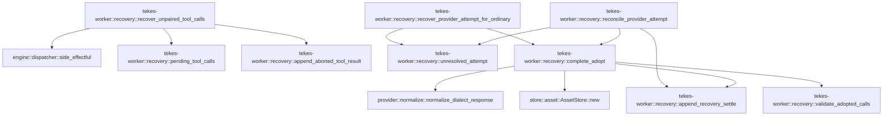

# tekes-worker::recovery

[Package atlas](index.md) · [Source](../../src/recovery.rs)

## Declarations

Visibility is the declaration spelling; trait members and reexports require their enclosing interface. `cfg` is not evaluated.

| Symbol | Kind | Visibility | Test / cfg |
|---|---|---|---|
| [tekes-worker::recovery::UnresolvedAttempt](../../src/recovery.rs#L3) | struct_item | `pub(crate)` |  |
| [tekes-worker::recovery::PendingToolCall](../../src/recovery.rs#L17) | struct_item | `pub(crate)` |  |
| [tekes-worker::recovery::RecoveryProgress](../../src/recovery.rs#L29) | enum_item | `pub(crate)` |  |
| [tekes-worker::recovery::append_recovery_settle](../../src/recovery.rs#L36) | function_item | `private` |  |
| [tekes-worker::recovery::reconcile_provider_attempt](../../src/recovery.rs#L55) | function_item | `pub(crate)` |  |
| [tekes-worker::recovery::recover_unpaired_tool_calls](../../src/recovery.rs#L110) | function_item | `pub(crate)` |  |
| [tekes-worker::recovery::pending_tool_calls](../../src/recovery.rs#L231) | function_item | `pub(crate)` |  |
| [tekes-worker::recovery::append_aborted_tool_result](../../src/recovery.rs#L307) | function_item | `private` |  |
| [tekes-worker::recovery::recover_provider_attempt_for_ordinary](../../src/recovery.rs#L322) | function_item | `pub(crate)` |  |
| [tekes-worker::recovery::unresolved_attempt](../../src/recovery.rs#L424) | function_item | `pub(crate)` |  |
| [tekes-worker::recovery::validate_adopted_calls](../../src/recovery.rs#L541) | function_item | `pub(crate)` |  |
| [tekes-worker::recovery::complete_adopt](../../src/recovery.rs#L571) | function_item | `private` |  |

## Imports / reexports

| Local name | Source path | Visibility |
|---|---|---|
| `*` | `super::*` | `private` |

## Module declarations

| Module | Visibility | Attributes |
|---|---|---|

## Function call graphs

Edges below are syntactically resolved calls only, including private functions. Graphs partition callers into groups of 20; they are not execution order. All unresolved sites are listed below and in the JSON inventory.

Functions 1–9: 12 direct edges

## Call sites

Includes test functions (marked in declarations). Receiver-type-required sites need type analysis/manual tracing. Calls in closures are attributed to their enclosing function; their occurrence here does not mean the closure executes immediately.

| Caller | Callee expression | Source lines | Target / classification |
|---|---|---|---|
| `append_recovery_settle` | `ledger.projection().is_some_and` | [41](../../src/recovery.rs#L41) | receiver-type-required |
| `append_recovery_settle` | `ledger.projection` | [41](../../src/recovery.rs#L41) | receiver-type-required |
| `append_recovery_settle` | `append_settle` | [46](../../src/recovery.rs#L46) | external-constructor-callback-or-unresolved |
| `append_recovery_settle` | `options.event_timestamp` | [48](../../src/recovery.rs#L48) | receiver-type-required |
| `append_recovery_settle` | `Some` | [51](../../src/recovery.rs#L51) | external-constructor-callback-or-unresolved |
| `reconcile_provider_attempt` | `unresolved_attempt` | [60](../../src/recovery.rs#L60) | [tekes-worker::recovery::unresolved_attempt](../../src/recovery.rs#L424) |
| `reconcile_provider_attempt` | `ledger.projection` | [61](../../src/recovery.rs#L61) | receiver-type-required |
| `reconcile_provider_attempt` | `append_recovery_settle` | [67](../../src/recovery.rs#L67), [105](../../src/recovery.rs#L105) | [tekes-worker::recovery::append_recovery_settle](../../src/recovery.rs#L36) |
| `reconcile_provider_attempt` | `Ok` | [69](../../src/recovery.rs#L69), [86](../../src/recovery.rs#L86), [106](../../src/recovery.rs#L106) | external-constructor-callback-or-unresolved |
| `reconcile_provider_attempt` | `attempt.decision.as_deref` | [71](../../src/recovery.rs#L71) | receiver-type-required |
| `reconcile_provider_attempt` | `decision.to_owned` | [72](../../src/recovery.rs#L72) | receiver-type-required |
| `reconcile_provider_attempt` | `"not_dispatched".to_owned` | [73](../../src/recovery.rs#L73) | receiver-type-required |
| `reconcile_provider_attempt` | `"unresolved".to_owned` | [74](../../src/recovery.rs#L74) | receiver-type-required |
| `reconcile_provider_attempt` | `attempt.decision.is_none` | [76](../../src/recovery.rs#L76) | receiver-type-required |
| `reconcile_provider_attempt` | `make_event` | [77](../../src/recovery.rs#L77), [89](../../src/recovery.rs#L89) | external-constructor-callback-or-unresolved |
| `reconcile_provider_attempt` | `ledger.append_contract` | [82](../../src/recovery.rs#L82), [96](../../src/recovery.rs#L96) | receiver-type-required |
| `reconcile_provider_attempt` | `BarrierContext::default` | [82](../../src/recovery.rs#L82), [96](../../src/recovery.rs#L96) | external-constructor-callback-or-unresolved |
| `reconcile_provider_attempt` | `complete_adopt` | [85](../../src/recovery.rs#L85) | [tekes-worker::recovery::complete_adopt](../../src/recovery.rs#L571) |
| `reconcile_provider_attempt` | `event.seq` | [95](../../src/recovery.rs#L95) | receiver-type-required |
| `reconcile_provider_attempt` | `stdout.write_all` | [97](../../src/recovery.rs#L97) | receiver-type-required |
| `reconcile_provider_attempt` | `encode_line` | [97](../../src/recovery.rs#L97) | external-constructor-callback-or-unresolved |
| `reconcile_provider_attempt` | `stdout.flush` | [104](../../src/recovery.rs#L104) | receiver-type-required |
| `recover_unpaired_tool_calls` | `pending_tool_calls` | [124](../../src/recovery.rs#L124) | [tekes-worker::recovery::pending_tool_calls](../../src/recovery.rs#L231) |
| `recover_unpaired_tool_calls` | `BTreeSet::new` | [132](../../src/recovery.rs#L132) | external-constructor-callback-or-unresolved |
| `recover_unpaired_tool_calls` | `pending         .iter()         .filter(&#124;call&#124; !seen_attempts.insert(call.attempt.clone()))         .map(&#124;call&#124; call.call.clone())         .collect::<BTreeSet<_>>` | [133](../../src/recovery.rs#L133) | receiver-type-required |
| `recover_unpaired_tool_calls` | `pending         .iter()         .filter(&#124;call&#124; !seen_attempts.insert(call.attempt.clone()))         .map` | [133](../../src/recovery.rs#L133) | receiver-type-required |
| `recover_unpaired_tool_calls` | `pending         .iter()         .filter` | [133](../../src/recovery.rs#L133) | receiver-type-required |
| `recover_unpaired_tool_calls` | `pending         .iter` | [133](../../src/recovery.rs#L133) | receiver-type-required |
| `recover_unpaired_tool_calls` | `seen_attempts.insert` | [135](../../src/recovery.rs#L135) | receiver-type-required |
| `recover_unpaired_tool_calls` | `call.attempt.clone` | [135](../../src/recovery.rs#L135) | receiver-type-required |
| `recover_unpaired_tool_calls` | `call.call.clone` | [136](../../src/recovery.rs#L136), [190](../../src/recovery.rs#L190) | receiver-type-required |
| `recover_unpaired_tool_calls` | `BuiltinManifest::compiled` | [138](../../src/recovery.rs#L138) | external-constructor-callback-or-unresolved |
| `recover_unpaired_tool_calls` | `unstarted.contains` | [143](../../src/recovery.rs#L143) | receiver-type-required |
| `recover_unpaired_tool_calls` | `call.approval_response.is_none` | [145](../../src/recovery.rs#L145) | receiver-type-required |
| `recover_unpaired_tool_calls` | `Ok` | [147](../../src/recovery.rs#L147), [176](../../src/recovery.rs#L176), [218](../../src/recovery.rs#L218), [228](../../src/recovery.rs#L228) | external-constructor-callback-or-unresolved |
| `recover_unpaired_tool_calls` | `append_aborted_tool_result` | [149](../../src/recovery.rs#L149), [156](../../src/recovery.rs#L156), [160](../../src/recovery.rs#L160), [210](../../src/recovery.rs#L210), [226](../../src/recovery.rs#L226) | [tekes-worker::recovery::append_aborted_tool_result](../../src/recovery.rs#L307) |
| `recover_unpaired_tool_calls` | `continuation_facts` | [152](../../src/recovery.rs#L152) | external-constructor-callback-or-unresolved |
| `recover_unpaired_tool_calls` | `wait_tool_continuation` | [163](../../src/recovery.rs#L163) | external-constructor-callback-or-unresolved |
| `recover_unpaired_tool_calls` | `manifest.tools.iter().find` | [180](../../src/recovery.rs#L180) | receiver-type-required |
| `recover_unpaired_tool_calls` | `manifest.tools.iter` | [180](../../src/recovery.rs#L180) | receiver-type-required |
| `recover_unpaired_tool_calls` | `tool.is_some_and` | [181](../../src/recovery.rs#L181), [183](../../src/recovery.rs#L183) | receiver-type-required |
| `recover_unpaired_tool_calls` | `engine::side_effectful` | [181](../../src/recovery.rs#L181) | [engine::dispatcher::side_effectful](../../../engine/src/dispatcher.rs#L276) |
| `recover_unpaired_tool_calls` | `call.approval_response.is_some` | [185](../../src/recovery.rs#L185) | receiver-type-required |
| `recover_unpaired_tool_calls` | `call.name.clone` | [191](../../src/recovery.rs#L191) | receiver-type-required |
| `recover_unpaired_tool_calls` | `call.arguments.clone` | [192](../../src/recovery.rs#L192) | receiver-type-required |
| `recover_unpaired_tool_calls` | `execute_provider_tool_calls` | [194](../../src/recovery.rs#L194) | external-constructor-callback-or-unresolved |
| `recover_unpaired_tool_calls` | `std::slice::from_ref` | [202](../../src/recovery.rs#L202) | external-constructor-callback-or-unresolved |
| `pending_tool_calls` | `ledger.projection().ok_or` | [234](../../src/recovery.rs#L234) | receiver-type-required |
| `pending_tool_calls` | `ledger.projection` | [234](../../src/recovery.rs#L234) | receiver-type-required |
| `pending_tool_calls` | `BTreeSet::new` | [235](../../src/recovery.rs#L235), [236](../../src/recovery.rs#L236) | external-constructor-callback-or-unresolved |
| `pending_tool_calls` | `std::collections::BTreeMap::<String, (bool, Option<Value>)>::new` | [237](../../src/recovery.rs#L237) | external-constructor-callback-or-unresolved |
| `pending_tool_calls` | `event.kind` | [239](../../src/recovery.rs#L239), [267](../../src/recovery.rs#L267), [301](../../src/recovery.rs#L301) | receiver-type-required |
| `pending_tool_calls` | `event.string_field` | [241](../../src/recovery.rs#L241), [246](../../src/recovery.rs#L246), [252](../../src/recovery.rs#L252), [270](../../src/recovery.rs#L270), [294](../../src/recovery.rs#L294) | receiver-type-required |
| `pending_tool_calls` | `results.insert` | [242](../../src/recovery.rs#L242) | receiver-type-required |
| `pending_tool_calls` | `call.to_owned` | [242](../../src/recovery.rs#L242), [247](../../src/recovery.rs#L247), [254](../../src/recovery.rs#L254), [276](../../src/recovery.rs#L276) | receiver-type-required |
| `pending_tool_calls` | `requests.insert` | [247](../../src/recovery.rs#L247) | receiver-type-required |
| `pending_tool_calls` | `serde_json::to_value` | [251](../../src/recovery.rs#L251), [274](../../src/recovery.rs#L274) | external-constructor-callback-or-unresolved |
| `pending_tool_calls` | `event.raw` | [251](../../src/recovery.rs#L251), [274](../../src/recovery.rs#L274) | receiver-type-required |
| `pending_tool_calls` | `responses.insert` | [253](../../src/recovery.rs#L253) | receiver-type-required |
| `pending_tool_calls` | `raw.get("grant").and_then(Value::as_bool).unwrap_or` | [256](../../src/recovery.rs#L256) | receiver-type-required |
| `pending_tool_calls` | `raw.get("grant").and_then` | [256](../../src/recovery.rs#L256) | receiver-type-required |
| `pending_tool_calls` | `raw.get` | [256](../../src/recovery.rs#L256), [257](../../src/recovery.rs#L257), [281](../../src/recovery.rs#L281), [289](../../src/recovery.rs#L289) | receiver-type-required |
| `pending_tool_calls` | `raw.get("answer").cloned` | [257](../../src/recovery.rs#L257) | receiver-type-required |
| `pending_tool_calls` | `Vec::new` | [265](../../src/recovery.rs#L265) | external-constructor-callback-or-unresolved |
| `pending_tool_calls` | `event.string_field("call").ok_or` | [270](../../src/recovery.rs#L270) | receiver-type-required |
| `pending_tool_calls` | `results.contains` | [271](../../src/recovery.rs#L271) | receiver-type-required |
| `pending_tool_calls` | `pending.push` | [275](../../src/recovery.rs#L275) | receiver-type-required |
| `pending_tool_calls` | `event                 .string_field("name")                 .ok_or("tool_call lacks name")?                 .to_owned` | [277](../../src/recovery.rs#L277) | receiver-type-required |
| `pending_tool_calls` | `event                 .string_field("name")                 .ok_or` | [277](../../src/recovery.rs#L277) | receiver-type-required |
| `pending_tool_calls` | `event                 .string_field` | [277](../../src/recovery.rs#L277), [282](../../src/recovery.rs#L282) | receiver-type-required |
| `pending_tool_calls` | `materialize_json` | [281](../../src/recovery.rs#L281) | external-constructor-callback-or-unresolved |
| `pending_tool_calls` | `raw.get("args").ok_or` | [281](../../src/recovery.rs#L281) | receiver-type-required |
| `pending_tool_calls` | `event                 .string_field("attempt")                 .ok_or("tool_call lacks attempt")?                 .to_owned` | [282](../../src/recovery.rs#L282) | receiver-type-required |
| `pending_tool_calls` | `event                 .string_field("attempt")                 .ok_or` | [282](../../src/recovery.rs#L282) | receiver-type-required |
| `pending_tool_calls` | `event.turn().ok_or` | [286](../../src/recovery.rs#L286) | receiver-type-required |
| `pending_tool_calls` | `event.turn` | [286](../../src/recovery.rs#L286) | receiver-type-required |
| `pending_tool_calls` | `requests.contains` | [287](../../src/recovery.rs#L287) | receiver-type-required |
| `pending_tool_calls` | `responses.get(call).cloned` | [288](../../src/recovery.rs#L288) | receiver-type-required |
| `pending_tool_calls` | `responses.get` | [288](../../src/recovery.rs#L288) | receiver-type-required |
| `pending_tool_calls` | `raw.get("execution_tracked").and_then` | [289](../../src/recovery.rs#L289) | receiver-type-required |
| `pending_tool_calls` | `Some` | [289](../../src/recovery.rs#L289), [294](../../src/recovery.rs#L294) | external-constructor-callback-or-unresolved |
| `pending_tool_calls` | `projection                 .events                 .iter()                 .rev()                 .filter(&#124;event&#124; event.string_field("call") == Some(call))                 .find(&#124;event&#124; {                     matches!(                         event.kind(),                         EventKind::ToolExecutionStarted &#124; EventKind::ApprovalRequest                     )                 })                 .is_some_and` | [290](../../src/recovery.rs#L290) | receiver-type-required |
| `pending_tool_calls` | `projection                 .events                 .iter()                 .rev()                 .filter(&#124;event&#124; event.string_field("call") == Some(call))                 .find` | [290](../../src/recovery.rs#L290) | receiver-type-required |
| `pending_tool_calls` | `projection                 .events                 .iter()                 .rev()                 .filter` | [290](../../src/recovery.rs#L290) | receiver-type-required |
| `pending_tool_calls` | `projection                 .events                 .iter()                 .rev` | [290](../../src/recovery.rs#L290) | receiver-type-required |
| `pending_tool_calls` | `projection                 .events                 .iter` | [290](../../src/recovery.rs#L290) | receiver-type-required |
| `pending_tool_calls` | `Ok` | [304](../../src/recovery.rs#L304) | external-constructor-callback-or-unresolved |
| `append_aborted_tool_result` | `make_event` | [314](../../src/recovery.rs#L314) | external-constructor-callback-or-unresolved |
| `append_aborted_tool_result` | `ledger.append_contract` | [318](../../src/recovery.rs#L318) | receiver-type-required |
| `append_aborted_tool_result` | `BarrierContext::default` | [318](../../src/recovery.rs#L318) | external-constructor-callback-or-unresolved |
| `append_aborted_tool_result` | `Ok` | [319](../../src/recovery.rs#L319) | external-constructor-callback-or-unresolved |
| `recover_provider_attempt_for_ordinary` | `unresolved_attempt` | [327](../../src/recovery.rs#L327) | [tekes-worker::recovery::unresolved_attempt](../../src/recovery.rs#L424) |
| `recover_provider_attempt_for_ordinary` | `Ok` | [328](../../src/recovery.rs#L328), [386](../../src/recovery.rs#L386), [388](../../src/recovery.rs#L388), [417](../../src/recovery.rs#L417), [419](../../src/recovery.rs#L419) | external-constructor-callback-or-unresolved |
| `recover_provider_attempt_for_ordinary` | `ledger         .projection()         .ok_or("ledger projection missing")?         .events         .iter()         .find(&#124;event&#124; {             *event.kind() == EventKind::Epoch                 && event.string_field("id") == Some(attempt.epoch.as_str())         })         .and_then(&#124;event&#124; event.string_field("adapter"))         .ok_or` | [330](../../src/recovery.rs#L330) | receiver-type-required |
| `recover_provider_attempt_for_ordinary` | `ledger         .projection()         .ok_or("ledger projection missing")?         .events         .iter()         .find(&#124;event&#124; {             *event.kind() == EventKind::Epoch                 && event.string_field("id") == Some(attempt.epoch.as_str())         })         .and_then` | [330](../../src/recovery.rs#L330) | receiver-type-required |
| `recover_provider_attempt_for_ordinary` | `ledger         .projection()         .ok_or("ledger projection missing")?         .events         .iter()         .find` | [330](../../src/recovery.rs#L330) | receiver-type-required |
| `recover_provider_attempt_for_ordinary` | `ledger         .projection()         .ok_or("ledger projection missing")?         .events         .iter` | [330](../../src/recovery.rs#L330) | receiver-type-required |
| `recover_provider_attempt_for_ordinary` | `ledger         .projection()         .ok_or` | [330](../../src/recovery.rs#L330) | receiver-type-required |
| `recover_provider_attempt_for_ordinary` | `ledger         .projection` | [330](../../src/recovery.rs#L330) | receiver-type-required |
| `recover_provider_attempt_for_ordinary` | `event.kind` | [336](../../src/recovery.rs#L336) | receiver-type-required |
| `recover_provider_attempt_for_ordinary` | `event.string_field` | [337](../../src/recovery.rs#L337), [339](../../src/recovery.rs#L339) | receiver-type-required |
| `recover_provider_attempt_for_ordinary` | `Some` | [337](../../src/recovery.rs#L337), [415](../../src/recovery.rs#L415) | external-constructor-callback-or-unresolved |
| `recover_provider_attempt_for_ordinary` | `attempt.epoch.as_str` | [337](../../src/recovery.rs#L337) | receiver-type-required |
| `recover_provider_attempt_for_ordinary` | `DialectId::from_str` | [341](../../src/recovery.rs#L341) | external-constructor-callback-or-unresolved |
| `recover_provider_attempt_for_ordinary` | `dialect.family().capabilities` | [342](../../src/recovery.rs#L342) | receiver-type-required |
| `recover_provider_attempt_for_ordinary` | `dialect.family` | [342](../../src/recovery.rs#L342) | receiver-type-required |
| `recover_provider_attempt_for_ordinary` | `attempt.decision.as_deref` | [343](../../src/recovery.rs#L343) | receiver-type-required |
| `recover_provider_attempt_for_ordinary` | `Err` | [349](../../src/recovery.rs#L349) | external-constructor-callback-or-unresolved |
| `recover_provider_attempt_for_ordinary` | `format!("unknown recorded recovery decision {other}").into` | [349](../../src/recovery.rs#L349) | receiver-type-required |
| `recover_provider_attempt_for_ordinary` | `decide_recovery` | [350](../../src/recovery.rs#L350) | external-constructor-callback-or-unresolved |
| `recover_provider_attempt_for_ordinary` | `dialect.server_managed` | [352](../../src/recovery.rs#L352) | receiver-type-required |
| `recover_provider_attempt_for_ordinary` | `sent_state` | [364](../../src/recovery.rs#L364) | external-constructor-callback-or-unresolved |
| `recover_provider_attempt_for_ordinary` | `attempt.decision.is_none` | [369](../../src/recovery.rs#L369) | receiver-type-required |
| `recover_provider_attempt_for_ordinary` | `make_event` | [377](../../src/recovery.rs#L377), [393](../../src/recovery.rs#L393) | external-constructor-callback-or-unresolved |
| `recover_provider_attempt_for_ordinary` | `ledger.append_contract` | [382](../../src/recovery.rs#L382), [400](../../src/recovery.rs#L400) | receiver-type-required |
| `recover_provider_attempt_for_ordinary` | `BarrierContext::default` | [382](../../src/recovery.rs#L382), [400](../../src/recovery.rs#L400) | external-constructor-callback-or-unresolved |
| `recover_provider_attempt_for_ordinary` | `complete_adopt` | [385](../../src/recovery.rs#L385) | [tekes-worker::recovery::complete_adopt](../../src/recovery.rs#L571) |
| `recover_provider_attempt_for_ordinary` | `event.seq` | [399](../../src/recovery.rs#L399) | receiver-type-required |
| `recover_provider_attempt_for_ordinary` | `stdout.write_all` | [401](../../src/recovery.rs#L401) | receiver-type-required |
| `recover_provider_attempt_for_ordinary` | `encode_line` | [401](../../src/recovery.rs#L401) | external-constructor-callback-or-unresolved |
| `recover_provider_attempt_for_ordinary` | `stdout.flush` | [408](../../src/recovery.rs#L408) | receiver-type-required |
| `recover_provider_attempt_for_ordinary` | `append_settle` | [410](../../src/recovery.rs#L410) | external-constructor-callback-or-unresolved |
| `recover_provider_attempt_for_ordinary` | `options.event_timestamp` | [412](../../src/recovery.rs#L412) | receiver-type-required |
| `unresolved_attempt` | `ledger.projection().ok_or` | [427](../../src/recovery.rs#L427) | receiver-type-required |
| `unresolved_attempt` | `ledger.projection` | [427](../../src/recovery.rs#L427) | receiver-type-required |
| `unresolved_attempt` | `std::collections::BTreeMap::<String, UnresolvedAttempt>::new` | [428](../../src/recovery.rs#L428) | external-constructor-callback-or-unresolved |
| `unresolved_attempt` | `std::collections::BTreeMap::<String, String>::new` | [429](../../src/recovery.rs#L429) | external-constructor-callback-or-unresolved |
| `unresolved_attempt` | `event.kind` | [431](../../src/recovery.rs#L431) | receiver-type-required |
| `unresolved_attempt` | `event                     .string_field("attempt")                     .ok_or("attempt lacks id")?                     .to_owned` | [433](../../src/recovery.rs#L433) | receiver-type-required |
| `unresolved_attempt` | `event                     .string_field("attempt")                     .ok_or` | [433](../../src/recovery.rs#L433) | receiver-type-required |
| `unresolved_attempt` | `event                     .string_field` | [433](../../src/recovery.rs#L433), [458](../../src/recovery.rs#L458), [466](../../src/recovery.rs#L466), [487](../../src/recovery.rs#L487) | receiver-type-required |
| `unresolved_attempt` | `attempts.insert` | [437](../../src/recovery.rs#L437) | receiver-type-required |
| `unresolved_attempt` | `id.clone` | [438](../../src/recovery.rs#L438) | receiver-type-required |
| `unresolved_attempt` | `event.turn().ok_or` | [441](../../src/recovery.rs#L441) | receiver-type-required |
| `unresolved_attempt` | `event.turn` | [441](../../src/recovery.rs#L441), [527](../../src/recovery.rs#L527) | receiver-type-required |
| `unresolved_attempt` | `event                             .string_field("epoch")                             .ok_or("attempt lacks epoch")?                             .to_owned` | [442](../../src/recovery.rs#L442) | receiver-type-required |
| `unresolved_attempt` | `event                             .string_field("epoch")                             .ok_or` | [442](../../src/recovery.rs#L442) | receiver-type-required |
| `unresolved_attempt` | `event                             .string_field` | [442](../../src/recovery.rs#L442) | receiver-type-required |
| `unresolved_attempt` | `Vec::new` | [448](../../src/recovery.rs#L448) | external-constructor-callback-or-unresolved |
| `unresolved_attempt` | `std::collections::BTreeSet::new` | [452](../../src/recovery.rs#L452), [453](../../src/recovery.rs#L453) | external-constructor-callback-or-unresolved |
| `unresolved_attempt` | `event                     .string_field("attempt")                     .and_then` | [458](../../src/recovery.rs#L458), [466](../../src/recovery.rs#L466), [487](../../src/recovery.rs#L487) | receiver-type-required |
| `unresolved_attempt` | `attempts.get_mut` | [460](../../src/recovery.rs#L460), [468](../../src/recovery.rs#L468), [489](../../src/recovery.rs#L489), [500](../../src/recovery.rs#L500), [513](../../src/recovery.rs#L513), [521](../../src/recovery.rs#L521) | receiver-type-required |
| `unresolved_attempt` | `event.string_field("decision").map` | [470](../../src/recovery.rs#L470) | receiver-type-required |
| `unresolved_attempt` | `event.string_field` | [470](../../src/recovery.rs#L470), [495](../../src/recovery.rs#L495), [510](../../src/recovery.rs#L510), [519](../../src/recovery.rs#L519) | receiver-type-required |
| `unresolved_attempt` | `serde_json::to_value` | [471](../../src/recovery.rs#L471) | external-constructor-callback-or-unresolved |
| `unresolved_attempt` | `event.raw` | [471](../../src/recovery.rs#L471) | receiver-type-required |
| `unresolved_attempt` | `raw                         .get("inventory")                         .and_then(Value::as_array)                         .into_iter()                         .flatten()                         .filter_map(Value::as_str)                         .map(str::to_owned)                         .collect` | [472](../../src/recovery.rs#L472) | receiver-type-required |
| `unresolved_attempt` | `raw                         .get("inventory")                         .and_then(Value::as_array)                         .into_iter()                         .flatten()                         .filter_map(Value::as_str)                         .map` | [472](../../src/recovery.rs#L472) | receiver-type-required |
| `unresolved_attempt` | `raw                         .get("inventory")                         .and_then(Value::as_array)                         .into_iter()                         .flatten()                         .filter_map` | [472](../../src/recovery.rs#L472) | receiver-type-required |
| `unresolved_attempt` | `raw                         .get("inventory")                         .and_then(Value::as_array)                         .into_iter()                         .flatten` | [472](../../src/recovery.rs#L472) | receiver-type-required |
| `unresolved_attempt` | `raw                         .get("inventory")                         .and_then(Value::as_array)                         .into_iter` | [472](../../src/recovery.rs#L472) | receiver-type-required |
| `unresolved_attempt` | `raw                         .get("inventory")                         .and_then` | [472](../../src/recovery.rs#L472) | receiver-type-required |
| `unresolved_attempt` | `raw                         .get` | [472](../../src/recovery.rs#L472) | receiver-type-required |
| `unresolved_attempt` | `raw                         .pointer("/response/asset")                         .and_then(Value::as_str)                         .map` | [480](../../src/recovery.rs#L480) | receiver-type-required |
| `unresolved_attempt` | `raw                         .pointer("/response/asset")                         .and_then` | [480](../../src/recovery.rs#L480) | receiver-type-required |
| `unresolved_attempt` | `raw                         .pointer` | [480](../../src/recovery.rs#L480) | receiver-type-required |
| `unresolved_attempt` | `attempts                         .get(id)                         .is_some_and` | [496](../../src/recovery.rs#L496) | receiver-type-required |
| `unresolved_attempt` | `attempts                         .get` | [496](../../src/recovery.rs#L496) | receiver-type-required |
| `unresolved_attempt` | `attempt.decision.as_deref` | [498](../../src/recovery.rs#L498) | receiver-type-required |
| `unresolved_attempt` | `Some` | [498](../../src/recovery.rs#L498), [501](../../src/recovery.rs#L501) | external-constructor-callback-or-unresolved |
| `unresolved_attempt` | `event.seq` | [501](../../src/recovery.rs#L501) | receiver-type-required |
| `unresolved_attempt` | `attempts.remove` | [504](../../src/recovery.rs#L504) | receiver-type-required |
| `unresolved_attempt` | `call_attempts.insert` | [512](../../src/recovery.rs#L512) | receiver-type-required |
| `unresolved_attempt` | `call.to_owned` | [512](../../src/recovery.rs#L512), [514](../../src/recovery.rs#L514), [523](../../src/recovery.rs#L523) | receiver-type-required |
| `unresolved_attempt` | `attempt_id.to_owned` | [512](../../src/recovery.rs#L512) | receiver-type-required |
| `unresolved_attempt` | `attempt.calls.insert` | [514](../../src/recovery.rs#L514) | receiver-type-required |
| `unresolved_attempt` | `call_attempts.get` | [520](../../src/recovery.rs#L520) | receiver-type-required |
| `unresolved_attempt` | `attempt.results.insert` | [523](../../src/recovery.rs#L523) | receiver-type-required |
| `unresolved_attempt` | `attempts.retain` | [528](../../src/recovery.rs#L528) | receiver-type-required |
| `unresolved_attempt` | `attempts.len` | [534](../../src/recovery.rs#L534) | receiver-type-required |
| `unresolved_attempt` | `Err` | [535](../../src/recovery.rs#L535) | external-constructor-callback-or-unresolved |
| `unresolved_attempt` | `"ledger has more than one live provider attempt".into` | [535](../../src/recovery.rs#L535) | receiver-type-required |
| `unresolved_attempt` | `Ok` | [537](../../src/recovery.rs#L537) | external-constructor-callback-or-unresolved |
| `unresolved_attempt` | `attempts.into_values().next` | [537](../../src/recovery.rs#L537) | receiver-type-required |
| `unresolved_attempt` | `attempts.into_values` | [537](../../src/recovery.rs#L537) | receiver-type-required |
| `validate_adopted_calls` | `ledger         .projection()         .ok_or` | [546](../../src/recovery.rs#L546) | receiver-type-required |
| `validate_adopted_calls` | `ledger         .projection` | [546](../../src/recovery.rs#L546) | receiver-type-required |
| `validate_adopted_calls` | `event.kind` | [551](../../src/recovery.rs#L551) | receiver-type-required |
| `validate_adopted_calls` | `event.string_field` | [551](../../src/recovery.rs#L551), [564](../../src/recovery.rs#L564) | receiver-type-required |
| `validate_adopted_calls` | `Some` | [551](../../src/recovery.rs#L551), [564](../../src/recovery.rs#L564) | external-constructor-callback-or-unresolved |
| `validate_adopted_calls` | `event             .string_field("call")             .ok_or` | [554](../../src/recovery.rs#L554) | receiver-type-required |
| `validate_adopted_calls` | `event             .string_field` | [554](../../src/recovery.rs#L554) | receiver-type-required |
| `validate_adopted_calls` | `calls             .iter()             .find(&#124;call&#124; call.call_id == call_id)             .ok_or` | [557](../../src/recovery.rs#L557) | receiver-type-required |
| `validate_adopted_calls` | `calls             .iter()             .find` | [557](../../src/recovery.rs#L557) | receiver-type-required |
| `validate_adopted_calls` | `calls             .iter` | [557](../../src/recovery.rs#L557) | receiver-type-required |
| `validate_adopted_calls` | `serde_json::to_value` | [561](../../src/recovery.rs#L561) | external-constructor-callback-or-unresolved |
| `validate_adopted_calls` | `event.raw` | [561](../../src/recovery.rs#L561) | receiver-type-required |
| `validate_adopted_calls` | `materialize_json` | [563](../../src/recovery.rs#L563) | external-constructor-callback-or-unresolved |
| `validate_adopted_calls` | `raw.get("args").ok_or` | [563](../../src/recovery.rs#L563) | receiver-type-required |
| `validate_adopted_calls` | `raw.get` | [563](../../src/recovery.rs#L563) | receiver-type-required |
| `validate_adopted_calls` | `call.name.as_str` | [564](../../src/recovery.rs#L564) | receiver-type-required |
| `validate_adopted_calls` | `Err` | [565](../../src/recovery.rs#L565) | external-constructor-callback-or-unresolved |
| `validate_adopted_calls` | `"adopt response changed a durable tool call".into` | [565](../../src/recovery.rs#L565) | receiver-type-required |
| `validate_adopted_calls` | `Ok` | [568](../../src/recovery.rs#L568) | external-constructor-callback-or-unresolved |
| `complete_adopt` | `attempt         .response_asset         .as_deref()         .ok_or` | [578](../../src/recovery.rs#L578) | receiver-type-required |
| `complete_adopt` | `attempt         .response_asset         .as_deref` | [578](../../src/recovery.rs#L578) | receiver-type-required |
| `complete_adopt` | `ledger.path().parent().ok_or` | [582](../../src/recovery.rs#L582) | receiver-type-required |
| `complete_adopt` | `ledger.path().parent` | [582](../../src/recovery.rs#L582) | receiver-type-required |
| `complete_adopt` | `ledger.path` | [582](../../src/recovery.rs#L582) | receiver-type-required |
| `complete_adopt` | `store::AssetStore::new(folder.join("assets"))?.read_verified` | [583](../../src/recovery.rs#L583) | receiver-type-required |
| `complete_adopt` | `store::AssetStore::new` | [583](../../src/recovery.rs#L583) | [store::asset::AssetStore::new](../../../store/src/asset.rs#L27) |
| `complete_adopt` | `folder.join` | [583](../../src/recovery.rs#L583) | receiver-type-required |
| `complete_adopt` | `ledger         .projection()         .ok_or("ledger projection missing")?         .events         .iter()         .find(&#124;event&#124; {             *event.kind() == EventKind::Epoch                 && event.string_field("id") == Some(attempt.epoch.as_str())         })         .and_then(&#124;event&#124; event.string_field("adapter"))         .ok_or` | [584](../../src/recovery.rs#L584) | receiver-type-required |
| `complete_adopt` | `ledger         .projection()         .ok_or("ledger projection missing")?         .events         .iter()         .find(&#124;event&#124; {             *event.kind() == EventKind::Epoch                 && event.string_field("id") == Some(attempt.epoch.as_str())         })         .and_then` | [584](../../src/recovery.rs#L584) | receiver-type-required |
| `complete_adopt` | `ledger         .projection()         .ok_or("ledger projection missing")?         .events         .iter()         .find` | [584](../../src/recovery.rs#L584) | receiver-type-required |
| `complete_adopt` | `ledger         .projection()         .ok_or("ledger projection missing")?         .events         .iter` | [584](../../src/recovery.rs#L584) | receiver-type-required |
| `complete_adopt` | `ledger         .projection()         .ok_or` | [584](../../src/recovery.rs#L584) | receiver-type-required |
| `complete_adopt` | `ledger         .projection` | [584](../../src/recovery.rs#L584) | receiver-type-required |
| `complete_adopt` | `event.kind` | [590](../../src/recovery.rs#L590) | receiver-type-required |
| `complete_adopt` | `event.string_field` | [591](../../src/recovery.rs#L591), [593](../../src/recovery.rs#L593) | receiver-type-required |
| `complete_adopt` | `Some` | [591](../../src/recovery.rs#L591), [666](../../src/recovery.rs#L666), [748](../../src/recovery.rs#L748) | external-constructor-callback-or-unresolved |
| `complete_adopt` | `attempt.epoch.as_str` | [591](../../src/recovery.rs#L591) | receiver-type-required |
| `complete_adopt` | `DialectId::from_str` | [595](../../src/recovery.rs#L595) | external-constructor-callback-or-unresolved |
| `complete_adopt` | `provider::normalize_dialect_response` | [596](../../src/recovery.rs#L596) | [provider::normalize::normalize_dialect_response](../../../provider/src/normalize.rs#L218) |
| `complete_adopt` | `terminal.is_final_answer` | [597](../../src/recovery.rs#L597) | receiver-type-required |
| `complete_adopt` | `terminal         .tool_calls         .iter()         .map(&#124;call&#124; call.call_id.as_str())         .collect::<Vec<_>>` | [598](../../src/recovery.rs#L598) | receiver-type-required |
| `complete_adopt` | `terminal         .tool_calls         .iter()         .map` | [598](../../src/recovery.rs#L598) | receiver-type-required |
| `complete_adopt` | `terminal         .tool_calls         .iter` | [598](../../src/recovery.rs#L598) | receiver-type-required |
| `complete_adopt` | `call.call_id.as_str` | [601](../../src/recovery.rs#L601) | receiver-type-required |
| `complete_adopt` | `attempt         .inventory         .iter()         .map(String::as_str)         .collect::<Vec<_>>` | [603](../../src/recovery.rs#L603) | receiver-type-required |
| `complete_adopt` | `attempt         .inventory         .iter()         .map` | [603](../../src/recovery.rs#L603) | receiver-type-required |
| `complete_adopt` | `attempt         .inventory         .iter` | [603](../../src/recovery.rs#L603) | receiver-type-required |
| `complete_adopt` | `Err` | [609](../../src/recovery.rs#L609) | external-constructor-callback-or-unresolved |
| `complete_adopt` | `"adopt response call inventory mismatch".into` | [609](../../src/recovery.rs#L609) | receiver-type-required |
| `complete_adopt` | `std::collections::BTreeMap::new` | [611](../../src/recovery.rs#L611) | external-constructor-callback-or-unresolved |
| `complete_adopt` | `repair_provider_call_arguments` | [613](../../src/recovery.rs#L613) | external-constructor-callback-or-unresolved |
| `complete_adopt` | `call.call_id.clone` | [614](../../src/recovery.rs#L614), [617](../../src/recovery.rs#L617) | receiver-type-required |
| `complete_adopt` | `local_provider_call_id` | [615](../../src/recovery.rs#L615) | external-constructor-callback-or-unresolved |
| `complete_adopt` | `wire_ids.insert` | [617](../../src/recovery.rs#L617) | receiver-type-required |
| `complete_adopt` | `validate_adopted_calls` | [620](../../src/recovery.rs#L620) | [tekes-worker::recovery::validate_adopted_calls](../../src/recovery.rs#L541) |
| `complete_adopt` | `attempt.outcome_seq.is_none` | [621](../../src/recovery.rs#L621) | receiver-type-required |
| `complete_adopt` | `sealed_fragments` | [626](../../src/recovery.rs#L626), [681](../../src/recovery.rs#L681) | external-constructor-callback-or-unresolved |
| `complete_adopt` | `text.as_bytes` | [626](../../src/recovery.rs#L626) | receiver-type-required |
| `complete_adopt` | `make_event` | [627](../../src/recovery.rs#L627), [641](../../src/recovery.rs#L641), [698](../../src/recovery.rs#L698), [721](../../src/recovery.rs#L721), [725](../../src/recovery.rs#L725) | external-constructor-callback-or-unresolved |
| `complete_adopt` | `ledger.append_contract` | [631](../../src/recovery.rs#L631), [647](../../src/recovery.rs#L647), [700](../../src/recovery.rs#L700), [722](../../src/recovery.rs#L722), [729](../../src/recovery.rs#L729) | receiver-type-required |
| `complete_adopt` | `BarrierContext::default` | [631](../../src/recovery.rs#L631), [647](../../src/recovery.rs#L647), [700](../../src/recovery.rs#L700), [722](../../src/recovery.rs#L722), [729](../../src/recovery.rs#L729) | external-constructor-callback-or-unresolved |
| `complete_adopt` | `event.seq` | [646](../../src/recovery.rs#L646), [699](../../src/recovery.rs#L699) | receiver-type-required |
| `complete_adopt` | `stdout.write_all` | [650](../../src/recovery.rs#L650), [703](../../src/recovery.rs#L703) | receiver-type-required |
| `complete_adopt` | `encode_line` | [650](../../src/recovery.rs#L650), [703](../../src/recovery.rs#L703) | external-constructor-callback-or-unresolved |
| `complete_adopt` | `stdout.flush` | [657](../../src/recovery.rs#L657), [710](../../src/recovery.rs#L710) | receiver-type-required |
| `complete_adopt` | `append_recovery_settle` | [659](../../src/recovery.rs#L659), [733](../../src/recovery.rs#L733) | [tekes-worker::recovery::append_recovery_settle](../../src/recovery.rs#L36) |
| `complete_adopt` | `append_settle` | [661](../../src/recovery.rs#L661), [743](../../src/recovery.rs#L743) | external-constructor-callback-or-unresolved |
| `complete_adopt` | `options.event_timestamp` | [663](../../src/recovery.rs#L663), [745](../../src/recovery.rs#L745) | receiver-type-required |
| `complete_adopt` | `Ok` | [669](../../src/recovery.rs#L669), [734](../../src/recovery.rs#L734), [740](../../src/recovery.rs#L740), [750](../../src/recovery.rs#L750), [752](../../src/recovery.rs#L752) | external-constructor-callback-or-unresolved |
| `complete_adopt` | `Vec::new` | [674](../../src/recovery.rs#L674) | external-constructor-callback-or-unresolved |
| `complete_adopt` | `content.push` | [677](../../src/recovery.rs#L677) | receiver-type-required |
| `complete_adopt` | `serde_json_canonicalizer::to_vec` | [680](../../src/recovery.rs#L680) | external-constructor-callback-or-unresolved |
| `complete_adopt` | `dialect.server_managed` | [688](../../src/recovery.rs#L688) | receiver-type-required |
| `complete_adopt` | `terminal                 .response_identity                 .as_deref()                 .ok_or` | [689](../../src/recovery.rs#L689) | receiver-type-required |
| `complete_adopt` | `terminal                 .response_identity                 .as_deref` | [689](../../src/recovery.rs#L689) | receiver-type-required |
| `complete_adopt` | `value                 .as_object_mut()                 .expect("output object")                 .insert` | [693](../../src/recovery.rs#L693) | receiver-type-required |
| `complete_adopt` | `value                 .as_object_mut()                 .expect` | [693](../../src/recovery.rs#L693) | receiver-type-required |
| `complete_adopt` | `value                 .as_object_mut` | [693](../../src/recovery.rs#L693) | receiver-type-required |
| `complete_adopt` | `"continuation".to_owned` | [696](../../src/recovery.rs#L696) | receiver-type-required |
| `complete_adopt` | `attempt.id.clone` | [706](../../src/recovery.rs#L706) | receiver-type-required |
| `complete_adopt` | `attempt.calls.contains` | [712](../../src/recovery.rs#L712) | receiver-type-required |
| `complete_adopt` | `wire_ids.get` | [718](../../src/recovery.rs#L718) | receiver-type-required |
| `complete_adopt` | `attempt.results.contains` | [724](../../src/recovery.rs#L724) | receiver-type-required |
