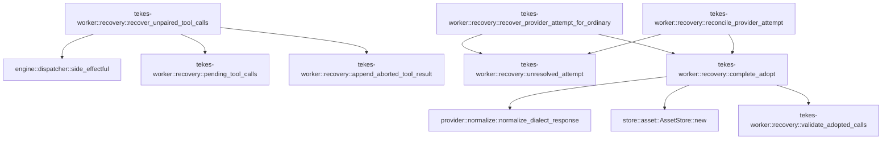

# tekes-worker::recovery

[Package atlas](index.md) · [Source](../../src/recovery.rs)

## Declarations

Visibility is the declaration spelling; trait members and reexports require their enclosing interface. `cfg` is not evaluated.

| Symbol | Kind | Visibility | Test / cfg |
|---|---|---|---|
| [tekes-worker::recovery::UnresolvedAttempt](../../src/recovery.rs#L3) | struct_item | `pub(crate)` |  |
| [tekes-worker::recovery::PendingToolCall](../../src/recovery.rs#L17) | struct_item | `pub(crate)` |  |
| [tekes-worker::recovery::RecoveryProgress](../../src/recovery.rs#L29) | enum_item | `pub(crate)` |  |
| [tekes-worker::recovery::reconcile_provider_attempt](../../src/recovery.rs#L34) | function_item | `pub(crate)` |  |
| [tekes-worker::recovery::recover_unpaired_tool_calls](../../src/recovery.rs#L101) | function_item | `pub(crate)` |  |
| [tekes-worker::recovery::pending_tool_calls](../../src/recovery.rs#L222) | function_item | `pub(crate)` |  |
| [tekes-worker::recovery::append_aborted_tool_result](../../src/recovery.rs#L298) | function_item | `private` |  |
| [tekes-worker::recovery::recover_provider_attempt_for_ordinary](../../src/recovery.rs#L313) | function_item | `pub(crate)` |  |
| [tekes-worker::recovery::unresolved_attempt](../../src/recovery.rs#L415) | function_item | `pub(crate)` |  |
| [tekes-worker::recovery::validate_adopted_calls](../../src/recovery.rs#L532) | function_item | `pub(crate)` |  |
| [tekes-worker::recovery::complete_adopt](../../src/recovery.rs#L562) | function_item | `private` |  |

## Imports / reexports

| Local name | Source path | Visibility |
|---|---|---|
| `*` | `super::*` | `private` |

## Module declarations

| Module | Visibility | Attributes |
|---|---|---|

## Function call graphs

Edges below are syntactically resolved calls only, including private functions. Graphs partition callers into groups of 20; they are not execution order. All unresolved sites are listed below and in the JSON inventory.

Functions 1–8: 10 direct edges

## Call sites

Includes test functions (marked in declarations). Receiver-type-required sites need type analysis/manual tracing. Calls in closures are attributed to their enclosing function; their occurrence here does not mean the closure executes immediately.

| Caller | Callee expression | Source lines | Target / classification |
|---|---|---|---|
| `reconcile_provider_attempt` | `unresolved_attempt` | [39](../../src/recovery.rs#L39) | [tekes-worker::recovery::unresolved_attempt](../../src/recovery.rs#L415) |
| `reconcile_provider_attempt` | `ledger.projection` | [40](../../src/recovery.rs#L40) | receiver-type-required |
| `reconcile_provider_attempt` | `append_settle` | [46](../../src/recovery.rs#L46), [90](../../src/recovery.rs#L90) | external-constructor-callback-or-unresolved |
| `reconcile_provider_attempt` | `options.event_timestamp` | [48](../../src/recovery.rs#L48), [92](../../src/recovery.rs#L92) | receiver-type-required |
| `reconcile_provider_attempt` | `Some` | [51](../../src/recovery.rs#L51), [95](../../src/recovery.rs#L95) | external-constructor-callback-or-unresolved |
| `reconcile_provider_attempt` | `Ok` | [54](../../src/recovery.rs#L54), [71](../../src/recovery.rs#L71), [97](../../src/recovery.rs#L97) | external-constructor-callback-or-unresolved |
| `reconcile_provider_attempt` | `attempt.decision.as_deref` | [56](../../src/recovery.rs#L56) | receiver-type-required |
| `reconcile_provider_attempt` | `decision.to_owned` | [57](../../src/recovery.rs#L57) | receiver-type-required |
| `reconcile_provider_attempt` | `"not_dispatched".to_owned` | [58](../../src/recovery.rs#L58) | receiver-type-required |
| `reconcile_provider_attempt` | `"unresolved".to_owned` | [59](../../src/recovery.rs#L59) | receiver-type-required |
| `reconcile_provider_attempt` | `attempt.decision.is_none` | [61](../../src/recovery.rs#L61) | receiver-type-required |
| `reconcile_provider_attempt` | `make_event` | [62](../../src/recovery.rs#L62), [74](../../src/recovery.rs#L74) | external-constructor-callback-or-unresolved |
| `reconcile_provider_attempt` | `ledger.append_contract` | [67](../../src/recovery.rs#L67), [81](../../src/recovery.rs#L81) | receiver-type-required |
| `reconcile_provider_attempt` | `BarrierContext::default` | [67](../../src/recovery.rs#L67), [81](../../src/recovery.rs#L81) | external-constructor-callback-or-unresolved |
| `reconcile_provider_attempt` | `complete_adopt` | [70](../../src/recovery.rs#L70) | [tekes-worker::recovery::complete_adopt](../../src/recovery.rs#L562) |
| `reconcile_provider_attempt` | `event.seq` | [80](../../src/recovery.rs#L80) | receiver-type-required |
| `reconcile_provider_attempt` | `stdout.write_all` | [82](../../src/recovery.rs#L82) | receiver-type-required |
| `reconcile_provider_attempt` | `encode_line` | [82](../../src/recovery.rs#L82) | external-constructor-callback-or-unresolved |
| `reconcile_provider_attempt` | `stdout.flush` | [89](../../src/recovery.rs#L89) | receiver-type-required |
| `recover_unpaired_tool_calls` | `pending_tool_calls` | [115](../../src/recovery.rs#L115) | [tekes-worker::recovery::pending_tool_calls](../../src/recovery.rs#L222) |
| `recover_unpaired_tool_calls` | `BTreeSet::new` | [123](../../src/recovery.rs#L123) | external-constructor-callback-or-unresolved |
| `recover_unpaired_tool_calls` | `pending         .iter()         .filter(&#124;call&#124; !seen_attempts.insert(call.attempt.clone()))         .map(&#124;call&#124; call.call.clone())         .collect::<BTreeSet<_>>` | [124](../../src/recovery.rs#L124) | receiver-type-required |
| `recover_unpaired_tool_calls` | `pending         .iter()         .filter(&#124;call&#124; !seen_attempts.insert(call.attempt.clone()))         .map` | [124](../../src/recovery.rs#L124) | receiver-type-required |
| `recover_unpaired_tool_calls` | `pending         .iter()         .filter` | [124](../../src/recovery.rs#L124) | receiver-type-required |
| `recover_unpaired_tool_calls` | `pending         .iter` | [124](../../src/recovery.rs#L124) | receiver-type-required |
| `recover_unpaired_tool_calls` | `seen_attempts.insert` | [126](../../src/recovery.rs#L126) | receiver-type-required |
| `recover_unpaired_tool_calls` | `call.attempt.clone` | [126](../../src/recovery.rs#L126) | receiver-type-required |
| `recover_unpaired_tool_calls` | `call.call.clone` | [127](../../src/recovery.rs#L127), [181](../../src/recovery.rs#L181) | receiver-type-required |
| `recover_unpaired_tool_calls` | `BuiltinManifest::compiled` | [129](../../src/recovery.rs#L129) | external-constructor-callback-or-unresolved |
| `recover_unpaired_tool_calls` | `unstarted.contains` | [134](../../src/recovery.rs#L134) | receiver-type-required |
| `recover_unpaired_tool_calls` | `call.approval_response.is_none` | [136](../../src/recovery.rs#L136) | receiver-type-required |
| `recover_unpaired_tool_calls` | `Ok` | [138](../../src/recovery.rs#L138), [167](../../src/recovery.rs#L167), [209](../../src/recovery.rs#L209), [219](../../src/recovery.rs#L219) | external-constructor-callback-or-unresolved |
| `recover_unpaired_tool_calls` | `append_aborted_tool_result` | [140](../../src/recovery.rs#L140), [147](../../src/recovery.rs#L147), [151](../../src/recovery.rs#L151), [201](../../src/recovery.rs#L201), [217](../../src/recovery.rs#L217) | [tekes-worker::recovery::append_aborted_tool_result](../../src/recovery.rs#L298) |
| `recover_unpaired_tool_calls` | `continuation_facts` | [143](../../src/recovery.rs#L143) | external-constructor-callback-or-unresolved |
| `recover_unpaired_tool_calls` | `wait_tool_continuation` | [154](../../src/recovery.rs#L154) | external-constructor-callback-or-unresolved |
| `recover_unpaired_tool_calls` | `manifest.tools.iter().find` | [171](../../src/recovery.rs#L171) | receiver-type-required |
| `recover_unpaired_tool_calls` | `manifest.tools.iter` | [171](../../src/recovery.rs#L171) | receiver-type-required |
| `recover_unpaired_tool_calls` | `tool.is_some_and` | [172](../../src/recovery.rs#L172), [174](../../src/recovery.rs#L174) | receiver-type-required |
| `recover_unpaired_tool_calls` | `engine::side_effectful` | [172](../../src/recovery.rs#L172) | [engine::dispatcher::side_effectful](../../../engine/src/dispatcher.rs#L276) |
| `recover_unpaired_tool_calls` | `call.approval_response.is_some` | [176](../../src/recovery.rs#L176) | receiver-type-required |
| `recover_unpaired_tool_calls` | `call.name.clone` | [182](../../src/recovery.rs#L182) | receiver-type-required |
| `recover_unpaired_tool_calls` | `call.arguments.clone` | [183](../../src/recovery.rs#L183) | receiver-type-required |
| `recover_unpaired_tool_calls` | `execute_provider_tool_calls` | [185](../../src/recovery.rs#L185) | external-constructor-callback-or-unresolved |
| `recover_unpaired_tool_calls` | `std::slice::from_ref` | [193](../../src/recovery.rs#L193) | external-constructor-callback-or-unresolved |
| `pending_tool_calls` | `ledger.projection().ok_or` | [225](../../src/recovery.rs#L225) | receiver-type-required |
| `pending_tool_calls` | `ledger.projection` | [225](../../src/recovery.rs#L225) | receiver-type-required |
| `pending_tool_calls` | `BTreeSet::new` | [226](../../src/recovery.rs#L226), [227](../../src/recovery.rs#L227) | external-constructor-callback-or-unresolved |
| `pending_tool_calls` | `std::collections::BTreeMap::<String, (bool, Option<Value>)>::new` | [228](../../src/recovery.rs#L228) | external-constructor-callback-or-unresolved |
| `pending_tool_calls` | `event.kind` | [230](../../src/recovery.rs#L230), [258](../../src/recovery.rs#L258), [292](../../src/recovery.rs#L292) | receiver-type-required |
| `pending_tool_calls` | `event.string_field` | [232](../../src/recovery.rs#L232), [237](../../src/recovery.rs#L237), [243](../../src/recovery.rs#L243), [261](../../src/recovery.rs#L261), [285](../../src/recovery.rs#L285) | receiver-type-required |
| `pending_tool_calls` | `results.insert` | [233](../../src/recovery.rs#L233) | receiver-type-required |
| `pending_tool_calls` | `call.to_owned` | [233](../../src/recovery.rs#L233), [238](../../src/recovery.rs#L238), [245](../../src/recovery.rs#L245), [267](../../src/recovery.rs#L267) | receiver-type-required |
| `pending_tool_calls` | `requests.insert` | [238](../../src/recovery.rs#L238) | receiver-type-required |
| `pending_tool_calls` | `serde_json::to_value` | [242](../../src/recovery.rs#L242), [265](../../src/recovery.rs#L265) | external-constructor-callback-or-unresolved |
| `pending_tool_calls` | `event.raw` | [242](../../src/recovery.rs#L242), [265](../../src/recovery.rs#L265) | receiver-type-required |
| `pending_tool_calls` | `responses.insert` | [244](../../src/recovery.rs#L244) | receiver-type-required |
| `pending_tool_calls` | `raw.get("grant").and_then(Value::as_bool).unwrap_or` | [247](../../src/recovery.rs#L247) | receiver-type-required |
| `pending_tool_calls` | `raw.get("grant").and_then` | [247](../../src/recovery.rs#L247) | receiver-type-required |
| `pending_tool_calls` | `raw.get` | [247](../../src/recovery.rs#L247), [248](../../src/recovery.rs#L248), [272](../../src/recovery.rs#L272), [280](../../src/recovery.rs#L280) | receiver-type-required |
| `pending_tool_calls` | `raw.get("answer").cloned` | [248](../../src/recovery.rs#L248) | receiver-type-required |
| `pending_tool_calls` | `Vec::new` | [256](../../src/recovery.rs#L256) | external-constructor-callback-or-unresolved |
| `pending_tool_calls` | `event.string_field("call").ok_or` | [261](../../src/recovery.rs#L261) | receiver-type-required |
| `pending_tool_calls` | `results.contains` | [262](../../src/recovery.rs#L262) | receiver-type-required |
| `pending_tool_calls` | `pending.push` | [266](../../src/recovery.rs#L266) | receiver-type-required |
| `pending_tool_calls` | `event                 .string_field("name")                 .ok_or("tool_call lacks name")?                 .to_owned` | [268](../../src/recovery.rs#L268) | receiver-type-required |
| `pending_tool_calls` | `event                 .string_field("name")                 .ok_or` | [268](../../src/recovery.rs#L268) | receiver-type-required |
| `pending_tool_calls` | `event                 .string_field` | [268](../../src/recovery.rs#L268), [273](../../src/recovery.rs#L273) | receiver-type-required |
| `pending_tool_calls` | `materialize_json` | [272](../../src/recovery.rs#L272) | external-constructor-callback-or-unresolved |
| `pending_tool_calls` | `raw.get("args").ok_or` | [272](../../src/recovery.rs#L272) | receiver-type-required |
| `pending_tool_calls` | `event                 .string_field("attempt")                 .ok_or("tool_call lacks attempt")?                 .to_owned` | [273](../../src/recovery.rs#L273) | receiver-type-required |
| `pending_tool_calls` | `event                 .string_field("attempt")                 .ok_or` | [273](../../src/recovery.rs#L273) | receiver-type-required |
| `pending_tool_calls` | `event.turn().ok_or` | [277](../../src/recovery.rs#L277) | receiver-type-required |
| `pending_tool_calls` | `event.turn` | [277](../../src/recovery.rs#L277) | receiver-type-required |
| `pending_tool_calls` | `requests.contains` | [278](../../src/recovery.rs#L278) | receiver-type-required |
| `pending_tool_calls` | `responses.get(call).cloned` | [279](../../src/recovery.rs#L279) | receiver-type-required |
| `pending_tool_calls` | `responses.get` | [279](../../src/recovery.rs#L279) | receiver-type-required |
| `pending_tool_calls` | `raw.get("execution_tracked").and_then` | [280](../../src/recovery.rs#L280) | receiver-type-required |
| `pending_tool_calls` | `Some` | [280](../../src/recovery.rs#L280), [285](../../src/recovery.rs#L285) | external-constructor-callback-or-unresolved |
| `pending_tool_calls` | `projection                 .events                 .iter()                 .rev()                 .filter(&#124;event&#124; event.string_field("call") == Some(call))                 .find(&#124;event&#124; {                     matches!(                         event.kind(),                         EventKind::ToolExecutionStarted &#124; EventKind::ApprovalRequest                     )                 })                 .is_some_and` | [281](../../src/recovery.rs#L281) | receiver-type-required |
| `pending_tool_calls` | `projection                 .events                 .iter()                 .rev()                 .filter(&#124;event&#124; event.string_field("call") == Some(call))                 .find` | [281](../../src/recovery.rs#L281) | receiver-type-required |
| `pending_tool_calls` | `projection                 .events                 .iter()                 .rev()                 .filter` | [281](../../src/recovery.rs#L281) | receiver-type-required |
| `pending_tool_calls` | `projection                 .events                 .iter()                 .rev` | [281](../../src/recovery.rs#L281) | receiver-type-required |
| `pending_tool_calls` | `projection                 .events                 .iter` | [281](../../src/recovery.rs#L281) | receiver-type-required |
| `pending_tool_calls` | `Ok` | [295](../../src/recovery.rs#L295) | external-constructor-callback-or-unresolved |
| `append_aborted_tool_result` | `make_event` | [305](../../src/recovery.rs#L305) | external-constructor-callback-or-unresolved |
| `append_aborted_tool_result` | `ledger.append_contract` | [309](../../src/recovery.rs#L309) | receiver-type-required |
| `append_aborted_tool_result` | `BarrierContext::default` | [309](../../src/recovery.rs#L309) | external-constructor-callback-or-unresolved |
| `append_aborted_tool_result` | `Ok` | [310](../../src/recovery.rs#L310) | external-constructor-callback-or-unresolved |
| `recover_provider_attempt_for_ordinary` | `unresolved_attempt` | [318](../../src/recovery.rs#L318) | [tekes-worker::recovery::unresolved_attempt](../../src/recovery.rs#L415) |
| `recover_provider_attempt_for_ordinary` | `Ok` | [319](../../src/recovery.rs#L319), [377](../../src/recovery.rs#L377), [379](../../src/recovery.rs#L379), [408](../../src/recovery.rs#L408), [410](../../src/recovery.rs#L410) | external-constructor-callback-or-unresolved |
| `recover_provider_attempt_for_ordinary` | `ledger         .projection()         .ok_or("ledger projection missing")?         .events         .iter()         .find(&#124;event&#124; {             *event.kind() == EventKind::Epoch                 && event.string_field("id") == Some(attempt.epoch.as_str())         })         .and_then(&#124;event&#124; event.string_field("adapter"))         .ok_or` | [321](../../src/recovery.rs#L321) | receiver-type-required |
| `recover_provider_attempt_for_ordinary` | `ledger         .projection()         .ok_or("ledger projection missing")?         .events         .iter()         .find(&#124;event&#124; {             *event.kind() == EventKind::Epoch                 && event.string_field("id") == Some(attempt.epoch.as_str())         })         .and_then` | [321](../../src/recovery.rs#L321) | receiver-type-required |
| `recover_provider_attempt_for_ordinary` | `ledger         .projection()         .ok_or("ledger projection missing")?         .events         .iter()         .find` | [321](../../src/recovery.rs#L321) | receiver-type-required |
| `recover_provider_attempt_for_ordinary` | `ledger         .projection()         .ok_or("ledger projection missing")?         .events         .iter` | [321](../../src/recovery.rs#L321) | receiver-type-required |
| `recover_provider_attempt_for_ordinary` | `ledger         .projection()         .ok_or` | [321](../../src/recovery.rs#L321) | receiver-type-required |
| `recover_provider_attempt_for_ordinary` | `ledger         .projection` | [321](../../src/recovery.rs#L321) | receiver-type-required |
| `recover_provider_attempt_for_ordinary` | `event.kind` | [327](../../src/recovery.rs#L327) | receiver-type-required |
| `recover_provider_attempt_for_ordinary` | `event.string_field` | [328](../../src/recovery.rs#L328), [330](../../src/recovery.rs#L330) | receiver-type-required |
| `recover_provider_attempt_for_ordinary` | `Some` | [328](../../src/recovery.rs#L328), [406](../../src/recovery.rs#L406) | external-constructor-callback-or-unresolved |
| `recover_provider_attempt_for_ordinary` | `attempt.epoch.as_str` | [328](../../src/recovery.rs#L328) | receiver-type-required |
| `recover_provider_attempt_for_ordinary` | `DialectId::from_str` | [332](../../src/recovery.rs#L332) | external-constructor-callback-or-unresolved |
| `recover_provider_attempt_for_ordinary` | `dialect.family().capabilities` | [333](../../src/recovery.rs#L333) | receiver-type-required |
| `recover_provider_attempt_for_ordinary` | `dialect.family` | [333](../../src/recovery.rs#L333) | receiver-type-required |
| `recover_provider_attempt_for_ordinary` | `attempt.decision.as_deref` | [334](../../src/recovery.rs#L334) | receiver-type-required |
| `recover_provider_attempt_for_ordinary` | `Err` | [340](../../src/recovery.rs#L340) | external-constructor-callback-or-unresolved |
| `recover_provider_attempt_for_ordinary` | `format!("unknown recorded recovery decision {other}").into` | [340](../../src/recovery.rs#L340) | receiver-type-required |
| `recover_provider_attempt_for_ordinary` | `decide_recovery` | [341](../../src/recovery.rs#L341) | external-constructor-callback-or-unresolved |
| `recover_provider_attempt_for_ordinary` | `dialect.server_managed` | [343](../../src/recovery.rs#L343) | receiver-type-required |
| `recover_provider_attempt_for_ordinary` | `sent_state` | [355](../../src/recovery.rs#L355) | external-constructor-callback-or-unresolved |
| `recover_provider_attempt_for_ordinary` | `attempt.decision.is_none` | [360](../../src/recovery.rs#L360) | receiver-type-required |
| `recover_provider_attempt_for_ordinary` | `make_event` | [368](../../src/recovery.rs#L368), [384](../../src/recovery.rs#L384) | external-constructor-callback-or-unresolved |
| `recover_provider_attempt_for_ordinary` | `ledger.append_contract` | [373](../../src/recovery.rs#L373), [391](../../src/recovery.rs#L391) | receiver-type-required |
| `recover_provider_attempt_for_ordinary` | `BarrierContext::default` | [373](../../src/recovery.rs#L373), [391](../../src/recovery.rs#L391) | external-constructor-callback-or-unresolved |
| `recover_provider_attempt_for_ordinary` | `complete_adopt` | [376](../../src/recovery.rs#L376) | [tekes-worker::recovery::complete_adopt](../../src/recovery.rs#L562) |
| `recover_provider_attempt_for_ordinary` | `event.seq` | [390](../../src/recovery.rs#L390) | receiver-type-required |
| `recover_provider_attempt_for_ordinary` | `stdout.write_all` | [392](../../src/recovery.rs#L392) | receiver-type-required |
| `recover_provider_attempt_for_ordinary` | `encode_line` | [392](../../src/recovery.rs#L392) | external-constructor-callback-or-unresolved |
| `recover_provider_attempt_for_ordinary` | `stdout.flush` | [399](../../src/recovery.rs#L399) | receiver-type-required |
| `recover_provider_attempt_for_ordinary` | `append_settle` | [401](../../src/recovery.rs#L401) | external-constructor-callback-or-unresolved |
| `recover_provider_attempt_for_ordinary` | `options.event_timestamp` | [403](../../src/recovery.rs#L403) | receiver-type-required |
| `unresolved_attempt` | `ledger.projection().ok_or` | [418](../../src/recovery.rs#L418) | receiver-type-required |
| `unresolved_attempt` | `ledger.projection` | [418](../../src/recovery.rs#L418) | receiver-type-required |
| `unresolved_attempt` | `std::collections::BTreeMap::<String, UnresolvedAttempt>::new` | [419](../../src/recovery.rs#L419) | external-constructor-callback-or-unresolved |
| `unresolved_attempt` | `std::collections::BTreeMap::<String, String>::new` | [420](../../src/recovery.rs#L420) | external-constructor-callback-or-unresolved |
| `unresolved_attempt` | `event.kind` | [422](../../src/recovery.rs#L422) | receiver-type-required |
| `unresolved_attempt` | `event                     .string_field("attempt")                     .ok_or("attempt lacks id")?                     .to_owned` | [424](../../src/recovery.rs#L424) | receiver-type-required |
| `unresolved_attempt` | `event                     .string_field("attempt")                     .ok_or` | [424](../../src/recovery.rs#L424) | receiver-type-required |
| `unresolved_attempt` | `event                     .string_field` | [424](../../src/recovery.rs#L424), [449](../../src/recovery.rs#L449), [457](../../src/recovery.rs#L457), [478](../../src/recovery.rs#L478) | receiver-type-required |
| `unresolved_attempt` | `attempts.insert` | [428](../../src/recovery.rs#L428) | receiver-type-required |
| `unresolved_attempt` | `id.clone` | [429](../../src/recovery.rs#L429) | receiver-type-required |
| `unresolved_attempt` | `event.turn().ok_or` | [432](../../src/recovery.rs#L432) | receiver-type-required |
| `unresolved_attempt` | `event.turn` | [432](../../src/recovery.rs#L432), [518](../../src/recovery.rs#L518) | receiver-type-required |
| `unresolved_attempt` | `event                             .string_field("epoch")                             .ok_or("attempt lacks epoch")?                             .to_owned` | [433](../../src/recovery.rs#L433) | receiver-type-required |
| `unresolved_attempt` | `event                             .string_field("epoch")                             .ok_or` | [433](../../src/recovery.rs#L433) | receiver-type-required |
| `unresolved_attempt` | `event                             .string_field` | [433](../../src/recovery.rs#L433) | receiver-type-required |
| `unresolved_attempt` | `Vec::new` | [439](../../src/recovery.rs#L439) | external-constructor-callback-or-unresolved |
| `unresolved_attempt` | `std::collections::BTreeSet::new` | [443](../../src/recovery.rs#L443), [444](../../src/recovery.rs#L444) | external-constructor-callback-or-unresolved |
| `unresolved_attempt` | `event                     .string_field("attempt")                     .and_then` | [449](../../src/recovery.rs#L449), [457](../../src/recovery.rs#L457), [478](../../src/recovery.rs#L478) | receiver-type-required |
| `unresolved_attempt` | `attempts.get_mut` | [451](../../src/recovery.rs#L451), [459](../../src/recovery.rs#L459), [480](../../src/recovery.rs#L480), [491](../../src/recovery.rs#L491), [504](../../src/recovery.rs#L504), [512](../../src/recovery.rs#L512) | receiver-type-required |
| `unresolved_attempt` | `event.string_field("decision").map` | [461](../../src/recovery.rs#L461) | receiver-type-required |
| `unresolved_attempt` | `event.string_field` | [461](../../src/recovery.rs#L461), [486](../../src/recovery.rs#L486), [501](../../src/recovery.rs#L501), [510](../../src/recovery.rs#L510) | receiver-type-required |
| `unresolved_attempt` | `serde_json::to_value` | [462](../../src/recovery.rs#L462) | external-constructor-callback-or-unresolved |
| `unresolved_attempt` | `event.raw` | [462](../../src/recovery.rs#L462) | receiver-type-required |
| `unresolved_attempt` | `raw                         .get("inventory")                         .and_then(Value::as_array)                         .into_iter()                         .flatten()                         .filter_map(Value::as_str)                         .map(str::to_owned)                         .collect` | [463](../../src/recovery.rs#L463) | receiver-type-required |
| `unresolved_attempt` | `raw                         .get("inventory")                         .and_then(Value::as_array)                         .into_iter()                         .flatten()                         .filter_map(Value::as_str)                         .map` | [463](../../src/recovery.rs#L463) | receiver-type-required |
| `unresolved_attempt` | `raw                         .get("inventory")                         .and_then(Value::as_array)                         .into_iter()                         .flatten()                         .filter_map` | [463](../../src/recovery.rs#L463) | receiver-type-required |
| `unresolved_attempt` | `raw                         .get("inventory")                         .and_then(Value::as_array)                         .into_iter()                         .flatten` | [463](../../src/recovery.rs#L463) | receiver-type-required |
| `unresolved_attempt` | `raw                         .get("inventory")                         .and_then(Value::as_array)                         .into_iter` | [463](../../src/recovery.rs#L463) | receiver-type-required |
| `unresolved_attempt` | `raw                         .get("inventory")                         .and_then` | [463](../../src/recovery.rs#L463) | receiver-type-required |
| `unresolved_attempt` | `raw                         .get` | [463](../../src/recovery.rs#L463) | receiver-type-required |
| `unresolved_attempt` | `raw                         .pointer("/response/asset")                         .and_then(Value::as_str)                         .map` | [471](../../src/recovery.rs#L471) | receiver-type-required |
| `unresolved_attempt` | `raw                         .pointer("/response/asset")                         .and_then` | [471](../../src/recovery.rs#L471) | receiver-type-required |
| `unresolved_attempt` | `raw                         .pointer` | [471](../../src/recovery.rs#L471) | receiver-type-required |
| `unresolved_attempt` | `attempts                         .get(id)                         .is_some_and` | [487](../../src/recovery.rs#L487) | receiver-type-required |
| `unresolved_attempt` | `attempts                         .get` | [487](../../src/recovery.rs#L487) | receiver-type-required |
| `unresolved_attempt` | `attempt.decision.as_deref` | [489](../../src/recovery.rs#L489) | receiver-type-required |
| `unresolved_attempt` | `Some` | [489](../../src/recovery.rs#L489), [492](../../src/recovery.rs#L492) | external-constructor-callback-or-unresolved |
| `unresolved_attempt` | `event.seq` | [492](../../src/recovery.rs#L492) | receiver-type-required |
| `unresolved_attempt` | `attempts.remove` | [495](../../src/recovery.rs#L495) | receiver-type-required |
| `unresolved_attempt` | `call_attempts.insert` | [503](../../src/recovery.rs#L503) | receiver-type-required |
| `unresolved_attempt` | `call.to_owned` | [503](../../src/recovery.rs#L503), [505](../../src/recovery.rs#L505), [514](../../src/recovery.rs#L514) | receiver-type-required |
| `unresolved_attempt` | `attempt_id.to_owned` | [503](../../src/recovery.rs#L503) | receiver-type-required |
| `unresolved_attempt` | `attempt.calls.insert` | [505](../../src/recovery.rs#L505) | receiver-type-required |
| `unresolved_attempt` | `call_attempts.get` | [511](../../src/recovery.rs#L511) | receiver-type-required |
| `unresolved_attempt` | `attempt.results.insert` | [514](../../src/recovery.rs#L514) | receiver-type-required |
| `unresolved_attempt` | `attempts.retain` | [519](../../src/recovery.rs#L519) | receiver-type-required |
| `unresolved_attempt` | `attempts.len` | [525](../../src/recovery.rs#L525) | receiver-type-required |
| `unresolved_attempt` | `Err` | [526](../../src/recovery.rs#L526) | external-constructor-callback-or-unresolved |
| `unresolved_attempt` | `"ledger has more than one live provider attempt".into` | [526](../../src/recovery.rs#L526) | receiver-type-required |
| `unresolved_attempt` | `Ok` | [528](../../src/recovery.rs#L528) | external-constructor-callback-or-unresolved |
| `unresolved_attempt` | `attempts.into_values().next` | [528](../../src/recovery.rs#L528) | receiver-type-required |
| `unresolved_attempt` | `attempts.into_values` | [528](../../src/recovery.rs#L528) | receiver-type-required |
| `validate_adopted_calls` | `ledger         .projection()         .ok_or` | [537](../../src/recovery.rs#L537) | receiver-type-required |
| `validate_adopted_calls` | `ledger         .projection` | [537](../../src/recovery.rs#L537) | receiver-type-required |
| `validate_adopted_calls` | `event.kind` | [542](../../src/recovery.rs#L542) | receiver-type-required |
| `validate_adopted_calls` | `event.string_field` | [542](../../src/recovery.rs#L542), [555](../../src/recovery.rs#L555) | receiver-type-required |
| `validate_adopted_calls` | `Some` | [542](../../src/recovery.rs#L542), [555](../../src/recovery.rs#L555) | external-constructor-callback-or-unresolved |
| `validate_adopted_calls` | `event             .string_field("call")             .ok_or` | [545](../../src/recovery.rs#L545) | receiver-type-required |
| `validate_adopted_calls` | `event             .string_field` | [545](../../src/recovery.rs#L545) | receiver-type-required |
| `validate_adopted_calls` | `calls             .iter()             .find(&#124;call&#124; call.call_id == call_id)             .ok_or` | [548](../../src/recovery.rs#L548) | receiver-type-required |
| `validate_adopted_calls` | `calls             .iter()             .find` | [548](../../src/recovery.rs#L548) | receiver-type-required |
| `validate_adopted_calls` | `calls             .iter` | [548](../../src/recovery.rs#L548) | receiver-type-required |
| `validate_adopted_calls` | `serde_json::to_value` | [552](../../src/recovery.rs#L552) | external-constructor-callback-or-unresolved |
| `validate_adopted_calls` | `event.raw` | [552](../../src/recovery.rs#L552) | receiver-type-required |
| `validate_adopted_calls` | `materialize_json` | [554](../../src/recovery.rs#L554) | external-constructor-callback-or-unresolved |
| `validate_adopted_calls` | `raw.get("args").ok_or` | [554](../../src/recovery.rs#L554) | receiver-type-required |
| `validate_adopted_calls` | `raw.get` | [554](../../src/recovery.rs#L554) | receiver-type-required |
| `validate_adopted_calls` | `call.name.as_str` | [555](../../src/recovery.rs#L555) | receiver-type-required |
| `validate_adopted_calls` | `Err` | [556](../../src/recovery.rs#L556) | external-constructor-callback-or-unresolved |
| `validate_adopted_calls` | `"adopt response changed a durable tool call".into` | [556](../../src/recovery.rs#L556) | receiver-type-required |
| `validate_adopted_calls` | `Ok` | [559](../../src/recovery.rs#L559) | external-constructor-callback-or-unresolved |
| `complete_adopt` | `attempt         .response_asset         .as_deref()         .ok_or` | [569](../../src/recovery.rs#L569) | receiver-type-required |
| `complete_adopt` | `attempt         .response_asset         .as_deref` | [569](../../src/recovery.rs#L569) | receiver-type-required |
| `complete_adopt` | `ledger.path().parent().ok_or` | [573](../../src/recovery.rs#L573) | receiver-type-required |
| `complete_adopt` | `ledger.path().parent` | [573](../../src/recovery.rs#L573) | receiver-type-required |
| `complete_adopt` | `ledger.path` | [573](../../src/recovery.rs#L573) | receiver-type-required |
| `complete_adopt` | `store::AssetStore::new(folder.join("assets"))?.read_verified` | [574](../../src/recovery.rs#L574) | receiver-type-required |
| `complete_adopt` | `store::AssetStore::new` | [574](../../src/recovery.rs#L574) | [store::asset::AssetStore::new](../../../store/src/asset.rs#L27) |
| `complete_adopt` | `folder.join` | [574](../../src/recovery.rs#L574) | receiver-type-required |
| `complete_adopt` | `ledger         .projection()         .ok_or("ledger projection missing")?         .events         .iter()         .find(&#124;event&#124; {             *event.kind() == EventKind::Epoch                 && event.string_field("id") == Some(attempt.epoch.as_str())         })         .and_then(&#124;event&#124; event.string_field("adapter"))         .ok_or` | [575](../../src/recovery.rs#L575) | receiver-type-required |
| `complete_adopt` | `ledger         .projection()         .ok_or("ledger projection missing")?         .events         .iter()         .find(&#124;event&#124; {             *event.kind() == EventKind::Epoch                 && event.string_field("id") == Some(attempt.epoch.as_str())         })         .and_then` | [575](../../src/recovery.rs#L575) | receiver-type-required |
| `complete_adopt` | `ledger         .projection()         .ok_or("ledger projection missing")?         .events         .iter()         .find` | [575](../../src/recovery.rs#L575) | receiver-type-required |
| `complete_adopt` | `ledger         .projection()         .ok_or("ledger projection missing")?         .events         .iter` | [575](../../src/recovery.rs#L575) | receiver-type-required |
| `complete_adopt` | `ledger         .projection()         .ok_or` | [575](../../src/recovery.rs#L575) | receiver-type-required |
| `complete_adopt` | `ledger         .projection` | [575](../../src/recovery.rs#L575) | receiver-type-required |
| `complete_adopt` | `event.kind` | [581](../../src/recovery.rs#L581) | receiver-type-required |
| `complete_adopt` | `event.string_field` | [582](../../src/recovery.rs#L582), [584](../../src/recovery.rs#L584) | receiver-type-required |
| `complete_adopt` | `Some` | [582](../../src/recovery.rs#L582), [655](../../src/recovery.rs#L655), [663](../../src/recovery.rs#L663), [735](../../src/recovery.rs#L735), [751](../../src/recovery.rs#L751) | external-constructor-callback-or-unresolved |
| `complete_adopt` | `attempt.epoch.as_str` | [582](../../src/recovery.rs#L582) | receiver-type-required |
| `complete_adopt` | `DialectId::from_str` | [586](../../src/recovery.rs#L586) | external-constructor-callback-or-unresolved |
| `complete_adopt` | `provider::normalize_dialect_response` | [587](../../src/recovery.rs#L587) | [provider::normalize::normalize_dialect_response](../../../provider/src/normalize.rs#L218) |
| `complete_adopt` | `terminal.is_final_answer` | [588](../../src/recovery.rs#L588) | receiver-type-required |
| `complete_adopt` | `terminal         .tool_calls         .iter()         .map(&#124;call&#124; call.call_id.as_str())         .collect::<Vec<_>>` | [589](../../src/recovery.rs#L589) | receiver-type-required |
| `complete_adopt` | `terminal         .tool_calls         .iter()         .map` | [589](../../src/recovery.rs#L589) | receiver-type-required |
| `complete_adopt` | `terminal         .tool_calls         .iter` | [589](../../src/recovery.rs#L589) | receiver-type-required |
| `complete_adopt` | `call.call_id.as_str` | [592](../../src/recovery.rs#L592) | receiver-type-required |
| `complete_adopt` | `attempt         .inventory         .iter()         .map(String::as_str)         .collect::<Vec<_>>` | [594](../../src/recovery.rs#L594) | receiver-type-required |
| `complete_adopt` | `attempt         .inventory         .iter()         .map` | [594](../../src/recovery.rs#L594) | receiver-type-required |
| `complete_adopt` | `attempt         .inventory         .iter` | [594](../../src/recovery.rs#L594) | receiver-type-required |
| `complete_adopt` | `Err` | [600](../../src/recovery.rs#L600) | external-constructor-callback-or-unresolved |
| `complete_adopt` | `"adopt response call inventory mismatch".into` | [600](../../src/recovery.rs#L600) | receiver-type-required |
| `complete_adopt` | `std::collections::BTreeMap::new` | [602](../../src/recovery.rs#L602) | external-constructor-callback-or-unresolved |
| `complete_adopt` | `repair_provider_call_arguments` | [604](../../src/recovery.rs#L604) | external-constructor-callback-or-unresolved |
| `complete_adopt` | `call.call_id.clone` | [605](../../src/recovery.rs#L605), [608](../../src/recovery.rs#L608) | receiver-type-required |
| `complete_adopt` | `local_provider_call_id` | [606](../../src/recovery.rs#L606) | external-constructor-callback-or-unresolved |
| `complete_adopt` | `wire_ids.insert` | [608](../../src/recovery.rs#L608) | receiver-type-required |
| `complete_adopt` | `validate_adopted_calls` | [611](../../src/recovery.rs#L611) | [tekes-worker::recovery::validate_adopted_calls](../../src/recovery.rs#L532) |
| `complete_adopt` | `attempt.outcome_seq.is_none` | [612](../../src/recovery.rs#L612) | receiver-type-required |
| `complete_adopt` | `sealed_fragments` | [617](../../src/recovery.rs#L617), [678](../../src/recovery.rs#L678) | external-constructor-callback-or-unresolved |
| `complete_adopt` | `text.as_bytes` | [617](../../src/recovery.rs#L617) | receiver-type-required |
| `complete_adopt` | `make_event` | [618](../../src/recovery.rs#L618), [632](../../src/recovery.rs#L632), [695](../../src/recovery.rs#L695), [718](../../src/recovery.rs#L718), [722](../../src/recovery.rs#L722) | external-constructor-callback-or-unresolved |
| `complete_adopt` | `ledger.append_contract` | [622](../../src/recovery.rs#L622), [638](../../src/recovery.rs#L638), [697](../../src/recovery.rs#L697), [719](../../src/recovery.rs#L719), [726](../../src/recovery.rs#L726) | receiver-type-required |
| `complete_adopt` | `BarrierContext::default` | [622](../../src/recovery.rs#L622), [638](../../src/recovery.rs#L638), [697](../../src/recovery.rs#L697), [719](../../src/recovery.rs#L719), [726](../../src/recovery.rs#L726) | external-constructor-callback-or-unresolved |
| `complete_adopt` | `event.seq` | [637](../../src/recovery.rs#L637), [696](../../src/recovery.rs#L696) | receiver-type-required |
| `complete_adopt` | `stdout.write_all` | [641](../../src/recovery.rs#L641), [700](../../src/recovery.rs#L700) | receiver-type-required |
| `complete_adopt` | `encode_line` | [641](../../src/recovery.rs#L641), [700](../../src/recovery.rs#L700) | external-constructor-callback-or-unresolved |
| `complete_adopt` | `stdout.flush` | [648](../../src/recovery.rs#L648), [707](../../src/recovery.rs#L707) | receiver-type-required |
| `complete_adopt` | `append_settle` | [650](../../src/recovery.rs#L650), [658](../../src/recovery.rs#L658), [730](../../src/recovery.rs#L730), [746](../../src/recovery.rs#L746) | external-constructor-callback-or-unresolved |
| `complete_adopt` | `options.event_timestamp` | [652](../../src/recovery.rs#L652), [660](../../src/recovery.rs#L660), [732](../../src/recovery.rs#L732), [748](../../src/recovery.rs#L748) | receiver-type-required |
| `complete_adopt` | `Ok` | [666](../../src/recovery.rs#L666), [737](../../src/recovery.rs#L737), [743](../../src/recovery.rs#L743), [753](../../src/recovery.rs#L753), [755](../../src/recovery.rs#L755) | external-constructor-callback-or-unresolved |
| `complete_adopt` | `Vec::new` | [671](../../src/recovery.rs#L671) | external-constructor-callback-or-unresolved |
| `complete_adopt` | `content.push` | [674](../../src/recovery.rs#L674) | receiver-type-required |
| `complete_adopt` | `serde_json_canonicalizer::to_vec` | [677](../../src/recovery.rs#L677) | external-constructor-callback-or-unresolved |
| `complete_adopt` | `dialect.server_managed` | [685](../../src/recovery.rs#L685) | receiver-type-required |
| `complete_adopt` | `terminal                 .response_identity                 .as_deref()                 .ok_or` | [686](../../src/recovery.rs#L686) | receiver-type-required |
| `complete_adopt` | `terminal                 .response_identity                 .as_deref` | [686](../../src/recovery.rs#L686) | receiver-type-required |
| `complete_adopt` | `value                 .as_object_mut()                 .expect("output object")                 .insert` | [690](../../src/recovery.rs#L690) | receiver-type-required |
| `complete_adopt` | `value                 .as_object_mut()                 .expect` | [690](../../src/recovery.rs#L690) | receiver-type-required |
| `complete_adopt` | `value                 .as_object_mut` | [690](../../src/recovery.rs#L690) | receiver-type-required |
| `complete_adopt` | `"continuation".to_owned` | [693](../../src/recovery.rs#L693) | receiver-type-required |
| `complete_adopt` | `attempt.id.clone` | [703](../../src/recovery.rs#L703) | receiver-type-required |
| `complete_adopt` | `attempt.calls.contains` | [709](../../src/recovery.rs#L709) | receiver-type-required |
| `complete_adopt` | `wire_ids.get` | [715](../../src/recovery.rs#L715) | receiver-type-required |
| `complete_adopt` | `attempt.results.contains` | [721](../../src/recovery.rs#L721) | receiver-type-required |
