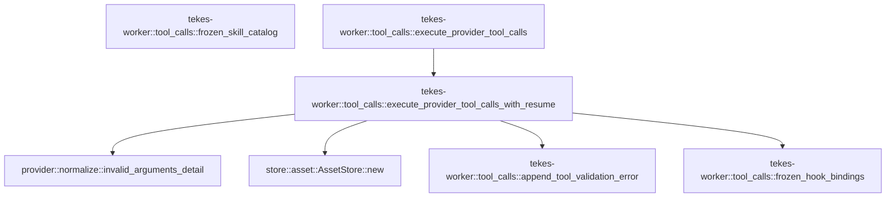

# tekes-worker::tool_calls

[Package atlas](index.md) · [Source](../../src/tool_calls.rs)

## Declarations

Visibility is the declaration spelling; trait members and reexports require their enclosing interface. `cfg` is not evaluated.

| Symbol | Kind | Visibility | Test / cfg |
|---|---|---|---|
| [tekes-worker::tool_calls::execute_provider_tool_calls](../../src/tool_calls.rs#L3) | function_item | `pub(crate)` |  |
| [tekes-worker::tool_calls::execute_provider_tool_calls_with_resume](../../src/tool_calls.rs#L17) | function_item | `pub(crate)` |  |
| [tekes-worker::tool_calls::append_tool_validation_error](../../src/tool_calls.rs#L217) | function_item | `pub(crate)` |  |
| [tekes-worker::tool_calls::frozen_hook_bindings](../../src/tool_calls.rs#L234) | function_item | `pub(crate)` |  |
| [tekes-worker::tool_calls::frozen_skill_catalog](../../src/tool_calls.rs#L266) | function_item | `pub(crate)` |  |
| [tekes-worker::tool_calls::ToolCallBatch](../../src/tool_calls.rs#L326) | struct_item | `pub(crate)` |  |

## Imports / reexports

| Local name | Source path | Visibility |
|---|---|---|
| `*` | `super::*` | `private` |

## Module declarations

| Module | Visibility | Attributes |
|---|---|---|

## Function call graphs

Edges below are syntactically resolved calls only, including private functions. Graphs partition callers into groups of 20; they are not execution order. All unresolved sites are listed below and in the JSON inventory.

Functions 1–5: 5 direct edges

## Call sites

Includes test functions (marked in declarations). Receiver-type-required sites need type analysis/manual tracing. Calls in closures are attributed to their enclosing function; their occurrence here does not mean the closure executes immediately.

| Caller | Callee expression | Source lines | Target / classification |
|---|---|---|---|
| `execute_provider_tool_calls` | `execute_provider_tool_calls_with_resume` | [14](../../src/tool_calls.rs#L14) | [tekes-worker::tool_calls::execute_provider_tool_calls_with_resume](../../src/tool_calls.rs#L17) |
| `execute_provider_tool_calls_with_resume` | `ledger         .path()         .parent()         .ok_or("worker ledger has no thread folder")?         .to_path_buf` | [38](../../src/tool_calls.rs#L38) | receiver-type-required |
| `execute_provider_tool_calls_with_resume` | `ledger         .path()         .parent()         .ok_or` | [38](../../src/tool_calls.rs#L38) | receiver-type-required |
| `execute_provider_tool_calls_with_resume` | `ledger         .path()         .parent` | [38](../../src/tool_calls.rs#L38) | receiver-type-required |
| `execute_provider_tool_calls_with_resume` | `ledger         .path` | [38](../../src/tool_calls.rs#L38) | receiver-type-required |
| `execute_provider_tool_calls_with_resume` | `ledger         .projection()         .and_then(&#124;projection&#124; projection.events.first())         .and_then(&#124;genesis&#124; genesis.string_field("thread"))         .ok_or("genesis thread binding is missing")?         .to_owned` | [43](../../src/tool_calls.rs#L43) | receiver-type-required |
| `execute_provider_tool_calls_with_resume` | `ledger         .projection()         .and_then(&#124;projection&#124; projection.events.first())         .and_then(&#124;genesis&#124; genesis.string_field("thread"))         .ok_or` | [43](../../src/tool_calls.rs#L43) | receiver-type-required |
| `execute_provider_tool_calls_with_resume` | `ledger         .projection()         .and_then(&#124;projection&#124; projection.events.first())         .and_then` | [43](../../src/tool_calls.rs#L43) | receiver-type-required |
| `execute_provider_tool_calls_with_resume` | `ledger         .projection()         .and_then` | [43](../../src/tool_calls.rs#L43) | receiver-type-required |
| `execute_provider_tool_calls_with_resume` | `ledger         .projection` | [43](../../src/tool_calls.rs#L43) | receiver-type-required |
| `execute_provider_tool_calls_with_resume` | `projection.events.first` | [45](../../src/tool_calls.rs#L45) | receiver-type-required |
| `execute_provider_tool_calls_with_resume` | `genesis.string_field` | [46](../../src/tool_calls.rs#L46) | receiver-type-required |
| `execute_provider_tool_calls_with_resume` | `BuiltinManifest::compiled` | [49](../../src/tool_calls.rs#L49) | external-constructor-callback-or-unresolved |
| `execute_provider_tool_calls_with_resume` | `store::AssetStore::new` | [50](../../src/tool_calls.rs#L50) | [store::asset::AssetStore::new](../../../store/src/asset.rs#L27) |
| `execute_provider_tool_calls_with_resume` | `thread_folder.join` | [50](../../src/tool_calls.rs#L50) | receiver-type-required |
| `execute_provider_tool_calls_with_resume` | `session_permission_policy` | [53](../../src/tool_calls.rs#L53) | external-constructor-callback-or-unresolved |
| `execute_provider_tool_calls_with_resume` | `execution_access_for_profile` | [55](../../src/tool_calls.rs#L55) | external-constructor-callback-or-unresolved |
| `execute_provider_tool_calls_with_resume` | `frozen_hook_bindings` | [57](../../src/tool_calls.rs#L57) | [tekes-worker::tool_calls::frozen_hook_bindings](../../src/tool_calls.rs#L234) |
| `execute_provider_tool_calls_with_resume` | `cancellation.supervisor_lost` | [58](../../src/tool_calls.rs#L58), [180](../../src/tool_calls.rs#L180) | receiver-type-required |
| `execute_provider_tool_calls_with_resume` | `Err` | [59](../../src/tool_calls.rs#L59), [173](../../src/tool_calls.rs#L173), [181](../../src/tool_calls.rs#L181) | external-constructor-callback-or-unresolved |
| `execute_provider_tool_calls_with_resume` | `Box::new` | [59](../../src/tool_calls.rs#L59), [173](../../src/tool_calls.rs#L173), [181](../../src/tool_calls.rs#L181) | external-constructor-callback-or-unresolved |
| `execute_provider_tool_calls_with_resume` | `ProtocolFailure` | [59](../../src/tool_calls.rs#L59), [173](../../src/tool_calls.rs#L173), [181](../../src/tool_calls.rs#L181) | external-constructor-callback-or-unresolved |
| `execute_provider_tool_calls_with_resume` | `"supervisor lost before tool execution".to_owned` | [60](../../src/tool_calls.rs#L60) | receiver-type-required |
| `execute_provider_tool_calls_with_resume` | `cancellation.stop_requested` | [63](../../src/tool_calls.rs#L63), [177](../../src/tool_calls.rs#L177) | receiver-type-required |
| `execute_provider_tool_calls_with_resume` | `Ok` | [64](../../src/tool_calls.rs#L64), [83](../../src/tool_calls.rs#L83), [178](../../src/tool_calls.rs#L178), [186](../../src/tool_calls.rs#L186), [210](../../src/tool_calls.rs#L210), [214](../../src/tool_calls.rs#L214) | external-constructor-callback-or-unresolved |
| `execute_provider_tool_calls_with_resume` | `execute_child_spawn_tool` | [67](../../src/tool_calls.rs#L67) | external-constructor-callback-or-unresolved |
| `execute_provider_tool_calls_with_resume` | `provider::invalid_arguments_detail` | [87](../../src/tool_calls.rs#L87) | [provider::normalize::invalid_arguments_detail](../../../provider/src/normalize.rs#L821) |
| `execute_provider_tool_calls_with_resume` | `append_tool_validation_error` | [90](../../src/tool_calls.rs#L90), [103](../../src/tool_calls.rs#L103), [168](../../src/tool_calls.rs#L168) | [tekes-worker::tool_calls::append_tool_validation_error](../../src/tool_calls.rs#L217) |
| `execute_provider_tool_calls_with_resume` | `storage_root_for_thread_folder(&thread_folder)             .map(&#124;root&#124; profile.config.protected_roots(&root))             .and_then` | [93](../../src/tool_calls.rs#L93) | receiver-type-required |
| `execute_provider_tool_calls_with_resume` | `storage_root_for_thread_folder(&thread_folder)             .map` | [93](../../src/tool_calls.rs#L93) | receiver-type-required |
| `execute_provider_tool_calls_with_resume` | `storage_root_for_thread_folder` | [93](../../src/tool_calls.rs#L93) | external-constructor-callback-or-unresolved |
| `execute_provider_tool_calls_with_resume` | `profile.config.protected_roots` | [94](../../src/tool_calls.rs#L94) | receiver-type-required |
| `execute_provider_tool_calls_with_resume` | `invocation_write_roots_for_access` | [96](../../src/tool_calls.rs#L96) | external-constructor-callback-or-unresolved |
| `execute_provider_tool_calls_with_resume` | `error.to_string` | [103](../../src/tool_calls.rs#L103), [152](../../src/tool_calls.rs#L152), [162](../../src/tool_calls.rs#L162) | receiver-type-required |
| `execute_provider_tool_calls_with_resume` | `assemble_tool_backends` | [107](../../src/tool_calls.rs#L107) | external-constructor-callback-or-unresolved |
| `execute_provider_tool_calls_with_resume` | `IJsonValue::parse` | [123](../../src/tool_calls.rs#L123) | external-constructor-callback-or-unresolved |
| `execute_provider_tool_calls_with_resume` | `serde_json::to_vec` | [123](../../src/tool_calls.rs#L123) | external-constructor-callback-or-unresolved |
| `execute_provider_tool_calls_with_resume` | `thread.clone` | [125](../../src/tool_calls.rs#L125) | receiver-type-required |
| `execute_provider_tool_calls_with_resume` | `attempt.to_owned` | [127](../../src/tool_calls.rs#L127) | receiver-type-required |
| `execute_provider_tool_calls_with_resume` | `call.call_id.clone` | [128](../../src/tool_calls.rs#L128) | receiver-type-required |
| `execute_provider_tool_calls_with_resume` | `call.name.clone` | [129](../../src/tool_calls.rs#L129) | receiver-type-required |
| `execute_provider_tool_calls_with_resume` | `options.event_timestamp().clone` | [131](../../src/tool_calls.rs#L131) | receiver-type-required |
| `execute_provider_tool_calls_with_resume` | `options.event_timestamp` | [131](../../src/tool_calls.rs#L131) | receiver-type-required |
| `execute_provider_tool_calls_with_resume` | `DynamicToolDispatcher::new(&profile.bindings.dynamic_catalog)             .deferred_search_entries(&dynamic_backend)?             .is_empty` | [133](../../src/tool_calls.rs#L133) | receiver-type-required |
| `execute_provider_tool_calls_with_resume` | `DynamicToolDispatcher::new(&profile.bindings.dynamic_catalog)             .deferred_search_entries` | [133](../../src/tool_calls.rs#L133) | receiver-type-required |
| `execute_provider_tool_calls_with_resume` | `DynamicToolDispatcher::new` | [133](../../src/tool_calls.rs#L133), [154](../../src/tool_calls.rs#L154) | external-constructor-callback-or-unresolved |
| `execute_provider_tool_calls_with_resume` | `tool_catalog_context` | [136](../../src/tool_calls.rs#L136) | external-constructor-callback-or-unresolved |
| `execute_provider_tool_calls_with_resume` | `ToolPipeline::new(ledger, assets.clone(), SecretScanner::default())             .with_resume_started` | [137](../../src/tool_calls.rs#L137) | receiver-type-required |
| `execute_provider_tool_calls_with_resume` | `ToolPipeline::new` | [137](../../src/tool_calls.rs#L137) | external-constructor-callback-or-unresolved |
| `execute_provider_tool_calls_with_resume` | `assets.clone` | [137](../../src/tool_calls.rs#L137) | receiver-type-required |
| `execute_provider_tool_calls_with_resume` | `SecretScanner::default` | [137](../../src/tool_calls.rs#L137) | external-constructor-callback-or-unresolved |
| `execute_provider_tool_calls_with_resume` | `manifest             .tools             .iter()             .any` | [139](../../src/tool_calls.rs#L139) | receiver-type-required |
| `execute_provider_tool_calls_with_resume` | `manifest             .tools             .iter` | [139](../../src/tool_calls.rs#L139) | receiver-type-required |
| `execute_provider_tool_calls_with_resume` | `ToolDispatcher::new(&manifest, &context)                 .dispatch(                     &mut pipeline,                     &invocation,                     &hooks,                     &mut policy,                     &mut backend,                 )                 .map_err` | [144](../../src/tool_calls.rs#L144) | receiver-type-required |
| `execute_provider_tool_calls_with_resume` | `ToolDispatcher::new(&manifest, &context)                 .dispatch` | [144](../../src/tool_calls.rs#L144) | receiver-type-required |
| `execute_provider_tool_calls_with_resume` | `ToolDispatcher::new` | [144](../../src/tool_calls.rs#L144) | external-constructor-callback-or-unresolved |
| `execute_provider_tool_calls_with_resume` | `DynamicToolDispatcher::new(&profile.bindings.dynamic_catalog)                 .dispatch(                     &mut pipeline,                     &invocation,                     &hooks,                     &mut policy,                     &mut dynamic_backend,                 )                 .map_err` | [154](../../src/tool_calls.rs#L154) | receiver-type-required |
| `execute_provider_tool_calls_with_resume` | `DynamicToolDispatcher::new(&profile.bindings.dynamic_catalog)                 .dispatch` | [154](../../src/tool_calls.rs#L154) | receiver-type-required |
| `execute_provider_tool_calls_with_resume` | `drop` | [167](../../src/tool_calls.rs#L167), [195](../../src/tool_calls.rs#L195), [196](../../src/tool_calls.rs#L196) | external-constructor-callback-or-unresolved |
| `execute_provider_tool_calls_with_resume` | `cancellation.protocol_failed` | [172](../../src/tool_calls.rs#L172) | receiver-type-required |
| `execute_provider_tool_calls_with_resume` | `"tool-control protocol failure".to_owned` | [174](../../src/tool_calls.rs#L174) | receiver-type-required |
| `execute_provider_tool_calls_with_resume` | `"supervisor lost during tool execution".to_owned` | [182](../../src/tool_calls.rs#L182) | receiver-type-required |
| `execute_provider_tool_calls_with_resume` | `wait_tool_continuation` | [197](../../src/tool_calls.rs#L197) | external-constructor-callback-or-unresolved |
| `append_tool_validation_error` | `make_event` | [224](../../src/tool_calls.rs#L224) | external-constructor-callback-or-unresolved |
| `append_tool_validation_error` | `ledger.append_contract` | [230](../../src/tool_calls.rs#L230) | receiver-type-required |
| `append_tool_validation_error` | `BarrierContext::default` | [230](../../src/tool_calls.rs#L230) | external-constructor-callback-or-unresolved |
| `append_tool_validation_error` | `Ok` | [231](../../src/tool_calls.rs#L231) | external-constructor-callback-or-unresolved |
| `frozen_hook_bindings` | `instruction         .effective         .hooks         .iter()         .filter(&#124;(_, index)&#124; {             if !instruction                 .sources                 .get(**index as usize)                 .is_some_and(&#124;source&#124; instruction.source_authorized(source))             {                 return false;             }             instruction                 .sources                 .get(**index as usize)                 .and_then(&#124;source&#124; serde_json::from_str::<Value>(&source.content).ok())                 .is_some_and(&#124;value&#124; value["format"] == 1)         })         .map(&#124;(logical_name, index)&#124; {             let source = instruction                 .sources                 .get(*index as usize)                 .ok_or_else(&#124;&#124; format!("effective hook {logical_name:?} has an invalid index"))?;             decode_hook_binding(source.content.as_bytes(), logical_name)                 .map_err(&#124;error&#124; Box::new(error) as Box<dyn std::error::Error>)         })         .collect` | [237](../../src/tool_calls.rs#L237) | receiver-type-required |
| `frozen_hook_bindings` | `instruction         .effective         .hooks         .iter()         .filter(&#124;(_, index)&#124; {             if !instruction                 .sources                 .get(**index as usize)                 .is_some_and(&#124;source&#124; instruction.source_authorized(source))             {                 return false;             }             instruction                 .sources                 .get(**index as usize)                 .and_then(&#124;source&#124; serde_json::from_str::<Value>(&source.content).ok())                 .is_some_and(&#124;value&#124; value["format"] == 1)         })         .map` | [237](../../src/tool_calls.rs#L237) | receiver-type-required |
| `frozen_hook_bindings` | `instruction         .effective         .hooks         .iter()         .filter` | [237](../../src/tool_calls.rs#L237) | receiver-type-required |
| `frozen_hook_bindings` | `instruction         .effective         .hooks         .iter` | [237](../../src/tool_calls.rs#L237) | receiver-type-required |
| `frozen_hook_bindings` | `instruction                 .sources                 .get(**index as usize)                 .is_some_and` | [242](../../src/tool_calls.rs#L242) | receiver-type-required |
| `frozen_hook_bindings` | `instruction                 .sources                 .get` | [242](../../src/tool_calls.rs#L242), [249](../../src/tool_calls.rs#L249), [256](../../src/tool_calls.rs#L256) | receiver-type-required |
| `frozen_hook_bindings` | `instruction.source_authorized` | [245](../../src/tool_calls.rs#L245) | receiver-type-required |
| `frozen_hook_bindings` | `instruction                 .sources                 .get(**index as usize)                 .and_then(&#124;source&#124; serde_json::from_str::<Value>(&source.content).ok())                 .is_some_and` | [249](../../src/tool_calls.rs#L249) | receiver-type-required |
| `frozen_hook_bindings` | `instruction                 .sources                 .get(**index as usize)                 .and_then` | [249](../../src/tool_calls.rs#L249) | receiver-type-required |
| `frozen_hook_bindings` | `serde_json::from_str::<Value>(&source.content).ok` | [252](../../src/tool_calls.rs#L252) | receiver-type-required |
| `frozen_hook_bindings` | `serde_json::from_str::<Value>` | [252](../../src/tool_calls.rs#L252) | external-constructor-callback-or-unresolved |
| `frozen_hook_bindings` | `instruction                 .sources                 .get(*index as usize)                 .ok_or_else` | [256](../../src/tool_calls.rs#L256) | receiver-type-required |
| `frozen_hook_bindings` | `decode_hook_binding(source.content.as_bytes(), logical_name)                 .map_err` | [260](../../src/tool_calls.rs#L260) | receiver-type-required |
| `frozen_hook_bindings` | `decode_hook_binding` | [260](../../src/tool_calls.rs#L260) | external-constructor-callback-or-unresolved |
| `frozen_hook_bindings` | `source.content.as_bytes` | [260](../../src/tool_calls.rs#L260) | receiver-type-required |
| `frozen_hook_bindings` | `Box::new` | [261](../../src/tool_calls.rs#L261) | external-constructor-callback-or-unresolved |
| `frozen_skill_catalog` | `ResourceCatalog::from_snapshot` | [269](../../src/tool_calls.rs#L269) | external-constructor-callback-or-unresolved |
| `frozen_skill_catalog` | `resources         .skill_summaries()         .into_iter()         .map(&#124;summary&#124; {             let package = resources.skill(&summary.name)?;             let content = json!({                 "format": 1,                 "name": summary.name,                 "description": summary.description,                 "body": package.body,                 "resources": package.resources,             });             Ok(CatalogEntry {                 name: summary.name,                 summary: summary.description,                 aliases: Vec::new(),                 schema_digest: summary.content_digest,                 content: IJsonValue::parse(&serde_json::to_vec(&content)?)?,             })         })         .collect::<Result<Vec<_>, Box<dyn std::error::Error>>>` | [270](../../src/tool_calls.rs#L270) | receiver-type-required |
| `frozen_skill_catalog` | `resources         .skill_summaries()         .into_iter()         .map` | [270](../../src/tool_calls.rs#L270) | receiver-type-required |
| `frozen_skill_catalog` | `resources         .skill_summaries()         .into_iter` | [270](../../src/tool_calls.rs#L270) | receiver-type-required |
| `frozen_skill_catalog` | `resources         .skill_summaries` | [270](../../src/tool_calls.rs#L270) | receiver-type-required |
| `frozen_skill_catalog` | `resources.skill` | [274](../../src/tool_calls.rs#L274) | receiver-type-required |
| `frozen_skill_catalog` | `Ok` | [282](../../src/tool_calls.rs#L282), [312](../../src/tool_calls.rs#L312), [323](../../src/tool_calls.rs#L323) | external-constructor-callback-or-unresolved |
| `frozen_skill_catalog` | `Vec::new` | [285](../../src/tool_calls.rs#L285), [315](../../src/tool_calls.rs#L315) | external-constructor-callback-or-unresolved |
| `frozen_skill_catalog` | `IJsonValue::parse` | [287](../../src/tool_calls.rs#L287) | external-constructor-callback-or-unresolved |
| `frozen_skill_catalog` | `serde_json::to_vec` | [287](../../src/tool_calls.rs#L287) | external-constructor-callback-or-unresolved |
| `frozen_skill_catalog` | `instruction         .effective         .skills         .iter()         .filter(&#124;(logical_name, index)&#124; {             !logical_name.contains('/')                 && instruction                     .sources                     .get(**index as usize)                     .is_some_and(&#124;source&#124; instruction.source_authorized(source))         })         .map(&#124;(logical_name, index)&#124; {             let source = instruction                 .sources                 .get(*index as usize)                 .ok_or_else(&#124;&#124; format!("effective skill {logical_name:?} has an invalid index"))?;             let summary = source                 .content                 .lines()                 .find(&#124;line&#124; !line.trim().is_empty())                 .map_or_else(&#124;&#124; logical_name.clone(), &#124;line&#124; line.trim().to_owned());             Ok(CatalogEntry {                 name: logical_name.clone(),                 summary,                 aliases: Vec::new(),                 schema_digest: source.content_sha256.clone(),                 content: IJsonValue::from(source.content.clone()),             })         })         .collect::<Result<Vec<_>, Box<dyn std::error::Error>>>` | [291](../../src/tool_calls.rs#L291) | receiver-type-required |
| `frozen_skill_catalog` | `instruction         .effective         .skills         .iter()         .filter(&#124;(logical_name, index)&#124; {             !logical_name.contains('/')                 && instruction                     .sources                     .get(**index as usize)                     .is_some_and(&#124;source&#124; instruction.source_authorized(source))         })         .map` | [291](../../src/tool_calls.rs#L291) | receiver-type-required |
| `frozen_skill_catalog` | `instruction         .effective         .skills         .iter()         .filter` | [291](../../src/tool_calls.rs#L291) | receiver-type-required |
| `frozen_skill_catalog` | `instruction         .effective         .skills         .iter` | [291](../../src/tool_calls.rs#L291) | receiver-type-required |
| `frozen_skill_catalog` | `logical_name.contains` | [296](../../src/tool_calls.rs#L296) | receiver-type-required |
| `frozen_skill_catalog` | `instruction                     .sources                     .get(**index as usize)                     .is_some_and` | [297](../../src/tool_calls.rs#L297) | receiver-type-required |
| `frozen_skill_catalog` | `instruction                     .sources                     .get` | [297](../../src/tool_calls.rs#L297) | receiver-type-required |
| `frozen_skill_catalog` | `instruction.source_authorized` | [300](../../src/tool_calls.rs#L300) | receiver-type-required |
| `frozen_skill_catalog` | `instruction                 .sources                 .get(*index as usize)                 .ok_or_else` | [303](../../src/tool_calls.rs#L303) | receiver-type-required |
| `frozen_skill_catalog` | `instruction                 .sources                 .get` | [303](../../src/tool_calls.rs#L303) | receiver-type-required |
| `frozen_skill_catalog` | `source                 .content                 .lines()                 .find(&#124;line&#124; !line.trim().is_empty())                 .map_or_else` | [307](../../src/tool_calls.rs#L307) | receiver-type-required |
| `frozen_skill_catalog` | `source                 .content                 .lines()                 .find` | [307](../../src/tool_calls.rs#L307) | receiver-type-required |
| `frozen_skill_catalog` | `source                 .content                 .lines` | [307](../../src/tool_calls.rs#L307) | receiver-type-required |
| `frozen_skill_catalog` | `line.trim().is_empty` | [310](../../src/tool_calls.rs#L310) | receiver-type-required |
| `frozen_skill_catalog` | `line.trim` | [310](../../src/tool_calls.rs#L310), [311](../../src/tool_calls.rs#L311) | receiver-type-required |
| `frozen_skill_catalog` | `logical_name.clone` | [311](../../src/tool_calls.rs#L311), [313](../../src/tool_calls.rs#L313) | receiver-type-required |
| `frozen_skill_catalog` | `line.trim().to_owned` | [311](../../src/tool_calls.rs#L311) | receiver-type-required |
| `frozen_skill_catalog` | `source.content_sha256.clone` | [316](../../src/tool_calls.rs#L316) | receiver-type-required |
| `frozen_skill_catalog` | `IJsonValue::from` | [317](../../src/tool_calls.rs#L317) | external-constructor-callback-or-unresolved |
| `frozen_skill_catalog` | `source.content.clone` | [317](../../src/tool_calls.rs#L317) | receiver-type-required |
| `frozen_skill_catalog` | `entries.extend` | [321](../../src/tool_calls.rs#L321) | receiver-type-required |
| `frozen_skill_catalog` | `entries.sort_by` | [322](../../src/tool_calls.rs#L322) | receiver-type-required |
| `frozen_skill_catalog` | `left.name.as_bytes().cmp` | [322](../../src/tool_calls.rs#L322) | receiver-type-required |
| `frozen_skill_catalog` | `left.name.as_bytes` | [322](../../src/tool_calls.rs#L322) | receiver-type-required |
| `frozen_skill_catalog` | `right.name.as_bytes` | [322](../../src/tool_calls.rs#L322) | receiver-type-required |
