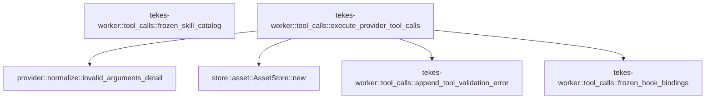

# tekes-worker::tool_calls

[Package atlas](index.md) · [Source](../../src/tool_calls.rs)

## Declarations

Visibility is the declaration spelling; trait members and reexports require their enclosing interface. `cfg` is not evaluated.

| Symbol | Kind | Visibility | Test / cfg |
|---|---|---|---|
| [tekes-worker::tool_calls::execute_provider_tool_calls](../../src/tool_calls.rs#L3) | function_item | `pub(crate)` |  |
| [tekes-worker::tool_calls::append_tool_validation_error](../../src/tool_calls.rs#L196) | function_item | `pub(crate)` |  |
| [tekes-worker::tool_calls::frozen_hook_bindings](../../src/tool_calls.rs#L213) | function_item | `pub(crate)` |  |
| [tekes-worker::tool_calls::frozen_skill_catalog](../../src/tool_calls.rs#L238) | function_item | `pub(crate)` |  |
| [tekes-worker::tool_calls::ToolCallBatch](../../src/tool_calls.rs#L292) | struct_item | `pub(crate)` |  |

## Imports / reexports

| Local name | Source path | Visibility |
|---|---|---|
| `*` | `super::*` | `private` |

## Module declarations

| Module | Visibility | Attributes |
|---|---|---|

## Function call graphs

Edges below are syntactically resolved calls only, including private functions. Graphs partition callers into groups of 20; they are not execution order. All unresolved sites are listed below and in the JSON inventory.

Functions 1–4: 4 direct edges

## Call sites

Includes test functions (marked in declarations). Receiver-type-required sites need type analysis/manual tracing. Calls in closures are attributed to their enclosing function; their occurrence here does not mean the closure executes immediately.

| Caller | Callee expression | Source lines | Target / classification |
|---|---|---|---|
| `execute_provider_tool_calls` | `ledger         .path()         .parent()         .ok_or("worker ledger has no thread folder")?         .to_path_buf` | [23](../../src/tool_calls.rs#L23) | receiver-type-required |
| `execute_provider_tool_calls` | `ledger         .path()         .parent()         .ok_or` | [23](../../src/tool_calls.rs#L23) | receiver-type-required |
| `execute_provider_tool_calls` | `ledger         .path()         .parent` | [23](../../src/tool_calls.rs#L23) | receiver-type-required |
| `execute_provider_tool_calls` | `ledger         .path` | [23](../../src/tool_calls.rs#L23) | receiver-type-required |
| `execute_provider_tool_calls` | `ledger         .projection()         .and_then(&#124;projection&#124; projection.events.first())         .and_then(&#124;genesis&#124; genesis.string_field("thread"))         .ok_or("genesis thread binding is missing")?         .to_owned` | [28](../../src/tool_calls.rs#L28) | receiver-type-required |
| `execute_provider_tool_calls` | `ledger         .projection()         .and_then(&#124;projection&#124; projection.events.first())         .and_then(&#124;genesis&#124; genesis.string_field("thread"))         .ok_or` | [28](../../src/tool_calls.rs#L28) | receiver-type-required |
| `execute_provider_tool_calls` | `ledger         .projection()         .and_then(&#124;projection&#124; projection.events.first())         .and_then` | [28](../../src/tool_calls.rs#L28) | receiver-type-required |
| `execute_provider_tool_calls` | `ledger         .projection()         .and_then` | [28](../../src/tool_calls.rs#L28) | receiver-type-required |
| `execute_provider_tool_calls` | `ledger         .projection` | [28](../../src/tool_calls.rs#L28) | receiver-type-required |
| `execute_provider_tool_calls` | `projection.events.first` | [30](../../src/tool_calls.rs#L30) | receiver-type-required |
| `execute_provider_tool_calls` | `genesis.string_field` | [31](../../src/tool_calls.rs#L31) | receiver-type-required |
| `execute_provider_tool_calls` | `BuiltinManifest::compiled` | [34](../../src/tool_calls.rs#L34) | external-constructor-callback-or-unresolved |
| `execute_provider_tool_calls` | `store::AssetStore::new` | [35](../../src/tool_calls.rs#L35) | [store::asset::AssetStore::new](../../../store/src/asset.rs#L27) |
| `execute_provider_tool_calls` | `thread_folder.join` | [35](../../src/tool_calls.rs#L35) | receiver-type-required |
| `execute_provider_tool_calls` | `frozen_hook_bindings` | [36](../../src/tool_calls.rs#L36) | [tekes-worker::tool_calls::frozen_hook_bindings](../../src/tool_calls.rs#L213) |
| `execute_provider_tool_calls` | `session_permission_policy` | [39](../../src/tool_calls.rs#L39) | external-constructor-callback-or-unresolved |
| `execute_provider_tool_calls` | `cancellation.supervisor_lost` | [41](../../src/tool_calls.rs#L41), [159](../../src/tool_calls.rs#L159) | receiver-type-required |
| `execute_provider_tool_calls` | `Err` | [42](../../src/tool_calls.rs#L42), [152](../../src/tool_calls.rs#L152), [160](../../src/tool_calls.rs#L160) | external-constructor-callback-or-unresolved |
| `execute_provider_tool_calls` | `Box::new` | [42](../../src/tool_calls.rs#L42), [152](../../src/tool_calls.rs#L152), [160](../../src/tool_calls.rs#L160) | external-constructor-callback-or-unresolved |
| `execute_provider_tool_calls` | `ProtocolFailure` | [42](../../src/tool_calls.rs#L42), [152](../../src/tool_calls.rs#L152), [160](../../src/tool_calls.rs#L160) | external-constructor-callback-or-unresolved |
| `execute_provider_tool_calls` | `"supervisor lost before tool execution".to_owned` | [43](../../src/tool_calls.rs#L43) | receiver-type-required |
| `execute_provider_tool_calls` | `cancellation.stop_requested` | [46](../../src/tool_calls.rs#L46), [156](../../src/tool_calls.rs#L156) | receiver-type-required |
| `execute_provider_tool_calls` | `Ok` | [47](../../src/tool_calls.rs#L47), [66](../../src/tool_calls.rs#L66), [157](../../src/tool_calls.rs#L157), [165](../../src/tool_calls.rs#L165), [189](../../src/tool_calls.rs#L189), [193](../../src/tool_calls.rs#L193) | external-constructor-callback-or-unresolved |
| `execute_provider_tool_calls` | `execute_child_spawn_tool` | [50](../../src/tool_calls.rs#L50) | external-constructor-callback-or-unresolved |
| `execute_provider_tool_calls` | `provider::invalid_arguments_detail` | [70](../../src/tool_calls.rs#L70) | [provider::normalize::invalid_arguments_detail](../../../provider/src/normalize.rs#L790) |
| `execute_provider_tool_calls` | `append_tool_validation_error` | [73](../../src/tool_calls.rs#L73), [84](../../src/tool_calls.rs#L84), [147](../../src/tool_calls.rs#L147) | [tekes-worker::tool_calls::append_tool_validation_error](../../src/tool_calls.rs#L196) |
| `execute_provider_tool_calls` | `kernel_protected_roots(&thread_folder)             .and_then` | [76](../../src/tool_calls.rs#L76) | receiver-type-required |
| `execute_provider_tool_calls` | `kernel_protected_roots` | [76](../../src/tool_calls.rs#L76) | external-constructor-callback-or-unresolved |
| `execute_provider_tool_calls` | `invocation_write_roots` | [77](../../src/tool_calls.rs#L77) | external-constructor-callback-or-unresolved |
| `execute_provider_tool_calls` | `error.to_string` | [84](../../src/tool_calls.rs#L84), [131](../../src/tool_calls.rs#L131), [141](../../src/tool_calls.rs#L141) | receiver-type-required |
| `execute_provider_tool_calls` | `assemble_tool_backends` | [88](../../src/tool_calls.rs#L88) | external-constructor-callback-or-unresolved |
| `execute_provider_tool_calls` | `IJsonValue::parse` | [103](../../src/tool_calls.rs#L103) | external-constructor-callback-or-unresolved |
| `execute_provider_tool_calls` | `serde_json::to_vec` | [103](../../src/tool_calls.rs#L103) | external-constructor-callback-or-unresolved |
| `execute_provider_tool_calls` | `thread.clone` | [105](../../src/tool_calls.rs#L105) | receiver-type-required |
| `execute_provider_tool_calls` | `attempt.to_owned` | [107](../../src/tool_calls.rs#L107) | receiver-type-required |
| `execute_provider_tool_calls` | `call.call_id.clone` | [108](../../src/tool_calls.rs#L108) | receiver-type-required |
| `execute_provider_tool_calls` | `call.name.clone` | [109](../../src/tool_calls.rs#L109) | receiver-type-required |
| `execute_provider_tool_calls` | `options.event_timestamp().clone` | [111](../../src/tool_calls.rs#L111) | receiver-type-required |
| `execute_provider_tool_calls` | `options.event_timestamp` | [111](../../src/tool_calls.rs#L111) | receiver-type-required |
| `execute_provider_tool_calls` | `DynamicToolDispatcher::new(&profile.bindings.dynamic_catalog)             .deferred_search_entries(&dynamic_backend)?             .is_empty` | [113](../../src/tool_calls.rs#L113) | receiver-type-required |
| `execute_provider_tool_calls` | `DynamicToolDispatcher::new(&profile.bindings.dynamic_catalog)             .deferred_search_entries` | [113](../../src/tool_calls.rs#L113) | receiver-type-required |
| `execute_provider_tool_calls` | `DynamicToolDispatcher::new` | [113](../../src/tool_calls.rs#L113), [133](../../src/tool_calls.rs#L133) | external-constructor-callback-or-unresolved |
| `execute_provider_tool_calls` | `tool_catalog_context` | [116](../../src/tool_calls.rs#L116) | external-constructor-callback-or-unresolved |
| `execute_provider_tool_calls` | `ToolPipeline::new` | [117](../../src/tool_calls.rs#L117) | external-constructor-callback-or-unresolved |
| `execute_provider_tool_calls` | `assets.clone` | [117](../../src/tool_calls.rs#L117) | receiver-type-required |
| `execute_provider_tool_calls` | `SecretScanner::default` | [117](../../src/tool_calls.rs#L117) | external-constructor-callback-or-unresolved |
| `execute_provider_tool_calls` | `manifest             .tools             .iter()             .any` | [118](../../src/tool_calls.rs#L118) | receiver-type-required |
| `execute_provider_tool_calls` | `manifest             .tools             .iter` | [118](../../src/tool_calls.rs#L118) | receiver-type-required |
| `execute_provider_tool_calls` | `ToolDispatcher::new(&manifest, &context)                 .dispatch(                     &mut pipeline,                     &invocation,                     &hooks,                     &mut policy,                     &mut backend,                 )                 .map_err` | [123](../../src/tool_calls.rs#L123) | receiver-type-required |
| `execute_provider_tool_calls` | `ToolDispatcher::new(&manifest, &context)                 .dispatch` | [123](../../src/tool_calls.rs#L123) | receiver-type-required |
| `execute_provider_tool_calls` | `ToolDispatcher::new` | [123](../../src/tool_calls.rs#L123) | external-constructor-callback-or-unresolved |
| `execute_provider_tool_calls` | `DynamicToolDispatcher::new(&profile.bindings.dynamic_catalog)                 .dispatch(                     &mut pipeline,                     &invocation,                     &hooks,                     &mut policy,                     &mut dynamic_backend,                 )                 .map_err` | [133](../../src/tool_calls.rs#L133) | receiver-type-required |
| `execute_provider_tool_calls` | `DynamicToolDispatcher::new(&profile.bindings.dynamic_catalog)                 .dispatch` | [133](../../src/tool_calls.rs#L133) | receiver-type-required |
| `execute_provider_tool_calls` | `drop` | [146](../../src/tool_calls.rs#L146), [174](../../src/tool_calls.rs#L174), [175](../../src/tool_calls.rs#L175) | external-constructor-callback-or-unresolved |
| `execute_provider_tool_calls` | `cancellation.protocol_failed` | [151](../../src/tool_calls.rs#L151) | receiver-type-required |
| `execute_provider_tool_calls` | `"tool-control protocol failure".to_owned` | [153](../../src/tool_calls.rs#L153) | receiver-type-required |
| `execute_provider_tool_calls` | `"supervisor lost during tool execution".to_owned` | [161](../../src/tool_calls.rs#L161) | receiver-type-required |
| `execute_provider_tool_calls` | `wait_tool_continuation` | [176](../../src/tool_calls.rs#L176) | external-constructor-callback-or-unresolved |
| `append_tool_validation_error` | `make_event` | [203](../../src/tool_calls.rs#L203) | external-constructor-callback-or-unresolved |
| `append_tool_validation_error` | `ledger.append_contract` | [209](../../src/tool_calls.rs#L209) | receiver-type-required |
| `append_tool_validation_error` | `BarrierContext::default` | [209](../../src/tool_calls.rs#L209) | external-constructor-callback-or-unresolved |
| `append_tool_validation_error` | `Ok` | [210](../../src/tool_calls.rs#L210) | external-constructor-callback-or-unresolved |
| `frozen_hook_bindings` | `instruction         .effective         .hooks         .iter()         .filter(&#124;(_, index)&#124; {             instruction                 .sources                 .get(**index as usize)                 .and_then(&#124;source&#124; serde_json::from_str::<Value>(&source.content).ok())                 .is_some_and(&#124;value&#124; value["format"] == 1)         })         .map(&#124;(logical_name, index)&#124; {             let source = instruction                 .sources                 .get(*index as usize)                 .ok_or_else(&#124;&#124; format!("effective hook {logical_name:?} has an invalid index"))?;             decode_hook_binding(source.content.as_bytes(), logical_name)                 .map_err(&#124;error&#124; Box::new(error) as Box<dyn std::error::Error>)         })         .collect` | [216](../../src/tool_calls.rs#L216) | receiver-type-required |
| `frozen_hook_bindings` | `instruction         .effective         .hooks         .iter()         .filter(&#124;(_, index)&#124; {             instruction                 .sources                 .get(**index as usize)                 .and_then(&#124;source&#124; serde_json::from_str::<Value>(&source.content).ok())                 .is_some_and(&#124;value&#124; value["format"] == 1)         })         .map` | [216](../../src/tool_calls.rs#L216) | receiver-type-required |
| `frozen_hook_bindings` | `instruction         .effective         .hooks         .iter()         .filter` | [216](../../src/tool_calls.rs#L216) | receiver-type-required |
| `frozen_hook_bindings` | `instruction         .effective         .hooks         .iter` | [216](../../src/tool_calls.rs#L216) | receiver-type-required |
| `frozen_hook_bindings` | `instruction                 .sources                 .get(**index as usize)                 .and_then(&#124;source&#124; serde_json::from_str::<Value>(&source.content).ok())                 .is_some_and` | [221](../../src/tool_calls.rs#L221) | receiver-type-required |
| `frozen_hook_bindings` | `instruction                 .sources                 .get(**index as usize)                 .and_then` | [221](../../src/tool_calls.rs#L221) | receiver-type-required |
| `frozen_hook_bindings` | `instruction                 .sources                 .get` | [221](../../src/tool_calls.rs#L221), [228](../../src/tool_calls.rs#L228) | receiver-type-required |
| `frozen_hook_bindings` | `serde_json::from_str::<Value>(&source.content).ok` | [224](../../src/tool_calls.rs#L224) | receiver-type-required |
| `frozen_hook_bindings` | `serde_json::from_str::<Value>` | [224](../../src/tool_calls.rs#L224) | external-constructor-callback-or-unresolved |
| `frozen_hook_bindings` | `instruction                 .sources                 .get(*index as usize)                 .ok_or_else` | [228](../../src/tool_calls.rs#L228) | receiver-type-required |
| `frozen_hook_bindings` | `decode_hook_binding(source.content.as_bytes(), logical_name)                 .map_err` | [232](../../src/tool_calls.rs#L232) | receiver-type-required |
| `frozen_hook_bindings` | `decode_hook_binding` | [232](../../src/tool_calls.rs#L232) | external-constructor-callback-or-unresolved |
| `frozen_hook_bindings` | `source.content.as_bytes` | [232](../../src/tool_calls.rs#L232) | receiver-type-required |
| `frozen_hook_bindings` | `Box::new` | [233](../../src/tool_calls.rs#L233) | external-constructor-callback-or-unresolved |
| `frozen_skill_catalog` | `ResourceCatalog::from_snapshot` | [241](../../src/tool_calls.rs#L241) | external-constructor-callback-or-unresolved |
| `frozen_skill_catalog` | `resources         .skill_summaries()         .into_iter()         .map(&#124;summary&#124; {             let package = resources.skill(&summary.name)?;             let content = json!({                 "format": 1,                 "name": summary.name,                 "description": summary.description,                 "body": package.body,                 "resources": package.resources,             });             Ok(CatalogEntry {                 name: summary.name,                 summary: summary.description,                 aliases: Vec::new(),                 schema_digest: summary.content_digest,                 content: IJsonValue::parse(&serde_json::to_vec(&content)?)?,             })         })         .collect::<Result<Vec<_>, Box<dyn std::error::Error>>>` | [242](../../src/tool_calls.rs#L242) | receiver-type-required |
| `frozen_skill_catalog` | `resources         .skill_summaries()         .into_iter()         .map` | [242](../../src/tool_calls.rs#L242) | receiver-type-required |
| `frozen_skill_catalog` | `resources         .skill_summaries()         .into_iter` | [242](../../src/tool_calls.rs#L242) | receiver-type-required |
| `frozen_skill_catalog` | `resources         .skill_summaries` | [242](../../src/tool_calls.rs#L242) | receiver-type-required |
| `frozen_skill_catalog` | `resources.skill` | [246](../../src/tool_calls.rs#L246) | receiver-type-required |
| `frozen_skill_catalog` | `Ok` | [254](../../src/tool_calls.rs#L254), [278](../../src/tool_calls.rs#L278), [289](../../src/tool_calls.rs#L289) | external-constructor-callback-or-unresolved |
| `frozen_skill_catalog` | `Vec::new` | [257](../../src/tool_calls.rs#L257), [281](../../src/tool_calls.rs#L281) | external-constructor-callback-or-unresolved |
| `frozen_skill_catalog` | `IJsonValue::parse` | [259](../../src/tool_calls.rs#L259) | external-constructor-callback-or-unresolved |
| `frozen_skill_catalog` | `serde_json::to_vec` | [259](../../src/tool_calls.rs#L259) | external-constructor-callback-or-unresolved |
| `frozen_skill_catalog` | `instruction         .effective         .skills         .iter()         .filter(&#124;(logical_name, _)&#124; !logical_name.contains('/'))         .map(&#124;(logical_name, index)&#124; {             let source = instruction                 .sources                 .get(*index as usize)                 .ok_or_else(&#124;&#124; format!("effective skill {logical_name:?} has an invalid index"))?;             let summary = source                 .content                 .lines()                 .find(&#124;line&#124; !line.trim().is_empty())                 .map_or_else(&#124;&#124; logical_name.clone(), &#124;line&#124; line.trim().to_owned());             Ok(CatalogEntry {                 name: logical_name.clone(),                 summary,                 aliases: Vec::new(),                 schema_digest: source.content_sha256.clone(),                 content: IJsonValue::from(source.content.clone()),             })         })         .collect::<Result<Vec<_>, Box<dyn std::error::Error>>>` | [263](../../src/tool_calls.rs#L263) | receiver-type-required |
| `frozen_skill_catalog` | `instruction         .effective         .skills         .iter()         .filter(&#124;(logical_name, _)&#124; !logical_name.contains('/'))         .map` | [263](../../src/tool_calls.rs#L263) | receiver-type-required |
| `frozen_skill_catalog` | `instruction         .effective         .skills         .iter()         .filter` | [263](../../src/tool_calls.rs#L263) | receiver-type-required |
| `frozen_skill_catalog` | `instruction         .effective         .skills         .iter` | [263](../../src/tool_calls.rs#L263) | receiver-type-required |
| `frozen_skill_catalog` | `logical_name.contains` | [267](../../src/tool_calls.rs#L267) | receiver-type-required |
| `frozen_skill_catalog` | `instruction                 .sources                 .get(*index as usize)                 .ok_or_else` | [269](../../src/tool_calls.rs#L269) | receiver-type-required |
| `frozen_skill_catalog` | `instruction                 .sources                 .get` | [269](../../src/tool_calls.rs#L269) | receiver-type-required |
| `frozen_skill_catalog` | `source                 .content                 .lines()                 .find(&#124;line&#124; !line.trim().is_empty())                 .map_or_else` | [273](../../src/tool_calls.rs#L273) | receiver-type-required |
| `frozen_skill_catalog` | `source                 .content                 .lines()                 .find` | [273](../../src/tool_calls.rs#L273) | receiver-type-required |
| `frozen_skill_catalog` | `source                 .content                 .lines` | [273](../../src/tool_calls.rs#L273) | receiver-type-required |
| `frozen_skill_catalog` | `line.trim().is_empty` | [276](../../src/tool_calls.rs#L276) | receiver-type-required |
| `frozen_skill_catalog` | `line.trim` | [276](../../src/tool_calls.rs#L276), [277](../../src/tool_calls.rs#L277) | receiver-type-required |
| `frozen_skill_catalog` | `logical_name.clone` | [277](../../src/tool_calls.rs#L277), [279](../../src/tool_calls.rs#L279) | receiver-type-required |
| `frozen_skill_catalog` | `line.trim().to_owned` | [277](../../src/tool_calls.rs#L277) | receiver-type-required |
| `frozen_skill_catalog` | `source.content_sha256.clone` | [282](../../src/tool_calls.rs#L282) | receiver-type-required |
| `frozen_skill_catalog` | `IJsonValue::from` | [283](../../src/tool_calls.rs#L283) | external-constructor-callback-or-unresolved |
| `frozen_skill_catalog` | `source.content.clone` | [283](../../src/tool_calls.rs#L283) | receiver-type-required |
| `frozen_skill_catalog` | `entries.extend` | [287](../../src/tool_calls.rs#L287) | receiver-type-required |
| `frozen_skill_catalog` | `entries.sort_by` | [288](../../src/tool_calls.rs#L288) | receiver-type-required |
| `frozen_skill_catalog` | `left.name.as_bytes().cmp` | [288](../../src/tool_calls.rs#L288) | receiver-type-required |
| `frozen_skill_catalog` | `left.name.as_bytes` | [288](../../src/tool_calls.rs#L288) | receiver-type-required |
| `frozen_skill_catalog` | `right.name.as_bytes` | [288](../../src/tool_calls.rs#L288) | receiver-type-required |
