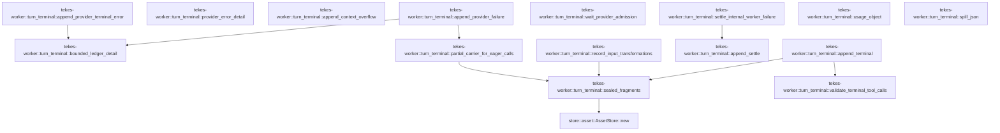

# tekes-worker::turn_terminal

[Package atlas](index.md) · [Source](../../src/turn_terminal.rs)

## Declarations

Visibility is the declaration spelling; trait members and reexports require their enclosing interface. `cfg` is not evaluated.

| Symbol | Kind | Visibility | Test / cfg |
|---|---|---|---|
| [tekes-worker::turn_terminal::PROVIDER_RETRIES](../../src/turn_terminal.rs#L4) | const_item | `pub(crate)` |  |
| [tekes-worker::turn_terminal::PROVIDER_ADMISSION_FLOOR](../../src/turn_terminal.rs#L5) | const_item | `private` |  |
| [tekes-worker::turn_terminal::PROVIDER_ADMISSION_CEILING](../../src/turn_terminal.rs#L6) | const_item | `private` |  |
| [tekes-worker::turn_terminal::PROVIDER_ADMISSION_SUBKIND](../../src/turn_terminal.rs#L7) | const_item | `pub(crate)` |  |
| [tekes-worker::turn_terminal::validate_terminal_tool_calls](../../src/turn_terminal.rs#L13) | function_item | `pub(crate)` |  |
| [tekes-worker::turn_terminal::TerminalAppend](../../src/turn_terminal.rs#L86) | struct_item | `pub(crate)` |  |
| [tekes-worker::turn_terminal::append_terminal](../../src/turn_terminal.rs#L96) | function_item | `pub(crate)` |  |
| [tekes-worker::turn_terminal::append_provider_terminal_error](../../src/turn_terminal.rs#L192) | function_item | `pub(crate)` |  |
| [tekes-worker::turn_terminal::provider_error_detail](../../src/turn_terminal.rs#L250) | function_item | `private` |  |
| [tekes-worker::turn_terminal::append_context_overflow](../../src/turn_terminal.rs#L265) | function_item | `pub(crate)` |  |
| [tekes-worker::turn_terminal::append_provider_failure](../../src/turn_terminal.rs#L291) | function_item | `pub(crate)` |  |
| [tekes-worker::turn_terminal::partial_carrier_for_eager_calls](../../src/turn_terminal.rs#L404) | function_item | `private` |  |
| [tekes-worker::turn_terminal::ProviderAdmissionRetry](../../src/turn_terminal.rs#L441) | struct_item | `pub(crate)` |  |
| [tekes-worker::turn_terminal::wait_provider_admission](../../src/turn_terminal.rs#L455) | function_item | `pub(crate)` |  |
| [tekes-worker::turn_terminal::settle_internal_worker_failure](../../src/turn_terminal.rs#L495) | function_item | `pub(crate)` |  |
| [tekes-worker::turn_terminal::bounded_ledger_detail](../../src/turn_terminal.rs#L527) | function_item | `pub(crate)` |  |
| [tekes-worker::turn_terminal::usage_object](../../src/turn_terminal.rs#L549) | function_item | `pub(crate)` |  |
| [tekes-worker::turn_terminal::record_input_transformations](../../src/turn_terminal.rs#L571) | function_item | `pub(crate)` |  |
| [tekes-worker::turn_terminal::sealed_fragments](../../src/turn_terminal.rs#L591) | function_item | `pub(crate)` |  |
| [tekes-worker::turn_terminal::spill_json](../../src/turn_terminal.rs#L605) | function_item | `pub(crate)` |  |
| [tekes-worker::turn_terminal::append_settle](../../src/turn_terminal.rs#L618) | function_item | `pub(crate)` |  |

## Imports / reexports

| Local name | Source path | Visibility |
|---|---|---|
| `*` | `super::*` | `private` |

## Module declarations

| Module | Visibility | Attributes |
|---|---|---|

## Function call graphs

Edges below are syntactically resolved calls only, including private functions. Graphs partition callers into groups of 20; they are not execution order. All unresolved sites are listed below and in the JSON inventory.

Functions 1–15: 9 direct edges

## Call sites

Includes test functions (marked in declarations). Receiver-type-required sites need type analysis/manual tracing. Calls in closures are attributed to their enclosing function; their occurrence here does not mean the closure executes immediately.

| Caller | Callee expression | Source lines | Target / classification |
|---|---|---|---|
| `PROVIDER_ADMISSION_FLOOR` | `Duration::from_secs` | [5](../../src/turn_terminal.rs#L5) | external-constructor-callback-or-unresolved |
| `PROVIDER_ADMISSION_CEILING` | `Duration::from_secs` | [6](../../src/turn_terminal.rs#L6) | external-constructor-callback-or-unresolved |
| `validate_terminal_tool_calls` | `std::collections::BTreeMap::<&str, (&str, &str, &Value)>::new` | [19](../../src/turn_terminal.rs#L19) | external-constructor-callback-or-unresolved |
| `validate_terminal_tool_calls` | `ledger         .projection()         .ok_or` | [20](../../src/turn_terminal.rs#L20) | receiver-type-required |
| `validate_terminal_tool_calls` | `ledger         .projection` | [20](../../src/turn_terminal.rs#L20) | receiver-type-required |
| `validate_terminal_tool_calls` | `Vec::with_capacity` | [24](../../src/turn_terminal.rs#L24) | external-constructor-callback-or-unresolved |
| `validate_terminal_tool_calls` | `events.len` | [24](../../src/turn_terminal.rs#L24) | receiver-type-required |
| `validate_terminal_tool_calls` | `event.kind` | [26](../../src/turn_terminal.rs#L26) | receiver-type-required |
| `validate_terminal_tool_calls` | `raws.push` | [29](../../src/turn_terminal.rs#L29) | receiver-type-required |
| `validate_terminal_tool_calls` | `serde_json::to_value` | [29](../../src/turn_terminal.rs#L29) | external-constructor-callback-or-unresolved |
| `validate_terminal_tool_calls` | `event.raw` | [29](../../src/turn_terminal.rs#L29) | receiver-type-required |
| `validate_terminal_tool_calls` | `durable.insert` | [32](../../src/turn_terminal.rs#L32) | receiver-type-required |
| `validate_terminal_tool_calls` | `event                 .string_field("call")                 .ok_or` | [33](../../src/turn_terminal.rs#L33) | receiver-type-required |
| `validate_terminal_tool_calls` | `event                 .string_field` | [33](../../src/turn_terminal.rs#L33) | receiver-type-required |
| `validate_terminal_tool_calls` | `event                     .string_field("attempt")                     .ok_or` | [37](../../src/turn_terminal.rs#L37) | receiver-type-required |
| `validate_terminal_tool_calls` | `event                     .string_field` | [37](../../src/turn_terminal.rs#L37), [40](../../src/turn_terminal.rs#L40) | receiver-type-required |
| `validate_terminal_tool_calls` | `event                     .string_field("name")                     .ok_or` | [40](../../src/turn_terminal.rs#L40) | receiver-type-required |
| `validate_terminal_tool_calls` | `raw.get("args").ok_or` | [43](../../src/turn_terminal.rs#L43) | receiver-type-required |
| `validate_terminal_tool_calls` | `raw.get` | [43](../../src/turn_terminal.rs#L43) | receiver-type-required |
| `validate_terminal_tool_calls` | `BTreeSet::new` | [47](../../src/turn_terminal.rs#L47) | external-constructor-callback-or-unresolved |
| `validate_terminal_tool_calls` | `call.call_id.is_empty` | [49](../../src/turn_terminal.rs#L49) | receiver-type-required |
| `validate_terminal_tool_calls` | `incoming.insert` | [49](../../src/turn_terminal.rs#L49) | receiver-type-required |
| `validate_terminal_tool_calls` | `call.call_id.as_str` | [49](../../src/turn_terminal.rs#L49), [56](../../src/turn_terminal.rs#L56), [75](../../src/turn_terminal.rs#L75) | receiver-type-required |
| `validate_terminal_tool_calls` | `Err` | [50](../../src/turn_terminal.rs#L50), [60](../../src/turn_terminal.rs#L60), [67](../../src/turn_terminal.rs#L67), [76](../../src/turn_terminal.rs#L76) | external-constructor-callback-or-unresolved |
| `validate_terminal_tool_calls` | `format!(                 "provider tool call id {} is empty or duplicated",                 call.call_id             )             .into` | [50](../../src/turn_terminal.rs#L50) | receiver-type-required |
| `validate_terminal_tool_calls` | `durable.get` | [56](../../src/turn_terminal.rs#L56) | receiver-type-required |
| `validate_terminal_tool_calls` | `eager.contains` | [59](../../src/turn_terminal.rs#L59) | receiver-type-required |
| `validate_terminal_tool_calls` | `format!(                 "provider tool call id {} reuses a durable call",                 call.call_id             )             .into` | [60](../../src/turn_terminal.rs#L60) | receiver-type-required |
| `validate_terminal_tool_calls` | `materialize_json` | [66](../../src/turn_terminal.rs#L66) | external-constructor-callback-or-unresolved |
| `validate_terminal_tool_calls` | `format!(                 "response terminal changed eagerly dispatched call {}",                 call.call_id             )             .into` | [67](../../src/turn_terminal.rs#L67) | receiver-type-required |
| `validate_terminal_tool_calls` | `incoming.contains` | [75](../../src/turn_terminal.rs#L75) | receiver-type-required |
| `validate_terminal_tool_calls` | `format!(                 "response terminal omitted eagerly dispatched call {}",                 call.call_id             )             .into` | [76](../../src/turn_terminal.rs#L76) | receiver-type-required |
| `validate_terminal_tool_calls` | `Ok` | [83](../../src/turn_terminal.rs#L83) | external-constructor-callback-or-unresolved |
| `append_terminal` | `std::collections::BTreeMap::new` | [110](../../src/turn_terminal.rs#L110) | external-constructor-callback-or-unresolved |
| `append_terminal` | `repair_provider_call_arguments` | [112](../../src/turn_terminal.rs#L112) | external-constructor-callback-or-unresolved |
| `append_terminal` | `call.call_id.clone` | [113](../../src/turn_terminal.rs#L113), [116](../../src/turn_terminal.rs#L116) | receiver-type-required |
| `append_terminal` | `local_provider_call_id` | [114](../../src/turn_terminal.rs#L114) | external-constructor-callback-or-unresolved |
| `append_terminal` | `wire_ids.insert` | [116](../../src/turn_terminal.rs#L116) | receiver-type-required |
| `append_terminal` | `validate_terminal_tool_calls` | [119](../../src/turn_terminal.rs#L119) | [tekes-worker::turn_terminal::validate_terminal_tool_calls](../../src/turn_terminal.rs#L13) |
| `append_terminal` | `terminal.response_identity.is_none` | [120](../../src/turn_terminal.rs#L120) | receiver-type-required |
| `append_terminal` | `Err` | [121](../../src/turn_terminal.rs#L121) | external-constructor-callback-or-unresolved |
| `append_terminal` | `"server-managed provider terminal lacks continuation identity".into` | [121](../../src/turn_terminal.rs#L121) | receiver-type-required |
| `append_terminal` | `Vec::new` | [123](../../src/turn_terminal.rs#L123) | external-constructor-callback-or-unresolved |
| `append_terminal` | `output_content.push` | [126](../../src/turn_terminal.rs#L126) | receiver-type-required |
| `append_terminal` | `sealed_fragments` | [128](../../src/turn_terminal.rs#L128), [154](../../src/turn_terminal.rs#L154) | [tekes-worker::turn_terminal::sealed_fragments](../../src/turn_terminal.rs#L591) |
| `append_terminal` | `text.as_bytes` | [128](../../src/turn_terminal.rs#L128) | receiver-type-required |
| `append_terminal` | `make_event` | [129](../../src/turn_terminal.rs#L129), [167](../../src/turn_terminal.rs#L167) | external-constructor-callback-or-unresolved |
| `append_terminal` | `ledger.append_contract` | [133](../../src/turn_terminal.rs#L133), [169](../../src/turn_terminal.rs#L169) | receiver-type-required |
| `append_terminal` | `BarrierContext::default` | [133](../../src/turn_terminal.rs#L133), [169](../../src/turn_terminal.rs#L169) | external-constructor-callback-or-unresolved |
| `append_terminal` | `eager.contains` | [140](../../src/turn_terminal.rs#L140) | receiver-type-required |
| `append_terminal` | `append_provider_tool_call_with_wire_id` | [143](../../src/turn_terminal.rs#L143) | external-constructor-callback-or-unresolved |
| `append_terminal` | `wire_ids.get(&call.call_id).map` | [150](../../src/turn_terminal.rs#L150) | receiver-type-required |
| `append_terminal` | `wire_ids.get` | [150](../../src/turn_terminal.rs#L150) | receiver-type-required |
| `append_terminal` | `serde_json_canonicalizer::to_vec` | [153](../../src/turn_terminal.rs#L153) | external-constructor-callback-or-unresolved |
| `append_terminal` | `terminal.response_identity.as_deref` | [161](../../src/turn_terminal.rs#L161) | receiver-type-required |
| `append_terminal` | `output             .as_object_mut()             .expect("output object")             .insert` | [162](../../src/turn_terminal.rs#L162) | receiver-type-required |
| `append_terminal` | `output             .as_object_mut()             .expect` | [162](../../src/turn_terminal.rs#L162) | receiver-type-required |
| `append_terminal` | `output             .as_object_mut` | [162](../../src/turn_terminal.rs#L162) | receiver-type-required |
| `append_terminal` | `"continuation".to_owned` | [165](../../src/turn_terminal.rs#L165) | receiver-type-required |
| `append_terminal` | `event.seq` | [168](../../src/turn_terminal.rs#L168) | receiver-type-required |
| `append_terminal` | `terminal.is_final_answer` | [171](../../src/turn_terminal.rs#L171) | receiver-type-required |
| `append_terminal` | `Some` | [171](../../src/turn_terminal.rs#L171), [173](../../src/turn_terminal.rs#L173) | external-constructor-callback-or-unresolved |
| `append_terminal` | `Ok` | [181](../../src/turn_terminal.rs#L181) | external-constructor-callback-or-unresolved |
| `append_provider_terminal_error` | `Some` | [207](../../src/turn_terminal.rs#L207), [228](../../src/turn_terminal.rs#L228), [230](../../src/turn_terminal.rs#L230), [241](../../src/turn_terminal.rs#L241) | external-constructor-callback-or-unresolved |
| `append_provider_terminal_error` | `terminal                 .stop_details                 .as_ref()                 .and_then(&#124;details&#124; details.get("category"))                 .and_then` | [208](../../src/turn_terminal.rs#L208) | receiver-type-required |
| `append_provider_terminal_error` | `terminal                 .stop_details                 .as_ref()                 .and_then` | [208](../../src/turn_terminal.rs#L208) | receiver-type-required |
| `append_provider_terminal_error` | `terminal                 .stop_details                 .as_ref` | [208](../../src/turn_terminal.rs#L208) | receiver-type-required |
| `append_provider_terminal_error` | `details.get` | [211](../../src/turn_terminal.rs#L211) | receiver-type-required |
| `append_provider_terminal_error` | `bounded_ledger_detail` | [214](../../src/turn_terminal.rs#L214), [224](../../src/turn_terminal.rs#L224), [228](../../src/turn_terminal.rs#L228) | [tekes-worker::turn_terminal::bounded_ledger_detail](../../src/turn_terminal.rs#L527) |
| `append_provider_terminal_error` | `"content_filter".to_owned` | [215](../../src/turn_terminal.rs#L215) | receiver-type-required |
| `append_provider_terminal_error` | `terminal             .provider_error             .as_ref()             .and_then(provider_error_detail)             .or_else(&#124;&#124; terminal.incomplete_reason.clone())             .map` | [219](../../src/turn_terminal.rs#L219) | receiver-type-required |
| `append_provider_terminal_error` | `terminal             .provider_error             .as_ref()             .and_then(provider_error_detail)             .or_else` | [219](../../src/turn_terminal.rs#L219) | receiver-type-required |
| `append_provider_terminal_error` | `terminal             .provider_error             .as_ref()             .and_then` | [219](../../src/turn_terminal.rs#L219) | receiver-type-required |
| `append_provider_terminal_error` | `terminal             .provider_error             .as_ref` | [219](../../src/turn_terminal.rs#L219) | receiver-type-required |
| `append_provider_terminal_error` | `terminal.incomplete_reason.clone` | [223](../../src/turn_terminal.rs#L223) | receiver-type-required |
| `append_provider_terminal_error` | `Value::String` | [234](../../src/turn_terminal.rs#L234) | external-constructor-callback-or-unresolved |
| `append_provider_terminal_error` | `make_event` | [236](../../src/turn_terminal.rs#L236) | external-constructor-callback-or-unresolved |
| `append_provider_terminal_error` | `event.seq` | [237](../../src/turn_terminal.rs#L237) | receiver-type-required |
| `append_provider_terminal_error` | `ledger.append_contract` | [238](../../src/turn_terminal.rs#L238) | receiver-type-required |
| `append_provider_terminal_error` | `BarrierContext::default` | [238](../../src/turn_terminal.rs#L238) | external-constructor-callback-or-unresolved |
| `append_provider_terminal_error` | `Ok` | [239](../../src/turn_terminal.rs#L239) | external-constructor-callback-or-unresolved |
| `append_provider_terminal_error` | `Vec::new` | [246](../../src/turn_terminal.rs#L246) | external-constructor-callback-or-unresolved |
| `provider_error_detail` | `value.get("error").unwrap_or` | [251](../../src/turn_terminal.rs#L251) | receiver-type-required |
| `provider_error_detail` | `value.get` | [251](../../src/turn_terminal.rs#L251) | receiver-type-required |
| `provider_error_detail` | `["code", "type", "message"]         .into_iter()         .filter_map(&#124;field&#124; {             value                 .get(field)                 .and_then(Value::as_str)                 .filter(&#124;value&#124; !value.is_empty())                 .map(&#124;value&#124; format!("{field}={value}"))         })         .collect::<Vec<_>>` | [252](../../src/turn_terminal.rs#L252) | receiver-type-required |
| `provider_error_detail` | `["code", "type", "message"]         .into_iter()         .filter_map` | [252](../../src/turn_terminal.rs#L252) | receiver-type-required |
| `provider_error_detail` | `["code", "type", "message"]         .into_iter` | [252](../../src/turn_terminal.rs#L252) | receiver-type-required |
| `provider_error_detail` | `value                 .get(field)                 .and_then(Value::as_str)                 .filter(&#124;value&#124; !value.is_empty())                 .map` | [255](../../src/turn_terminal.rs#L255) | receiver-type-required |
| `provider_error_detail` | `value                 .get(field)                 .and_then(Value::as_str)                 .filter` | [255](../../src/turn_terminal.rs#L255) | receiver-type-required |
| `provider_error_detail` | `value                 .get(field)                 .and_then` | [255](../../src/turn_terminal.rs#L255) | receiver-type-required |
| `provider_error_detail` | `value                 .get` | [255](../../src/turn_terminal.rs#L255) | receiver-type-required |
| `provider_error_detail` | `value.is_empty` | [258](../../src/turn_terminal.rs#L258) | receiver-type-required |
| `provider_error_detail` | `(!fields.is_empty()).then` | [262](../../src/turn_terminal.rs#L262) | receiver-type-required |
| `provider_error_detail` | `fields.is_empty` | [262](../../src/turn_terminal.rs#L262) | receiver-type-required |
| `provider_error_detail` | `fields.join` | [262](../../src/turn_terminal.rs#L262) | receiver-type-required |
| `append_context_overflow` | `make_event` | [272](../../src/turn_terminal.rs#L272) | external-constructor-callback-or-unresolved |
| `append_context_overflow` | `event.seq` | [277](../../src/turn_terminal.rs#L277) | receiver-type-required |
| `append_context_overflow` | `ledger.append_contract` | [278](../../src/turn_terminal.rs#L278) | receiver-type-required |
| `append_context_overflow` | `BarrierContext::default` | [278](../../src/turn_terminal.rs#L278) | external-constructor-callback-or-unresolved |
| `append_context_overflow` | `Ok` | [279](../../src/turn_terminal.rs#L279) | external-constructor-callback-or-unresolved |
| `append_context_overflow` | `Vec::new` | [286](../../src/turn_terminal.rs#L286) | external-constructor-callback-or-unresolved |
| `append_provider_failure` | `detail.as_ref().map_or_else` | [304](../../src/turn_terminal.rs#L304) | receiver-type-required |
| `append_provider_failure` | `detail.as_ref` | [304](../../src/turn_terminal.rs#L304) | receiver-type-required |
| `append_provider_failure` | `Some` | [310](../../src/turn_terminal.rs#L310), [345](../../src/turn_terminal.rs#L345), [355](../../src/turn_terminal.rs#L355) | external-constructor-callback-or-unresolved |
| `append_provider_failure` | `status.map_or_else` | [332](../../src/turn_terminal.rs#L332) | receiver-type-required |
| `append_provider_failure` | `detail.clone` | [333](../../src/turn_terminal.rs#L333) | receiver-type-required |
| `append_provider_failure` | `cancellation.supervisor_lost` | [347](../../src/turn_terminal.rs#L347) | receiver-type-required |
| `append_provider_failure` | `"supervisor_lost".to_owned` | [348](../../src/turn_terminal.rs#L348) | receiver-type-required |
| `append_provider_failure` | `cancellation.stop_requested` | [350](../../src/turn_terminal.rs#L350) | receiver-type-required |
| `append_provider_failure` | `"user_stop".to_owned` | [352](../../src/turn_terminal.rs#L352) | receiver-type-required |
| `append_provider_failure` | `"cancelled".to_owned` | [357](../../src/turn_terminal.rs#L357) | receiver-type-required |
| `append_provider_failure` | `bounded_ledger_detail` | [359](../../src/turn_terminal.rs#L359) | [tekes-worker::turn_terminal::bounded_ledger_detail](../../src/turn_terminal.rs#L527) |
| `append_provider_failure` | `partial_carrier_for_eager_calls` | [369](../../src/turn_terminal.rs#L369) | [tekes-worker::turn_terminal::partial_carrier_for_eager_calls](../../src/turn_terminal.rs#L404) |
| `append_provider_failure` | `error             .as_object_mut()             .expect("error object")             .insert` | [371](../../src/turn_terminal.rs#L371) | receiver-type-required |
| `append_provider_failure` | `error             .as_object_mut()             .expect` | [371](../../src/turn_terminal.rs#L371) | receiver-type-required |
| `append_provider_failure` | `error             .as_object_mut` | [371](../../src/turn_terminal.rs#L371) | receiver-type-required |
| `append_provider_failure` | `"sealed".to_owned` | [374](../../src/turn_terminal.rs#L374) | receiver-type-required |
| `append_provider_failure` | `make_event` | [376](../../src/turn_terminal.rs#L376) | external-constructor-callback-or-unresolved |
| `append_provider_failure` | `event.seq` | [377](../../src/turn_terminal.rs#L377) | receiver-type-required |
| `append_provider_failure` | `ledger.append_contract` | [378](../../src/turn_terminal.rs#L378) | receiver-type-required |
| `append_provider_failure` | `BarrierContext::default` | [378](../../src/turn_terminal.rs#L378) | external-constructor-callback-or-unresolved |
| `append_provider_failure` | `Ok` | [379](../../src/turn_terminal.rs#L379) | external-constructor-callback-or-unresolved |
| `append_provider_failure` | `retry.then_some` | [383](../../src/turn_terminal.rs#L383) | receiver-type-required |
| `append_provider_failure` | `Vec::new` | [392](../../src/turn_terminal.rs#L392) | external-constructor-callback-or-unresolved |
| `partial_carrier_for_eager_calls` | `eager.calls.is_empty` | [410](../../src/turn_terminal.rs#L410) | receiver-type-required |
| `partial_carrier_for_eager_calls` | `Ok` | [411](../../src/turn_terminal.rs#L411), [414](../../src/turn_terminal.rs#L414), [431](../../src/turn_terminal.rs#L431), [435](../../src/turn_terminal.rs#L435) | external-constructor-callback-or-unresolved |
| `partial_carrier_for_eager_calls` | `partial.as_array` | [413](../../src/turn_terminal.rs#L413) | receiver-type-required |
| `partial_carrier_for_eager_calls` | `items         .iter()         .filter_map(&#124;item&#124; {             match item.get("type").and_then(Value::as_str)? {                 "tool_use" => item.get("id"),                 _ => item.get("call_id"),             }             .and_then(Value::as_str)         })         .collect::<BTreeSet<_>>` | [416](../../src/turn_terminal.rs#L416) | receiver-type-required |
| `partial_carrier_for_eager_calls` | `items         .iter()         .filter_map` | [416](../../src/turn_terminal.rs#L416) | receiver-type-required |
| `partial_carrier_for_eager_calls` | `items         .iter` | [416](../../src/turn_terminal.rs#L416) | receiver-type-required |
| `partial_carrier_for_eager_calls` | `match item.get("type").and_then(Value::as_str)? {                 "tool_use" => item.get("id"),                 _ => item.get("call_id"),             }             .and_then` | [419](../../src/turn_terminal.rs#L419) | receiver-type-required |
| `partial_carrier_for_eager_calls` | `item.get("type").and_then` | [419](../../src/turn_terminal.rs#L419) | receiver-type-required |
| `partial_carrier_for_eager_calls` | `item.get` | [419](../../src/turn_terminal.rs#L419), [420](../../src/turn_terminal.rs#L420), [421](../../src/turn_terminal.rs#L421) | receiver-type-required |
| `partial_carrier_for_eager_calls` | `eager.calls.iter().all` | [426](../../src/turn_terminal.rs#L426) | receiver-type-required |
| `partial_carrier_for_eager_calls` | `eager.calls.iter` | [426](../../src/turn_terminal.rs#L426) | receiver-type-required |
| `partial_carrier_for_eager_calls` | `eager.wire_ids.get(&call.call_id).unwrap_or` | [427](../../src/turn_terminal.rs#L427) | receiver-type-required |
| `partial_carrier_for_eager_calls` | `eager.wire_ids.get` | [427](../../src/turn_terminal.rs#L427) | receiver-type-required |
| `partial_carrier_for_eager_calls` | `sealed_calls.contains` | [428](../../src/turn_terminal.rs#L428) | receiver-type-required |
| `partial_carrier_for_eager_calls` | `wire_id.as_str` | [428](../../src/turn_terminal.rs#L428) | receiver-type-required |
| `partial_carrier_for_eager_calls` | `serde_json_canonicalizer::to_vec` | [433](../../src/turn_terminal.rs#L433) | external-constructor-callback-or-unresolved |
| `partial_carrier_for_eager_calls` | `sealed_fragments` | [434](../../src/turn_terminal.rs#L434) | [tekes-worker::turn_terminal::sealed_fragments](../../src/turn_terminal.rs#L591) |
| `partial_carrier_for_eager_calls` | `Some` | [435](../../src/turn_terminal.rs#L435) | external-constructor-callback-or-unresolved |
| `wait_provider_admission` | `PROVIDER_RETRIES.saturating_sub` | [468](../../src/turn_terminal.rs#L468) | receiver-type-required |
| `wait_provider_admission` | `Duration::from_secs` | [469](../../src/turn_terminal.rs#L469) | external-constructor-callback-or-unresolved |
| `wait_provider_admission` | `u32::from` | [469](../../src/turn_terminal.rs#L469) | external-constructor-callback-or-unresolved |
| `wait_provider_admission` | `exhausted.min` | [469](../../src/turn_terminal.rs#L469) | receiver-type-required |
| `wait_provider_admission` | `retry_after_seconds         .map_or(backoff, Duration::from_secs)         .clamp` | [470](../../src/turn_terminal.rs#L470) | receiver-type-required |
| `wait_provider_admission` | `retry_after_seconds         .map_or` | [470](../../src/turn_terminal.rs#L470) | receiver-type-required |
| `wait_provider_admission` | `rfc3339_after` | [473](../../src/turn_terminal.rs#L473) | external-constructor-callback-or-unresolved |
| `wait_provider_admission` | `make_event` | [474](../../src/turn_terminal.rs#L474) | external-constructor-callback-or-unresolved |
| `wait_provider_admission` | `ledger.append_contract` | [484](../../src/turn_terminal.rs#L484) | receiver-type-required |
| `wait_provider_admission` | `BarrierContext::default` | [484](../../src/turn_terminal.rs#L484) | external-constructor-callback-or-unresolved |
| `wait_provider_admission` | `Instant::now` | [485](../../src/turn_terminal.rs#L485), [486](../../src/turn_terminal.rs#L486), [490](../../src/turn_terminal.rs#L490) | external-constructor-callback-or-unresolved |
| `wait_provider_admission` | `cancellation.stop_requested` | [487](../../src/turn_terminal.rs#L487) | receiver-type-required |
| `wait_provider_admission` | `cancellation.supervisor_lost` | [487](../../src/turn_terminal.rs#L487) | receiver-type-required |
| `wait_provider_admission` | `std::thread::sleep` | [490](../../src/turn_terminal.rs#L490) | external-constructor-callback-or-unresolved |
| `wait_provider_admission` | `(deadline - Instant::now()).min` | [490](../../src/turn_terminal.rs#L490) | receiver-type-required |
| `wait_provider_admission` | `Duration::from_millis` | [490](../../src/turn_terminal.rs#L490) | external-constructor-callback-or-unresolved |
| `wait_provider_admission` | `Ok` | [492](../../src/turn_terminal.rs#L492) | external-constructor-callback-or-unresolved |
| `settle_internal_worker_failure` | `ledger.projection` | [500](../../src/turn_terminal.rs#L500) | receiver-type-required |
| `settle_internal_worker_failure` | `Err` | [501](../../src/turn_terminal.rs#L501), [507](../../src/turn_terminal.rs#L507), [510](../../src/turn_terminal.rs#L510) | external-constructor-callback-or-unresolved |
| `settle_internal_worker_failure` | `"worker ledger projection missing while reporting failure".into` | [501](../../src/turn_terminal.rs#L501) | receiver-type-required |
| `settle_internal_worker_failure` | `unresolved_attempt(ledger)?.is_some` | [505](../../src/turn_terminal.rs#L505) | receiver-type-required |
| `settle_internal_worker_failure` | `unresolved_attempt` | [505](../../src/turn_terminal.rs#L505) | external-constructor-callback-or-unresolved |
| `settle_internal_worker_failure` | `error.to_string().into` | [507](../../src/turn_terminal.rs#L507), [510](../../src/turn_terminal.rs#L510) | receiver-type-required |
| `settle_internal_worker_failure` | `error.to_string` | [507](../../src/turn_terminal.rs#L507), [510](../../src/turn_terminal.rs#L510) | receiver-type-required |
| `settle_internal_worker_failure` | `make_event` | [512](../../src/turn_terminal.rs#L512) | external-constructor-callback-or-unresolved |
| `settle_internal_worker_failure` | `ledger.append_contract` | [517](../../src/turn_terminal.rs#L517) | receiver-type-required |
| `settle_internal_worker_failure` | `BarrierContext::default` | [517](../../src/turn_terminal.rs#L517) | external-constructor-callback-or-unresolved |
| `settle_internal_worker_failure` | `append_settle` | [518](../../src/turn_terminal.rs#L518) | [tekes-worker::turn_terminal::append_settle](../../src/turn_terminal.rs#L618) |
| `settle_internal_worker_failure` | `options.event_timestamp` | [520](../../src/turn_terminal.rs#L520) | receiver-type-required |
| `settle_internal_worker_failure` | `Some` | [523](../../src/turn_terminal.rs#L523) | external-constructor-callback-or-unresolved |
| `bounded_ledger_detail` | `value.replace` | [528](../../src/turn_terminal.rs#L528) | receiver-type-required |
| `bounded_ledger_detail` | `IJsonValue::parse(         &serde_json::to_vec(&sanitized).expect("diagnostic string is JSON serializable"),     )     .map` | [529](../../src/turn_terminal.rs#L529) | receiver-type-required |
| `bounded_ledger_detail` | `IJsonValue::parse` | [529](../../src/turn_terminal.rs#L529) | external-constructor-callback-or-unresolved |
| `bounded_ledger_detail` | `serde_json::to_vec(&sanitized).expect` | [530](../../src/turn_terminal.rs#L530) | receiver-type-required |
| `bounded_ledger_detail` | `serde_json::to_vec` | [530](../../src/turn_terminal.rs#L530) | external-constructor-callback-or-unresolved |
| `bounded_ledger_detail` | `SecretScanner::default().scan` | [532](../../src/turn_terminal.rs#L532) | receiver-type-required |
| `bounded_ledger_detail` | `SecretScanner::default` | [532](../../src/turn_terminal.rs#L532) | external-constructor-callback-or-unresolved |
| `bounded_ledger_detail` | `serde_json::to_value(value)             .ok()             .and_then(&#124;value&#124; value.as_str().map(str::to_owned))             .unwrap_or_else` | [534](../../src/turn_terminal.rs#L534) | receiver-type-required |
| `bounded_ledger_detail` | `serde_json::to_value(value)             .ok()             .and_then` | [534](../../src/turn_terminal.rs#L534) | receiver-type-required |
| `bounded_ledger_detail` | `serde_json::to_value(value)             .ok` | [534](../../src/turn_terminal.rs#L534) | receiver-type-required |
| `bounded_ledger_detail` | `serde_json::to_value` | [534](../../src/turn_terminal.rs#L534) | external-constructor-callback-or-unresolved |
| `bounded_ledger_detail` | `value.as_str().map` | [536](../../src/turn_terminal.rs#L536) | receiver-type-required |
| `bounded_ledger_detail` | `value.as_str` | [536](../../src/turn_terminal.rs#L536) | receiver-type-required |
| `bounded_ledger_detail` | `"diagnostic unavailable".to_owned` | [537](../../src/turn_terminal.rs#L537) | receiver-type-required |
| `bounded_ledger_detail` | `"diagnostic withheld".to_owned` | [538](../../src/turn_terminal.rs#L538) | receiver-type-required |
| `bounded_ledger_detail` | `sanitized.len().min` | [540](../../src/turn_terminal.rs#L540) | receiver-type-required |
| `bounded_ledger_detail` | `sanitized.len` | [540](../../src/turn_terminal.rs#L540) | receiver-type-required |
| `bounded_ledger_detail` | `sanitized.is_char_boundary` | [541](../../src/turn_terminal.rs#L541) | receiver-type-required |
| `bounded_ledger_detail` | `sanitized[..end].to_owned` | [544](../../src/turn_terminal.rs#L544) | receiver-type-required |
| `usage_object` | `value.as_object_mut().expect` | [554](../../src/turn_terminal.rs#L554) | receiver-type-required |
| `usage_object` | `value.as_object_mut` | [554](../../src/turn_terminal.rs#L554) | receiver-type-required |
| `usage_object` | `usage.input_tokens.as_ref` | [556](../../src/turn_terminal.rs#L556) | receiver-type-required |
| `usage_object` | `usage.output_tokens.as_ref` | [557](../../src/turn_terminal.rs#L557) | receiver-type-required |
| `usage_object` | `usage.cache_read.as_ref` | [558](../../src/turn_terminal.rs#L558) | receiver-type-required |
| `usage_object` | `usage.cache_miss.as_ref` | [559](../../src/turn_terminal.rs#L559) | receiver-type-required |
| `usage_object` | `usage.cache_write.as_ref` | [560](../../src/turn_terminal.rs#L560) | receiver-type-required |
| `usage_object` | `usage.reasoning_tokens.as_ref` | [561](../../src/turn_terminal.rs#L561) | receiver-type-required |
| `usage_object` | `object.insert` | [564](../../src/turn_terminal.rs#L564) | receiver-type-required |
| `usage_object` | `field.to_owned` | [564](../../src/turn_terminal.rs#L564) | receiver-type-required |
| `usage_object` | `Value::String` | [564](../../src/turn_terminal.rs#L564) | external-constructor-callback-or-unresolved |
| `usage_object` | `figure.clone` | [564](../../src/turn_terminal.rs#L564) | receiver-type-required |
| `record_input_transformations` | `sealed_fragments` | [580](../../src/turn_terminal.rs#L580) | [tekes-worker::turn_terminal::sealed_fragments](../../src/turn_terminal.rs#L591) |
| `record_input_transformations` | `serde_json_canonicalizer::to_vec` | [580](../../src/turn_terminal.rs#L580) | external-constructor-callback-or-unresolved |
| `record_input_transformations` | `make_event` | [581](../../src/turn_terminal.rs#L581) | external-constructor-callback-or-unresolved |
| `record_input_transformations` | `ledger.append_contract` | [587](../../src/turn_terminal.rs#L587) | receiver-type-required |
| `record_input_transformations` | `BarrierContext::default` | [587](../../src/turn_terminal.rs#L587) | external-constructor-callback-or-unresolved |
| `record_input_transformations` | `Ok` | [588](../../src/turn_terminal.rs#L588) | external-constructor-callback-or-unresolved |
| `sealed_fragments` | `std::str::from_utf8` | [595](../../src/turn_terminal.rs#L595) | external-constructor-callback-or-unresolved |
| `sealed_fragments` | `serde_json_canonicalizer::to_vec` | [596](../../src/turn_terminal.rs#L596) | external-constructor-callback-or-unresolved |
| `sealed_fragments` | `Value::String` | [596](../../src/turn_terminal.rs#L596), [598](../../src/turn_terminal.rs#L598) | external-constructor-callback-or-unresolved |
| `sealed_fragments` | `text.to_owned` | [596](../../src/turn_terminal.rs#L596), [598](../../src/turn_terminal.rs#L598) | receiver-type-required |
| `sealed_fragments` | `encoded.len` | [597](../../src/turn_terminal.rs#L597) | receiver-type-required |
| `sealed_fragments` | `Ok` | [598](../../src/turn_terminal.rs#L598), [602](../../src/turn_terminal.rs#L602) | external-constructor-callback-or-unresolved |
| `sealed_fragments` | `ledger.path().parent().ok_or` | [600](../../src/turn_terminal.rs#L600) | receiver-type-required |
| `sealed_fragments` | `ledger.path().parent` | [600](../../src/turn_terminal.rs#L600) | receiver-type-required |
| `sealed_fragments` | `ledger.path` | [600](../../src/turn_terminal.rs#L600) | receiver-type-required |
| `sealed_fragments` | `store::AssetStore::new(folder.join("assets"))?.publish` | [601](../../src/turn_terminal.rs#L601) | receiver-type-required |
| `sealed_fragments` | `store::AssetStore::new` | [601](../../src/turn_terminal.rs#L601) | [store::asset::AssetStore::new](../../../store/src/asset.rs#L27) |
| `sealed_fragments` | `folder.join` | [601](../../src/turn_terminal.rs#L601) | receiver-type-required |
| `spill_json` | `serde_json_canonicalizer::to_vec` | [609](../../src/turn_terminal.rs#L609) | external-constructor-callback-or-unresolved |
| `spill_json` | `bytes.len` | [610](../../src/turn_terminal.rs#L610) | receiver-type-required |
| `spill_json` | `Ok` | [611](../../src/turn_terminal.rs#L611), [615](../../src/turn_terminal.rs#L615) | external-constructor-callback-or-unresolved |
| `spill_json` | `value.clone` | [611](../../src/turn_terminal.rs#L611) | receiver-type-required |
| `spill_json` | `ledger.path().parent().ok_or` | [613](../../src/turn_terminal.rs#L613) | receiver-type-required |
| `spill_json` | `ledger.path().parent` | [613](../../src/turn_terminal.rs#L613) | receiver-type-required |
| `spill_json` | `ledger.path` | [613](../../src/turn_terminal.rs#L613) | receiver-type-required |
| `spill_json` | `AssetStore::new(folder.join("assets"))?.publish` | [614](../../src/turn_terminal.rs#L614) | receiver-type-required |
| `spill_json` | `AssetStore::new` | [614](../../src/turn_terminal.rs#L614) | external-constructor-callback-or-unresolved |
| `spill_json` | `folder.join` | [614](../../src/turn_terminal.rs#L614) | receiver-type-required |
| `append_settle` | `value.as_object_mut().expect("settle object").insert` | [630](../../src/turn_terminal.rs#L630) | receiver-type-required |
| `append_settle` | `value.as_object_mut().expect` | [630](../../src/turn_terminal.rs#L630) | receiver-type-required |
| `append_settle` | `value.as_object_mut` | [630](../../src/turn_terminal.rs#L630) | receiver-type-required |
| `append_settle` | `if outcome == "error" {                 "classification"             } else {                 "reason"             }             .to_owned` | [631](../../src/turn_terminal.rs#L631) | receiver-type-required |
| `append_settle` | `Value::String` | [637](../../src/turn_terminal.rs#L637) | external-constructor-callback-or-unresolved |
| `append_settle` | `reason.to_owned` | [637](../../src/turn_terminal.rs#L637) | receiver-type-required |
| `append_settle` | `ledger.append_contract` | [640](../../src/turn_terminal.rs#L640) | receiver-type-required |
| `append_settle` | `make_event` | [640](../../src/turn_terminal.rs#L640) | external-constructor-callback-or-unresolved |
| `append_settle` | `BarrierContext::default` | [640](../../src/turn_terminal.rs#L640) | external-constructor-callback-or-unresolved |
| `append_settle` | `Ok` | [641](../../src/turn_terminal.rs#L641) | external-constructor-callback-or-unresolved |
