# tekes-worker::validation_runtime

[Package atlas](index.md) · [Source](../../src/validation_runtime.rs)

## Declarations

Visibility is the declaration spelling; trait members and reexports require their enclosing interface. `cfg` is not evaluated.

| Symbol | Kind | Visibility | Test / cfg |
|---|---|---|---|
| [tekes-worker::validation_runtime::JUDGE_SYSTEM](../../src/validation_runtime.rs#L6) | const_item | `pub(super)` |  |
| [tekes-worker::validation_runtime::validator_workspace_paths](../../src/validation_runtime.rs#L8) | function_item | `pub(super)` |  |
| [tekes-worker::validation_runtime::freeze_artifact_copy](../../src/validation_runtime.rs#L23) | function_item | `private` |  |
| [tekes-worker::validation_runtime::value](../../src/validation_runtime.rs#L54) | function_item | `private` |  |
| [tekes-worker::validation_runtime::execution_evidence](../../src/validation_runtime.rs#L60) | function_item | `private` |  |
| [tekes-worker::validation_runtime::has_pending_validation](../../src/validation_runtime.rs#L107) | function_item | `pub(super)` |  |
| [tekes-worker::validation_runtime::activate_validator_profile](../../src/validation_runtime.rs#L135) | function_item | `pub(super)` |  |
| [tekes-worker::validation_runtime::isolate_validator_profile](../../src/validation_runtime.rs#L204) | function_item | `pub(super)` |  |
| [tekes-worker::validation_runtime::validator_spawn_matches](../../src/validation_runtime.rs#L222) | function_item | `private` |  |
| [tekes-worker::validation_runtime::lineage_tests::frozen_candidate_copy_is_read_only_and_detached_from_source](../../src/validation_runtime.rs#L248) | function_item | `private` | test; #[cfg(test)] |
| [tekes-worker::validation_runtime::lineage_tests::judge_execution_evidence_is_bound_to_candidate_turn_and_successful_results](../../src/validation_runtime.rs#L276) | function_item | `private` | test; #[cfg(test)] |
| [tekes-worker::validation_runtime::lineage_tests::validator_role_requires_the_exact_host_spawn_not_just_a_candidate_reference](../../src/validation_runtime.rs#L319) | function_item | `private` | test; #[cfg(test)] |
| [tekes-worker::validation_runtime::result_value](../../src/validation_runtime.rs#L347) | function_item | `pub(super)` |  |
| [tekes-worker::validation_runtime::result_value_at](../../src/validation_runtime.rs#L354) | function_item | `private` |  |
| [tekes-worker::validation_runtime::ArtifactRevision](../../src/validation_runtime.rs#L392) | struct_item | `private` |  |
| [tekes-worker::validation_runtime::ArtifactSnapshot](../../src/validation_runtime.rs#L400) | struct_item | `private` |  |
| [tekes-worker::validation_runtime::ArtifactSnapshot::observe](../../src/validation_runtime.rs#L403) | function_item | `private` |  |
| [tekes-worker::validation_runtime::ArtifactSnapshot::covered_set](../../src/validation_runtime.rs#L438) | function_item | `private` |  |
| [tekes-worker::validation_runtime::artifact_identity](../../src/validation_runtime.rs#L446) | function_item | `private` |  |
| [tekes-worker::validation_runtime::snapshot](../../src/validation_runtime.rs#L475) | function_item | `pub(super)` |  |
| [tekes-worker::validation_runtime::collect_artifacts](../../src/validation_runtime.rs#L498) | function_item | `private` |  |
| [tekes-worker::validation_runtime::state](../../src/validation_runtime.rs#L626) | function_item | `private` |  |
| [tekes-worker::validation_runtime::decision](../../src/validation_runtime.rs#L645) | function_item | `private` |  |
| [tekes-worker::validation_runtime::artifact_bytes](../../src/validation_runtime.rs#L661) | function_item | `pub(super)` |  |
| [tekes-worker::validation_runtime::artifact_bytes::LIMIT](../../src/validation_runtime.rs#L681) | const_item | `private` |  |
| [tekes-worker::validation_runtime::matches_snapshot](../../src/validation_runtime.rs#L698) | function_item | `private` |  |
| [tekes-worker::validation_runtime::validator_mandate_exhausted](../../src/validation_runtime.rs#L704) | function_item | `pub(super)` |  |
| [tekes-worker::validation_runtime::advance](../../src/validation_runtime.rs#L718) | function_item | `pub(super)` |  |
| [tekes-worker::validation_runtime::judge](../../src/validation_runtime.rs#L997) | function_item | `private` |  |
| [tekes-worker::validation_runtime::ensure_validator](../../src/validation_runtime.rs#L1107) | function_item | `private` |  |
| [tekes-worker::validation_runtime::artifact_snapshot_tests::revision](../../src/validation_runtime.rs#L1239) | function_item | `private` | test; #[cfg(test)] |
| [tekes-worker::validation_runtime::artifact_snapshot_tests::path_aliases_collapse_and_newest_version_wins_independent_of_branch_order](../../src/validation_runtime.rs#L1249) | function_item | `private` | test; #[cfg(test)] |
| [tekes-worker::validation_runtime::artifact_snapshot_tests::ambiguous_or_conflicting_branch_versions_cannot_be_silently_promoted](../../src/validation_runtime.rs#L1276) | function_item | `private` | test; #[cfg(test)] |
| [tekes-worker::validation_runtime::artifact_snapshot_tests::legacy_local_unversioned_history_uses_its_own_ledger_order](../../src/validation_runtime.rs#L1295) | function_item | `private` | test; #[cfg(test)] |
| [tekes-worker::validation_runtime::artifact_tree_tests::Branch](../../src/validation_runtime.rs#L1311) | struct_item | `private` | test; #[cfg(test)] |
| [tekes-worker::validation_runtime::artifact_tree_tests::write_branch](../../src/validation_runtime.rs#L1317) | function_item | `private` | test; #[cfg(test)] |
| [tekes-worker::validation_runtime::artifact_tree_tests::nested_and_competing_branches_choose_latest_shared_version](../../src/validation_runtime.rs#L1423) | function_item | `private` | test; #[cfg(test)] |

## Imports / reexports

| Local name | Source path | Visibility |
|---|---|---|
| `*` | `super::*` | `private` |
| `ValidationBinding` | `engine::ValidationBinding` | `private` |
| `ValidationDecision` | `engine::ValidationDecision` | `private` |
| `BTreeMap` | `std::collections::BTreeMap` | `private` |
| `*` | `super::*` | `private` |
| `*` | `super::*` | `private` |
| `*` | `super::*` | `private` |

## Module declarations

| Module | Visibility | Attributes |
|---|---|---|
| `tekes-worker::validation_runtime::lineage_tests` | `private` | #[cfg(test)] |
| `tekes-worker::validation_runtime::artifact_snapshot_tests` | `private` | #[cfg(test)] |
| `tekes-worker::validation_runtime::artifact_tree_tests` | `private` | #[cfg(test)] |

## Function call graphs

Edges below are syntactically resolved calls only, including private functions. Graphs partition callers into groups of 20; they are not execution order. All unresolved sites are listed below and in the JSON inventory.

```mermaid
flowchart TD
  n0["tekes-worker::validation_runtime::has_pending_validation"]
  n1["tekes-worker::validation_runtime::activate_validator_profile"]
  n2["tekes-worker::validation_runtime::isolate_validator_profile"]
  n3["tekes-worker::validation_runtime::validator_spawn_matches"]
  n4["tekes-worker::validation_runtime::freeze_artifact_copy"]
  n5["tekes-worker::validation_runtime::result_value"]
  n6["tekes-worker::validation_runtime::result_value_at"]
  n7["tekes-worker::validation_runtime::ArtifactSnapshot::observe"]
  n8["tekes-worker::validation_runtime::ArtifactSnapshot::covered_set"]
  n9["tekes-worker::validation_runtime::artifact_identity"]
  n10["tekes-worker::validation_runtime::snapshot"]
  n11["tekes-worker::validation_runtime::collect_artifacts"]
  n12["tekes-worker::validation_runtime::value"]
  n13["tekes-worker::validation_runtime::execution_evidence"]
  n14["tekes-worker::validation_runtime::state"]
  n15["tekes-worker::validation_runtime::decision"]
  n16["tekes-worker::validation_runtime::artifact_bytes"]
  n17["tekes-worker::validation_runtime::matches_snapshot"]
  n18["tekes-worker::validation_runtime::validator_mandate_exhausted"]
  n19["tekes-worker::validation_runtime::validator_workspace_paths"]
  n0 --> n12
  n1 --> n2
  n1 --> n3
  n1 --> n12
  n1 --> n19
  n5 --> n6
  n6 --> n6
  n10 --> n11
  n11 --> n3
  n11 --> n6
  n11 --> n9
  n11 --> n11
  n11 --> n12
  n13 --> n12
  n15 --> n12
```

Functions 1–20: 15 direct edges

Functions 21–23: 20 direct edges

```mermaid
flowchart TD
  n0["engine::validation_writer::materialize_validation_settlement"]
  n1["engine::validation_writer::begin_validation"]
  n2["engine::validation_writer::commit_validation_decision"]
  n3["tekes-worker::validation_runtime::ensure_validator"]
  n4["tekes-worker::validation_runtime::freeze_artifact_copy"]
  n5["tekes-worker::validation_runtime::result_value"]
  n6["tekes-worker::validation_runtime::snapshot"]
  n7["tekes-worker::validation_runtime::value"]
  n8["tekes-worker::validation_runtime::state"]
  n9["tekes-worker::validation_runtime::decision"]
  n10["tekes-worker::validation_runtime::artifact_bytes"]
  n11["tekes-worker::validation_runtime::matches_snapshot"]
  n12["tekes-worker::validation_runtime::validator_mandate_exhausted"]
  n13["tekes-worker::validation_runtime::advance"]
  n14["tekes-worker::validation_runtime::validator_workspace_paths"]
  n15["tekes-worker::validation_runtime::judge"]
  n3 --> n4
  n3 --> n7
  n3 --> n10
  n3 --> n11
  n3 --> n14
  n13 --> n0
  n13 --> n1
  n13 --> n2
  n13 --> n5
  n13 --> n6
  n13 --> n7
  n13 --> n8
  n13 --> n9
  n13 --> n12
  n13 --> n15
  n15 --> n3
  n15 --> n5
  n15 --> n8
  n15 --> n10
  n15 --> n11
```

## Call sites

Includes test functions (marked in declarations). Receiver-type-required sites need type analysis/manual tracing. Calls in closures are attributed to their enclosing function; their occurrence here does not mean the closure executes immediately.

| Caller | Callee expression | Source lines | Target / classification |
|---|---|---|---|
| `validator_workspace_paths` | `ledger_path         .parent()         .ok_or("validator folder missing")?         .canonicalize` | [11](../../src/validation_runtime.rs#L11) | receiver-type-required |
| `validator_workspace_paths` | `ledger_path         .parent()         .ok_or` | [11](../../src/validation_runtime.rs#L11) | receiver-type-required |
| `validator_workspace_paths` | `ledger_path         .parent` | [11](../../src/validation_runtime.rs#L11) | receiver-type-required |
| `validator_workspace_paths` | `ledger_path         .file_stem()         .and_then(&#124;value&#124; value.to_str())         .ok_or` | [15](../../src/validation_runtime.rs#L15) | receiver-type-required |
| `validator_workspace_paths` | `ledger_path         .file_stem()         .and_then` | [15](../../src/validation_runtime.rs#L15) | receiver-type-required |
| `validator_workspace_paths` | `ledger_path         .file_stem` | [15](../../src/validation_runtime.rs#L15) | receiver-type-required |
| `validator_workspace_paths` | `value.to_str` | [17](../../src/validation_runtime.rs#L17) | receiver-type-required |
| `validator_workspace_paths` | `folder.join("validator-workspaces").join` | [19](../../src/validation_runtime.rs#L19) | receiver-type-required |
| `validator_workspace_paths` | `folder.join` | [19](../../src/validation_runtime.rs#L19) | receiver-type-required |
| `validator_workspace_paths` | `Ok` | [20](../../src/validation_runtime.rs#L20) | external-constructor-callback-or-unresolved |
| `validator_workspace_paths` | `root.join` | [20](../../src/validation_runtime.rs#L20) | receiver-type-required |
| `freeze_artifact_copy` | `workspace_roots         .iter()         .enumerate()         .find_map` | [29](../../src/validation_runtime.rs#L29) | receiver-type-required |
| `freeze_artifact_copy` | `workspace_roots         .iter()         .enumerate` | [29](../../src/validation_runtime.rs#L29) | receiver-type-required |
| `freeze_artifact_copy` | `workspace_roots         .iter` | [29](../../src/validation_runtime.rs#L29) | receiver-type-required |
| `freeze_artifact_copy` | `std::path::Path::new(path)                 .strip_prefix(root)                 .ok()                 .map` | [33](../../src/validation_runtime.rs#L33) | receiver-type-required |
| `freeze_artifact_copy` | `std::path::Path::new(path)                 .strip_prefix(root)                 .ok` | [33](../../src/validation_runtime.rs#L33) | receiver-type-required |
| `freeze_artifact_copy` | `std::path::Path::new(path)                 .strip_prefix` | [33](../../src/validation_runtime.rs#L33) | receiver-type-required |
| `freeze_artifact_copy` | `std::path::Path::new` | [33](../../src/validation_runtime.rs#L33) | external-constructor-callback-or-unresolved |
| `freeze_artifact_copy` | `snapshot_root                         .join(format!("workspace-{index}"))                         .join` | [37](../../src/validation_runtime.rs#L37) | receiver-type-required |
| `freeze_artifact_copy` | `snapshot_root                         .join` | [37](../../src/validation_runtime.rs#L37) | receiver-type-required |
| `freeze_artifact_copy` | `fs::create_dir_all` | [43](../../src/validation_runtime.rs#L43) | external-constructor-callback-or-unresolved |
| `freeze_artifact_copy` | `target.parent().ok_or` | [43](../../src/validation_runtime.rs#L43) | receiver-type-required |
| `freeze_artifact_copy` | `target.parent` | [43](../../src/validation_runtime.rs#L43) | receiver-type-required |
| `freeze_artifact_copy` | `target.exists` | [44](../../src/validation_runtime.rs#L44) | receiver-type-required |
| `freeze_artifact_copy` | `fs::remove_file` | [45](../../src/validation_runtime.rs#L45) | external-constructor-callback-or-unresolved |
| `freeze_artifact_copy` | `fs::write` | [47](../../src/validation_runtime.rs#L47) | external-constructor-callback-or-unresolved |
| `freeze_artifact_copy` | `fs::set_permissions` | [49](../../src/validation_runtime.rs#L49) | external-constructor-callback-or-unresolved |
| `freeze_artifact_copy` | `fs::Permissions::from_mode` | [49](../../src/validation_runtime.rs#L49) | external-constructor-callback-or-unresolved |
| `freeze_artifact_copy` | `Ok` | [51](../../src/validation_runtime.rs#L51) | external-constructor-callback-or-unresolved |
| `value` | `Ok` | [55](../../src/validation_runtime.rs#L55) | external-constructor-callback-or-unresolved |
| `value` | `serde_json::to_value` | [55](../../src/validation_runtime.rs#L55) | external-constructor-callback-or-unresolved |
| `value` | `event.raw` | [55](../../src/validation_runtime.rs#L55) | receiver-type-required |
| `execution_evidence` | `events         .iter()         .filter(&#124;e&#124; {             e.turn() == Some(turn) && e.seq() <= output_seq && e.kind() == &EventKind::ToolCall         })         .filter_map(&#124;e&#124; e.string_field("call"))         .collect` | [65](../../src/validation_runtime.rs#L65) | receiver-type-required |
| `execution_evidence` | `events         .iter()         .filter(&#124;e&#124; {             e.turn() == Some(turn) && e.seq() <= output_seq && e.kind() == &EventKind::ToolCall         })         .filter_map` | [65](../../src/validation_runtime.rs#L65) | receiver-type-required |
| `execution_evidence` | `events         .iter()         .filter` | [65](../../src/validation_runtime.rs#L65) | receiver-type-required |
| `execution_evidence` | `events         .iter` | [65](../../src/validation_runtime.rs#L65) | receiver-type-required |
| `execution_evidence` | `e.turn` | [68](../../src/validation_runtime.rs#L68), [76](../../src/validation_runtime.rs#L76) | receiver-type-required |
| `execution_evidence` | `Some` | [68](../../src/validation_runtime.rs#L68), [76](../../src/validation_runtime.rs#L76) | external-constructor-callback-or-unresolved |
| `execution_evidence` | `e.seq` | [68](../../src/validation_runtime.rs#L68), [77](../../src/validation_runtime.rs#L77) | receiver-type-required |
| `execution_evidence` | `e.kind` | [68](../../src/validation_runtime.rs#L68) | receiver-type-required |
| `execution_evidence` | `e.string_field` | [70](../../src/validation_runtime.rs#L70), [85](../../src/validation_runtime.rs#L85) | receiver-type-required |
| `execution_evidence` | `Vec::new` | [72](../../src/validation_runtime.rs#L72) | external-constructor-callback-or-unresolved |
| `execution_evidence` | `events.iter().filter` | [75](../../src/validation_runtime.rs#L75) | receiver-type-required |
| `execution_evidence` | `events.iter` | [75](../../src/validation_runtime.rs#L75) | receiver-type-required |
| `execution_evidence` | `e.string_field("call")                 .is_some_and` | [85](../../src/validation_runtime.rs#L85) | receiver-type-required |
| `execution_evidence` | `calls.contains` | [86](../../src/validation_runtime.rs#L86) | receiver-type-required |
| `execution_evidence` | `value` | [88](../../src/validation_runtime.rs#L88) | [tekes-worker::validation_runtime::value](../../src/validation_runtime.rs#L54) |
| `execution_evidence` | `serde_json::to_vec` | [89](../../src/validation_runtime.rs#L89) | external-constructor-callback-or-unresolved |
| `execution_evidence` | `SecretScanner::default().scan` | [90](../../src/validation_runtime.rs#L90) | receiver-type-required |
| `execution_evidence` | `SecretScanner::default` | [90](../../src/validation_runtime.rs#L90) | external-constructor-callback-or-unresolved |
| `execution_evidence` | `IJsonValue::parse` | [90](../../src/validation_runtime.rs#L90) | external-constructor-callback-or-unresolved |
| `execution_evidence` | `encoded.len` | [92](../../src/validation_runtime.rs#L92), [98](../../src/validation_runtime.rs#L98) | receiver-type-required |
| `execution_evidence` | `facts.len` | [93](../../src/validation_runtime.rs#L93) | receiver-type-required |
| `execution_evidence` | `facts.push` | [99](../../src/validation_runtime.rs#L99) | receiver-type-required |
| `execution_evidence` | `Ok` | [101](../../src/validation_runtime.rs#L101) | external-constructor-callback-or-unresolved |
| `has_pending_validation` | `ledger.projection` | [110](../../src/validation_runtime.rs#L110) | receiver-type-required |
| `has_pending_validation` | `Ok` | [111](../../src/validation_runtime.rs#L111), [119](../../src/validation_runtime.rs#L119), [129](../../src/validation_runtime.rs#L129), [132](../../src/validation_runtime.rs#L132) | external-constructor-callback-or-unresolved |
| `has_pending_validation` | `projection             .events             .first()             .is_none_or` | [114](../../src/validation_runtime.rs#L114) | receiver-type-required |
| `has_pending_validation` | `projection             .events             .first` | [114](../../src/validation_runtime.rs#L114) | receiver-type-required |
| `has_pending_validation` | `e.has_field` | [117](../../src/validation_runtime.rs#L117) | receiver-type-required |
| `has_pending_validation` | `event.turn` | [122](../../src/validation_runtime.rs#L122) | receiver-type-required |
| `has_pending_validation` | `event.kind` | [125](../../src/validation_runtime.rs#L125), [127](../../src/validation_runtime.rs#L127) | receiver-type-required |
| `has_pending_validation` | `event.string_field` | [126](../../src/validation_runtime.rs#L126) | receiver-type-required |
| `has_pending_validation` | `Some` | [126](../../src/validation_runtime.rs#L126) | external-constructor-callback-or-unresolved |
| `has_pending_validation` | `value` | [127](../../src/validation_runtime.rs#L127) | [tekes-worker::validation_runtime::value](../../src/validation_runtime.rs#L54) |
| `activate_validator_profile` | `Ok` | [140](../../src/validation_runtime.rs#L140), [148](../../src/validation_runtime.rs#L148), [201](../../src/validation_runtime.rs#L201) | external-constructor-callback-or-unresolved |
| `activate_validator_profile` | `ledger         .projection()         .and_then(&#124;p&#124; p.events.first())         .ok_or` | [142](../../src/validation_runtime.rs#L142) | receiver-type-required |
| `activate_validator_profile` | `ledger         .projection()         .and_then` | [142](../../src/validation_runtime.rs#L142) | receiver-type-required |
| `activate_validator_profile` | `ledger         .projection` | [142](../../src/validation_runtime.rs#L142) | receiver-type-required |
| `activate_validator_profile` | `p.events.first` | [144](../../src/validation_runtime.rs#L144) | receiver-type-required |
| `activate_validator_profile` | `value` | [146](../../src/validation_runtime.rs#L146), [171](../../src/validation_runtime.rs#L171), [189](../../src/validation_runtime.rs#L189) | [tekes-worker::validation_runtime::value](../../src/validation_runtime.rs#L54) |
| `activate_validator_profile` | `raw.get` | [147](../../src/validation_runtime.rs#L147) | receiver-type-required |
| `activate_validator_profile` | `raw         .pointer("/parent/file")         .and_then(Value::as_str)         .ok_or` | [150](../../src/validation_runtime.rs#L150) | receiver-type-required |
| `activate_validator_profile` | `raw         .pointer("/parent/file")         .and_then` | [150](../../src/validation_runtime.rs#L150) | receiver-type-required |
| `activate_validator_profile` | `raw         .pointer` | [150](../../src/validation_runtime.rs#L150), [175](../../src/validation_runtime.rs#L175) | receiver-type-required |
| `activate_validator_profile` | `ledger         .path()         .parent()         .ok_or("validator folder missing")?         .join` | [154](../../src/validation_runtime.rs#L154) | receiver-type-required |
| `activate_validator_profile` | `ledger         .path()         .parent()         .ok_or` | [154](../../src/validation_runtime.rs#L154) | receiver-type-required |
| `activate_validator_profile` | `ledger         .path()         .parent` | [154](../../src/validation_runtime.rs#L154) | receiver-type-required |
| `activate_validator_profile` | `ledger         .path` | [154](../../src/validation_runtime.rs#L154), [184](../../src/validation_runtime.rs#L184) | receiver-type-required |
| `activate_validator_profile` | `read_child_projection` | [159](../../src/validation_runtime.rs#L159) | external-constructor-callback-or-unresolved |
| `activate_validator_profile` | `binding         .get("candidate_seq")         .and_then(Value::as_u64)         .ok_or` | [160](../../src/validation_runtime.rs#L160) | receiver-type-required |
| `activate_validator_profile` | `binding         .get("candidate_seq")         .and_then` | [160](../../src/validation_runtime.rs#L160) | receiver-type-required |
| `activate_validator_profile` | `binding         .get` | [160](../../src/validation_runtime.rs#L160) | receiver-type-required |
| `activate_validator_profile` | `projection         .events         .iter()         .find(&#124;event&#124; event.seq() == candidate_seq)         .ok_or` | [164](../../src/validation_runtime.rs#L164) | receiver-type-required |
| `activate_validator_profile` | `projection         .events         .iter()         .find` | [164](../../src/validation_runtime.rs#L164), [179](../../src/validation_runtime.rs#L179) | receiver-type-required |
| `activate_validator_profile` | `projection         .events         .iter` | [164](../../src/validation_runtime.rs#L164), [179](../../src/validation_runtime.rs#L179) | receiver-type-required |
| `activate_validator_profile` | `event.seq` | [167](../../src/validation_runtime.rs#L167), [182](../../src/validation_runtime.rs#L182) | receiver-type-required |
| `activate_validator_profile` | `candidate.kind` | [169](../../src/validation_runtime.rs#L169) | receiver-type-required |
| `activate_validator_profile` | `candidate.string_field` | [170](../../src/validation_runtime.rs#L170) | receiver-type-required |
| `activate_validator_profile` | `Some` | [170](../../src/validation_runtime.rs#L170) | external-constructor-callback-or-unresolved |
| `activate_validator_profile` | `Err` | [173](../../src/validation_runtime.rs#L173), [190](../../src/validation_runtime.rs#L190), [198](../../src/validation_runtime.rs#L198) | external-constructor-callback-or-unresolved |
| `activate_validator_profile` | `"validator lineage does not match host candidate".into` | [173](../../src/validation_runtime.rs#L173) | receiver-type-required |
| `activate_validator_profile` | `raw         .pointer("/parent/seq")         .and_then(Value::as_u64)         .ok_or` | [175](../../src/validation_runtime.rs#L175) | receiver-type-required |
| `activate_validator_profile` | `raw         .pointer("/parent/seq")         .and_then` | [175](../../src/validation_runtime.rs#L175) | receiver-type-required |
| `activate_validator_profile` | `projection         .events         .iter()         .find(&#124;event&#124; event.seq() == spawn_seq)         .ok_or` | [179](../../src/validation_runtime.rs#L179) | receiver-type-required |
| `activate_validator_profile` | `ledger         .path()         .file_name()         .and_then(&#124;name&#124; name.to_str())         .ok_or` | [184](../../src/validation_runtime.rs#L184) | receiver-type-required |
| `activate_validator_profile` | `ledger         .path()         .file_name()         .and_then` | [184](../../src/validation_runtime.rs#L184) | receiver-type-required |
| `activate_validator_profile` | `ledger         .path()         .file_name` | [184](../../src/validation_runtime.rs#L184) | receiver-type-required |
| `activate_validator_profile` | `name.to_str` | [187](../../src/validation_runtime.rs#L187) | receiver-type-required |
| `activate_validator_profile` | `validator_spawn_matches` | [189](../../src/validation_runtime.rs#L189) | [tekes-worker::validation_runtime::validator_spawn_matches](../../src/validation_runtime.rs#L222) |
| `activate_validator_profile` | `"validator lineage does not match host spawn".into` | [190](../../src/validation_runtime.rs#L190) | receiver-type-required |
| `activate_validator_profile` | `validator_workspace_paths` | [192](../../src/validation_runtime.rs#L192) | [tekes-worker::validation_runtime::validator_workspace_paths](../../src/validation_runtime.rs#L8) |
| `activate_validator_profile` | `ledger.path` | [192](../../src/validation_runtime.rs#L192) | receiver-type-required |
| `activate_validator_profile` | `scratch.is_dir` | [193](../../src/validation_runtime.rs#L193) | receiver-type-required |
| `activate_validator_profile` | `snapshot.is_dir` | [194](../../src/validation_runtime.rs#L194) | receiver-type-required |
| `activate_validator_profile` | `scratch.canonicalize` | [195](../../src/validation_runtime.rs#L195) | receiver-type-required |
| `activate_validator_profile` | `snapshot.canonicalize` | [196](../../src/validation_runtime.rs#L196) | receiver-type-required |
| `activate_validator_profile` | `"validator private workspace is missing".into` | [198](../../src/validation_runtime.rs#L198) | receiver-type-required |
| `activate_validator_profile` | `isolate_validator_profile` | [200](../../src/validation_runtime.rs#L200) | [tekes-worker::validation_runtime::isolate_validator_profile](../../src/validation_runtime.rs#L204) |
| `isolate_validator_profile` | `scratch.to_string_lossy().into_owned` | [209](../../src/validation_runtime.rs#L209) | receiver-type-required |
| `isolate_validator_profile` | `scratch.to_string_lossy` | [209](../../src/validation_runtime.rs#L209) | receiver-type-required |
| `isolate_validator_profile` | `snapshot.to_string_lossy().into_owned` | [210](../../src/validation_runtime.rs#L210) | receiver-type-required |
| `isolate_validator_profile` | `snapshot.to_string_lossy` | [210](../../src/validation_runtime.rs#L210) | receiver-type-required |
| `isolate_validator_profile` | `std::mem::replace` | [211](../../src/validation_runtime.rs#L211) | external-constructor-callback-or-unresolved |
| `isolate_validator_profile` | `profile.config.execution.cwd.extend` | [215](../../src/validation_runtime.rs#L215) | receiver-type-required |
| `isolate_validator_profile` | `Some` | [218](../../src/validation_runtime.rs#L218) | external-constructor-callback-or-unresolved |
| `validator_spawn_matches` | `binding["candidate_seq"].as_u64` | [224](../../src/validation_runtime.rs#L224) | receiver-type-required |
| `validator_spawn_matches` | `genesis["parent"]["spawn_id"].as_str` | [227](../../src/validation_runtime.rs#L227) | receiver-type-required |
| `validator_spawn_matches` | `genesis["thread"].as_str` | [230](../../src/validation_runtime.rs#L230) | receiver-type-required |
| `validator_spawn_matches` | `spawn["seq"].as_u64().is_some_and` | [234](../../src/validation_runtime.rs#L234) | receiver-type-required |
| `validator_spawn_matches` | `spawn["seq"].as_u64` | [234](../../src/validation_runtime.rs#L234) | receiver-type-required |
| `frozen_candidate_copy_is_read_only_and_detached_from_source` | `tempfile::tempdir().unwrap` | [249](../../src/validation_runtime.rs#L249) | receiver-type-required |
| `frozen_candidate_copy_is_read_only_and_detached_from_source` | `tempfile::tempdir` | [249](../../src/validation_runtime.rs#L249) | external-constructor-callback-or-unresolved |
| `frozen_candidate_copy_is_read_only_and_detached_from_source` | `root.path().join` | [250](../../src/validation_runtime.rs#L250), [251](../../src/validation_runtime.rs#L251) | receiver-type-required |
| `frozen_candidate_copy_is_read_only_and_detached_from_source` | `root.path` | [250](../../src/validation_runtime.rs#L250), [251](../../src/validation_runtime.rs#L251) | receiver-type-required |
| `frozen_candidate_copy_is_read_only_and_detached_from_source` | `fs::create_dir(&source).unwrap` | [252](../../src/validation_runtime.rs#L252) | receiver-type-required |
| `frozen_candidate_copy_is_read_only_and_detached_from_source` | `fs::create_dir` | [252](../../src/validation_runtime.rs#L252), [253](../../src/validation_runtime.rs#L253) | external-constructor-callback-or-unresolved |
| `frozen_candidate_copy_is_read_only_and_detached_from_source` | `fs::create_dir(&snapshot).unwrap` | [253](../../src/validation_runtime.rs#L253) | receiver-type-required |
| `frozen_candidate_copy_is_read_only_and_detached_from_source` | `source.join` | [254](../../src/validation_runtime.rs#L254) | receiver-type-required |
| `frozen_candidate_copy_is_read_only_and_detached_from_source` | `fs::write(&candidate, b"candidate").unwrap` | [255](../../src/validation_runtime.rs#L255) | receiver-type-required |
| `frozen_candidate_copy_is_read_only_and_detached_from_source` | `fs::write` | [255](../../src/validation_runtime.rs#L255), [264](../../src/validation_runtime.rs#L264) | external-constructor-callback-or-unresolved |
| `frozen_candidate_copy_is_read_only_and_detached_from_source` | `freeze_artifact_copy(             &snapshot,             &[source.to_string_lossy().into_owned()],             candidate.to_str().unwrap(),             b"candidate",         )         .unwrap()         .unwrap` | [256](../../src/validation_runtime.rs#L256) | receiver-type-required |
| `frozen_candidate_copy_is_read_only_and_detached_from_source` | `freeze_artifact_copy(             &snapshot,             &[source.to_string_lossy().into_owned()],             candidate.to_str().unwrap(),             b"candidate",         )         .unwrap` | [256](../../src/validation_runtime.rs#L256) | receiver-type-required |
| `frozen_candidate_copy_is_read_only_and_detached_from_source` | `freeze_artifact_copy` | [256](../../src/validation_runtime.rs#L256) | external-constructor-callback-or-unresolved |
| `frozen_candidate_copy_is_read_only_and_detached_from_source` | `source.to_string_lossy().into_owned` | [258](../../src/validation_runtime.rs#L258) | receiver-type-required |
| `frozen_candidate_copy_is_read_only_and_detached_from_source` | `source.to_string_lossy` | [258](../../src/validation_runtime.rs#L258) | receiver-type-required |
| `frozen_candidate_copy_is_read_only_and_detached_from_source` | `candidate.to_str().unwrap` | [259](../../src/validation_runtime.rs#L259) | receiver-type-required |
| `frozen_candidate_copy_is_read_only_and_detached_from_source` | `candidate.to_str` | [259](../../src/validation_runtime.rs#L259) | receiver-type-required |
| `frozen_candidate_copy_is_read_only_and_detached_from_source` | `fs::write(&candidate, b"later revision").unwrap` | [264](../../src/validation_runtime.rs#L264) | receiver-type-required |
| `judge_execution_evidence_is_bound_to_candidate_turn_and_successful_results` | `make_event(json!({"v":1,"seq":seq,             "ts":"2026-09-04T00:00:00.000Z","kind":"tool_call","turn":turn,             "call":id,"name":"task","attempt":"a","source":"provider","args":{"task":"required task"}})).unwrap` | [278](../../src/validation_runtime.rs#L278) | receiver-type-required |
| `judge_execution_evidence_is_bound_to_candidate_turn_and_successful_results` | `make_event` | [278](../../src/validation_runtime.rs#L278), [282](../../src/validation_runtime.rs#L282), [285](../../src/validation_runtime.rs#L285), [309](../../src/validation_runtime.rs#L309) | external-constructor-callback-or-unresolved |
| `judge_execution_evidence_is_bound_to_candidate_turn_and_successful_results` | `make_event(json!({"v":1,"seq":3,"ts":"2026-09-04T00:00:00.000Z",             "kind":"tool_result","turn":2,"call":"required","outcome":"ok","content":[]}))         .unwrap` | [282](../../src/validation_runtime.rs#L282) | receiver-type-required |
| `judge_execution_evidence_is_bound_to_candidate_turn_and_successful_results` | `make_event(json!({"v":1,"seq":4,"ts":"2026-09-04T00:00:00.000Z",             "kind":"spawn","turn":2,"call":"validation-7","child":"018f0000-0000-7000-8000-000000000003.jsonl",             "spawn_id":"validator","resume":"never","seed":{"kinds":[]}})).unwrap` | [285](../../src/validation_runtime.rs#L285) | receiver-type-required |
| `judge_execution_evidence_is_bound_to_candidate_turn_and_successful_results` | `execution_evidence(&events, 2, 4).unwrap` | [295](../../src/validation_runtime.rs#L295) | receiver-type-required |
| `judge_execution_evidence_is_bound_to_candidate_turn_and_successful_results` | `execution_evidence` | [295](../../src/validation_runtime.rs#L295), [312](../../src/validation_runtime.rs#L312) | external-constructor-callback-or-unresolved |
| `judge_execution_evidence_is_bound_to_candidate_turn_and_successful_results` | `evidence["events"].as_array().unwrap` | [298](../../src/validation_runtime.rs#L298) | receiver-type-required |
| `judge_execution_evidence_is_bound_to_candidate_turn_and_successful_results` | `evidence["events"].as_array` | [298](../../src/validation_runtime.rs#L298) | receiver-type-required |
| `judge_execution_evidence_is_bound_to_candidate_turn_and_successful_results` | `(2..42)             .map(&#124;seq&#124; {                 let mut raw = value(&call(seq, 2, &format!("large-{seq}"))).unwrap();                 raw["args"]["task"] = json!("x".repeat(8 * 1024));                 make_event(raw).unwrap()             })             .collect` | [305](../../src/validation_runtime.rs#L305) | receiver-type-required |
| `judge_execution_evidence_is_bound_to_candidate_turn_and_successful_results` | `(2..42)             .map` | [305](../../src/validation_runtime.rs#L305) | receiver-type-required |
| `judge_execution_evidence_is_bound_to_candidate_turn_and_successful_results` | `value(&call(seq, 2, &format!("large-{seq}"))).unwrap` | [307](../../src/validation_runtime.rs#L307) | receiver-type-required |
| `judge_execution_evidence_is_bound_to_candidate_turn_and_successful_results` | `value` | [307](../../src/validation_runtime.rs#L307) | external-constructor-callback-or-unresolved |
| `judge_execution_evidence_is_bound_to_candidate_turn_and_successful_results` | `call` | [307](../../src/validation_runtime.rs#L307) | external-constructor-callback-or-unresolved |
| `judge_execution_evidence_is_bound_to_candidate_turn_and_successful_results` | `make_event(raw).unwrap` | [309](../../src/validation_runtime.rs#L309) | receiver-type-required |
| `judge_execution_evidence_is_bound_to_candidate_turn_and_successful_results` | `execution_evidence(&large, 2, 42).unwrap` | [312](../../src/validation_runtime.rs#L312) | receiver-type-required |
| `validator_role_requires_the_exact_host_spawn_not_just_a_candidate_reference` | `spawn.clone` | [333](../../src/validation_runtime.rs#L333) | receiver-type-required |
| `validator_role_requires_the_exact_host_spawn_not_just_a_candidate_reference` | `genesis.clone` | [341](../../src/validation_runtime.rs#L341) | receiver-type-required |
| `result_value` | `result_value_at` | [351](../../src/validation_runtime.rs#L351) | [tekes-worker::validation_runtime::result_value_at](../../src/validation_runtime.rs#L354) |
| `result_value` | `ledger.path` | [351](../../src/validation_runtime.rs#L351) | receiver-type-required |
| `result_value_at` | `event.has_field` | [361](../../src/validation_runtime.rs#L361) | receiver-type-required |
| `result_value_at` | `read_child_projection` | [362](../../src/validation_runtime.rs#L362) | external-constructor-callback-or-unresolved |
| `result_value_at` | `projection             .events             .iter()             .find(&#124;candidate&#124; {                 candidate.kind() == &EventKind::ToolResult                     && candidate.string_field("call") == event.string_field("call")                     && candidate.seq() < event.seq()                     && !candidate.has_field("supersedes")             })             .ok_or` | [363](../../src/validation_runtime.rs#L363) | receiver-type-required |
| `result_value_at` | `projection             .events             .iter()             .find` | [363](../../src/validation_runtime.rs#L363) | receiver-type-required |
| `result_value_at` | `projection             .events             .iter` | [363](../../src/validation_runtime.rs#L363) | receiver-type-required |
| `result_value_at` | `candidate.kind` | [367](../../src/validation_runtime.rs#L367) | receiver-type-required |
| `result_value_at` | `candidate.string_field` | [368](../../src/validation_runtime.rs#L368) | receiver-type-required |
| `result_value_at` | `event.string_field` | [368](../../src/validation_runtime.rs#L368) | receiver-type-required |
| `result_value_at` | `candidate.seq` | [369](../../src/validation_runtime.rs#L369) | receiver-type-required |
| `result_value_at` | `event.seq` | [369](../../src/validation_runtime.rs#L369) | receiver-type-required |
| `result_value_at` | `candidate.has_field` | [370](../../src/validation_runtime.rs#L370) | receiver-type-required |
| `result_value_at` | `result_value_at` | [373](../../src/validation_runtime.rs#L373) | [tekes-worker::validation_runtime::result_value_at](../../src/validation_runtime.rs#L354) |
| `result_value_at` | `value` | [375](../../src/validation_runtime.rs#L375) | external-constructor-callback-or-unresolved |
| `result_value_at` | `materialize_json_at` | [377](../../src/validation_runtime.rs#L377), [384](../../src/validation_runtime.rs#L384) | external-constructor-callback-or-unresolved |
| `result_value_at` | `raw.get("content").ok_or` | [377](../../src/validation_runtime.rs#L377) | receiver-type-required |
| `result_value_at` | `raw.get` | [377](../../src/validation_runtime.rs#L377) | receiver-type-required |
| `result_value_at` | `content         .as_array()         .ok_or` | [378](../../src/validation_runtime.rs#L378) | receiver-type-required |
| `result_value_at` | `content         .as_array` | [378](../../src/validation_runtime.rs#L378) | receiver-type-required |
| `result_value_at` | `String::new` | [381](../../src/validation_runtime.rs#L381) | external-constructor-callback-or-unresolved |
| `result_value_at` | `block.get("type").and_then` | [383](../../src/validation_runtime.rs#L383) | receiver-type-required |
| `result_value_at` | `block.get` | [383](../../src/validation_runtime.rs#L383), [384](../../src/validation_runtime.rs#L384) | receiver-type-required |
| `result_value_at` | `Some` | [383](../../src/validation_runtime.rs#L383) | external-constructor-callback-or-unresolved |
| `result_value_at` | `block.get("text").ok_or` | [384](../../src/validation_runtime.rs#L384) | receiver-type-required |
| `result_value_at` | `text.push_str` | [385](../../src/validation_runtime.rs#L385) | receiver-type-required |
| `result_value_at` | `value.as_str().ok_or` | [385](../../src/validation_runtime.rs#L385) | receiver-type-required |
| `result_value_at` | `value.as_str` | [385](../../src/validation_runtime.rs#L385) | receiver-type-required |
| `result_value_at` | `Ok` | [388](../../src/validation_runtime.rs#L388) | external-constructor-callback-or-unresolved |
| `result_value_at` | `serde_json::from_str` | [388](../../src/validation_runtime.rs#L388) | external-constructor-callback-or-unresolved |
| `observe` | `self.0.get` | [408](../../src/validation_runtime.rs#L408) | receiver-type-required |
| `observe` | `Ok` | [410](../../src/validation_runtime.rs#L410), [418](../../src/validation_runtime.rs#L418), [423](../../src/validation_runtime.rs#L423), [435](../../src/validation_runtime.rs#L435) | external-constructor-callback-or-unresolved |
| `observe` | `Err` | [413](../../src/validation_runtime.rs#L413), [427](../../src/validation_runtime.rs#L427) | external-constructor-callback-or-unresolved |
| `observe` | `format!(                             "artifact {path} has conflicting content at version {new}"                         )                         .into` | [413](../../src/validation_runtime.rs#L413) | receiver-type-required |
| `observe` | `format!(                         "artifact {path} has cross-session history without comparable versions"                     )                     .into` | [427](../../src/validation_runtime.rs#L427) | receiver-type-required |
| `observe` | `self.0.insert` | [434](../../src/validation_runtime.rs#L434) | receiver-type-required |
| `covered_set` | `self.0             .into_iter()             .map(&#124;(path, revision)&#124; (path, revision.sha256))             .collect` | [439](../../src/validation_runtime.rs#L439) | receiver-type-required |
| `covered_set` | `self.0             .into_iter()             .map` | [439](../../src/validation_runtime.rs#L439) | receiver-type-required |
| `covered_set` | `self.0             .into_iter` | [439](../../src/validation_runtime.rs#L439) | receiver-type-required |
| `artifact_identity` | `PathBuf::from` | [450](../../src/validation_runtime.rs#L450) | external-constructor-callback-or-unresolved |
| `artifact_identity` | `path.is_absolute` | [451](../../src/validation_runtime.rs#L451) | receiver-type-required |
| `artifact_identity` | `workspace.join` | [454](../../src/validation_runtime.rs#L454) | receiver-type-required |
| `artifact_identity` | `PathBuf::new` | [456](../../src/validation_runtime.rs#L456) | external-constructor-callback-or-unresolved |
| `artifact_identity` | `path.components` | [457](../../src/validation_runtime.rs#L457) | receiver-type-required |
| `artifact_identity` | `Err` | [460](../../src/validation_runtime.rs#L460), [467](../../src/validation_runtime.rs#L467) | external-constructor-callback-or-unresolved |
| `artifact_identity` | `"artifact identity contains parent traversal".into` | [460](../../src/validation_runtime.rs#L460) | receiver-type-required |
| `artifact_identity` | `normalized.push` | [463](../../src/validation_runtime.rs#L463) | receiver-type-required |
| `artifact_identity` | `component.as_os_str` | [463](../../src/validation_runtime.rs#L463) | receiver-type-required |
| `artifact_identity` | `normalized.is_absolute` | [466](../../src/validation_runtime.rs#L466) | receiver-type-required |
| `artifact_identity` | `"artifact workspace root is not absolute".into` | [467](../../src/validation_runtime.rs#L467) | receiver-type-required |
| `artifact_identity` | `normalized         .into_os_string()         .into_string()         .map_err` | [469](../../src/validation_runtime.rs#L469) | receiver-type-required |
| `artifact_identity` | `normalized         .into_os_string()         .into_string` | [469](../../src/validation_runtime.rs#L469) | receiver-type-required |
| `artifact_identity` | `normalized         .into_os_string` | [469](../../src/validation_runtime.rs#L469) | receiver-type-required |
| `artifact_identity` | `"artifact identity is not UTF-8".into` | [472](../../src/validation_runtime.rs#L472) | receiver-type-required |
| `snapshot` | `ArtifactSnapshot::default` | [480](../../src/validation_runtime.rs#L480) | external-constructor-callback-or-unresolved |
| `snapshot` | `profile         .config         .execution         .cwd         .first()         .ok_or` | [481](../../src/validation_runtime.rs#L481) | receiver-type-required |
| `snapshot` | `profile         .config         .execution         .cwd         .first` | [481](../../src/validation_runtime.rs#L481) | receiver-type-required |
| `snapshot` | `collect_artifacts` | [487](../../src/validation_runtime.rs#L487) | [tekes-worker::validation_runtime::collect_artifacts](../../src/validation_runtime.rs#L498) |
| `snapshot` | `ledger.path` | [488](../../src/validation_runtime.rs#L488) | receiver-type-required |
| `snapshot` | `ledger.projection().ok_or` | [489](../../src/validation_runtime.rs#L489) | receiver-type-required |
| `snapshot` | `ledger.projection` | [489](../../src/validation_runtime.rs#L489) | receiver-type-required |
| `snapshot` | `std::path::Path::new` | [491](../../src/validation_runtime.rs#L491) | external-constructor-callback-or-unresolved |
| `snapshot` | `BTreeSet::new` | [492](../../src/validation_runtime.rs#L492) | external-constructor-callback-or-unresolved |
| `snapshot` | `Ok` | [495](../../src/validation_runtime.rs#L495) | external-constructor-callback-or-unresolved |
| `snapshot` | `snapshot.covered_set` | [495](../../src/validation_runtime.rs#L495) | receiver-type-required |
| `collect_artifacts` | `visited.len` | [506](../../src/validation_runtime.rs#L506) | receiver-type-required |
| `collect_artifacts` | `visited.insert` | [506](../../src/validation_runtime.rs#L506) | receiver-type-required |
| `collect_artifacts` | `path.to_owned` | [506](../../src/validation_runtime.rs#L506) | receiver-type-required |
| `collect_artifacts` | `Err` | [507](../../src/validation_runtime.rs#L507), [575](../../src/validation_runtime.rs#L575), [584](../../src/validation_runtime.rs#L584), [602](../../src/validation_runtime.rs#L602), [607](../../src/validation_runtime.rs#L607), [617](../../src/validation_runtime.rs#L617) | external-constructor-callback-or-unresolved |
| `collect_artifacts` | `"artifact session graph is cyclic or exceeds the traversal bound".into` | [507](../../src/validation_runtime.rs#L507) | receiver-type-required |
| `collect_artifacts` | `events         .iter()         .filter(&#124;e&#124; e.kind() == &EventKind::ToolCall)         .filter_map(&#124;e&#124; Some((e.string_field("call")?, e.string_field("name")?)))         .collect` | [510](../../src/validation_runtime.rs#L510) | receiver-type-required |
| `collect_artifacts` | `events         .iter()         .filter(&#124;e&#124; e.kind() == &EventKind::ToolCall)         .filter_map` | [510](../../src/validation_runtime.rs#L510) | receiver-type-required |
| `collect_artifacts` | `events         .iter()         .filter` | [510](../../src/validation_runtime.rs#L510) | receiver-type-required |
| `collect_artifacts` | `events         .iter` | [510](../../src/validation_runtime.rs#L510) | receiver-type-required |
| `collect_artifacts` | `e.kind` | [512](../../src/validation_runtime.rs#L512), [521](../../src/validation_runtime.rs#L521) | receiver-type-required |
| `collect_artifacts` | `Some` | [513](../../src/validation_runtime.rs#L513), [520](../../src/validation_runtime.rs#L520), [522](../../src/validation_runtime.rs#L522), [563](../../src/validation_runtime.rs#L563), [593](../../src/validation_runtime.rs#L593), [613](../../src/validation_runtime.rs#L613) | external-constructor-callback-or-unresolved |
| `collect_artifacts` | `e.string_field` | [513](../../src/validation_runtime.rs#L513), [522](../../src/validation_runtime.rs#L522) | receiver-type-required |
| `collect_artifacts` | `events         .first()         .and_then(&#124;event&#124; event.string_field("thread"))         .ok_or` | [515](../../src/validation_runtime.rs#L515) | receiver-type-required |
| `collect_artifacts` | `events         .first()         .and_then` | [515](../../src/validation_runtime.rs#L515) | receiver-type-required |
| `collect_artifacts` | `events         .first` | [515](../../src/validation_runtime.rs#L515) | receiver-type-required |
| `collect_artifacts` | `event.string_field` | [517](../../src/validation_runtime.rs#L517), [613](../../src/validation_runtime.rs#L613), [614](../../src/validation_runtime.rs#L614), [615](../../src/validation_runtime.rs#L615) | receiver-type-required |
| `collect_artifacts` | `events.iter().filter` | [519](../../src/validation_runtime.rs#L519), [562](../../src/validation_runtime.rs#L562) | receiver-type-required |
| `collect_artifacts` | `events.iter` | [519](../../src/validation_runtime.rs#L519), [562](../../src/validation_runtime.rs#L562), [611](../../src/validation_runtime.rs#L611) | receiver-type-required |
| `collect_artifacts` | `turn.is_none_or` | [520](../../src/validation_runtime.rs#L520), [563](../../src/validation_runtime.rs#L563) | receiver-type-required |
| `collect_artifacts` | `e.turn` | [520](../../src/validation_runtime.rs#L520) | receiver-type-required |
| `collect_artifacts` | `e.has_field` | [525](../../src/validation_runtime.rs#L525) | receiver-type-required |
| `collect_artifacts` | `event             .string_field("call")             .and_then(&#124;call&#124; names.get(call))             .copied` | [527](../../src/validation_runtime.rs#L527) | receiver-type-required |
| `collect_artifacts` | `event             .string_field("call")             .and_then` | [527](../../src/validation_runtime.rs#L527) | receiver-type-required |
| `collect_artifacts` | `event             .string_field` | [527](../../src/validation_runtime.rs#L527) | receiver-type-required |
| `collect_artifacts` | `names.get` | [529](../../src/validation_runtime.rs#L529) | receiver-type-required |
| `collect_artifacts` | `result_value_at` | [534](../../src/validation_runtime.rs#L534) | [tekes-worker::validation_runtime::result_value_at](../../src/validation_runtime.rs#L354) |
| `collect_artifacts` | `result                 .get("artifacts")                 .and_then(Value::as_array)                 .map(&#124;a&#124; a.iter().collect())                 .unwrap_or_default` | [538](../../src/validation_runtime.rs#L538) | receiver-type-required |
| `collect_artifacts` | `result                 .get("artifacts")                 .and_then(Value::as_array)                 .map` | [538](../../src/validation_runtime.rs#L538) | receiver-type-required |
| `collect_artifacts` | `result                 .get("artifacts")                 .and_then` | [538](../../src/validation_runtime.rs#L538) | receiver-type-required |
| `collect_artifacts` | `result                 .get` | [538](../../src/validation_runtime.rs#L538) | receiver-type-required |
| `collect_artifacts` | `a.iter().collect` | [541](../../src/validation_runtime.rs#L541) | receiver-type-required |
| `collect_artifacts` | `a.iter` | [541](../../src/validation_runtime.rs#L541) | receiver-type-required |
| `collect_artifacts` | `artifact.get("path").and_then` | [546](../../src/validation_runtime.rs#L546) | receiver-type-required |
| `collect_artifacts` | `artifact.get` | [546](../../src/validation_runtime.rs#L546), [547](../../src/validation_runtime.rs#L547), [554](../../src/validation_runtime.rs#L554) | receiver-type-required |
| `collect_artifacts` | `artifact.get("sha256").and_then` | [547](../../src/validation_runtime.rs#L547) | receiver-type-required |
| `collect_artifacts` | `artifact_identity` | [549](../../src/validation_runtime.rs#L549) | [tekes-worker::validation_runtime::artifact_identity](../../src/validation_runtime.rs#L446) |
| `collect_artifacts` | `snapshot.observe` | [550](../../src/validation_runtime.rs#L550) | receiver-type-required |
| `collect_artifacts` | `sha.to_owned` | [553](../../src/validation_runtime.rs#L553) | receiver-type-required |
| `collect_artifacts` | `artifact.get("artifact_version").and_then` | [554](../../src/validation_runtime.rs#L554) | receiver-type-required |
| `collect_artifacts` | `source.to_owned` | [555](../../src/validation_runtime.rs#L555) | receiver-type-required |
| `collect_artifacts` | `event.seq` | [556](../../src/validation_runtime.rs#L556) | receiver-type-required |
| `collect_artifacts` | `event.kind` | [563](../../src/validation_runtime.rs#L563), [612](../../src/validation_runtime.rs#L612) | receiver-type-required |
| `collect_artifacts` | `event.turn` | [563](../../src/validation_runtime.rs#L563) | receiver-type-required |
| `collect_artifacts` | `spawn             .string_field("child")             .ok_or` | [565](../../src/validation_runtime.rs#L565) | receiver-type-required |
| `collect_artifacts` | `spawn             .string_field` | [565](../../src/validation_runtime.rs#L565) | receiver-type-required |
| `collect_artifacts` | `"artifact child is not a ledger basename".into` | [575](../../src/validation_runtime.rs#L575) | receiver-type-required |
| `collect_artifacts` | `path             .parent()             .ok_or("artifact parent folder missing")?             .join` | [577](../../src/validation_runtime.rs#L577) | receiver-type-required |
| `collect_artifacts` | `path             .parent()             .ok_or` | [577](../../src/validation_runtime.rs#L577) | receiver-type-required |
| `collect_artifacts` | `path             .parent` | [577](../../src/validation_runtime.rs#L577) | receiver-type-required |
| `collect_artifacts` | `fs::read` | [581](../../src/validation_runtime.rs#L581) | external-constructor-callback-or-unresolved |
| `collect_artifacts` | `scan_valid_prefix` | [582](../../src/validation_runtime.rs#L582) | external-constructor-callback-or-unresolved |
| `collect_artifacts` | `scan.needs_repair` | [583](../../src/validation_runtime.rs#L583) | receiver-type-required |
| `collect_artifacts` | `"artifact child ledger requires tail repair before validation".into` | [584](../../src/validation_runtime.rs#L584) | receiver-type-required |
| `collect_artifacts` | `scan.projection.ok_or` | [586](../../src/validation_runtime.rs#L586) | receiver-type-required |
| `collect_artifacts` | `child             .events             .first()             .ok_or` | [587](../../src/validation_runtime.rs#L587) | receiver-type-required |
| `collect_artifacts` | `child             .events             .first` | [587](../../src/validation_runtime.rs#L587) | receiver-type-required |
| `collect_artifacts` | `value` | [591](../../src/validation_runtime.rs#L591), [596](../../src/validation_runtime.rs#L596), [606](../../src/validation_runtime.rs#L606) | [tekes-worker::validation_runtime::value](../../src/validation_runtime.rs#L54) |
| `collect_artifacts` | `raw["parent"]["file"].as_str` | [592](../../src/validation_runtime.rs#L592) | receiver-type-required |
| `collect_artifacts` | `path.file_name().and_then` | [592](../../src/validation_runtime.rs#L592) | receiver-type-required |
| `collect_artifacts` | `path.file_name` | [592](../../src/validation_runtime.rs#L592) | receiver-type-required |
| `collect_artifacts` | `name.to_str` | [592](../../src/validation_runtime.rs#L592), [600](../../src/validation_runtime.rs#L600) | receiver-type-required |
| `collect_artifacts` | `raw["parent"]["seq"].as_u64` | [593](../../src/validation_runtime.rs#L593) | receiver-type-required |
| `collect_artifacts` | `spawn.seq` | [593](../../src/validation_runtime.rs#L593) | receiver-type-required |
| `collect_artifacts` | `raw["parent"]["spawn_id"].as_str` | [594](../../src/validation_runtime.rs#L594) | receiver-type-required |
| `collect_artifacts` | `spawn.string_field` | [594](../../src/validation_runtime.rs#L594), [614](../../src/validation_runtime.rs#L614), [615](../../src/validation_runtime.rs#L615) | receiver-type-required |
| `collect_artifacts` | `raw["workspace"].as_str` | [595](../../src/validation_runtime.rs#L595) | receiver-type-required |
| `collect_artifacts` | `events[0].string_field` | [595](../../src/validation_runtime.rs#L595) | receiver-type-required |
| `collect_artifacts` | `raw.get` | [596](../../src/validation_runtime.rs#L596), [605](../../src/validation_runtime.rs#L605) | receiver-type-required |
| `collect_artifacts` | `value(&events[0])?.get` | [596](../../src/validation_runtime.rs#L596) | receiver-type-required |
| `collect_artifacts` | `raw["thread"].as_str` | [597](../../src/validation_runtime.rs#L597) | receiver-type-required |
| `collect_artifacts` | `std::path::Path::new(child_file)                     .file_stem()                     .and_then` | [598](../../src/validation_runtime.rs#L598) | receiver-type-required |
| `collect_artifacts` | `std::path::Path::new(child_file)                     .file_stem` | [598](../../src/validation_runtime.rs#L598) | receiver-type-required |
| `collect_artifacts` | `std::path::Path::new` | [598](../../src/validation_runtime.rs#L598) | external-constructor-callback-or-unresolved |
| `collect_artifacts` | `"artifact child lineage does not match its durable spawn".into` | [602](../../src/validation_runtime.rs#L602) | receiver-type-required |
| `collect_artifacts` | `raw.get("validator_for").is_some` | [605](../../src/validation_runtime.rs#L605) | receiver-type-required |
| `collect_artifacts` | `validator_spawn_matches` | [606](../../src/validation_runtime.rs#L606) | [tekes-worker::validation_runtime::validator_spawn_matches](../../src/validation_runtime.rs#L222) |
| `collect_artifacts` | `"artifact graph contains an unbound validator".into` | [607](../../src/validation_runtime.rs#L607) | receiver-type-required |
| `collect_artifacts` | `events.iter().any` | [611](../../src/validation_runtime.rs#L611) | receiver-type-required |
| `collect_artifacts` | `"artifact snapshot requires the spawned worker join to settle first".into` | [618](../../src/validation_runtime.rs#L618) | receiver-type-required |
| `collect_artifacts` | `collect_artifacts` | [621](../../src/validation_runtime.rs#L621) | [tekes-worker::validation_runtime::collect_artifacts](../../src/validation_runtime.rs#L498) |
| `collect_artifacts` | `Ok` | [623](../../src/validation_runtime.rs#L623) | external-constructor-callback-or-unresolved |
| `state` | `ledger.next_seq` | [634](../../src/validation_runtime.rs#L634) | receiver-type-required |
| `state` | `ledger.append` | [635](../../src/validation_runtime.rs#L635) | receiver-type-required |
| `state` | `make_event` | [636](../../src/validation_runtime.rs#L636) | external-constructor-callback-or-unresolved |
| `state` | `Ok` | [642](../../src/validation_runtime.rs#L642) | external-constructor-callback-or-unresolved |
| `decision` | `ledger         .projection()         .unwrap()         .events         .iter()         .find(&#124;e&#124; e.seq() == seq)         .ok_or` | [649](../../src/validation_runtime.rs#L649) | receiver-type-required |
| `decision` | `ledger         .projection()         .unwrap()         .events         .iter()         .find` | [649](../../src/validation_runtime.rs#L649) | receiver-type-required |
| `decision` | `ledger         .projection()         .unwrap()         .events         .iter` | [649](../../src/validation_runtime.rs#L649) | receiver-type-required |
| `decision` | `ledger         .projection()         .unwrap` | [649](../../src/validation_runtime.rs#L649) | receiver-type-required |
| `decision` | `ledger         .projection` | [649](../../src/validation_runtime.rs#L649) | receiver-type-required |
| `decision` | `e.seq` | [654](../../src/validation_runtime.rs#L654) | receiver-type-required |
| `decision` | `Ok` | [656](../../src/validation_runtime.rs#L656) | external-constructor-callback-or-unresolved |
| `decision` | `serde_json::from_value` | [656](../../src/validation_runtime.rs#L656) | external-constructor-callback-or-unresolved |
| `decision` | `value(event)?["payload"]["decision"].clone` | [657](../../src/validation_runtime.rs#L657) | receiver-type-required |
| `decision` | `value` | [657](../../src/validation_runtime.rs#L657) | [tekes-worker::validation_runtime::value](../../src/validation_runtime.rs#L54) |
| `artifact_bytes` | `PathBuf::from` | [665](../../src/validation_runtime.rs#L665), [669](../../src/validation_runtime.rs#L669) | external-constructor-callback-or-unresolved |
| `artifact_bytes` | `path.is_absolute` | [666](../../src/validation_runtime.rs#L666) | receiver-type-required |
| `artifact_bytes` | `PathBuf::from(             profile                 .config                 .execution                 .cwd                 .first()                 .ok_or("workspace has no root")?,         )         .join` | [669](../../src/validation_runtime.rs#L669) | receiver-type-required |
| `artifact_bytes` | `profile                 .config                 .execution                 .cwd                 .first()                 .ok_or` | [670](../../src/validation_runtime.rs#L670) | receiver-type-required |
| `artifact_bytes` | `profile                 .config                 .execution                 .cwd                 .first` | [670](../../src/validation_runtime.rs#L670) | receiver-type-required |
| `artifact_bytes` | `fs::OpenOptions::new()         .read(true)         .custom_flags(libc::O_NOFOLLOW &#124; libc::O_NONBLOCK &#124; libc::O_CLOEXEC)         .open` | [682](../../src/validation_runtime.rs#L682) | receiver-type-required |
| `artifact_bytes` | `fs::OpenOptions::new()         .read(true)         .custom_flags` | [682](../../src/validation_runtime.rs#L682) | receiver-type-required |
| `artifact_bytes` | `fs::OpenOptions::new()         .read` | [682](../../src/validation_runtime.rs#L682) | receiver-type-required |
| `artifact_bytes` | `fs::OpenOptions::new` | [682](../../src/validation_runtime.rs#L682) | external-constructor-callback-or-unresolved |
| `artifact_bytes` | `file.metadata` | [686](../../src/validation_runtime.rs#L686) | receiver-type-required |
| `artifact_bytes` | `metadata.is_file` | [687](../../src/validation_runtime.rs#L687) | receiver-type-required |
| `artifact_bytes` | `metadata.len` | [687](../../src/validation_runtime.rs#L687) | receiver-type-required |
| `artifact_bytes` | `Err` | [688](../../src/validation_runtime.rs#L688), [693](../../src/validation_runtime.rs#L693) | external-constructor-callback-or-unresolved |
| `artifact_bytes` | `"artifact is not a bounded regular file".into` | [688](../../src/validation_runtime.rs#L688) | receiver-type-required |
| `artifact_bytes` | `Vec::new` | [690](../../src/validation_runtime.rs#L690) | external-constructor-callback-or-unresolved |
| `artifact_bytes` | `file.take(LIMIT + 1).read_to_end` | [691](../../src/validation_runtime.rs#L691) | receiver-type-required |
| `artifact_bytes` | `file.take` | [691](../../src/validation_runtime.rs#L691) | receiver-type-required |
| `artifact_bytes` | `bytes.len` | [692](../../src/validation_runtime.rs#L692) | receiver-type-required |
| `artifact_bytes` | `"artifact grew beyond snapshot read limit".into` | [693](../../src/validation_runtime.rs#L693) | receiver-type-required |
| `artifact_bytes` | `Ok` | [695](../../src/validation_runtime.rs#L695) | external-constructor-callback-or-unresolved |
| `validator_mandate_exhausted` | `events         .iter()         .filter(&#124;event&#124; {             event.turn() == Some(turn)                 && event.kind() == &EventKind::ToolCall                 && event.string_field("name") == Some("verify")         })         .count` | [705](../../src/validation_runtime.rs#L705) | receiver-type-required |
| `validator_mandate_exhausted` | `events         .iter()         .filter` | [705](../../src/validation_runtime.rs#L705) | receiver-type-required |
| `validator_mandate_exhausted` | `events         .iter` | [705](../../src/validation_runtime.rs#L705) | receiver-type-required |
| `validator_mandate_exhausted` | `event.turn` | [708](../../src/validation_runtime.rs#L708) | receiver-type-required |
| `validator_mandate_exhausted` | `Some` | [708](../../src/validation_runtime.rs#L708), [710](../../src/validation_runtime.rs#L710) | external-constructor-callback-or-unresolved |
| `validator_mandate_exhausted` | `event.kind` | [709](../../src/validation_runtime.rs#L709) | receiver-type-required |
| `validator_mandate_exhausted` | `event.string_field` | [710](../../src/validation_runtime.rs#L710) | receiver-type-required |
| `advance` | `cancellation.stop_requested` | [726](../../src/validation_runtime.rs#L726), [945](../../src/validation_runtime.rs#L945) | receiver-type-required |
| `advance` | `Ok` | [727](../../src/validation_runtime.rs#L727), [731](../../src/validation_runtime.rs#L731), [776](../../src/validation_runtime.rs#L776), [787](../../src/validation_runtime.rs#L787), [825](../../src/validation_runtime.rs#L825), [839](../../src/validation_runtime.rs#L839), [847](../../src/validation_runtime.rs#L847), [850](../../src/validation_runtime.rs#L850), [854](../../src/validation_runtime.rs#L854), [866](../../src/validation_runtime.rs#L866), [880](../../src/validation_runtime.rs#L880), [946](../../src/validation_runtime.rs#L946), [962](../../src/validation_runtime.rs#L962), [988](../../src/validation_runtime.rs#L988), [990](../../src/validation_runtime.rs#L990) | external-constructor-callback-or-unresolved |
| `advance` | `ledger.projection().ok_or` | [729](../../src/validation_runtime.rs#L729) | receiver-type-required |
| `advance` | `ledger.projection` | [729](../../src/validation_runtime.rs#L729) | receiver-type-required |
| `advance` | `projection.latest_turn.ok_or` | [733](../../src/validation_runtime.rs#L733) | receiver-type-required |
| `advance` | `projection             .events             .iter()             .filter(&#124;e&#124; {                 e.turn() == Some(turn)                     && e.kind() == &EventKind::ToolCall                     && e.string_field("name") == Some("verify")             })             .filter_map(&#124;e&#124; e.string_field("call").map(str::to_owned))             .collect` | [735](../../src/validation_runtime.rs#L735) | receiver-type-required |
| `advance` | `projection             .events             .iter()             .filter(&#124;e&#124; {                 e.turn() == Some(turn)                     && e.kind() == &EventKind::ToolCall                     && e.string_field("name") == Some("verify")             })             .filter_map` | [735](../../src/validation_runtime.rs#L735) | receiver-type-required |
| `advance` | `projection             .events             .iter()             .filter` | [735](../../src/validation_runtime.rs#L735), [745](../../src/validation_runtime.rs#L745), [789](../../src/validation_runtime.rs#L789) | receiver-type-required |
| `advance` | `projection             .events             .iter` | [735](../../src/validation_runtime.rs#L735), [745](../../src/validation_runtime.rs#L745), [789](../../src/validation_runtime.rs#L789) | receiver-type-required |
| `advance` | `e.turn` | [739](../../src/validation_runtime.rs#L739), [749](../../src/validation_runtime.rs#L749), [845](../../src/validation_runtime.rs#L845), [860](../../src/validation_runtime.rs#L860), [871](../../src/validation_runtime.rs#L871), [890](../../src/validation_runtime.rs#L890), [972](../../src/validation_runtime.rs#L972) | receiver-type-required |
| `advance` | `Some` | [739](../../src/validation_runtime.rs#L739), [741](../../src/validation_runtime.rs#L741), [749](../../src/validation_runtime.rs#L749), [751](../../src/validation_runtime.rs#L751), [768](../../src/validation_runtime.rs#L768), [785](../../src/validation_runtime.rs#L785), [792](../../src/validation_runtime.rs#L792), [795](../../src/validation_runtime.rs#L795), [796](../../src/validation_runtime.rs#L796), [800](../../src/validation_runtime.rs#L800), [803](../../src/validation_runtime.rs#L803), [823](../../src/validation_runtime.rs#L823), [845](../../src/validation_runtime.rs#L845), [849](../../src/validation_runtime.rs#L849), [860](../../src/validation_runtime.rs#L860), [861](../../src/validation_runtime.rs#L861), [864](../../src/validation_runtime.rs#L864), [871](../../src/validation_runtime.rs#L871), [890](../../src/validation_runtime.rs#L890), [891](../../src/validation_runtime.rs#L891), [893](../../src/validation_runtime.rs#L893), [930](../../src/validation_runtime.rs#L930), [972](../../src/validation_runtime.rs#L972), [973](../../src/validation_runtime.rs#L973) | external-constructor-callback-or-unresolved |
| `advance` | `e.kind` | [740](../../src/validation_runtime.rs#L740), [750](../../src/validation_runtime.rs#L750), [845](../../src/validation_runtime.rs#L845) | receiver-type-required |
| `advance` | `e.string_field` | [741](../../src/validation_runtime.rs#L741), [743](../../src/validation_runtime.rs#L743), [751](../../src/validation_runtime.rs#L751), [752](../../src/validation_runtime.rs#L752), [861](../../src/validation_runtime.rs#L861), [871](../../src/validation_runtime.rs#L871), [891](../../src/validation_runtime.rs#L891), [973](../../src/validation_runtime.rs#L973) | receiver-type-required |
| `advance` | `e.string_field("call").map` | [743](../../src/validation_runtime.rs#L743) | receiver-type-required |
| `advance` | `projection             .events             .iter()             .filter(&#124;e&#124; {                 e.turn() == Some(turn)                     && e.kind() == &EventKind::ToolResult                     && e.string_field("outcome") == Some("ok")                     && e.string_field("call")                         .is_some_and(&#124;call&#124; names.contains(call))             })             .cloned()             .collect::<Vec<_>>` | [745](../../src/validation_runtime.rs#L745) | receiver-type-required |
| `advance` | `projection             .events             .iter()             .filter(&#124;e&#124; {                 e.turn() == Some(turn)                     && e.kind() == &EventKind::ToolResult                     && e.string_field("outcome") == Some("ok")                     && e.string_field("call")                         .is_some_and(&#124;call&#124; names.contains(call))             })             .cloned` | [745](../../src/validation_runtime.rs#L745) | receiver-type-required |
| `advance` | `e.string_field("call")                         .is_some_and` | [752](../../src/validation_runtime.rs#L752) | receiver-type-required |
| `advance` | `names.contains` | [753](../../src/validation_runtime.rs#L753) | receiver-type-required |
| `advance` | `serde_json::from_value` | [757](../../src/validation_runtime.rs#L757), [898](../../src/validation_runtime.rs#L898) | external-constructor-callback-or-unresolved |
| `advance` | `value(&projection.events[0])?["validator_for"]["binding"]["snapshot"].clone` | [758](../../src/validation_runtime.rs#L758) | receiver-type-required |
| `advance` | `value` | [758](../../src/validation_runtime.rs#L758), [801](../../src/validation_runtime.rs#L801), [849](../../src/validation_runtime.rs#L849), [862](../../src/validation_runtime.rs#L862), [892](../../src/validation_runtime.rs#L892), [898](../../src/validation_runtime.rs#L898), [928](../../src/validation_runtime.rs#L928) | [tekes-worker::validation_runtime::value](../../src/validation_runtime.rs#L54) |
| `advance` | `result_value` | [761](../../src/validation_runtime.rs#L761) | [tekes-worker::validation_runtime::result_value](../../src/validation_runtime.rs#L347) |
| `advance` | `result["covered_set"]                 .as_array()                 .ok_or` | [762](../../src/validation_runtime.rs#L762) | receiver-type-required |
| `advance` | `result["covered_set"]                 .as_array` | [762](../../src/validation_runtime.rs#L762) | receiver-type-required |
| `advance` | `covered                 .iter()                 .filter_map(&#124;entry&#124; {                     Some((                         entry["id"].as_str()?.to_owned(),                         entry["dedup_key"].as_str()?.to_owned(),                     ))                 })                 .collect` | [765](../../src/validation_runtime.rs#L765) | receiver-type-required |
| `advance` | `covered                 .iter()                 .filter_map` | [765](../../src/validation_runtime.rs#L765) | receiver-type-required |
| `advance` | `covered                 .iter` | [765](../../src/validation_runtime.rs#L765) | receiver-type-required |
| `advance` | `entry["id"].as_str()?.to_owned` | [769](../../src/validation_runtime.rs#L769) | receiver-type-required |
| `advance` | `entry["id"].as_str` | [769](../../src/validation_runtime.rs#L769) | receiver-type-required |
| `advance` | `entry["dedup_key"].as_str()?.to_owned` | [770](../../src/validation_runtime.rs#L770) | receiver-type-required |
| `advance` | `entry["dedup_key"].as_str` | [770](../../src/validation_runtime.rs#L770) | receiver-type-required |
| `advance` | `actual.len` | [774](../../src/validation_runtime.rs#L774) | receiver-type-required |
| `advance` | `covered.len` | [774](../../src/validation_runtime.rs#L774) | receiver-type-required |
| `advance` | `append_settle` | [775](../../src/validation_runtime.rs#L775), [780](../../src/validation_runtime.rs#L780), [818](../../src/validation_runtime.rs#L818), [853](../../src/validation_runtime.rs#L853) | external-constructor-callback-or-unresolved |
| `advance` | `options.event_timestamp` | [775](../../src/validation_runtime.rs#L775), [782](../../src/validation_runtime.rs#L782), [820](../../src/validation_runtime.rs#L820), [853](../../src/validation_runtime.rs#L853), [908](../../src/validation_runtime.rs#L908), [911](../../src/validation_runtime.rs#L911), [950](../../src/validation_runtime.rs#L950), [959](../../src/validation_runtime.rs#L959) | receiver-type-required |
| `advance` | `validator_mandate_exhausted` | [779](../../src/validation_runtime.rs#L779) | [tekes-worker::validation_runtime::validator_mandate_exhausted](../../src/validation_runtime.rs#L704) |
| `advance` | `projection             .events             .iter()             .filter(&#124;event&#124; event.turn() == Some(turn) && event.kind() == &EventKind::Output)             .count` | [789](../../src/validation_runtime.rs#L789) | receiver-type-required |
| `advance` | `event.turn` | [792](../../src/validation_runtime.rs#L792), [795](../../src/validation_runtime.rs#L795) | receiver-type-required |
| `advance` | `event.kind` | [792](../../src/validation_runtime.rs#L792) | receiver-type-required |
| `advance` | `projection.events.iter().any` | [794](../../src/validation_runtime.rs#L794), [799](../../src/validation_runtime.rs#L799), [859](../../src/validation_runtime.rs#L859), [870](../../src/validation_runtime.rs#L870) | receiver-type-required |
| `advance` | `projection.events.iter` | [794](../../src/validation_runtime.rs#L794), [799](../../src/validation_runtime.rs#L799), [859](../../src/validation_runtime.rs#L859), [870](../../src/validation_runtime.rs#L870) | receiver-type-required |
| `advance` | `event.string_field` | [796](../../src/validation_runtime.rs#L796), [800](../../src/validation_runtime.rs#L800) | receiver-type-required |
| `advance` | `verify_results.last` | [798](../../src/validation_runtime.rs#L798) | receiver-type-required |
| `advance` | `value(event)                         .ok()                         .is_some_and` | [801](../../src/validation_runtime.rs#L801) | receiver-type-required |
| `advance` | `value(event)                         .ok` | [801](../../src/validation_runtime.rs#L801) | receiver-type-required |
| `advance` | `v["payload"]["result_seq"].as_u64` | [803](../../src/validation_runtime.rs#L803) | receiver-type-required |
| `advance` | `result.seq` | [803](../../src/validation_runtime.rs#L803) | receiver-type-required |
| `advance` | `state` | [806](../../src/validation_runtime.rs#L806), [828](../../src/validation_runtime.rs#L828), [978](../../src/validation_runtime.rs#L978) | [tekes-worker::validation_runtime::state](../../src/validation_runtime.rs#L626) |
| `advance` | `names.is_empty` | [817](../../src/validation_runtime.rs#L817), [827](../../src/validation_runtime.rs#L827) | receiver-type-required |
| `advance` | `projection         .events         .iter()         .rev()         .find` | [841](../../src/validation_runtime.rs#L841) | receiver-type-required |
| `advance` | `projection         .events         .iter()         .rev` | [841](../../src/validation_runtime.rs#L841) | receiver-type-required |
| `advance` | `projection         .events         .iter` | [841](../../src/validation_runtime.rs#L841), [886](../../src/validation_runtime.rs#L886) | receiver-type-required |
| `advance` | `value(output)?.get` | [849](../../src/validation_runtime.rs#L849) | receiver-type-required |
| `advance` | `Value::Bool` | [849](../../src/validation_runtime.rs#L849) | external-constructor-callback-or-unresolved |
| `advance` | `projection.events[0].has_field` | [852](../../src/validation_runtime.rs#L852) | receiver-type-required |
| `advance` | `output.seq` | [856](../../src/validation_runtime.rs#L856) | receiver-type-required |
| `advance` | `value(e)                 .ok()                 .is_some_and` | [862](../../src/validation_runtime.rs#L862) | receiver-type-required |
| `advance` | `value(e)                 .ok` | [862](../../src/validation_runtime.rs#L862) | receiver-type-required |
| `advance` | `v["payload"]["output_seq"].as_u64` | [864](../../src/validation_runtime.rs#L864) | receiver-type-required |
| `advance` | `make_event` | [874](../../src/validation_runtime.rs#L874) | external-constructor-callback-or-unresolved |
| `advance` | `ledger.append_contract` | [879](../../src/validation_runtime.rs#L879) | receiver-type-required |
| `advance` | `BarrierContext::default` | [879](../../src/validation_runtime.rs#L879) | external-constructor-callback-or-unresolved |
| `advance` | `projection.events[0]         .string_field("thread")         .ok_or("thread missing")?         .to_owned` | [882](../../src/validation_runtime.rs#L882) | receiver-type-required |
| `advance` | `projection.events[0]         .string_field("thread")         .ok_or` | [882](../../src/validation_runtime.rs#L882) | receiver-type-required |
| `advance` | `projection.events[0]         .string_field` | [882](../../src/validation_runtime.rs#L882) | receiver-type-required |
| `advance` | `projection         .events         .iter()         .find(&#124;e&#124; {             e.turn() == Some(turn)                 && e.string_field("subkind") == Some("validation.candidate")                 && value(e).ok().is_some_and(&#124;v&#124; {                     v["payload"]["binding"]["output_seq"].as_u64() == Some(output_seq)                 })         })         .cloned` | [886](../../src/validation_runtime.rs#L886) | receiver-type-required |
| `advance` | `projection         .events         .iter()         .find` | [886](../../src/validation_runtime.rs#L886) | receiver-type-required |
| `advance` | `value(e).ok().is_some_and` | [892](../../src/validation_runtime.rs#L892) | receiver-type-required |
| `advance` | `value(e).ok` | [892](../../src/validation_runtime.rs#L892) | receiver-type-required |
| `advance` | `v["payload"]["binding"]["output_seq"].as_u64` | [893](../../src/validation_runtime.rs#L893) | receiver-type-required |
| `advance` | `value(&existing)?["payload"]["binding"].clone` | [898](../../src/validation_runtime.rs#L898) | receiver-type-required |
| `advance` | `thread.clone` | [901](../../src/validation_runtime.rs#L901) | receiver-type-required |
| `advance` | `snapshot` | [905](../../src/validation_runtime.rs#L905) | [tekes-worker::validation_runtime::snapshot](../../src/validation_runtime.rs#L475) |
| `advance` | `engine::begin_validation` | [908](../../src/validation_runtime.rs#L908) | [engine::validation_writer::begin_validation](../../../engine/src/validation_writer.rs#L25) |
| `advance` | `engine::commit_validation_decision` | [909](../../src/validation_runtime.rs#L909), [948](../../src/validation_runtime.rs#L948) | [engine::validation_writer::commit_validation_decision](../../../engine/src/validation_writer.rs#L92) |
| `advance` | `ledger             .projection()             .unwrap()             .events             .iter()             .find(&#124;e&#124; {                 matches!(                     e.string_field("subkind"),                     Some("validation.verdict" &#124; "validation.death")                 ) && value(e)                     .ok()                     .is_some_and(&#124;v&#124; v["payload"]["candidate_seq"].as_u64() == Some(candidate_seq))             })             .map` | [919](../../src/validation_runtime.rs#L919) | receiver-type-required |
| `advance` | `ledger             .projection()             .unwrap()             .events             .iter()             .find` | [919](../../src/validation_runtime.rs#L919) | receiver-type-required |
| `advance` | `ledger             .projection()             .unwrap()             .events             .iter` | [919](../../src/validation_runtime.rs#L919) | receiver-type-required |
| `advance` | `ledger             .projection()             .unwrap` | [919](../../src/validation_runtime.rs#L919) | receiver-type-required |
| `advance` | `ledger             .projection` | [919](../../src/validation_runtime.rs#L919) | receiver-type-required |
| `advance` | `value(e)                     .ok()                     .is_some_and` | [928](../../src/validation_runtime.rs#L928) | receiver-type-required |
| `advance` | `value(e)                     .ok` | [928](../../src/validation_runtime.rs#L928) | receiver-type-required |
| `advance` | `v["payload"]["candidate_seq"].as_u64` | [930](../../src/validation_runtime.rs#L930) | receiver-type-required |
| `advance` | `judge` | [935](../../src/validation_runtime.rs#L935) | [tekes-worker::validation_runtime::judge](../../src/validation_runtime.rs#L997) |
| `advance` | `decision` | [955](../../src/validation_runtime.rs#L955) | [tekes-worker::validation_runtime::decision](../../src/validation_runtime.rs#L645) |
| `advance` | `engine::materialize_validation_settlement` | [957](../../src/validation_runtime.rs#L957) | [engine::validation_writer::materialize_validation_settlement](../../../engine/src/validation_writer.rs#L248) |
| `advance` | `ledger                 .projection()                 .unwrap()                 .events                 .iter()                 .rev()                 .find(&#124;e&#124; {                     e.turn() == Some(turn)                         && e.string_field("subkind") == Some("validation.verdict")                 })                 .map(value)                 .transpose()?                 .unwrap_or` | [965](../../src/validation_runtime.rs#L965) | receiver-type-required |
| `advance` | `ledger                 .projection()                 .unwrap()                 .events                 .iter()                 .rev()                 .find(&#124;e&#124; {                     e.turn() == Some(turn)                         && e.string_field("subkind") == Some("validation.verdict")                 })                 .map(value)                 .transpose` | [965](../../src/validation_runtime.rs#L965) | receiver-type-required |
| `advance` | `ledger                 .projection()                 .unwrap()                 .events                 .iter()                 .rev()                 .find(&#124;e&#124; {                     e.turn() == Some(turn)                         && e.string_field("subkind") == Some("validation.verdict")                 })                 .map` | [965](../../src/validation_runtime.rs#L965) | receiver-type-required |
| `advance` | `ledger                 .projection()                 .unwrap()                 .events                 .iter()                 .rev()                 .find` | [965](../../src/validation_runtime.rs#L965) | receiver-type-required |
| `advance` | `ledger                 .projection()                 .unwrap()                 .events                 .iter()                 .rev` | [965](../../src/validation_runtime.rs#L965) | receiver-type-required |
| `advance` | `ledger                 .projection()                 .unwrap()                 .events                 .iter` | [965](../../src/validation_runtime.rs#L965) | receiver-type-required |
| `advance` | `ledger                 .projection()                 .unwrap` | [965](../../src/validation_runtime.rs#L965) | receiver-type-required |
| `advance` | `ledger                 .projection` | [965](../../src/validation_runtime.rs#L965) | receiver-type-required |
| `advance` | `Err` | [992](../../src/validation_runtime.rs#L992) | external-constructor-callback-or-unresolved |
| `advance` | `"validator did not produce a routing decision".into` | [992](../../src/validation_runtime.rs#L992) | receiver-type-required |
| `judge` | `ensure_validator` | [1006](../../src/validation_runtime.rs#L1006) | [tekes-worker::validation_runtime::ensure_validator](../../src/validation_runtime.rs#L1107) |
| `judge` | `exchange_launch_child_runtime` | [1007](../../src/validation_runtime.rs#L1007) | external-constructor-callback-or-unresolved |
| `judge` | `state` | [1009](../../src/validation_runtime.rs#L1009), [1086](../../src/validation_runtime.rs#L1086), [1097](../../src/validation_runtime.rs#L1097) | [tekes-worker::validation_runtime::state](../../src/validation_runtime.rs#L626) |
| `judge` | `wait_for_child_terminal` | [1018](../../src/validation_runtime.rs#L1018) | external-constructor-callback-or-unresolved |
| `judge` | `ledger.projection().unwrap().events.iter().any` | [1027](../../src/validation_runtime.rs#L1027) | receiver-type-required |
| `judge` | `ledger.projection().unwrap().events.iter` | [1027](../../src/validation_runtime.rs#L1027) | receiver-type-required |
| `judge` | `ledger.projection().unwrap` | [1027](../../src/validation_runtime.rs#L1027) | receiver-type-required |
| `judge` | `ledger.projection` | [1027](../../src/validation_runtime.rs#L1027) | receiver-type-required |
| `judge` | `event.kind` | [1028](../../src/validation_runtime.rs#L1028) | receiver-type-required |
| `judge` | `event.string_field` | [1028](../../src/validation_runtime.rs#L1028) | receiver-type-required |
| `judge` | `Some` | [1028](../../src/validation_runtime.rs#L1028), [1049](../../src/validation_runtime.rs#L1049), [1055](../../src/validation_runtime.rs#L1055) | external-constructor-callback-or-unresolved |
| `judge` | `call.as_str` | [1028](../../src/validation_runtime.rs#L1028) | receiver-type-required |
| `judge` | `ledger.append_contract` | [1030](../../src/validation_runtime.rs#L1030) | receiver-type-required |
| `judge` | `make_event` | [1030](../../src/validation_runtime.rs#L1030) | external-constructor-callback-or-unresolved |
| `judge` | `BarrierContext::default` | [1032](../../src/validation_runtime.rs#L1032) | external-constructor-callback-or-unresolved |
| `judge` | `ledger.path().parent().unwrap().join` | [1034](../../src/validation_runtime.rs#L1034) | receiver-type-required |
| `judge` | `ledger.path().parent().unwrap` | [1034](../../src/validation_runtime.rs#L1034) | receiver-type-required |
| `judge` | `ledger.path().parent` | [1034](../../src/validation_runtime.rs#L1034) | receiver-type-required |
| `judge` | `ledger.path` | [1034](../../src/validation_runtime.rs#L1034) | receiver-type-required |
| `judge` | `LockedLedger::open` | [1036](../../src/validation_runtime.rs#L1036) | external-constructor-callback-or-unresolved |
| `judge` | `cancellation.stop_requested` | [1039](../../src/validation_runtime.rs#L1039) | receiver-type-required |
| `judge` | `cancellation.supervisor_lost` | [1039](../../src/validation_runtime.rs#L1039) | receiver-type-required |
| `judge` | `std::thread::sleep` | [1041](../../src/validation_runtime.rs#L1041) | external-constructor-callback-or-unresolved |
| `judge` | `Duration::from_millis` | [1041](../../src/validation_runtime.rs#L1041) | external-constructor-callback-or-unresolved |
| `judge` | `Err` | [1043](../../src/validation_runtime.rs#L1043) | external-constructor-callback-or-unresolved |
| `judge` | `error.into` | [1043](../../src/validation_runtime.rs#L1043) | receiver-type-required |
| `judge` | `child.projection().ok_or` | [1046](../../src/validation_runtime.rs#L1046) | receiver-type-required |
| `judge` | `child.projection` | [1046](../../src/validation_runtime.rs#L1046) | receiver-type-required |
| `judge` | `events         .iter()         .filter(&#124;e&#124; e.kind() == &EventKind::ToolCall && e.string_field("name") == Some("verify"))         .filter_map(&#124;e&#124; e.string_field("call").map(str::to_owned))         .collect` | [1047](../../src/validation_runtime.rs#L1047) | receiver-type-required |
| `judge` | `events         .iter()         .filter(&#124;e&#124; e.kind() == &EventKind::ToolCall && e.string_field("name") == Some("verify"))         .filter_map` | [1047](../../src/validation_runtime.rs#L1047) | receiver-type-required |
| `judge` | `events         .iter()         .filter` | [1047](../../src/validation_runtime.rs#L1047) | receiver-type-required |
| `judge` | `events         .iter` | [1047](../../src/validation_runtime.rs#L1047) | receiver-type-required |
| `judge` | `e.kind` | [1049](../../src/validation_runtime.rs#L1049), [1054](../../src/validation_runtime.rs#L1054) | receiver-type-required |
| `judge` | `e.string_field` | [1049](../../src/validation_runtime.rs#L1049), [1050](../../src/validation_runtime.rs#L1050), [1055](../../src/validation_runtime.rs#L1055), [1056](../../src/validation_runtime.rs#L1056) | receiver-type-required |
| `judge` | `e.string_field("call").map` | [1050](../../src/validation_runtime.rs#L1050) | receiver-type-required |
| `judge` | `events.iter().filter` | [1053](../../src/validation_runtime.rs#L1053) | receiver-type-required |
| `judge` | `events.iter` | [1053](../../src/validation_runtime.rs#L1053) | receiver-type-required |
| `judge` | `e.string_field("call")                     .is_some_and` | [1056](../../src/validation_runtime.rs#L1056) | receiver-type-required |
| `judge` | `calls.contains` | [1057](../../src/validation_runtime.rs#L1057) | receiver-type-required |
| `judge` | `result_value` | [1059](../../src/validation_runtime.rs#L1059) | [tekes-worker::validation_runtime::result_value](../../src/validation_runtime.rs#L347) |
| `judge` | `result["covered_set"]                 .as_array()                 .ok_or("verify lacks covered_set")?                 .iter()                 .map(&#124;v&#124; {                     Ok((                         v["id"].as_str().ok_or("verify id missing")?.to_owned(),                         v["dedup_key"]                             .as_str()                             .ok_or("verify dedup_key missing")?                             .to_owned(),                     ))                 })                 .collect::<Result<_, Box<dyn std::error::Error>>>` | [1060](../../src/validation_runtime.rs#L1060) | receiver-type-required |
| `judge` | `result["covered_set"]                 .as_array()                 .ok_or("verify lacks covered_set")?                 .iter()                 .map` | [1060](../../src/validation_runtime.rs#L1060) | receiver-type-required |
| `judge` | `result["covered_set"]                 .as_array()                 .ok_or("verify lacks covered_set")?                 .iter` | [1060](../../src/validation_runtime.rs#L1060) | receiver-type-required |
| `judge` | `result["covered_set"]                 .as_array()                 .ok_or` | [1060](../../src/validation_runtime.rs#L1060) | receiver-type-required |
| `judge` | `result["covered_set"]                 .as_array` | [1060](../../src/validation_runtime.rs#L1060) | receiver-type-required |
| `judge` | `Ok` | [1065](../../src/validation_runtime.rs#L1065) | external-constructor-callback-or-unresolved |
| `judge` | `v["id"].as_str().ok_or("verify id missing")?.to_owned` | [1066](../../src/validation_runtime.rs#L1066) | receiver-type-required |
| `judge` | `v["id"].as_str().ok_or` | [1066](../../src/validation_runtime.rs#L1066) | receiver-type-required |
| `judge` | `v["id"].as_str` | [1066](../../src/validation_runtime.rs#L1066) | receiver-type-required |
| `judge` | `v["dedup_key"]                             .as_str()                             .ok_or("verify dedup_key missing")?                             .to_owned` | [1067](../../src/validation_runtime.rs#L1067) | receiver-type-required |
| `judge` | `v["dedup_key"]                             .as_str()                             .ok_or` | [1067](../../src/validation_runtime.rs#L1067) | receiver-type-required |
| `judge` | `v["dedup_key"]                             .as_str` | [1067](../../src/validation_runtime.rs#L1067) | receiver-type-required |
| `judge` | `result["covered_set"].as_array().unwrap().len` | [1075](../../src/validation_runtime.rs#L1075) | receiver-type-required |
| `judge` | `result["covered_set"].as_array().unwrap` | [1075](../../src/validation_runtime.rs#L1075) | receiver-type-required |
| `judge` | `result["covered_set"].as_array` | [1075](../../src/validation_runtime.rs#L1075) | receiver-type-required |
| `judge` | `covered.len` | [1075](../../src/validation_runtime.rs#L1075) | receiver-type-required |
| `judge` | `binding.snapshot.iter().filter(&#124;(path,sha)&#124; artifact_bytes(run.profile,path).map(&#124;bytes&#124; !matches_snapshot(&bytes,sha)).unwrap_or(true))                 .map(&#124;(path,_)&#124; json!({"id":path,"issues":["Artifact no longer matches the frozen candidate snapshot"],"guidance":["Restore or repair the requested deliverable and emit a new candidate."]})).collect::<Vec<_>>` | [1079](../../src/validation_runtime.rs#L1079) | receiver-type-required |
| `judge` | `binding.snapshot.iter().filter(&#124;(path,sha)&#124; artifact_bytes(run.profile,path).map(&#124;bytes&#124; !matches_snapshot(&bytes,sha)).unwrap_or(true))                 .map` | [1079](../../src/validation_runtime.rs#L1079) | receiver-type-required |
| `judge` | `binding.snapshot.iter().filter` | [1079](../../src/validation_runtime.rs#L1079) | receiver-type-required |
| `judge` | `binding.snapshot.iter` | [1079](../../src/validation_runtime.rs#L1079) | receiver-type-required |
| `judge` | `artifact_bytes(run.profile,path).map(&#124;bytes&#124; !matches_snapshot(&bytes,sha)).unwrap_or` | [1079](../../src/validation_runtime.rs#L1079) | receiver-type-required |
| `judge` | `artifact_bytes(run.profile,path).map` | [1079](../../src/validation_runtime.rs#L1079) | receiver-type-required |
| `judge` | `artifact_bytes` | [1079](../../src/validation_runtime.rs#L1079) | [tekes-worker::validation_runtime::artifact_bytes](../../src/validation_runtime.rs#L661) |
| `judge` | `matches_snapshot` | [1079](../../src/validation_runtime.rs#L1079) | [tekes-worker::validation_runtime::matches_snapshot](../../src/validation_runtime.rs#L698) |
| `judge` | `changed.is_empty` | [1081](../../src/validation_runtime.rs#L1081) | receiver-type-required |
| `judge` | `result["verdict"].clone` | [1082](../../src/validation_runtime.rs#L1082) | receiver-type-required |
| `judge` | `result["failures"].clone` | [1082](../../src/validation_runtime.rs#L1082) | receiver-type-required |
| `ensure_validator` | `ledger.projection().unwrap().events.iter().find` | [1115](../../src/validation_runtime.rs#L1115) | receiver-type-required |
| `ensure_validator` | `ledger.projection().unwrap().events.iter` | [1115](../../src/validation_runtime.rs#L1115) | receiver-type-required |
| `ensure_validator` | `ledger.projection().unwrap` | [1115](../../src/validation_runtime.rs#L1115), [1144](../../src/validation_runtime.rs#L1144) | receiver-type-required |
| `ensure_validator` | `ledger.projection` | [1115](../../src/validation_runtime.rs#L1115), [1144](../../src/validation_runtime.rs#L1144) | receiver-type-required |
| `ensure_validator` | `e.kind` | [1116](../../src/validation_runtime.rs#L1116) | receiver-type-required |
| `ensure_validator` | `e.string_field` | [1116](../../src/validation_runtime.rs#L1116) | receiver-type-required |
| `ensure_validator` | `Some` | [1116](../../src/validation_runtime.rs#L1116) | external-constructor-callback-or-unresolved |
| `ensure_validator` | `call.as_str` | [1116](../../src/validation_runtime.rs#L1116) | receiver-type-required |
| `ensure_validator` | `event             .string_field("child")             .ok_or("validator spawn child missing")?             .to_owned` | [1119](../../src/validation_runtime.rs#L1119) | receiver-type-required |
| `ensure_validator` | `event             .string_field("child")             .ok_or` | [1119](../../src/validation_runtime.rs#L1119) | receiver-type-required |
| `ensure_validator` | `event             .string_field` | [1119](../../src/validation_runtime.rs#L1119) | receiver-type-required |
| `ensure_validator` | `Ok` | [1123](../../src/validation_runtime.rs#L1123), [1227](../../src/validation_runtime.rs#L1227) | external-constructor-callback-or-unresolved |
| `ensure_validator` | `child_file.trim_end_matches(".jsonl").to_owned` | [1124](../../src/validation_runtime.rs#L1124) | receiver-type-required |
| `ensure_validator` | `child_file.trim_end_matches` | [1124](../../src/validation_runtime.rs#L1124) | receiver-type-required |
| `ensure_validator` | `event                 .string_field("spawn_id")                 .ok_or("validator spawn id missing")?                 .to_owned` | [1126](../../src/validation_runtime.rs#L1126) | receiver-type-required |
| `ensure_validator` | `event                 .string_field("spawn_id")                 .ok_or` | [1126](../../src/validation_runtime.rs#L1126) | receiver-type-required |
| `ensure_validator` | `event                 .string_field` | [1126](../../src/validation_runtime.rs#L1126) | receiver-type-required |
| `ensure_validator` | `ResumePolicy::Bounded` | [1130](../../src/validation_runtime.rs#L1130), [1231](../../src/validation_runtime.rs#L1231) | external-constructor-callback-or-unresolved |
| `ensure_validator` | `ledger.next_seq` | [1133](../../src/validation_runtime.rs#L1133) | receiver-type-required |
| `ensure_validator` | `child_identity` | [1134](../../src/validation_runtime.rs#L1134) | external-constructor-callback-or-unresolved |
| `ensure_validator` | `ledger.path().parent().ok_or` | [1136](../../src/validation_runtime.rs#L1136) | receiver-type-required |
| `ensure_validator` | `ledger.path().parent` | [1136](../../src/validation_runtime.rs#L1136) | receiver-type-required |
| `ensure_validator` | `ledger.path` | [1136](../../src/validation_runtime.rs#L1136) | receiver-type-required |
| `ensure_validator` | `folder.join` | [1137](../../src/validation_runtime.rs#L1137), [1167](../../src/validation_runtime.rs#L1167), [1203](../../src/validation_runtime.rs#L1203) | receiver-type-required |
| `ensure_validator` | `validator_workspace_paths` | [1138](../../src/validation_runtime.rs#L1138) | [tekes-worker::validation_runtime::validator_workspace_paths](../../src/validation_runtime.rs#L8) |
| `ensure_validator` | `fs::create_dir_all` | [1139](../../src/validation_runtime.rs#L1139), [1140](../../src/validation_runtime.rs#L1140) | external-constructor-callback-or-unresolved |
| `ensure_validator` | `scratch.canonicalize` | [1141](../../src/validation_runtime.rs#L1141) | receiver-type-required |
| `ensure_validator` | `snapshot_root.canonicalize` | [1141](../../src/validation_runtime.rs#L1141) | receiver-type-required |
| `ensure_validator` | `Err` | [1142](../../src/validation_runtime.rs#L1142) | external-constructor-callback-or-unresolved |
| `ensure_validator` | `"validator private workspace resolves outside its directory".into` | [1142](../../src/validation_runtime.rs#L1142) | receiver-type-required |
| `ensure_validator` | `current_turn_inputs` | [1145](../../src/validation_runtime.rs#L1145) | external-constructor-callback-or-unresolved |
| `ensure_validator` | `events         .iter()         .filter(&#124;e&#124; inputs.contains(&e.seq()))         .map(&#124;e&#124; {             let raw = value(e)?;             materialize_json(                 ledger,                 raw.get("content").ok_or("validation input missing")?,             )         })         .collect::<Result<Vec<_>, Box<dyn std::error::Error>>>` | [1146](../../src/validation_runtime.rs#L1146) | receiver-type-required |
| `ensure_validator` | `events         .iter()         .filter(&#124;e&#124; inputs.contains(&e.seq()))         .map` | [1146](../../src/validation_runtime.rs#L1146) | receiver-type-required |
| `ensure_validator` | `events         .iter()         .filter` | [1146](../../src/validation_runtime.rs#L1146) | receiver-type-required |
| `ensure_validator` | `events         .iter` | [1146](../../src/validation_runtime.rs#L1146), [1157](../../src/validation_runtime.rs#L1157) | receiver-type-required |
| `ensure_validator` | `inputs.contains` | [1148](../../src/validation_runtime.rs#L1148) | receiver-type-required |
| `ensure_validator` | `e.seq` | [1148](../../src/validation_runtime.rs#L1148), [1159](../../src/validation_runtime.rs#L1159) | receiver-type-required |
| `ensure_validator` | `value` | [1150](../../src/validation_runtime.rs#L1150), [1161](../../src/validation_runtime.rs#L1161), [1217](../../src/validation_runtime.rs#L1217) | [tekes-worker::validation_runtime::value](../../src/validation_runtime.rs#L54) |
| `ensure_validator` | `materialize_json` | [1151](../../src/validation_runtime.rs#L1151), [1161](../../src/validation_runtime.rs#L1161) | external-constructor-callback-or-unresolved |
| `ensure_validator` | `raw.get("content").ok_or` | [1153](../../src/validation_runtime.rs#L1153) | receiver-type-required |
| `ensure_validator` | `raw.get` | [1153](../../src/validation_runtime.rs#L1153) | receiver-type-required |
| `ensure_validator` | `events         .iter()         .find(&#124;e&#124; e.seq() == binding.output_seq)         .ok_or` | [1157](../../src/validation_runtime.rs#L1157) | receiver-type-required |
| `ensure_validator` | `events         .iter()         .find` | [1157](../../src/validation_runtime.rs#L1157) | receiver-type-required |
| `ensure_validator` | `binding         .snapshot         .iter()         .map(&#124;(id, dedup_key)&#124; json!({"id":id,"dedup_key":dedup_key}))         .collect` | [1162](../../src/validation_runtime.rs#L1162) | receiver-type-required |
| `ensure_validator` | `binding         .snapshot         .iter()         .map` | [1162](../../src/validation_runtime.rs#L1162) | receiver-type-required |
| `ensure_validator` | `binding         .snapshot         .iter` | [1162](../../src/validation_runtime.rs#L1162) | receiver-type-required |
| `ensure_validator` | `AssetStore::new` | [1167](../../src/validation_runtime.rs#L1167), [1203](../../src/validation_runtime.rs#L1203) | external-constructor-callback-or-unresolved |
| `ensure_validator` | `Vec::new` | [1168](../../src/validation_runtime.rs#L1168) | external-constructor-callback-or-unresolved |
| `ensure_validator` | `artifact_bytes` | [1170](../../src/validation_runtime.rs#L1170) | [tekes-worker::validation_runtime::artifact_bytes](../../src/validation_runtime.rs#L661) |
| `ensure_validator` | `matches_snapshot` | [1171](../../src/validation_runtime.rs#L1171) | [tekes-worker::validation_runtime::matches_snapshot](../../src/validation_runtime.rs#L698) |
| `ensure_validator` | `SecretScanner::default().scan` | [1172](../../src/validation_runtime.rs#L1172) | receiver-type-required |
| `ensure_validator` | `SecretScanner::default` | [1172](../../src/validation_runtime.rs#L1172) | external-constructor-callback-or-unresolved |
| `ensure_validator` | `IJsonValue::from` | [1172](../../src/validation_runtime.rs#L1172) | external-constructor-callback-or-unresolved |
| `ensure_validator` | `String::from_utf8_lossy(&bytes).into_owned` | [1173](../../src/validation_runtime.rs#L1173) | receiver-type-required |
| `ensure_validator` | `String::from_utf8_lossy` | [1173](../../src/validation_runtime.rs#L1173) | external-constructor-callback-or-unresolved |
| `ensure_validator` | `assets.publish` | [1176](../../src/validation_runtime.rs#L1176) | receiver-type-required |
| `ensure_validator` | `freeze_artifact_copy` | [1177](../../src/validation_runtime.rs#L1177) | [tekes-worker::validation_runtime::freeze_artifact_copy](../../src/validation_runtime.rs#L23) |
| `ensure_validator` | `frozen_artifacts.push` | [1193](../../src/validation_runtime.rs#L1193) | receiver-type-required |
| `ensure_validator` | `execution_evidence` | [1195](../../src/validation_runtime.rs#L1195) | external-constructor-callback-or-unresolved |
| `ensure_validator` | `make_event` | [1196](../../src/validation_runtime.rs#L1196), [1223](../../src/validation_runtime.rs#L1223), [1225](../../src/validation_runtime.rs#L1225) | external-constructor-callback-or-unresolved |
| `ensure_validator` | `seed_event.canonical_bytes` | [1201](../../src/validation_runtime.rs#L1201) | receiver-type-required |
| `ensure_validator` | `seed_bytes.push` | [1202](../../src/validation_runtime.rs#L1202) | receiver-type-required |
| `ensure_validator` | `AssetStore::new(folder.join("assets"))?.publish` | [1203](../../src/validation_runtime.rs#L1203) | receiver-type-required |
| `ensure_validator` | `ledger         .path()         .file_name()         .and_then(&#124;s&#124; s.to_str())         .ok_or` | [1204](../../src/validation_runtime.rs#L1204) | receiver-type-required |
| `ensure_validator` | `ledger         .path()         .file_name()         .and_then` | [1204](../../src/validation_runtime.rs#L1204) | receiver-type-required |
| `ensure_validator` | `ledger         .path()         .file_name` | [1204](../../src/validation_runtime.rs#L1204) | receiver-type-required |
| `ensure_validator` | `ledger         .path` | [1204](../../src/validation_runtime.rs#L1204) | receiver-type-required |
| `ensure_validator` | `s.to_str` | [1207](../../src/validation_runtime.rs#L1207) | receiver-type-required |
| `ensure_validator` | `value(&events[0])?.get` | [1217](../../src/validation_runtime.rs#L1217) | receiver-type-required |
| `ensure_validator` | `raw.as_object_mut().expect("genesis").remove` | [1218](../../src/validation_runtime.rs#L1218) | receiver-type-required |
| `ensure_validator` | `raw.as_object_mut().expect` | [1218](../../src/validation_runtime.rs#L1218) | receiver-type-required |
| `ensure_validator` | `raw.as_object_mut` | [1218](../../src/validation_runtime.rs#L1218) | receiver-type-required |
| `ensure_validator` | `execution.clone` | [1219](../../src/validation_runtime.rs#L1219) | receiver-type-required |
| `ensure_validator` | `execution["cwd"].clone` | [1220](../../src/validation_runtime.rs#L1220) | receiver-type-required |
| `ensure_validator` | `publish_child_genesis` | [1224](../../src/validation_runtime.rs#L1224) | external-constructor-callback-or-unresolved |
| `ensure_validator` | `ledger.append_contract` | [1225](../../src/validation_runtime.rs#L1225) | receiver-type-required |
| `ensure_validator` | `BarrierContext::default` | [1226](../../src/validation_runtime.rs#L1226) | external-constructor-callback-or-unresolved |
| `revision` | `source.into` | [1242](../../src/validation_runtime.rs#L1242) | receiver-type-required |
| `revision` | `sha.into` | [1244](../../src/validation_runtime.rs#L1244) | receiver-type-required |
| `path_aliases_collapse_and_newest_version_wins_independent_of_branch_order` | `std::path::Path::new` | [1250](../../src/validation_runtime.rs#L1250) | external-constructor-callback-or-unresolved |
| `path_aliases_collapse_and_newest_version_wins_independent_of_branch_order` | `artifact_identity(root, "./note.txt").unwrap` | [1251](../../src/validation_runtime.rs#L1251) | receiver-type-required |
| `path_aliases_collapse_and_newest_version_wins_independent_of_branch_order` | `artifact_identity` | [1251](../../src/validation_runtime.rs#L1251), [1252](../../src/validation_runtime.rs#L1252) | external-constructor-callback-or-unresolved |
| `path_aliases_collapse_and_newest_version_wins_independent_of_branch_order` | `artifact_identity(root, "/workspace/note.txt").unwrap` | [1252](../../src/validation_runtime.rs#L1252) | receiver-type-required |
| `path_aliases_collapse_and_newest_version_wins_independent_of_branch_order` | `ArtifactSnapshot::default` | [1255](../../src/validation_runtime.rs#L1255) | external-constructor-callback-or-unresolved |
| `path_aliases_collapse_and_newest_version_wins_independent_of_branch_order` | `records.reverse` | [1261](../../src/validation_runtime.rs#L1261) | receiver-type-required |
| `path_aliases_collapse_and_newest_version_wins_independent_of_branch_order` | `snapshot.observe(relative.clone(), record).unwrap` | [1264](../../src/validation_runtime.rs#L1264) | receiver-type-required |
| `path_aliases_collapse_and_newest_version_wins_independent_of_branch_order` | `snapshot.observe` | [1264](../../src/validation_runtime.rs#L1264) | receiver-type-required |
| `path_aliases_collapse_and_newest_version_wins_independent_of_branch_order` | `relative.clone` | [1264](../../src/validation_runtime.rs#L1264) | receiver-type-required |
| `ambiguous_or_conflicting_branch_versions_cannot_be_silently_promoted` | `ArtifactSnapshot::default` | [1277](../../src/validation_runtime.rs#L1277) | external-constructor-callback-or-unresolved |
| `ambiguous_or_conflicting_branch_versions_cannot_be_silently_promoted` | `snapshot             .observe("file".into(), revision(Some(2), "a", 10, "old"))             .unwrap` | [1278](../../src/validation_runtime.rs#L1278) | receiver-type-required |
| `ambiguous_or_conflicting_branch_versions_cannot_be_silently_promoted` | `snapshot             .observe` | [1278](../../src/validation_runtime.rs#L1278) | receiver-type-required |
| `ambiguous_or_conflicting_branch_versions_cannot_be_silently_promoted` | `"file".into` | [1279](../../src/validation_runtime.rs#L1279) | receiver-type-required |
| `ambiguous_or_conflicting_branch_versions_cannot_be_silently_promoted` | `revision` | [1279](../../src/validation_runtime.rs#L1279) | [tekes-worker::validation_runtime::artifact_snapshot_tests::revision](../../src/validation_runtime.rs#L1239) |
| `ambiguous_or_conflicting_branch_versions_cannot_be_silently_promoted` | `Some` | [1279](../../src/validation_runtime.rs#L1279) | external-constructor-callback-or-unresolved |
| `legacy_local_unversioned_history_uses_its_own_ledger_order` | `ArtifactSnapshot::default` | [1296](../../src/validation_runtime.rs#L1296) | external-constructor-callback-or-unresolved |
| `legacy_local_unversioned_history_uses_its_own_ledger_order` | `snapshot             .observe("file".into(), revision(None, "a", 20, "new"))             .unwrap` | [1297](../../src/validation_runtime.rs#L1297) | receiver-type-required |
| `legacy_local_unversioned_history_uses_its_own_ledger_order` | `snapshot             .observe` | [1297](../../src/validation_runtime.rs#L1297), [1300](../../src/validation_runtime.rs#L1300) | receiver-type-required |
| `legacy_local_unversioned_history_uses_its_own_ledger_order` | `"file".into` | [1298](../../src/validation_runtime.rs#L1298), [1301](../../src/validation_runtime.rs#L1301) | receiver-type-required |
| `legacy_local_unversioned_history_uses_its_own_ledger_order` | `revision` | [1298](../../src/validation_runtime.rs#L1298), [1301](../../src/validation_runtime.rs#L1301) | [tekes-worker::validation_runtime::artifact_snapshot_tests::revision](../../src/validation_runtime.rs#L1239) |
| `legacy_local_unversioned_history_uses_its_own_ledger_order` | `snapshot             .observe("file".into(), revision(None, "a", 10, "old"))             .unwrap` | [1300](../../src/validation_runtime.rs#L1300) | receiver-type-required |
| `write_branch` | `folder.join` | [1318](../../src/validation_runtime.rs#L1318), [1319](../../src/validation_runtime.rs#L1319) | receiver-type-required |
| `write_branch` | `AssetStore::new(folder.join("assets"))             .unwrap()             .publish(b"{}")             .unwrap` | [1319](../../src/validation_runtime.rs#L1319) | receiver-type-required |
| `write_branch` | `AssetStore::new(folder.join("assets"))             .unwrap()             .publish` | [1319](../../src/validation_runtime.rs#L1319) | receiver-type-required |
| `write_branch` | `AssetStore::new(folder.join("assets"))             .unwrap` | [1319](../../src/validation_runtime.rs#L1319) | receiver-type-required |
| `write_branch` | `AssetStore::new` | [1319](../../src/validation_runtime.rs#L1319) | external-constructor-callback-or-unresolved |
| `write_branch` | `Vec::new` | [1323](../../src/validation_runtime.rs#L1323), [1403](../../src/validation_runtime.rs#L1403) | external-constructor-callback-or-unresolved |
| `write_branch` | `records.push` | [1328](../../src/validation_runtime.rs#L1328) | receiver-type-required |
| `write_branch` | `records.len` | [1329](../../src/validation_runtime.rs#L1329) | receiver-type-required |
| `write_branch` | `parent.is_some` | [1335](../../src/validation_runtime.rs#L1335) | receiver-type-required |
| `write_branch` | `push` | [1339](../../src/validation_runtime.rs#L1339), [1341](../../src/validation_runtime.rs#L1341), [1343](../../src/validation_runtime.rs#L1343), [1347](../../src/validation_runtime.rs#L1347), [1349](../../src/validation_runtime.rs#L1349), [1353](../../src/validation_runtime.rs#L1353), [1357](../../src/validation_runtime.rs#L1357), [1363](../../src/validation_runtime.rs#L1363), [1368](../../src/validation_runtime.rs#L1368), [1374](../../src/validation_runtime.rs#L1374), [1383](../../src/validation_runtime.rs#L1383), [1393](../../src/validation_runtime.rs#L1393), [1397](../../src/validation_runtime.rs#L1397), [1402](../../src/validation_runtime.rs#L1402) | external-constructor-callback-or-unresolved |
| `write_branch` | `branch.revision.is_some` | [1356](../../src/validation_runtime.rs#L1356) | receiver-type-required |
| `write_branch` | `write_branch` | [1387](../../src/validation_runtime.rs#L1387) | [tekes-worker::validation_runtime::artifact_tree_tests::write_branch](../../src/validation_runtime.rs#L1317) |
| `write_branch` | `Some` | [1390](../../src/validation_runtime.rs#L1390) | external-constructor-callback-or-unresolved |
| `write_branch` | `bytes.extend` | [1405](../../src/validation_runtime.rs#L1405) | receiver-type-required |
| `write_branch` | `make_event(record).unwrap().canonical_bytes().unwrap` | [1405](../../src/validation_runtime.rs#L1405) | receiver-type-required |
| `write_branch` | `make_event(record).unwrap().canonical_bytes` | [1405](../../src/validation_runtime.rs#L1405) | receiver-type-required |
| `write_branch` | `make_event(record).unwrap` | [1405](../../src/validation_runtime.rs#L1405) | receiver-type-required |
| `write_branch` | `make_event` | [1405](../../src/validation_runtime.rs#L1405) | external-constructor-callback-or-unresolved |
| `write_branch` | `bytes.push` | [1406](../../src/validation_runtime.rs#L1406) | receiver-type-required |
| `write_branch` | `scan_valid_prefix` | [1408](../../src/validation_runtime.rs#L1408) | external-constructor-callback-or-unresolved |
| `write_branch` | `fs::write(&path, bytes).unwrap` | [1418](../../src/validation_runtime.rs#L1418) | receiver-type-required |
| `write_branch` | `fs::write` | [1418](../../src/validation_runtime.rs#L1418) | external-constructor-callback-or-unresolved |
| `nested_and_competing_branches_choose_latest_shared_version` | `tempfile::tempdir().unwrap` | [1425](../../src/validation_runtime.rs#L1425) | receiver-type-required |
| `nested_and_competing_branches_choose_latest_shared_version` | `tempfile::tempdir` | [1425](../../src/validation_runtime.rs#L1425) | external-constructor-callback-or-unresolved |
| `nested_and_competing_branches_choose_latest_shared_version` | `children.reverse` | [1443](../../src/validation_runtime.rs#L1443) | receiver-type-required |
| `nested_and_competing_branches_choose_latest_shared_version` | `Some` | [1447](../../src/validation_runtime.rs#L1447), [1456](../../src/validation_runtime.rs#L1456), [1498](../../src/validation_runtime.rs#L1498) | external-constructor-callback-or-unresolved |
| `nested_and_competing_branches_choose_latest_shared_version` | `write_branch` | [1450](../../src/validation_runtime.rs#L1450) | [tekes-worker::validation_runtime::artifact_tree_tests::write_branch](../../src/validation_runtime.rs#L1317) |
| `nested_and_competing_branches_choose_latest_shared_version` | `folder.path` | [1450](../../src/validation_runtime.rs#L1450), [1457](../../src/validation_runtime.rs#L1457), [1499](../../src/validation_runtime.rs#L1499) | receiver-type-required |
| `nested_and_competing_branches_choose_latest_shared_version` | `read_child_projection(&path).unwrap` | [1451](../../src/validation_runtime.rs#L1451) | receiver-type-required |
| `nested_and_competing_branches_choose_latest_shared_version` | `read_child_projection` | [1451](../../src/validation_runtime.rs#L1451) | external-constructor-callback-or-unresolved |
| `nested_and_competing_branches_choose_latest_shared_version` | `ArtifactSnapshot::default` | [1452](../../src/validation_runtime.rs#L1452), [1494](../../src/validation_runtime.rs#L1494) | external-constructor-callback-or-unresolved |
| `nested_and_competing_branches_choose_latest_shared_version` | `collect_artifacts(                 &path,                 &projection,                 Some(1),                 folder.path(),                 &mut BTreeSet::new(),                 &mut snapshot,             )             .unwrap` | [1453](../../src/validation_runtime.rs#L1453) | receiver-type-required |
| `nested_and_competing_branches_choose_latest_shared_version` | `collect_artifacts` | [1453](../../src/validation_runtime.rs#L1453), [1495](../../src/validation_runtime.rs#L1495) | external-constructor-callback-or-unresolved |
| `nested_and_competing_branches_choose_latest_shared_version` | `BTreeSet::new` | [1458](../../src/validation_runtime.rs#L1458), [1500](../../src/validation_runtime.rs#L1500) | external-constructor-callback-or-unresolved |
| `nested_and_competing_branches_choose_latest_shared_version` | `folder                 .path()                 .join("shared.txt")                 .to_string_lossy()                 .into_owned` | [1462](../../src/validation_runtime.rs#L1462) | receiver-type-required |
| `nested_and_competing_branches_choose_latest_shared_version` | `folder                 .path()                 .join("shared.txt")                 .to_string_lossy` | [1462](../../src/validation_runtime.rs#L1462) | receiver-type-required |
| `nested_and_competing_branches_choose_latest_shared_version` | `folder                 .path()                 .join` | [1462](../../src/validation_runtime.rs#L1462), [1476](../../src/validation_runtime.rs#L1476) | receiver-type-required |
| `nested_and_competing_branches_choose_latest_shared_version` | `folder                 .path` | [1462](../../src/validation_runtime.rs#L1462), [1476](../../src/validation_runtime.rs#L1476) | receiver-type-required |
| `nested_and_competing_branches_choose_latest_shared_version` | `fs::read(&grandchild).unwrap` | [1479](../../src/validation_runtime.rs#L1479) | receiver-type-required |
| `nested_and_competing_branches_choose_latest_shared_version` | `fs::read` | [1479](../../src/validation_runtime.rs#L1479) | external-constructor-callback-or-unresolved |
| `nested_and_competing_branches_choose_latest_shared_version` | `damaged.extend_from_slice` | [1480](../../src/validation_runtime.rs#L1480) | receiver-type-required |
| `nested_and_competing_branches_choose_latest_shared_version` | `fs::write(&grandchild, damaged).unwrap` | [1481](../../src/validation_runtime.rs#L1481) | receiver-type-required |
| `nested_and_competing_branches_choose_latest_shared_version` | `fs::write` | [1481](../../src/validation_runtime.rs#L1481) | external-constructor-callback-or-unresolved |
| `nested_and_competing_branches_choose_latest_shared_version` | `collect_artifacts(                 &path,                 &projection,                 Some(2),                 folder.path(),                 &mut BTreeSet::new(),                 &mut other_turn,             )             .unwrap` | [1495](../../src/validation_runtime.rs#L1495) | receiver-type-required |
